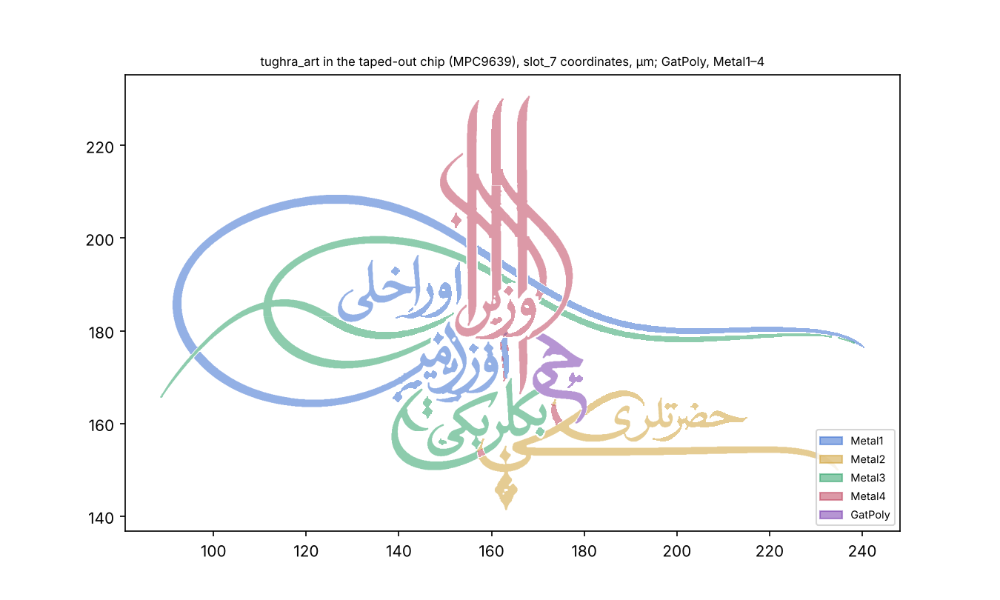
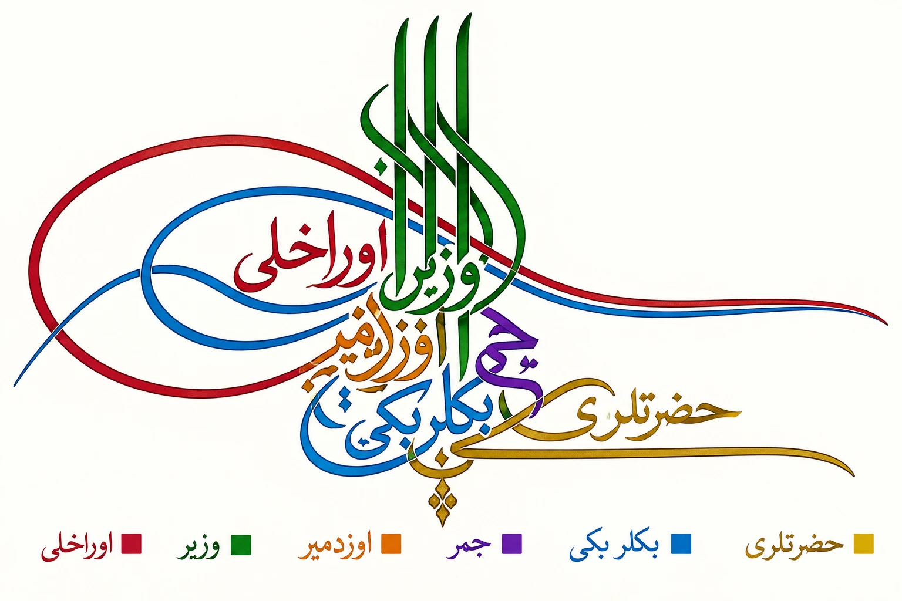

<!--
SPDX-FileCopyrightText: 2026 Christoph Maier
SPDX-License-Identifier: Apache-2.0
-->
# tughra_art: die art of slot 7

The same description is section 7 of the slot 7 description page ([docs/chipalooza2_as_taped_out/README.md](../docs/chipalooza2_as_taped_out/README.md#7-aside-the-tughra)); keep the two in step.

The cell `tughra_art` is a calligraphic tughra drawn in metal and polysilicon on the otherwise empty band between the TopMetal1 straps
of the slot: a deliberate piece of die art, not a circuit. It has no device and no pin, and is not connected to anything.

*Figure: the polygons of `tughra_art` read from the chip GDS `MPC9639.gds.gz` (cell `YX_tughra_art` inside `slot_7`), drawn per layer in slot-local
coordinates. Made on 2026-11-22 with KLayout and matplotlib from the chip data, not taken from the design repository's preview.*

| item | value |
|---|---|
| cell | `tughra_art`, 158.05 × 90.0 µm; in the chip `YX_tughra_art`, once, inside `slot_7` |
| placement | (88.5, 141.3) µm in the slot; in the chip the slot origin is at (1379.95, 2170.05) µm (no rotation, no mirror), so the art is at about (1468.45, 2311.35) µm |
| layers (art) | GatPoly 2 polygons 74.2 µm²; Metal1 18 / 544.5 µm²; Metal2 7 / 272.1 µm²; Metal3 12 / 484.1 µm²; Metal4 13 / 478.4 µm² (areas read from the chip on 2026-11-22; they equal the design repository's `verify_report.md`) |
| no-fill markers | the seven `.nofill` layers (Activ, GatPoly, Metal1–4, TopMetal1; datatype 23) carry one identical box each, 85.5, 141.0 to 243.55, 231.0 µm in slot coordinates (chip: 1465.45, 2311.05 to 1623.5, 2401.05 µm) |
| filler | *checked on 2026-11-22:* inside that box the chip has **0 µm² of filler** (datatype 22) on GatPoly and Metal1–4, and the drawn areas inside the box equal the art's own areas: the art reached the tape-out unchanged and unfilled |
| source | the design repository's `art/` (`toplevel` at `a45cbb55`, "art rev 4"): `art/source/tughra_source.webp` (the picture), `build_art.py`, `verify_art.py`, `verify_report.md`, `fill_test.md`; the cell as delivered: [`art/tughra_art.gds`](tughra_art.gds) in the slot 7 repository |
| design-side checks (quoted) | XOR of slot_7 with the art removed against the original: 0 on all 39 layer/datatypes; LVS deep before and after: match, extracted netlists identical; no rule newly violated by the art in DRC with density and antenna on (the 7 density rules AFil.g, GFil.g, M1–M4.j, TM1.c are violated with and without it: unfilled slot); closest approach to existing shapes on its own layer: 36.6 µm on Metal3, more than 60 µm on the others; the PDK filler script keeps out of the marker box (filler test) |
| layers not used | no TopMetal1 art. *Checked on 2026-11-22:* the slot's TopMetal1 (4 merged polygons, the supply straps) has 0 µm² inside the marker box, so the box is a clear area of the TopMetal1 straps |

The art is why `slot_7.gds` differs from v3 (`7394d092…`) by one instance; `art/check_art_only.py` in the delivery proves it (86 sub-cells and slot_7's own shapes
and labels identical; flat XOR of the result against v3 + art = 0 on every layer, and 0 against the design repository's `art/slot7_with_art.gds`).

## Files in this folder

| file | what |
|---|---|
| [`tughra_art.gds`](tughra_art.gds) | the cell `tughra_art` as delivered (design repository `toplevel`, art rev 4); sha256 in the [repository README](../README.md) |
| [`add_art.py`](add_art.py) | inserts `tughra_art` into `slot_7` at (88.5, 141.3) µm and touches nothing else: `python3 -I add_art.py <slot_7.gds in> <tughra_art.gds> <slot_7.gds out>` |
| [`check_art_only.py`](check_art_only.py) | checks that the taped-out `final/gds/slot_7.gds` is the slot before the art plus that one instance and nothing else; exit 1 on any difference: `python3 -I check_art_only.py <before> <tughra_art.gds> <after> [<reference with art>]` |

The build of the art itself (source picture, segmentation, layer assignment, previews, checks) is in the design repository's
[`art/`](https://github.com/tatzelbrumm/sg13cmos5l_cm_ip__single2diff2single/tree/a45cbb555b9a64baebda7ad68f05b62a3dca288f/art)
and [`ART_NOTES.md`](https://github.com/tatzelbrumm/sg13cmos5l_cm_ip__single2diff2single/blob/a45cbb555b9a64baebda7ad68f05b62a3dca288f/ART_NOTES.md)
(`toplevel` at `a45cbb55`).

## The inscription

The tughra spells, in Ottoman Turkish in Arabic script, **اوراخلی وزیر اوزدمیر جم بکلربکی حضرتلری**, *Urachlı Vezir Özdemir Cem
Beylerbeyi hazretleri*. Checked on 2026-11-25 against the source picture of the design repository (`art/source/tughra_source.webp`,
`toplevel` at `a45cbb55`), whose color legend under the calligraphy names one word per color (the build cut the legend off at
source row 897, [ART_NOTES.md](https://github.com/tatzelbrumm/sg13cmos5l_cm_ip__single2diff2single/blob/a45cbb555b9a64baebda7ad68f05b62a3dca288f/ART_NOTES.md)),
and against the chip's polygons (figure above). Each color went to one layer (art rev 4).

| word | reading | color in the source | layer on the chip | legend | calligraphy (source picture and chip) |
|---|---|---|---|---|---|
| اوراخلی | Urachlı (from Urach) | red | Metal1 | as written | as written |
| وزیر | vezir | green | Metal4 (with the three stems) | as written | as written |
| اوزدمیر | Özdemir | orange | Metal1 | as written | the letter after ز is drawn as a tall vertical stroke, the height of an alif, where the short د is expected; as drawn the word reads closer to اوزامیر |
| جم | Cem | purple | GatPoly | as written | as written, with an ornamental stroke |
| بکلربکی | beylerbeyi (Ottoman spelling *beglerbegi*) | blue | Metal3 | as written | as written |
| حضرتلری | hazretleri | gold | Metal2 | as written | as written |

The legend is in the order of the reading (right to left). The words were read from the pictures by the documentation
author; no reader of Ottoman calligraphy has checked them.

*Figure: the source picture (`art/source/tughra_source.webp` of the design repository at `a45cbb55`, converted to PNG); the legend row
below the calligraphy is not part of the art on the chip.*

## Why a tughra

A tughra is the calligraphic monogram of an Ottoman sultan. This one gives Ottoman court titles (*vezir*, *beylerbeyi*,
*hazretleri*) to Cem Özdemir, born in Bad Urach, Minister-President of Baden-Württemberg and a former federal minister of
education. The choice is deliberate. During the challenge the designer tried to establish, by analogy, what a reviewer
expected, the equivalent of a target bandwidth and the best achievable S₂₁. The answer was an accusation of latent racism
and the advice to take the matter elsewhere. In the designer's view the accusation was unfounded; he took the matter
elsewhere: to the Minister-President.

The tughra is what latent racism looks like when it is actually there: it assigns an Ottoman court to a Swabian on the
strength of his name and his parents' origin ("Muhteşem Urach instead of Haus am Berg-Sozialpädagogik", in the designer's
words). It is not latent: it sits openly on the die, in metal.
