<!--
SPDX-FileCopyrightText: 2026 Christoph Maier
SPDX-License-Identifier: Apache-2.0
-->
# S2D / D2S analog pad pair with on-chip reference — data sheet

**IHP SG13CMOS5L · Chipalooza Challenge #2, slot 7 · taped out 2026-11-09 · preliminary: simulation results, silicon not yet measured**

> **Status, 2026-11-25.** Taped out as commit `158afc5`, contained unchanged in the chip GDS. DRC 0 violations, LVS match
> (KLayout, IHP decks). Both pads verified on extracted layout over 5 process corners, −40 … 125 °C, 3.0 … 3.6 V.
> Silicon measurement pending.

## Features

- Single-ended pad to differential pair (S2D, gain 2) and back (D2S, gain ½)
- Input 0 … 1 V; output error below 1 mV at 27 °C
- Bandwidth 1 … 2 MHz; loads 10 … 300 pF, 1 kΩ
- On-chip bandgap reference and bias; single 3.3 V supply, 0.45 mA
- Test modes selected by digital inputs

**Applications:** analog test access to an SoC; differential on-chip signal paths from and to single-ended pads; low-frequency
instrumentation and audio-range interfaces.

## Description

The input pad (S2D, `s7_an[0]`) produces outp − outn = 2 (pad − vref) around the common mode vcm. The output pad (D2S,
`s7_an[1]`) produces pad = vcm + (vinp − vinn)/2. A bandgap core sets the 5 µA references of both pads; a replica-bias
block derives vcm ≈ 1.26 V and vref ≈ 0.49 V from copies of the pads' own circuits, so the operating point tracks process
and temperature. In the default mode the pads form a loop: the output pad repeats the input pad, shifted by vcm − vref
≈ 0.77 V.

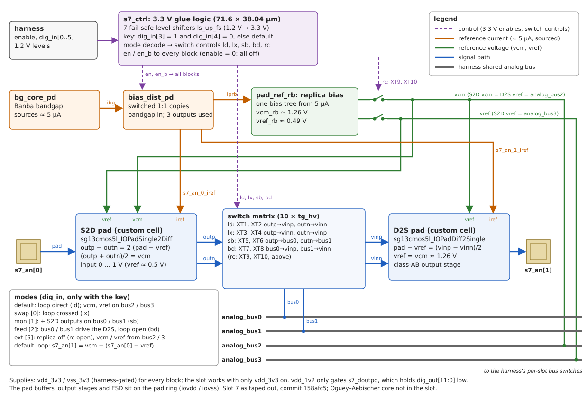

## Architecture

| block | function | principle |
|---|---|---|
| S2D pad `sg13cmos5l_IOPadSingle2Diff` | single-ended in, differential out | matched-pair differential difference amplifier `s2d_mpdda`: identical units on (pad, vref) and on the two feedback paths set outp − outn = 2 (pad − vref); two further units form the common-mode feedback to vcm; folded cascode |
| D2S pad `sg13cmos5l_IOPadDiff2Single` | differential in, single-ended out | Miller-compensated class-AB driver `d2s_mpdda_pd` with a matched-pair front end; the output transistors are the pad's own clamp frames, biased through replicas; 2 kΩ secondary protection |
| replica bias `pad_ref_rb` | vcm and vref for both pads | copies of the pads' input and folding nodes place vcm at the center of the linear band and vref near 0.5 V; one 5 µA reference, bypass capacitors |
| bandgap core `bg_core_pd` | 5 µA reference currents | current-mode (Banba) bandgap without op amp; 47.55 × 50.05 µm |
| bias distribution `bias_dist_pd` | one copy of the reference per pad | 1:1 current mirrors, each input and output behind a transmission gate |
| glue `s7_ctrl`, `s7_doutpd` | enable, mode decode, switch matrix | fail-safe 3.3 V level shifters, 3.3 V static logic, 10 transmission gates; 12 pull-downs for `dig_out` |

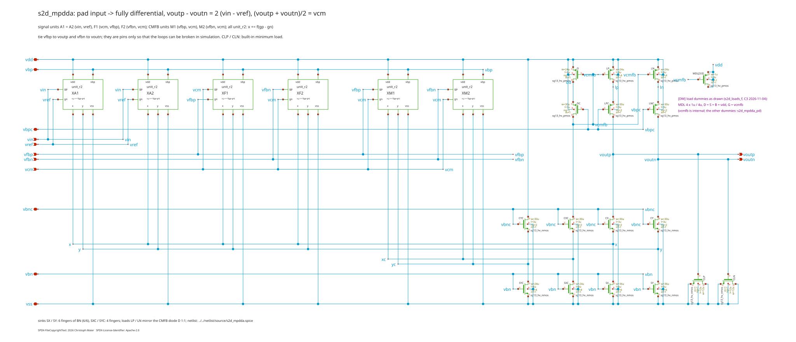

*S2D core `s2d_mpdda` (xschem, design repository at `91a7da8b`).*

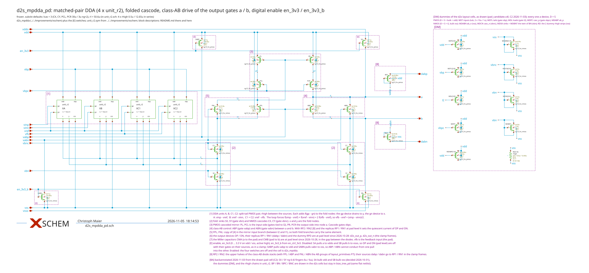

*D2S core `d2s_mpdda_pd` (xschem, design repository at `91a7da8b`).*

## Pins

| pin | type | function |
|---|---|---|
| `s7_an[0]` | analog input, pad | S2D input |
| `s7_an[1]` | analog output, pad | D2S output |
| `analog_bus0`, `analog_bus1` | analog, shared bus | mode mon: S2D outp / outn out; mode feed: D2S vinp / vinn in |
| `analog_bus2`, `analog_bus3` | analog, shared bus | vcm / vref out (read with a high-impedance meter); mode ext: vcm / vref in |
| `enable` | digital input | slot on (default mode) / off |
| `dig_in[0]`, `[1]`, `[2]`, `[5]` | digital inputs | modes swap, mon, feed, ext |
| `dig_in[3]`, `dig_in[4]` | digital inputs | key: the mode bits act only with `dig_in[3]` = 1 and `dig_in[4]` = 0 |
| `dig_out[11:0]` | digital outputs | not used, held low |
| `vdd_3v3`, `vss_3v3` | supply | 3.3 V supply of the slot |
| `vdd_1v2` | supply | gate supply of the `dig_out` pull-downs only |
| pad ring `iovdd`, `iovss` | supply | 3.3 V supply of the two pads |

In mode mon the S2D → D2S loop remains stable while the buses are connected; its bandwidth is lower then.

## For the integrator

- **Harness settings:** select slot 7; switch on its 3.3 V supply (1.2 V only for the `dig_out` pull-downs); route all
  `dig_in` to constant 0, then set the bits needed; enable the analog bus switches in use.
- **State after power-up:** all `dig_in` = 0 gives the default mode when `enable` = 1. Disabled, the slot draws leakage
  only; with the slot's supplies off the pads draw at most 67 nA at 125 °C.
- **Supplies:** the slot works with `vdd_3v3` alone.
- **Shared buses:** vcm and vref on `analog_bus2`, `analog_bus3` drive transistor gates only: read them with a
  high-impedance meter.
- **Dedicated pads:** both analog pads of the slot are the custom cells in `pads/`; the harness places them.
- **Outline:** 537.15 × 273 µm; all 63 frame pins as in the harness template; LEF, pin-less Liberty stub and Verilog stub in
  `final/`.
- **Reuse:** the pad cells are self-contained (`iovdd`, `iovss`, `vdd`, `vss`, bond pad). Core side: S2D `vref`, `vcm`,
  `iref` (5 µA), enable pair, outputs `outp`, `outn`; D2S `vinp`, `vinn`, `vref`, `iref` (5 µA), enable pair.

## Absolute maximum ratings

As specified for the IHP SG13CMOS5L 3.3 V devices in the PDK process specification. Pad voltages beyond the pad-ring
supplies are clamped by the pads' diodes.

## Recommended operating conditions

| parameter | min | typ | max | unit |
|---|---:|---:|---:|---|
| supply `vdd_3v3`, pad ring | 3.0 | 3.3 | 3.6 | V |
| temperature (simulated) | −40 | 27 | 125 | °C |
| input voltage, S2D pad (linear operation) | 0 | | 1.0 | V |
| load capacitance, D2S pad | 10 | | 300 | pF |
| load resistance, D2S pad (to 1.26 V) | 1 | | | kΩ |

## Electrical characteristics

Typical: tt, 27 °C, 3.3 V, default mode, slot's own references. Min / max: 5 process corners × −40 / 27 / 125 °C ×
3.0 / 3.3 / 3.6 V unless stated. Pads from extracted layout where marked (x).

| parameter | conditions | min | typ | max | unit |
|---|---|---:|---:|---:|---|
| **End to end (S2D → D2S)** | | | | | |
| error from out = vcm + (in − vref), in 0 … 1 V | | | 0.86 | 6.5 | mV |
| −3 dB bandwidth | 5 PVT points; unloaded, 1 kΩ ∥ 10 pF, 1 kΩ ∥ 100 pF; schematic, (x) and whole slot extracted | 1.04 | | 1.69 | MHz |
| settling to 1 %, 0.25 → 0.75 V step | 27 °C; the same loads; schematic, (x) and whole slot extracted | 453 | | 643 | ns |
| THD, 10 kHz | | | −78 | −53 | dB |
| **S2D input pad** | | | | | |
| gain (outp − outn) / (pad − vref) | (x) | 1.9985 | 1.999 | 1.9993 | |
| linear input range (1 mV), low end | vref 0.49 V, vcm 1.26 V | | −0.157 | 0.086 | V |
| linear input range (1 mV), high end | vref 0.49 V, vcm 1.26 V | 0.980 | 1.296 | | V |
| −3 dB bandwidth | 3.3 V (x) | 1.24 | 1.41 | 1.67 | MHz |
| input noise density, 1 kHz | 3.3 V (x) | 596 | 679 | 726 | nV/√Hz |
| input offset from mismatch, 1 σ | 100 Monte Carlo runs (x) | | 6.2 | | mV |
| enable time | 3.3 V (x) | 1.46 | 1.50 | 1.52 | µs |
| **D2S output pad** | | | | | |
| gain pad / (vinp − vinn) | | 0.4983 | 0.4999 | 0.5000 | |
| linear output range (10 mV), low end | 3.3 V, 1 kΩ, input common mode 1.26 V | | 0.211 | 0.328 | V |
| linear output range (10 mV), high end | 3.3 V, 1 kΩ, input common mode 1.26 V | 2.258 | 2.317 | | V |
| −3 dB bandwidth | 10 … 300 pF, 1 kΩ or open (x) | 1.43 | | 2.71 | MHz |
| slew rate | 10 … 300 pF (x) | 1.59 | | 2.79 | V/µs |
| output offset from mismatch, 1 σ | 30 Monte Carlo runs | | 6.3 | | mV |
| **References** | | | | | |
| vcm | | 1.120 | 1.262 | 1.395 | V |
| vref | | 0.436 | 0.494 | 0.596 | V |
| bandgap reference current | | 3.83 | 4.96 | 6.37 | µA |
| **Supply current** | | | | | |
| slot `vdd_3v3`, enabled | 5 PVT points | 48.4 | | 49.7 | µA |
| pad ring, enabled, D2S unloaded | 5 PVT points | 365 | | 396 | µA |
| slot / pad ring, disabled | 5 PVT points | | | 56 / 58 | nA |

At 3.6 V the devices that switch rail to rail see VGS = 3.6 V, above the 3.3 V that the process specification gives
for 27 °C; 3.6 V is a supply-tolerance corner of the characterization, 3.3 V is the operating point.

## Typical performance

| | |
|---|---|
| 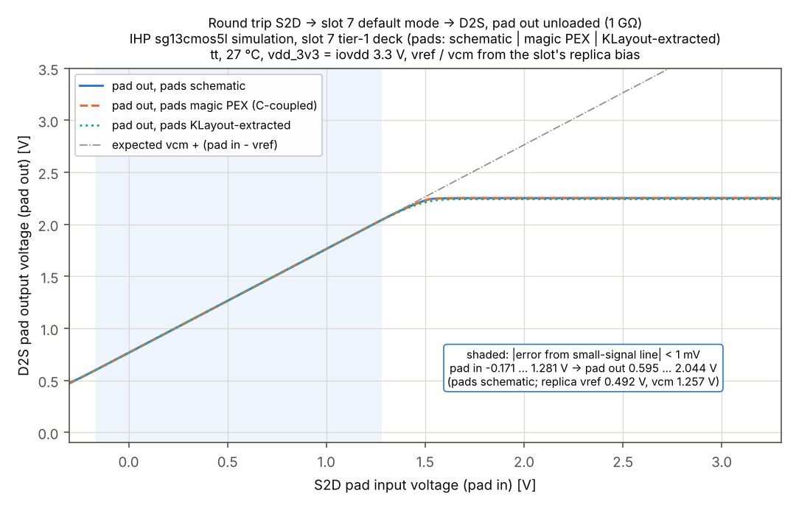 | 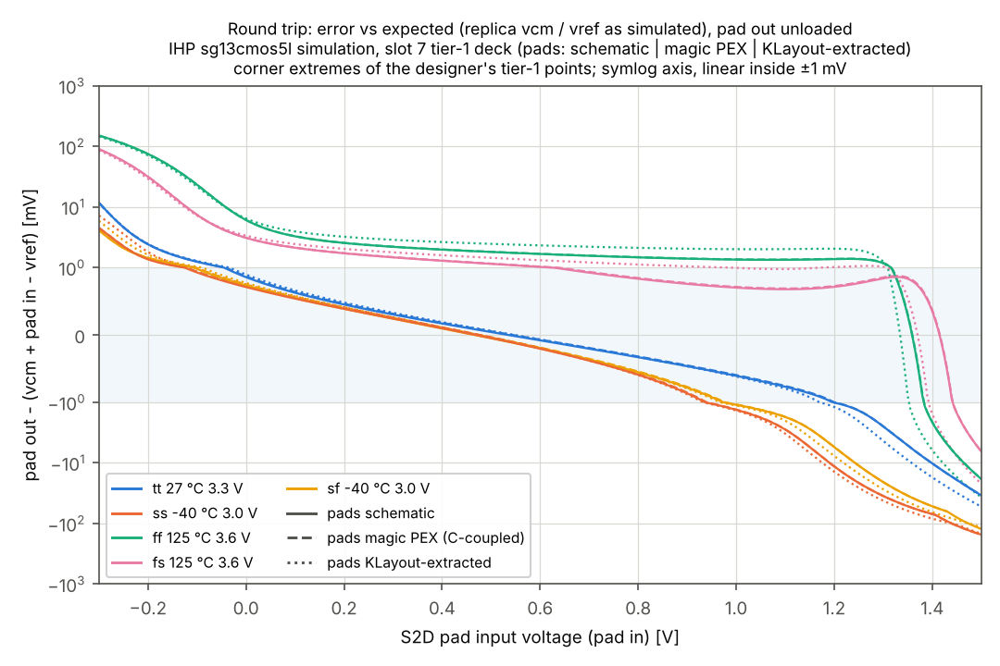 |
| End to end: output vs input, 27 °C. Shaded: within 1 mV of the straight line. | End-to-end error over the corner extremes. |
| 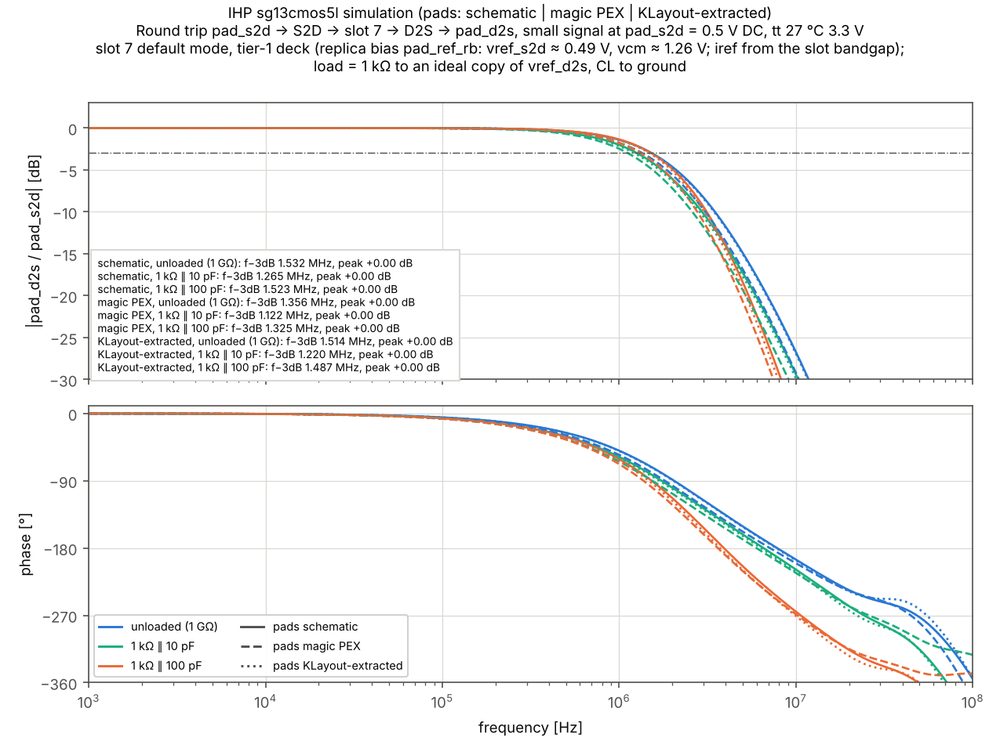 | 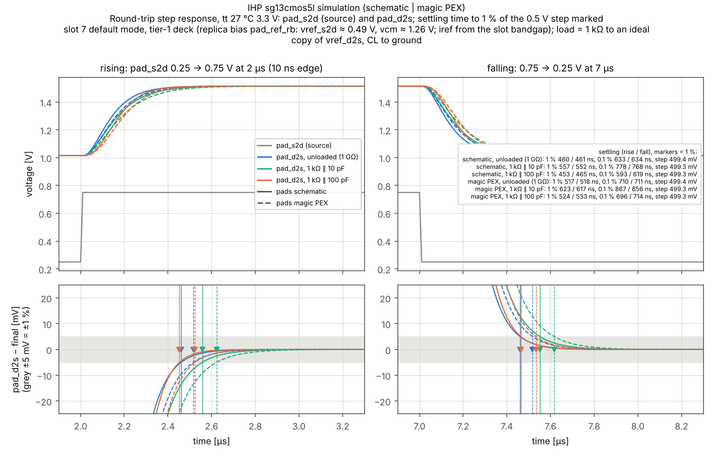 |
| End-to-end frequency response, 27 °C, three loads. | 0.25 → 0.75 V step, 27 °C: first order, no overshoot. |
| 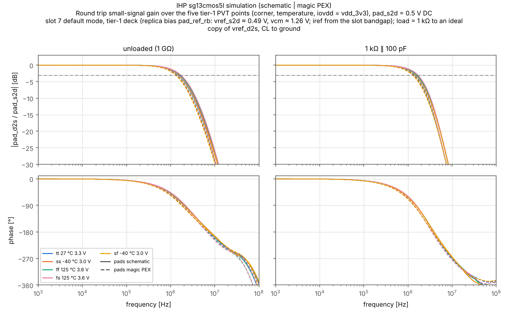 | 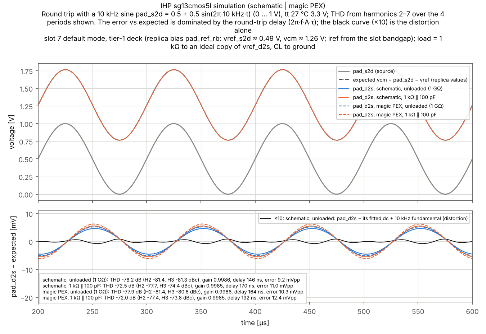 |
| End-to-end frequency response at the five PVT points, unloaded and 1 kΩ ∥ 100 pF. | 10 kHz sine, 0 … 1 V, 27 °C: input, expected and output (top); output − expected (bottom). |
| 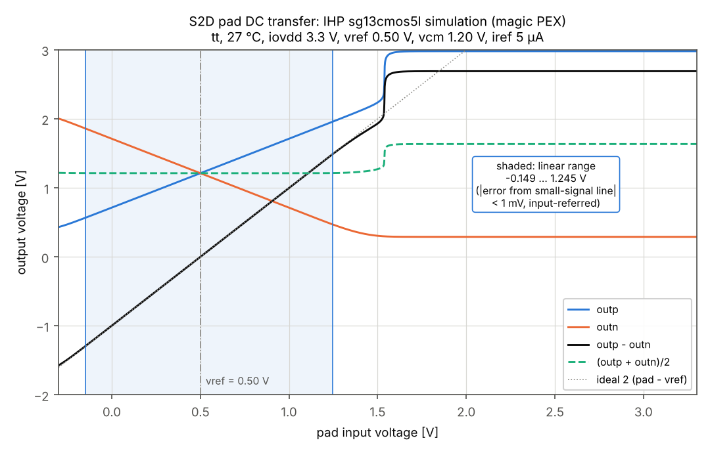 | 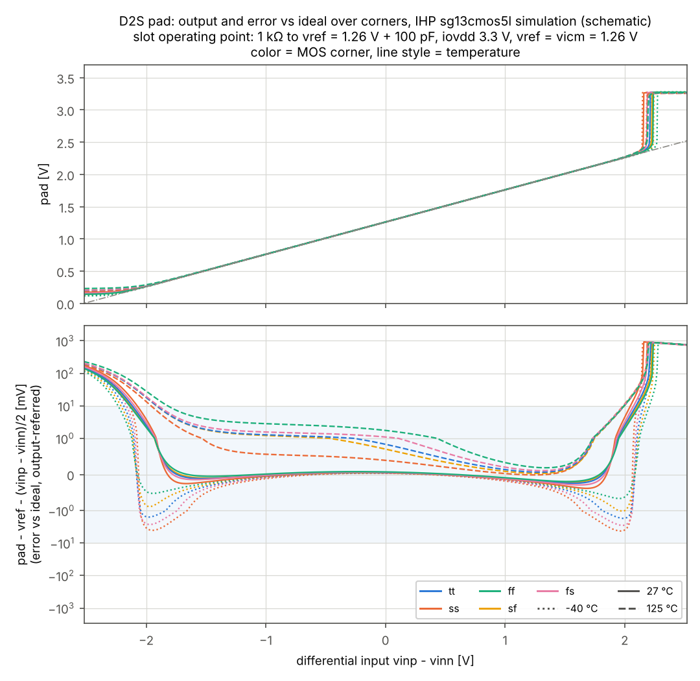 |
| S2D alone, extracted layout, 27 °C, vref 0.5 V, vcm 1.2 V: outp, outn, difference and common mode; shaded: linear input range. | D2S alone at the slot's operating point (input common mode 1.26 V, 1 kΩ + 100 pF): output and error from ½ (vinp − vinn), 5 corners × 3 temperatures. |
| 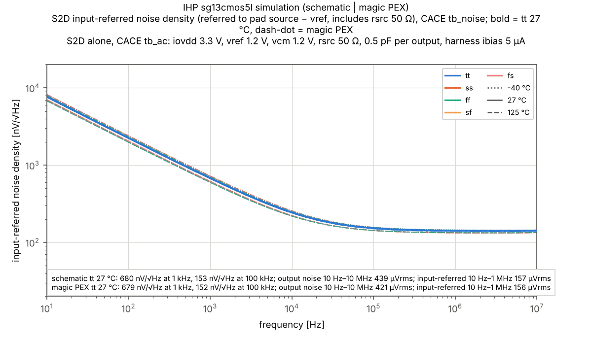 | 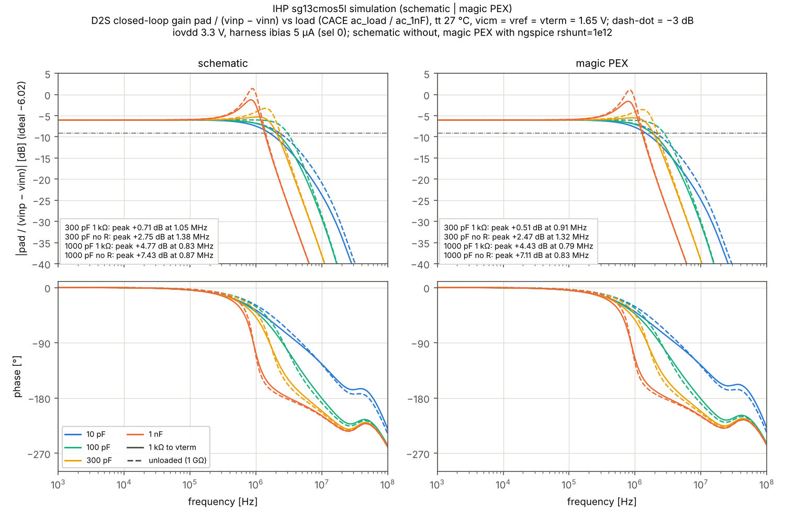 |
| S2D input-referred noise density, 10 Hz … 10 MHz, corners × temperatures, schematic and extracted. | D2S frequency response at 10, 100, 300 pF and 1 nF, with 1 kΩ and unloaded, 27 °C. |
| 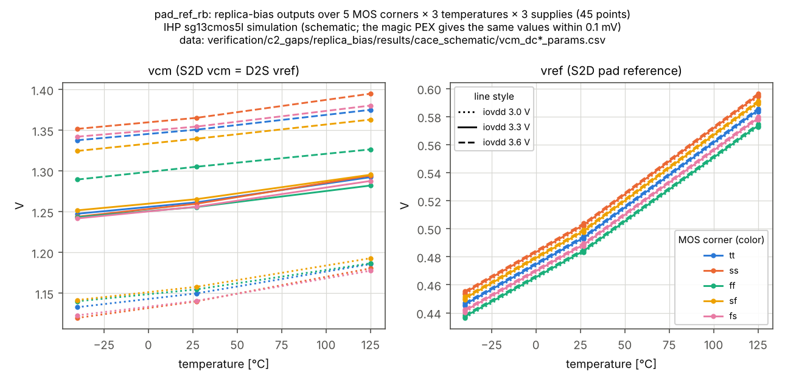 | 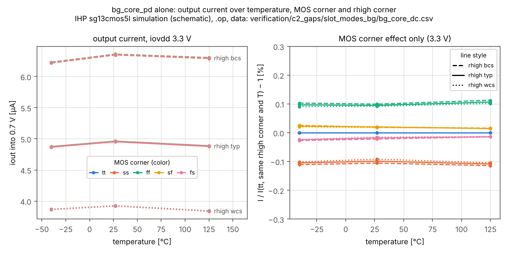 |
| vcm and vref vs temperature, 5 corners × 3.0 / 3.3 / 3.6 V (schematic). | Bandgap output current vs temperature, 5 MOS × 3 resistor corners, 3.3 V (schematic). |

## Schematic and extracted layout

Both pads were simulated on their extracted layout (magic, C-coupled) with the same test benches as the schematic. The
layout leaves the DC values unchanged. S2D: bandwidth −8 %, step response +12 %. D2S: bandwidth and slew rate about −11 %,
settling and enable time about +10 %, noise within 5 %. The whole slot, extracted (magic, C-coupled and with wire
resistance; LVS match): end-to-end bandwidth a further −2.5 … −3.9 %, settling +2.5 … +4.6 %, DC error unchanged
(≤ 0.2 mV), supply current within 0.3 %.

| | |
|---|---|
| 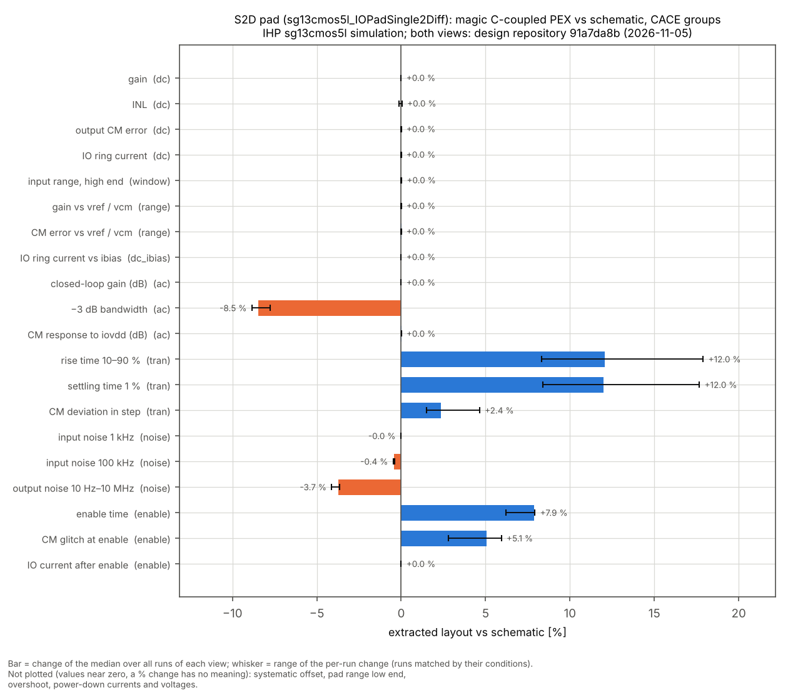 | 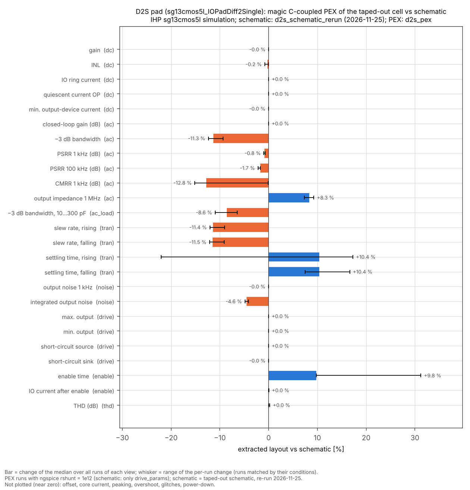 |
| S2D: change per characterized quantity, extracted vs schematic (bar: median, whisker: range per run). | D2S: the same. |

## Mismatch (Monte Carlo)

tt, 27 °C, 3.3 V.

| quantity | view | runs | mean | σ | min … max |
|---|---|---:|---:|---:|---|
| S2D input offset | schematic / extracted | 100 | −0.40 / −1.35 mV | 5.25 / 6.15 mV | −10.2 … 16.0 / −13.2 … 19.6 mV |
| S2D gain | schematic / extracted | 100 | 1.999 / 1.999 | 0.0167 / 0.0164 | 1.958 … 2.050 / 1.959 … 2.034 |
| S2D output common-mode error | schematic / extracted | 100 | 7.9 / 9.3 mV | 11.0 / 12.7 mV | −27.3 … 47.0 / −17.9 … 42.0 mV |
| D2S output offset | schematic | 30 | 0.31 mV | 6.28 mV | −14.28 … 13.92 mV |
| D2S gain | schematic | 30 | 0.5001 | 0.0037 | 0.4888 … 0.5051 |
| vcm | schematic | 100 | 1.2609 V | 5.4 mV | 1.2469 … 1.2740 V |
| vref | schematic | 100 | 0.4931 V | 3.8 mV | 0.4814 … 0.5018 V |

| | |
|---|---|
| 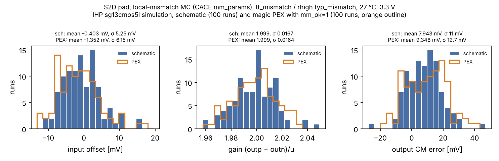 | 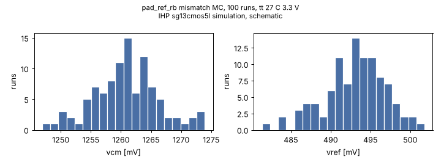 |
| S2D: input offset, gain, output common-mode error; schematic and extracted. | Replica bias: vcm and vref. |

## Modes

| mode | controls (with the key) | function |
|---|---|---|
| default | none | loop S2D → D2S; vcm, vref on `analog_bus2`, `analog_bus3` |
| swap | `dig_in[0]` | loop crossed: out = vcm − (in − vref) |
| mon | `dig_in[1]` | S2D outputs on `analog_bus0`, `analog_bus1` |
| feed | `dig_in[2]` | D2S driven from `analog_bus0`, `analog_bus1`; loop open |
| ext | `dig_in[5]` | vcm, vref driven from `analog_bus2`, `analog_bus3` |

## Layout

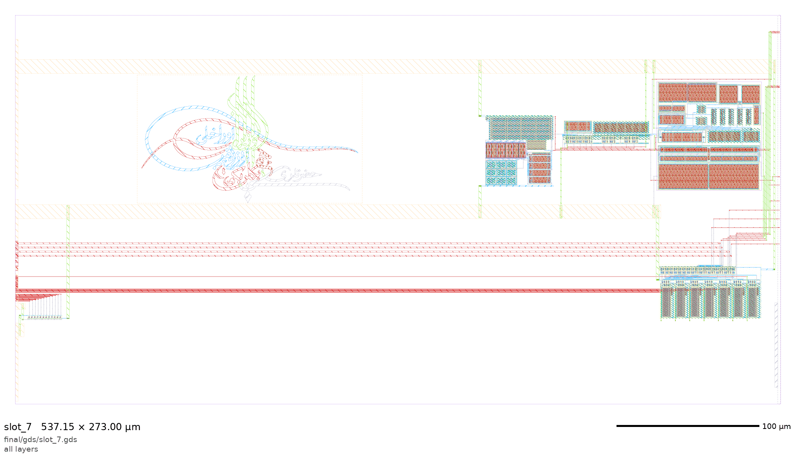

| | |
|---|---|
| 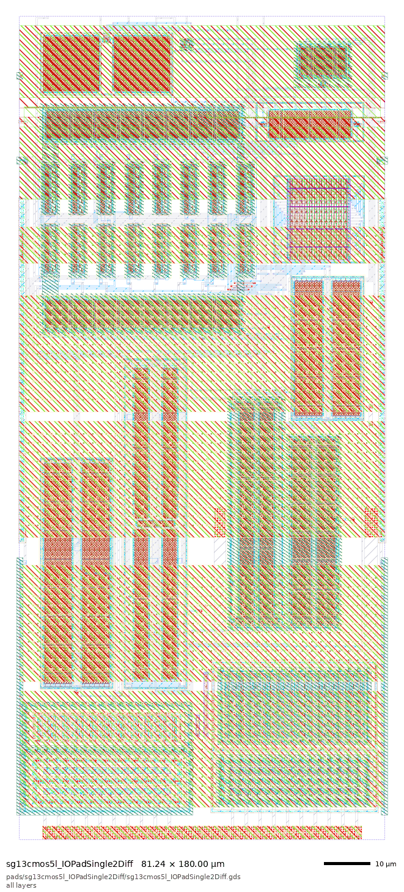 | 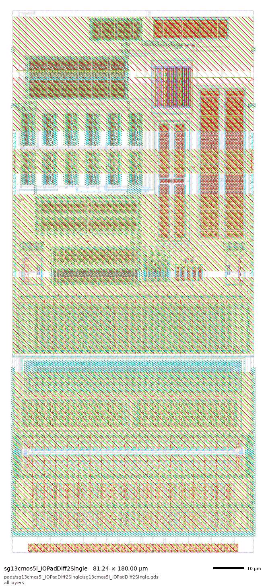 |
| S2D pad cell, 80 × 180 µm. | D2S pad cell, 80 × 180 µm. |

## Physical verification

Taped-out GDS, re-run on 2026-11-25 with the IHP decks (reports: `signoff/taped_out_158afc5/reports/`).

| check | `slot_7` | S2D pad | D2S pad |
|---|---|---|---|
| KLayout DRC, full deck | 0 | 0 | 0 |
| KLayout DRC, maximal deck with latch-up rules | 0 | 0 | 0 |
| KLayout density | 7 minimum-density rules, filled at chip level | 4, filled at chip level | 4, filled at chip level |
| KLayout LVS | match, 497 devices | match, 76 devices | match, 77 devices |
| magic DRC | 48 "Metal1 overlap of Via1" markers in `bg_core_pd` (KLayout passes the same rules) | 0 | 0 |
| KLayout antenna rules | 0 | 0 | 0 |
| magic + netgen LVS | 5 subcircuits match; top level: pin `vss_1v2_uq0`; whole-slot extraction: 371 = 371 devices, 222 = 222 nets | `vss` / `iovss` substrate merge | `vss` / `iovss` substrate merge |
| post-layout simulation | whole slot extracted (C-coupled and with wire resistance), 5 PVT points | extracted, full characterization | extracted, full characterization |
| ESD, human-body model ±0.5 … 2 kV, with the harness pad ring (stand-in diode models; indicative) | – | pad +9.3 / −4.7 V, input gate–drain 8.8 V at 2 kV | pad +6.3 / −2.6 V, gates ≤ 6.4 V at 2 kV |
| latch-up I-test, ±100 mA into the pad at 3.6 V | – | pad +4.95 / −1.26 V | pad +2.02 / −0.79 V |
| pad-ring supply at 5.4 V | – | largest drain–source voltage 5.0 V (breakdown ≥ 5.3 V), both pads in one run | |

## Silicon bring-up

Register values and acceptance intervals: test plan (`docs/chipalooza2_as_taped_out/TEST_PLAN.md`).

1. All bench sources at 0 V. Select slot 7; slot supplies off: pad-ring current is leakage only (≤ 67 nA at 125 °C).
2. Route all 24 `dig_in` to constant 0.
3. Slot supplies on, `enable` = 0: leakage only (slot 25 … 56 nA, pad ring 9 … 58 nA).
4. Digital latches on: `dig_out[11:0]` reads 0.
5. `enable` = 1, default mode: supply current rises by 48.4 … 49.7 µA (slot) and 365 … 396 µA (pad ring).
6. Close bus switches 2 and 3: vcm 1.120 … 1.379 V and vref 0.446 … 0.578 V (27 °C typical 1.262 / 0.494 V).
7. Sweep `s7_an[0]` 0 … 1 V, read `s7_an[1]`: vcm + (in − vref), deviation ≤ 0.9 mV typical, ≤ 6.5 mV over corners.
8. Modes swap, mon, feed and ext, each with the key, then back to the default.
9. Disable and supply-off: leakage as in steps 1 and 3.
10. Repeat steps 6 … 9 at −40, 27 and 125 °C.
11. Power down: open the bus switches and set all bench sources to 0 V before switching the slot supply off.

## Reproducing

- **Tools:** ngspice-47 with the IHP OSDI models, xschem 3.4.8RC, CACE 2.11.0, KLayout 0.30.12, magic 8.3.685,
  netgen 1.5.324; IHP-Open-PDK `ihp-sg13cmos5l` at `df4c5054` (2026-10-14).
- **Sign-off:** `signoff/taped_out_158afc5/run_signoff.sh [OUT_DIR]` (environment `PDK_ROOT`, `PDK`).
- **Simulations:** `verification/c2_gaps/<topic>/run.sh` for each topic (DC curves, AC / transient, pad mismatch, D2S
  post-layout, replica bias, slot modes); each fetches the circuit sources from the design repository at the commits named
  in its README.
- **Figures and documents:** `docs/chipalooza2_as_taped_out/pix/plots/make_plots.py`, `book/build_book.py`.

## Design files

| what | where |
|---|---|
| slot layout, abstract, Liberty and Verilog stubs | `final/gds/slot_7.gds`, `final/lef/`, `final/lib/`, `final/vh/` |
| custom pad cells (GDS, SPICE) | `pads/`, list in `pads/pads.txt` |
| netlists, netgen check | `netlist/` |
| sign-off reports and script | `signoff/` |
| simulation scripts, results, figures | `verification/c2_gaps/` |
| schematics (SVG) and layout renders | `docs/chipalooza2_as_taped_out/pix/` |
| xschem schematics, CACE test benches | design repository `tatzelbrumm/sg13cmos5l_cm_ip__single2diff2single` at `91a7da8b` (pads) and `9052bd35` (slot) |

## Repository and license

[github.com/tatzelbrumm/sg13cmos5l_cm_slot7](https://github.com/tatzelbrumm/sg13cmos5l_cm_slot7): taped-out commit
`158afc5`, documentation on branch `chipalooza2-documentation`. License: Solderpad Hardware License 2.1 (an Apache 2.0
wrapper); documentation Apache 2.0. Full data book with all results: `docs/chipalooza2_as_taped_out/pdf/slot7_databook.pdf`.
