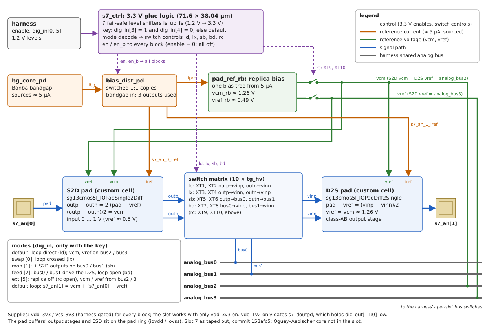
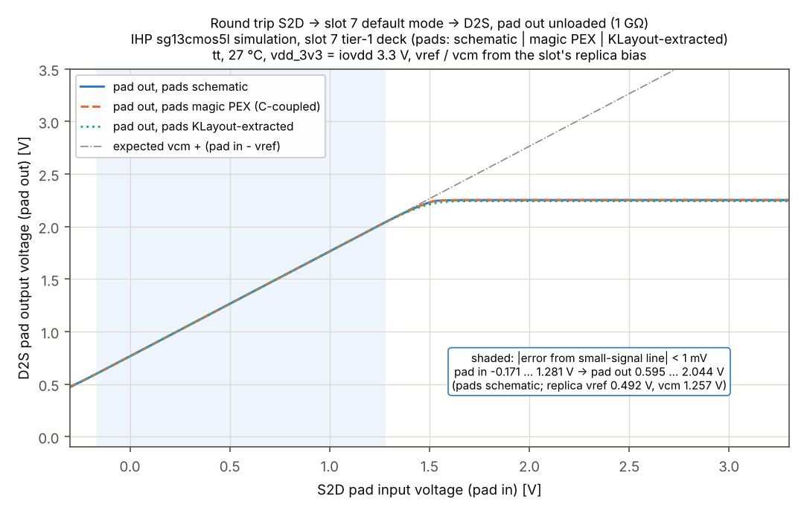
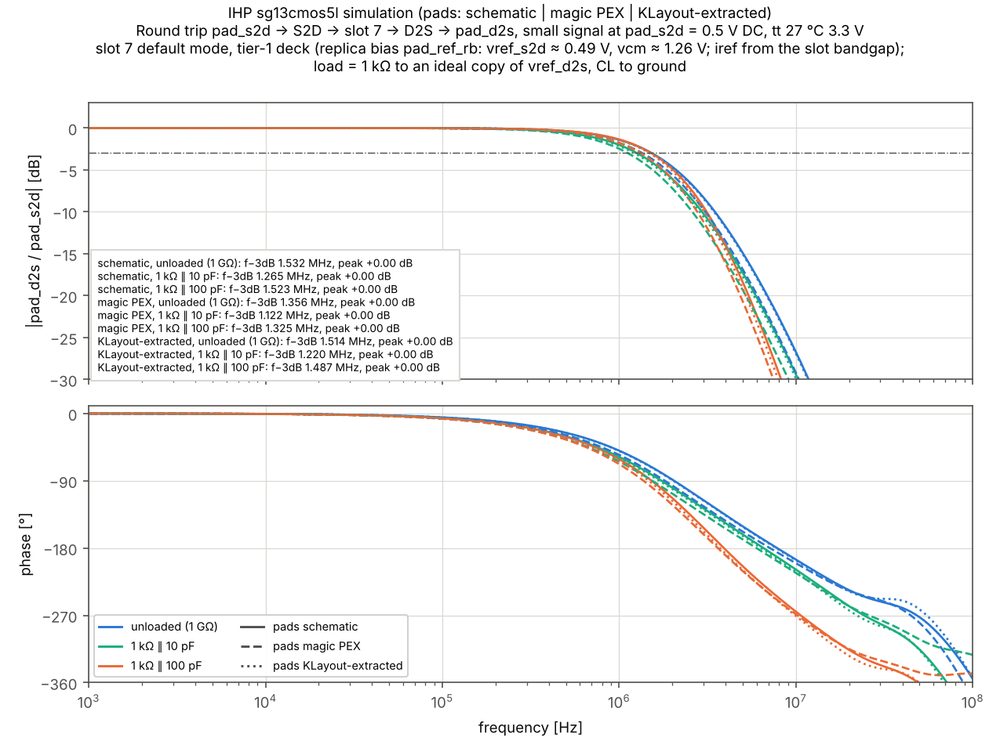

<!--
SPDX-FileCopyrightText: 2026 Christoph Maier
SPDX-License-Identifier: Apache-2.0
-->
<!-- Reference copy, kept unchanged: the first digest (two-page engineering summary), source of pdf/slot7_digest_2page_summary.pdf (built 2026-11-25 from commit 454d584). The current digest is DIGEST.md. -->
# Slot 7 in two pages

**Custom analog pad pair (single-ended ↔ differential) with its own bandgap-referenced bias.**
Chipalooza Challenge #2 (IHP SG13CMOS5L), slot 7, taped out on 2026-11-09. Designer: Christoph Maier.
All numbers are simulations; no silicon results exist yet.

## What it does

Two custom I/O pads. The input pad (**S2D**, `s7_an[0]`) turns a pad voltage into a differential pair inside the chip,
outp − outn = 2 (pad − vref). The output pad (**D2S**, `s7_an[1]`) turns a differential pair back into a pad voltage,
pad = vcm + (vinp − vinn)/2. The gains of 2 and ½ are set by matched transistors, not by resistors. An on-slot bandgap,
a bias distribution and a replica-bias block supply both pads. In the default mode the output pad repeats the input pad,
shifted up by about 0.77 V. Digital inputs select four other modes for test (swapped loop, monitoring and feeding the
internal pair through the shared analog buses, external references).

## Key numbers

Simulated over 5 process corners, −40 … 125 °C and 3.0 … 3.6 V unless stated; pads in extracted layout where available.

| quantity | value |
|---|---|
| input range (S2D, linear within 1 mV) | −0.16 … 1.30 V at 27 °C; at every corner at least 0.09 … 0.98 V |
| end-to-end transfer (default mode) | out = in + 0.77 V; error ≤ 0.9 mV at 27 °C, ≤ 6.5 mV at the worst corner (pad in 0 … 1 V) |
| gains | S2D 1.9985 … 1.9993; D2S 0.4983 … 0.5000 |
| output range (D2S, linear within 10 mV, 1 kΩ load) | 0.21 … 2.32 V at 27 °C; worst corner 0.33 … 2.26 V |
| bandwidth, settling (end to end) | 1.1 … 1.7 MHz, no peaking; 1 % settling in 0.45 … 0.62 µs |
| distortion | THD −78 dB at 10 kHz (27 °C) |
| loads | 10 … 300 pF, 1 kΩ or open |
| supply current (3.3 V) | slot 48 … 50 µA, pad pair 0.37 … 0.40 mA; off: below 0.1 µA |
| offset from device mismatch (1 σ) | S2D input 5.3 mV (6.2 mV extracted); D2S output 6.3 mV |
| area | slot 537 × 273 µm; each pad 80 × 180 µm |

| | |
|---|---|
|  |  |
| End to end, DC: output vs input pad at 27 °C (schematic and extracted layout overlap). | End to end, small signal at 27 °C: 1.1 … 1.5 MHz bandwidth depending on the load, no peaking. |

## Status

- **Taped out** as commit `158afc5`; the chip GDS contains it unchanged.
- **Sign-off** of the taped-out layout, repeated on 2026-11-25: DRC clean (KLayout, including the latch-up rules; metal density is filled at chip level), LVS match.
- **Post-layout simulation** of both pads over the corners above; the slot simulated with its extracted pads, replica bias and bias distribution.
- **Not done:** silicon measurement, ESD and latch-up simulation of the pads, extraction of the whole slot.
- No specification existed before the design. The numbers above are characterized results; the data book compares them
  with the designer's working limits.

## How to test it on the chip

1. Enable slot 7 over SPI (default mode).
2. Read `vcm` and `vref` on the shared analog buses 2 and 3 with a high-impedance meter (expected about 1.26 V and 0.49 V).
3. Sweep `s7_an[0]` from 0 to 1 V and read `s7_an[1]`: expected `vcm` + (in − `vref`), within a few mV.

Register settings, the other modes, equipment and acceptance limits are in the test plan.

## More

- Data book (description, data sheets, all figures, sign-off, test plan): `docs/chipalooza2_as_taped_out/pdf/slot7_databook.pdf`
- Repository: [github.com/tatzelbrumm/sg13cmos5l_cm_slot7](https://github.com/tatzelbrumm/sg13cmos5l_cm_slot7), branch `chipalooza2-documentation`
