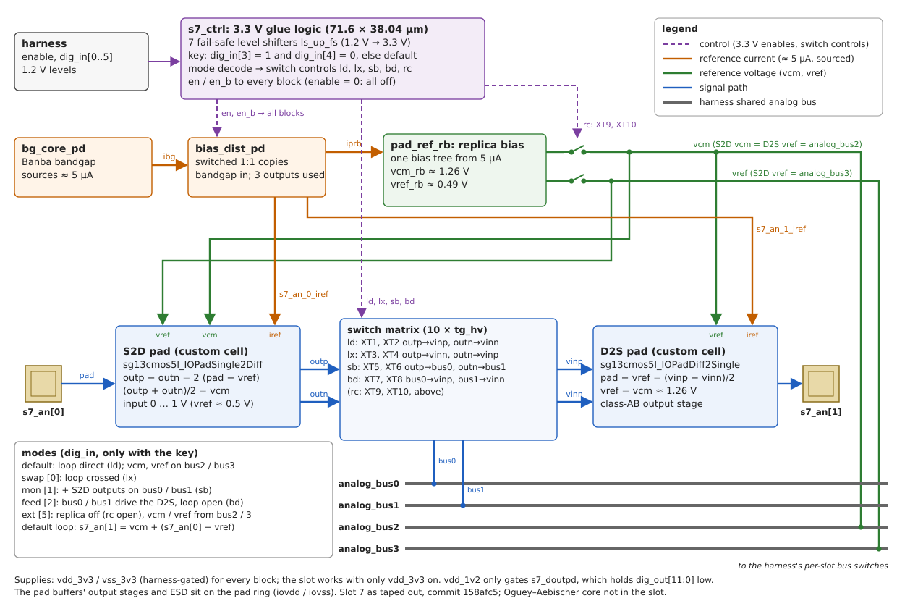
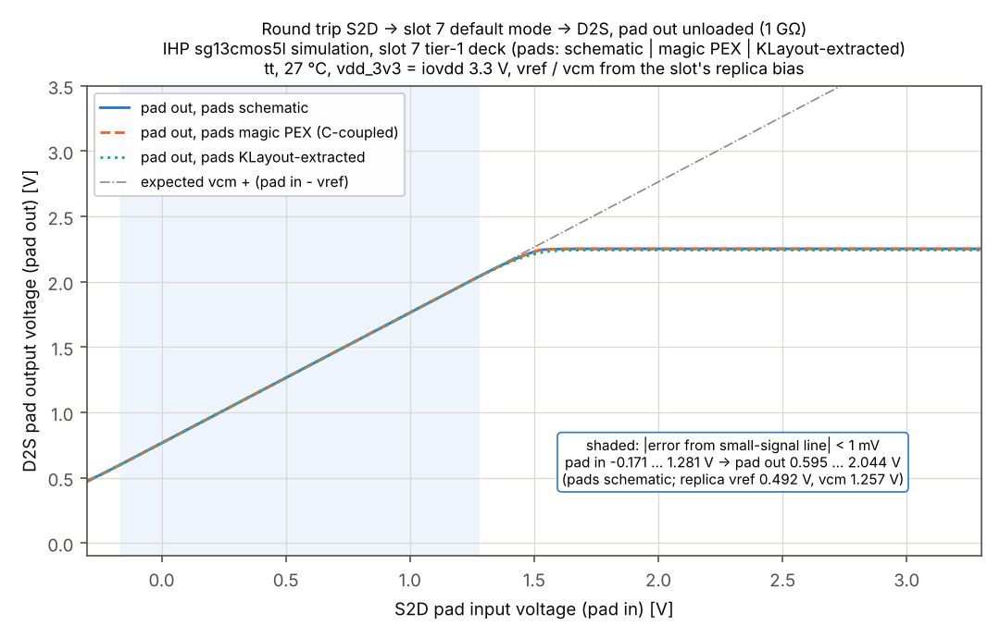
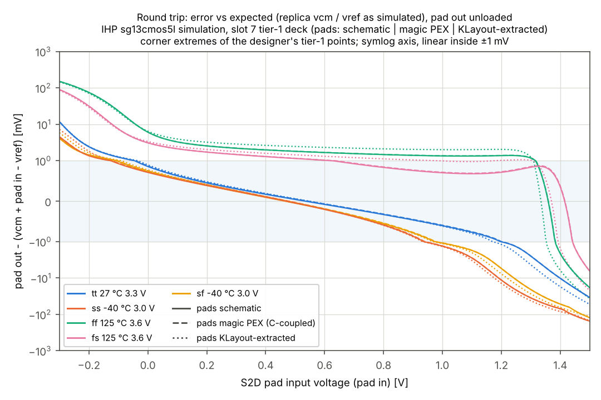
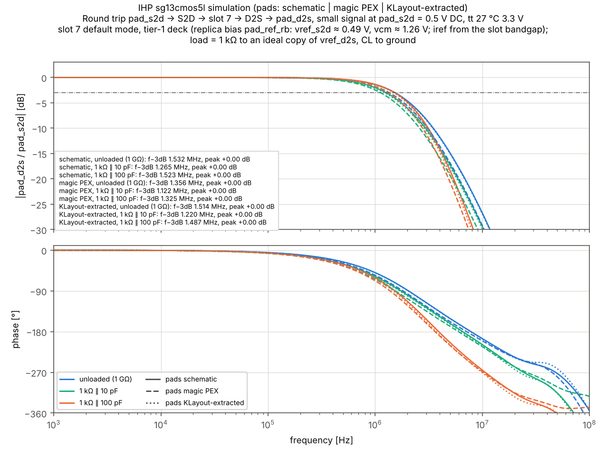
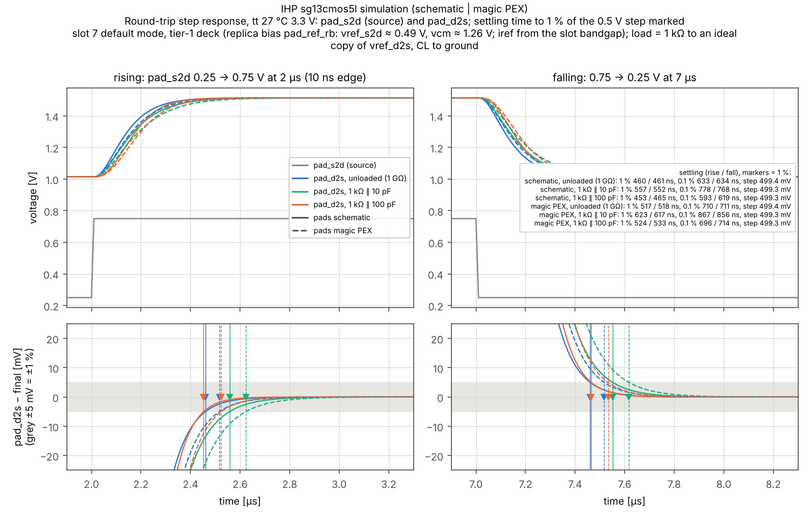

<!--
SPDX-FileCopyrightText: 2026 Christoph Maier
SPDX-License-Identifier: Apache-2.0
-->
<!-- Reference copy, kept unchanged: the three-page data-sheet digest, source of pdf/slot7_digest_3page_datasheet.pdf (built 2026-11-25 from commit 0fc8e56). The current digest is DIGEST.md. -->
# S2D / D2S analog pad pair with on-chip reference — data sheet

**IHP SG13CMOS5L · Chipalooza Challenge #2, slot 7 · taped out 2026-11-09 · preliminary: simulation results, silicon not yet measured**

> **Status, 2026-11-25.** Taped out as commit `158afc5`, contained unchanged in the chip GDS. DRC 0 violations, LVS match
> (KLayout, IHP decks). Both pads verified on extracted layout over 5 process corners, −40 … 125 °C, 3.0 … 3.6 V.
> Silicon measurement pending.

## Features

- Single-ended pad to differential pair (S2D, gain 2) and back (D2S, gain ½)
- Input 0 … 1 V; output error below 1 mV at 27 °C
- Bandwidth 1 … 2 MHz; loads 10 … 300 pF, 1 kΩ
- On-chip bandgap reference and bias; single 3.3 V supply, 0.45 mA
- Test modes selected by digital inputs

**Applications:** analog test access to an SoC; differential on-chip signal paths from and to single-ended pads; low-frequency
instrumentation and audio-range interfaces.

## Description

The input pad (S2D, `s7_an[0]`) produces outp − outn = 2 (pad − vref) around the common mode vcm. The output pad (D2S,
`s7_an[1]`) produces pad = vcm + (vinp − vinn)/2. A bandgap core sets the 5 µA references of both pads; a replica-bias
block derives vcm ≈ 1.26 V and vref ≈ 0.49 V from copies of the pads' own circuits, so the operating point tracks process
and temperature. In the default mode the pads form a loop: the output pad repeats the input pad, shifted by vcm − vref
≈ 0.77 V.

## Pins

| pin | type | function |
|---|---|---|
| `s7_an[0]` | analog input, pad | S2D input |
| `s7_an[1]` | analog output, pad | D2S output |
| `analog_bus0`, `analog_bus1` | analog, shared bus | mode mon: S2D outp / outn out; mode feed: D2S vinp / vinn in |
| `analog_bus2`, `analog_bus3` | analog, shared bus | vcm / vref out (read with a high-impedance meter); mode ext: vcm / vref in |
| `enable` | digital input | slot on (default mode) / off |
| `dig_in[0]`, `[1]`, `[2]`, `[5]` | digital inputs | modes swap, mon, feed, ext |
| `dig_in[3]`, `dig_in[4]` | digital inputs | key: the mode bits act only with `dig_in[3]` = 1 and `dig_in[4]` = 0 |
| `dig_out[11:0]` | digital outputs | not used, held low |
| `vdd_3v3`, `vss_3v3` | supply | 3.3 V supply of the slot |
| `vdd_1v2` | supply | gate supply of the `dig_out` pull-downs only |
| pad ring `iovdd`, `iovss` | supply | 3.3 V supply of the two pads |

In mode mon the S2D → D2S loop remains stable while the buses are connected; its bandwidth is lower then.

## Absolute maximum ratings

As specified for the IHP SG13CMOS5L 3.3 V devices in the PDK process specification. Pad voltages beyond the pad-ring
supplies are clamped by the pads' diodes.

## Recommended operating conditions

| parameter | min | typ | max | unit |
|---|---:|---:|---:|---|
| supply `vdd_3v3`, pad ring | 3.0 | 3.3 | 3.6 | V |
| temperature (simulated) | −40 | 27 | 125 | °C |
| input voltage, S2D pad (linear operation) | 0 | | 1.0 | V |
| load capacitance, D2S pad | 10 | | 300 | pF |
| load resistance, D2S pad (to 1.26 V) | 1 | | | kΩ |

## Electrical characteristics

Typical: tt, 27 °C, 3.3 V, default mode, slot's own references. Min / max: 5 process corners × −40 / 27 / 125 °C ×
3.0 / 3.3 / 3.6 V unless stated. Pads from extracted layout where marked (x).

| parameter | conditions | min | typ | max | unit |
|---|---|---:|---:|---:|---|
| **End to end (S2D → D2S)** | | | | | |
| error from out = vcm + (in − vref), in 0 … 1 V | | | 0.86 | 6.5 | mV |
| −3 dB bandwidth | 5 PVT points; unloaded, 1 kΩ ∥ 10 pF, 1 kΩ ∥ 100 pF; schematic and (x) | 1.08 | | 1.69 | MHz |
| settling to 1 %, 0.25 → 0.75 V step | 27 °C; the same loads; schematic and (x) | 453 | | 623 | ns |
| THD, 10 kHz | | | −78 | −53 | dB |
| **S2D input pad** | | | | | |
| gain (outp − outn) / (pad − vref) | (x) | 1.9985 | 1.999 | 1.9993 | |
| linear input range (1 mV), low end | vref 0.49 V, vcm 1.26 V | | −0.157 | 0.086 | V |
| linear input range (1 mV), high end | vref 0.49 V, vcm 1.26 V | 0.980 | 1.296 | | V |
| −3 dB bandwidth | 3.3 V (x) | 1.24 | 1.41 | 1.67 | MHz |
| input noise density, 1 kHz | 3.3 V (x) | 596 | 679 | 726 | nV/√Hz |
| input offset from mismatch, 1 σ | 100 Monte Carlo runs (x) | | 6.2 | | mV |
| enable time | 3.3 V (x) | 1.46 | 1.50 | 1.52 | µs |
| **D2S output pad** | | | | | |
| gain pad / (vinp − vinn) | | 0.4983 | 0.4999 | 0.5000 | |
| linear output range (10 mV), low end | 3.3 V, 1 kΩ, input common mode 1.26 V | | 0.211 | 0.328 | V |
| linear output range (10 mV), high end | 3.3 V, 1 kΩ, input common mode 1.26 V | 2.258 | 2.317 | | V |
| −3 dB bandwidth | 10 … 300 pF, 1 kΩ or open (x) | 1.43 | | 2.71 | MHz |
| slew rate | 10 … 300 pF (x) | 1.59 | | 2.79 | V/µs |
| output offset from mismatch, 1 σ | 30 Monte Carlo runs | | 6.3 | | mV |
| **References** | | | | | |
| vcm | | 1.115 | 1.257 | 1.395 | V |
| vref | | 0.436 | 0.492 | 0.596 | V |
| bandgap reference current | | 3.83 | 4.96 | 6.37 | µA |
| **Supply current** | | | | | |
| slot `vdd_3v3`, enabled | 5 PVT points | 48.4 | | 49.7 | µA |
| pad ring, enabled, D2S unloaded | 5 PVT points | 365 | | 396 | µA |
| slot / pad ring, disabled | 5 PVT points | | | 56 / 58 | nA |

## Typical performance

| | |
|---|---|
|  |  |
| End to end: output vs input, 27 °C. Shaded: within 1 mV of the straight line. | End-to-end error over the corner extremes. |
|  |  |
| End-to-end frequency response, 27 °C, three loads. | 0.25 → 0.75 V step, 27 °C: first order, no overshoot. |

## Modes

| mode | controls (with the key) | function |
|---|---|---|
| default | none | loop S2D → D2S; vcm, vref on `analog_bus2`, `analog_bus3` |
| swap | `dig_in[0]` | loop crossed: out = vcm − (in − vref) |
| mon | `dig_in[1]` | S2D outputs on `analog_bus0`, `analog_bus1` |
| feed | `dig_in[2]` | D2S driven from `analog_bus0`, `analog_bus1`; loop open |
| ext | `dig_in[5]` | vcm, vref driven from `analog_bus2`, `analog_bus3` |

## Physical and verification data

| item | value |
|---|---|
| slot area | 537.15 × 273 µm; pads 80 × 180 µm each |
| DRC (KLayout, IHP decks, taped-out GDS) | 0 violations, latch-up rules included; density rules apply after chip-level fill |
| LVS (KLayout) | match: slot 497 devices, both pads |
| post-layout simulation | both pads extracted (magic), over the conditions above |
| ESD and latch-up simulation; extraction of the whole slot | not performed (latch-up DRC rules: 0 violations) |

## How to test

1. Select slot 7 and enable it over SPI (default mode).
2. Read vcm and vref on `analog_bus2` and `analog_bus3`: about 1.26 V and 0.49 V.
3. Sweep `s7_an[0]` from 0 to 1 V and read `s7_an[1]`: vcm + (in − vref) within a few mV.

## Design files, tools, licence

Repository [github.com/tatzelbrumm/sg13cmos5l_cm_slot7](https://github.com/tatzelbrumm/sg13cmos5l_cm_slot7) (taped-out
commit `158afc5`; documentation on branch `chipalooza2-documentation`): GDS, LEF, Liberty and Verilog stubs, netlists,
pad cells, sign-off reports and script, simulation scripts. Open-source tools: KLayout, magic, netgen, ngspice, xschem,
CACE, IHP open PDK. Licence: Solderpad Hardware License 2.1 (an Apache 2.0 wrapper); documentation Apache 2.0. Full data
book with all results: `docs/chipalooza2_as_taped_out/pdf/slot7_databook.pdf`.
