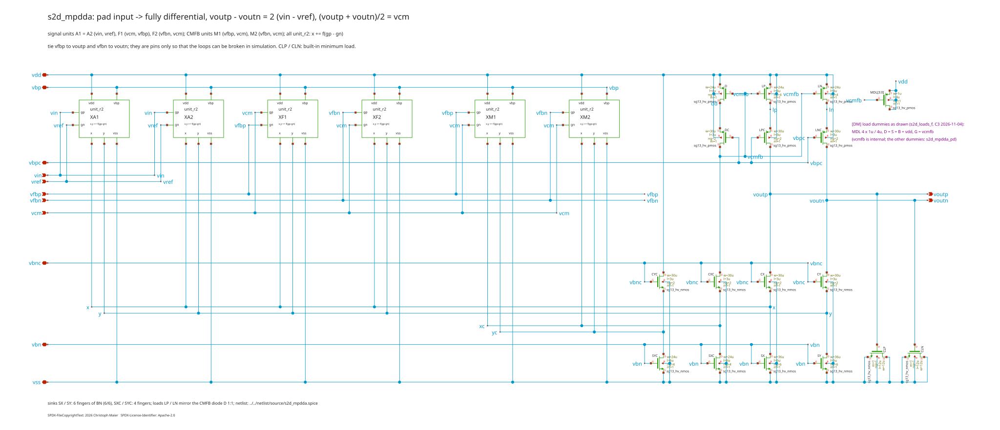
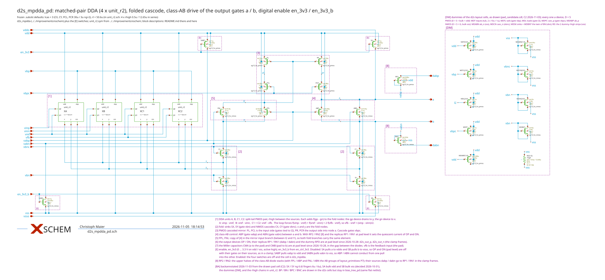
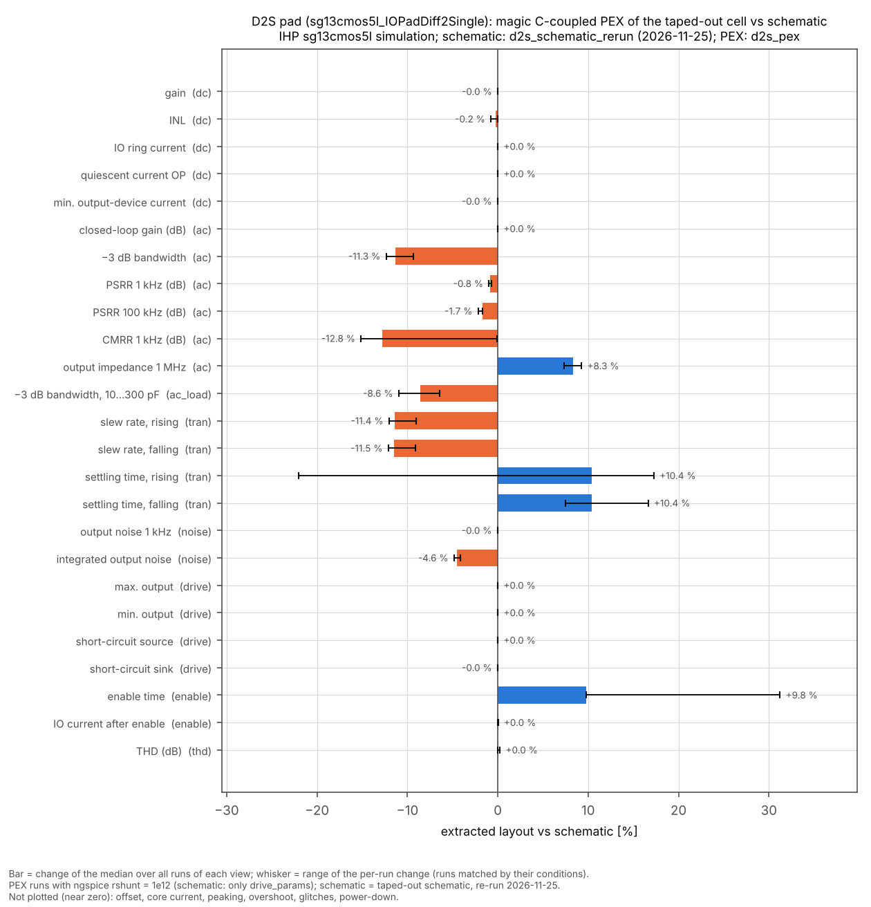
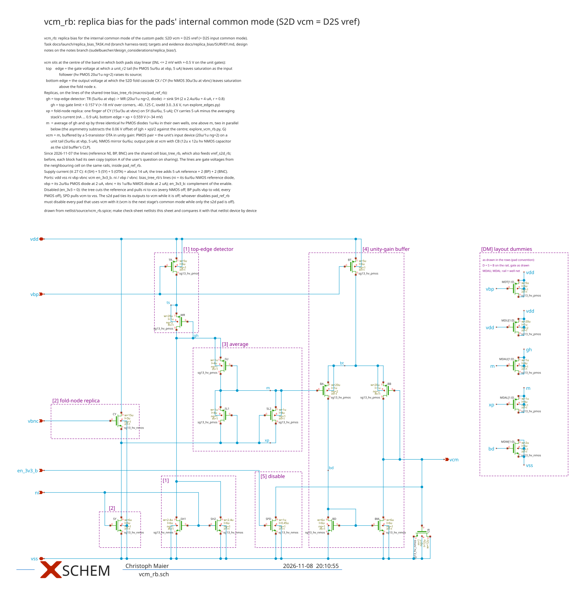
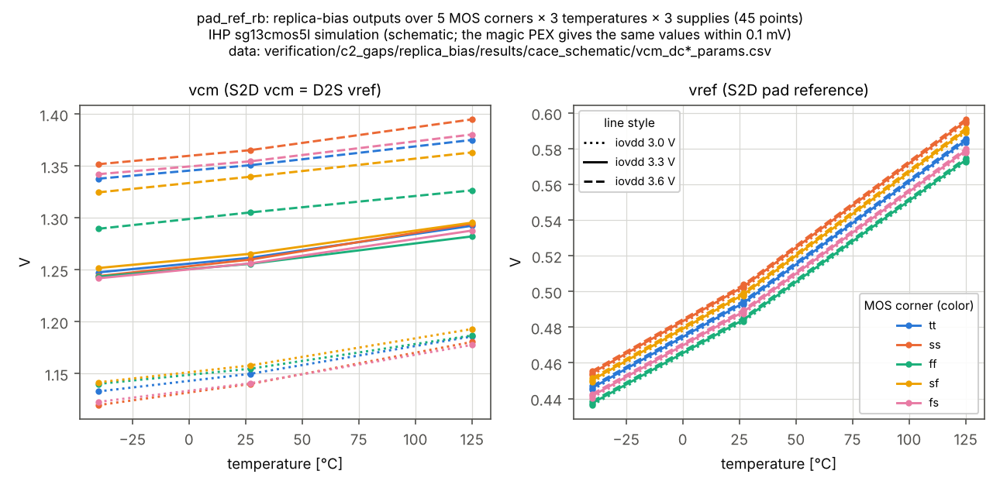
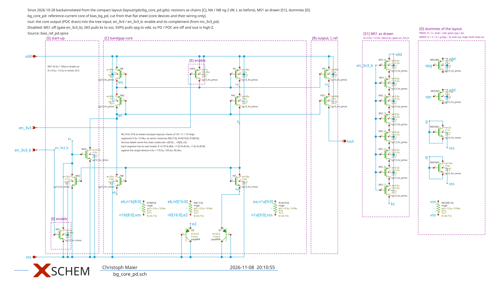
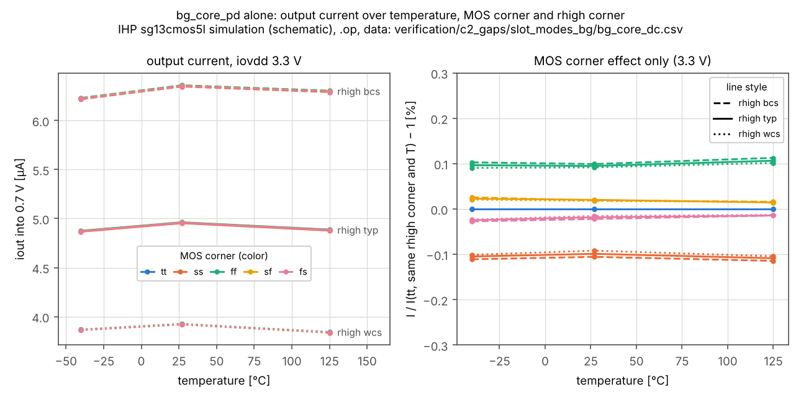
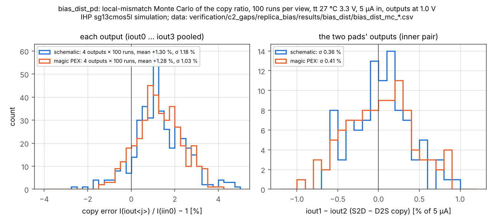
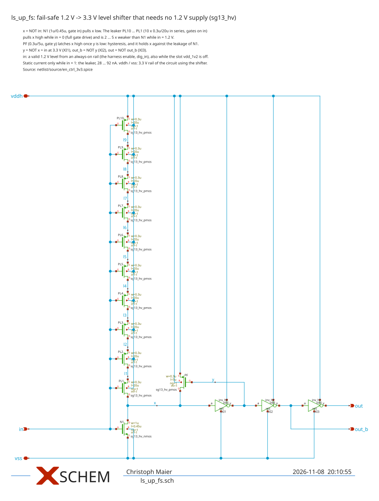

<!--
SPDX-FileCopyrightText: 2026 Christoph Maier
SPDX-License-Identifier: Apache-2.0
-->
# Slot 7: how it works, and why it is sized the way it is

For a reviewer who knows analog design but not this project. Back to [README.md](README.md); numbers in the data sheets
([datasheets/](datasheets/README.md)); measured-in-simulation curves in [`../../verification/c2_gaps/`](../../verification/c2_gaps/).
No silicon exists yet: every number here is an IHP sg13cmos5l **simulation** quoted from the files named next to it.

**Sources and conventions.**

- **P** = design repository [`tatzelbrumm/sg13cmos5l_cm_ip__single2diff2single`](https://github.com/tatzelbrumm/sg13cmos5l_cm_ip__single2diff2single)
  at commit [`91a7da8b`](https://github.com/tatzelbrumm/sg13cmos5l_cm_ip__single2diff2single/tree/91a7da8b67ac56a26c605501146667a1fde28c32)
  (the two pads, as taped out); **S** = the same repository at [`9052bd35`](https://github.com/tatzelbrumm/sg13cmos5l_cm_ip__single2diff2single/tree/9052bd35928c6d40344e8e686c9abbe736bfadb9)
  (`slot_7` and the blocks it places). Paths below are relative to that repository's root. Statements of fact and of
  design intent come from the READMEs and the comment headers of the source netlists named in each section.
- Sizing tables are copied from the **source netlists** (`netlist/source/*.spice`); for every cell the READMEs state that
  the xschem sheet netlists to the same devices (checked device by device by the designer). Layout dummies (D = S on a
  rail, no current) are left out of the tables. W is the total width over all fingers (`ng`).
- **Derivation (added here)** marks a step that is not in the sources: a short calculation from the netlist values that
  the reader can redo. Where the sources do not give a reason for a choice, the text says so.
- Schematic pictures: [pix/schematics/](pix/schematics/README.md) (xschem renders of the sources at P and S). Plots:
  [pix/plots/](pix/plots/README.md) (made from committed CSVs by `make_plots.py`).

Contents: [1 the common unit](#1-the-common-unit-unit_r2) · [2 S2D pad](#2-s2d-pad-sg13cmos5l_iopadsingle2diff) ·
[3 D2S pad](#3-d2s-pad-sg13cmos5l_iopaddiff2single) · [4 replica bias](#4-replica-bias-pad_ref_rb) ·
[5 bandgap](#5-bandgap-current-reference-bg_core_pd) · [6 distribution and fail-safe enables](#6-bias_dist_pd-and-the-fail-safe-enables) ·
[7 what the sources do not say](#7-what-the-sources-do-not-say)

## 1. The common unit `unit_r2`

Both pads are built from one matched unit, defined once in `macros/sg13cmos5l_IOPadDiff2Single/netlist/source/units.spice`
(P) and used unchanged by the S2D pad ([schematic](pix/schematics/unit_r2.svg)): a split-tail hv-PMOS pair with an
rhigh resistor between the two sources.

| device | W / L (µm), fingers | role |
|---|---|---|
| Ta, Tb | 5 / 6, ng 1 | the two tail halves, gate `vbp`, 5 µA each |
| R[3:0] | rhigh 0.5 / 12.65 each, 4 in series (0.5 / 50.6 total) | source degeneration between `sa` and `sb`; the netlist names it "R = 150 kOhm" |
| Ma (gate `gp`), Mb (gate `gn`) | 20 / 1, ng 2 each | input pair; Ma drains to `y`, Mb to `x` |

Source: `units.spice`, subckt `unit_r2` (P). Its header defines the unit's function as `x += f(gp − gn)`: the unit adds
to node `x` (and takes from node `y`) a current that is an odd, monotonic function of its gate difference, around the
5 µA each node receives at balance.

**Derivation (added here):** with the degeneration, the small-signal unit transconductance is
`G_u = 1 / (R + 2/g_m) < 1/R ≈ 6.7 µS`, and the current cannot exceed the tail current, so `f` saturates at about
±5 µA. The units' exact shape of `f` does not matter for the gain of either pad (sections 2 and 3); only matching does.
Why 5 µA, L = 6 µm tails and a 150 kΩ (50.6 µm) resistor were chosen is not stated in the sources (the `d2s_mpdda`
header records only the change "unit tails 2 × 5 µA (was 2 × 20 µA per pair)").

## 2. S2D pad (`sg13cmos5l_IOPadSingle2Diff`)

Function: `outp − outn = 2 (pad − vref)`, `(outp + outn)/2 = vcm`. Cell: `s2d_mpdda` inside `s2d_mpdda_pd`, its own
bias tree `bias_tree_noab_pd`, primary ESD `s2d_pad_esd`; the pad is the buffer input directly (no secondary
protection). Sources: `macros/sg13cmos5l_IOPadSingle2Diff/README.md`, `netlist/source/s2d_mpdda.spice`, `s2d_pd.spice`,
`sg13cmos5l_IOPadSingle2Diff.spice` (P).



*Figure 2.1: `s2d_mpdda` (P): signal units XA1, XA2, XF1, XF2, CMFB units XM1, XM2, folded cascode, CMFB diode, built-in
load capacitors CLP / CLN. Wrapper with enable: [s2d_mpdda_pd.svg](pix/schematics/s2d_mpdda_pd.svg); pad top:
[sg13cmos5l_IOPadSingle2Diff.svg](pix/schematics/sg13cmos5l_IOPadSingle2Diff.svg).*

### 2.1 Why four identical units give a gain of exactly 2 without a resistor ratio

All six units hang on the same fold nodes. The signal units are connected as (source: `s2d_mpdda.spice` header)

```
A1 = A2 : (gp, gn) = (vin, vref)       F1 : (vcm, vfbp)       F2 : (vfbn, vcm)       vfbp = outp, vfbn = outn
```

The folded cascode has the outputs as its only high-impedance nodes, so in steady state the net current the signal
units put into `x` must be zero:

```
2 f(vin − vref) + f(vcm − vfbp) + f(vfbn − vcm) = 0
```

With `f` odd, `f(vcm − vfbp) = −f(vfbp − vcm)`. Write `vfbp = vcm + c + u`, `vfbn = vcm + c − u` (differential half
`u`, common-mode error `c`). Once the CMFB has made `c = 0`:

```
2 f(vin − vref) = f(u) + f(u)   →   u = vin − vref          (f monotonic, so invertible)
outp − outn = 2u = 2 (vin − vref),      (outp + outn)/2 = vcm
```

The nonlinearity of `f` cancels because every unit sees the same kind of argument: each input unit sees the whole input,
each feedback unit half the differential output. Gain is a **count of matched units** (two input units against two
feedback units, each feedback unit seeing half of the output), not a ratio of resistors or transconductances. The
resistors in the units only linearize each unit; their value drops out. (The derivation of the balance is the
netlist header's; the step `f(vcm − vfbp) = −f(vfbp − vcm)` and the split into `c` and `u` are written out here.)

**CMFB.** Two more units sum the outputs with the same polarity: `xc += f(vfbp − vcm) + f(vfbn − vcm)` (header). That
current is folded into a cascoded PMOS diode `vcmfb` that the two output loads LP / LN mirror 1 : 1.
**Derivation (added here):** for odd `f`, `f(c + u) + f(c − u)` is exactly 0 at `c = 0` for any `u`, so the CMFB's
null does not move with the differential signal; the header's wording is "linear in the output common mode, second
order in the differential signal".

**What is left of the gain error.** Simulated gain 1.9985 … 1.9993 (schematic = extracted, 135 PVT runs;
[S2D data sheet](datasheets/sg13cmos5l_IOPadSingle2Diff.md)); mismatch Monte Carlo σ 0.74 % (100 runs, pad README).
**Derivation (added here):** the worst DC loop gain in the loop fixture is 64.54 dB (README, `loop_params`), i.e.
T ≈ 1680; a finite loop gain alone gives a gain error of about −1/T ≈ −0.06 %, the same order as the simulated −0.04 …
−0.08 %. The sources do not separate the contributions.

### 2.2 Input window

The README states it as "unit gates ≤ about iovdd − 1.3 V"; `vcm_rb/README.md` (S) locates that top edge: a unit tail
(5 / 6 at `vbp`) leaves saturation as the input device (20 / 1) raises its source, "at about iovdd − 1.25 V on the top
gate at ss / −40 °C". The same README gives the bottom edge: "the S2D fold cascode CX / CY leaves saturation above the
fold node x. It is 0.89 / 0.95 / 1.02 V at −40 / 27 / 125 °C", as an edge of the `vcm` band, which it defines for
±0.5 V on the unit gates.

**Derivation (added here):** every gate in the S2D is one of `vin`, `vref`, `vcm`, `vcm ± u`, so the highest unit gate
is `max(vin, vcm + |vin − vref|)`, and the lowest output is `vcm − |vin − vref|`. With `vref` below `vcm` (the slot's
case) the feedback gate `vcm + |u|` is the highest. The linear input range therefore ends where

```
vcm + |vin − vref|  ≈  iovdd − 1.25 V        (top unit gate)        or
vcm − |vin − vref|  ≈  0.39 … 0.52 V          (vcm_rb's bottom edge minus its 0.5 V signal, −40 … 125 °C; my reading)
```

whichever comes first. Check against the S2D range grid of [`dc_curves/results.md`](../../verification/c2_gaps/dc_curves/results.md) §4
(worst case over ss / tt / ff × −40 / 27 / 125 °C, 1 mV criterion):

| iovdd | vref | vcm | range [V] | u at the ends | limit by the two lines above |
|---|---|---|---|---|---|
| 3.0 V | 0.5 | 1.4 | 0.171 … 0.837 | −0.329 / +0.337 | top gate 1.73 … 1.74 V = iovdd − 1.26 V, symmetric in u as predicted |
| 3.0 V | 0.5 | 1.65 | 0.371 … 0.630 | ±0.13 | top gate 1.78 V = iovdd − 1.22 V |
| 3.3 V | 0.5 | 1.4 | 0.086 … 1.172 | +0.672 | top gate 2.07 V = iovdd − 1.23 V |
| 3.3 V | 0.5 | 1.2 | 0.086 … 1.154 | +0.654 | lowest output 0.55 V (bottom edge) |
| 3.3 V | 0.5 | 1.0 | 0.105 … 0.950 | +0.450 | lowest output 0.55 V (bottom edge) |

At the low end of the pad range (`vin` near 0 V) the README says the input devices' drains come close to their sources
at 125 °C (range from 0 V at −40 / 27 °C, 0.013 … 0.087 V at 125 °C); `vref_s2d_rb/README.md` (S) puts this edge at
`x − V_SG(follower, 5 µA) + 0.676 V` in terms of `vref`, which is why `vref` is made to rise with temperature
(section 4.3). With the slot's replica values (`vref` 0.49 V, `vcm` 1.26 V) the linear range is −0.157 … 1.296 V at
tt 27 °C 3.3 V and the high end is ≥ 0.980 V at every corner ([dc_curves](../../verification/c2_gaps/dc_curves/results.md) §1b).

### 2.3 Bias tree, iref and current budget

`iref` (5 µA, sourced into the pad by `bias_dist_pd`) enters the NMOS diode NI behind a transmission gate; one mirror
tree makes the four lines (source: `bias_tree_noab_pd.spice`, `bias_tree_pd/netlist/source/bias_ref_pd.spice`, P):
`vbp` (5 µA, unit tails), `vbpc` (2 µA, PMOS cascodes), `vbn` (5 µA, fold sinks), `vbnc` (2 µA, NMOS cascodes). Ratios
are finger counts against the diodes: the fold sinks SX / SY are 6 fingers of the bias diode BN (6 / 6 at 5 µA), i.e.
30 µA; the CMFB sinks 4 fingers, 20 µA (header of `s2d_mpdda.spice`).

**Derivation (added here), current from iovdd:** 6 units × 10 µA = 60 µA; loads LP + LN 2 × 10 µA; CMFB diode D 10 µA;
the CMFB fold branch XCYC 10 µA (it is folded "into vdd", header); tree branches NBP 5 + NBPC 2 + PBN 5 + PBNC 2 = 14 µA
(NI's 5 µA comes in through `iref`). Total ≈ 114 µA, against 115.5 µA simulated at tt 27 °C (`dc_params`, IO ring current).
The same count explains why the sinks are 30 µA: 4 signal units × 5 µA into each fold node plus the 10 µA load branch.

### 2.4 Bandwidth (load-compensated, single stage)

Each output node carries the built-in hv NMOS capacitor 12 × 12 µm ("about 0.53 pF at 0.7 V and 0.62 pF at 1.7 V",
header; "the CM loop needs about 0.5 pF per output for 60°") plus the external load (CACE default 0.5 pF).
**Derivation (added here):** small-signal, the current into `outp` is `2 G_u (vin − vref − u)`, so

```
f_−3dB ≈ 2 G_u / (2π C_L)  ≤  2 / (150 kΩ · 2π · 1.03 … 1.12 pF)  ≈  1.9 … 2.1 MHz
```

an upper bound because `G_u < 1/R`. Simulated: 1.35 … 1.81 MHz (schematic), 1.24 … 1.67 MHz (extracted). Loop phase
margin ≥ 86° differential, ≥ 62° common mode (README).

### 2.5 Enable and protection

Disabled: the tree is off (its TG opens `iref`, TDN pulls `ni` low) and four 1 / 0.45 transmission gates tie `outp`,
`outn` to `vcm` (`s2d_pd.spice`). `pad`, `vref`, `vcm` see gates only. Primary ESD as drawn in the template: gate-tied
clamps MCP / MCN with rppd gate ties, two `dpantenna` and two `dantenna` stripes; no secondary protection because the
buffer input is the pad (pad README). Whether the protection meets an ESD target was not simulated (README "Not done").

### 2.6 Sizing table, S2D pad

| device | W / L (µm), fingers | multiplicity | role | source (P) |
|---|---|---|---|---|
| XA1, XA2 | `unit_r2` | 2 | input units (vin, vref) | `s2d_mpdda.spice` |
| XF1, XF2 | `unit_r2` | 2 | feedback units (vcm, vfbp), (vfbn, vcm) | same |
| XM1, XM2 | `unit_r2` | 2 | CMFB units | same |
| XSX, XSY | hv NMOS 36 / 6, ng 6 | 2 | fold sinks, 30 µA each (6 × BN) | same |
| XCX, XCY | hv NMOS 30 / 3, ng 2 | 2 | NMOS cascodes (`lcas` = 3, W = 10 L) | same |
| XLP, XLN | hv PMOS 24 / 4, ng 4 | 2 | output loads, 10 µA, gate `vcmfb` | same |
| XLPC, XLNC | hv PMOS 30 / 3, ng 2 | 2 | load cascodes | same |
| XSXC, XSYC | hv NMOS 24 / 6, ng 4 | 2 | CMFB fold sinks, 20 µA | same |
| XCXC, XCYC | hv NMOS 30 / 3, ng 2 | 2 | CMFB cascodes | same |
| XD, XDC | hv PMOS 24 / 4 ng 4; 30 / 3 ng 2 | 1 each | CMFB diode = replica of a load with its cascode | same |
| XCLP, XCLN | hv NMOS 12 / 12 | 2 | built-in load capacitors | same |
| XTPN / XTPP, XTNN / XTNP | hv N / P 1 / 0.45 | 4 | outputs to `vcm` while disabled | `s2d_pd.spice` |
| XTGN / XTGP, XTDN | hv N / P 1 / 0.45 | 3 | `iref` switch and `ni` pull-down | `bias_tree_noab_pd.spice` |
| XNI, XNBP | hv NMOS 6 / 6 | 2 | reference diode; 5 µA to `vbp` | same |
| XNBPC | hv NMOS 2.4 / 6 | 1 | 2 µA to `vbpc` | same |
| XPBN, XPBNC | hv PMOS 5 / 6, 2 / 6 | 1 each | 5 µA to `vbn`, 2 µA to `vbnc` | same |
| BP, BN, BNC, BPC | hv P 5 / 6; N 6 / 6; N 1 / 8; P 1 / 4 | 1 each | bias diodes | `bias_ref_pd.spice` (`bias_diodes`) |
| XMCP | hv PMOS 266.4 / 0.6, ng 40 | 1 | ESD clamp to iovdd (gate tied by rppd 0.5 / 12.9) | `sg13cmos5l_IOPadSingle2Diff.spice` (`s2d_pad_esd`) |
| XMCN | hv NMOS 88 / 0.6, ng 20 | 1 | ESD clamp to iovss (gate tied by rppd 0.5 / 3.54) | same |
| XDP1/2, XDN1/2 | dpantenna / dantenna 1.26 × 27.78 | 2 + 2 | primary diodes | same |

Why these particular L values (6 µm tails and sinks, 3 µm cascodes, 4 µm loads) were chosen is not stated in the S2D
sources; the `d2s_mpdda` header (the same devices) says "offset: sinks 36/6, mirror 24/4 (the folding sinks dominated
the offset)" and "loop gain: folded and mirror cascodes at L = lcas um (default 3), W = 10 * L". The S2D `FILL_IN.md`
leaves open whether the offset (σ 6–7 mV) is enough or SX / SY should get 4× the area.

## 3. D2S pad (`sg13cmos5l_IOPadDiff2Single`)

> **Note (2026-11-25):** D2S *schematic* numbers in this section are from the re-run of the full CACE suite on the taped-out schematic ([d2s_schematic_rerun](../../verification/c2_gaps/d2s_schematic_rerun/results.md)); the committed results of 2026-10-21 predated the final schematic. Sizes are read from the netlists at `91a7da8b`, which are the taped-out circuit.

Function: `pad − vref = (vinp − vinn)/2`, class-AB output into 10 … 300 pF. Sources:
`macros/sg13cmos5l_IOPadDiff2Single/README.md`, `netlist/source/d2s_mpdda.spice`, `d2s_mpdda_pd.spice`, `d2s_out.spice`,
`sg13cmos5l_IOPadDiff2Single.spice`, `bias_tree_pd/netlist/source/bias_ref_pd.spice` (P).



*Figure 3.1: `d2s_mpdda_pd` (P): MP-DDA units, folded cascode with the low-voltage cascode mirror, floating current
source (FPL / FNL) and floating class-AB control (ABP / ABN), RP2 / RN2, disable switches. Output stage:
[d2s_out_p.svg](pix/schematics/d2s_out_p.svg), [d2s_out_n.svg](pix/schematics/d2s_out_n.svg); pad top:
[sg13cmos5l_IOPadDiff2Single.svg](pix/schematics/sg13cmos5l_IOPadDiff2Single.svg).*

### 3.1 The ½ from four matched units

Units (header of `d2s_mpdda.spice`): A (vinp, vref), B (vref, vinn), C1 = C2 (vref, vfb), `vfb` = pad (Kelvin tap).
Balance at the fold nodes:

```
f(vinp − vref) + f(vref − vinn) = 2 f(vfb − vref)
```

**Derivation (added here):** with `vinp = vicm + vd/2`, `vinn = vicm − vd/2` and `vicm = vref`, the left side is
`2 f(vd/2)`, so `vfb − vref = vd/2` for any matched odd monotonic `f`: gain ½ = (one unit per input) / (two feedback
units). If `vicm ≠ vref` by Δ, the left side becomes `f(vd/2 + Δ) + f(vd/2 − Δ)`, which equals `2 f(vd/2)` only for a
linear `f`; the slot avoids that by construction, because the D2S `vref` and its input common mode are the same net
(`vcm`; `vcm_rb/README.md`, S: "the reference `vref` of the D2S, which must equal the D2S input common mode").
Loop gain ≥ 48 dB (worst, 125 °C; README) gives a gain error of about −1/T ≈ −0.4 %, the size of the simulated worst
gain 0.4981 (derivation added here).

### 3.2 Folded cascode, class-AB control, output stage

- **Fold and mirror.** The units feed fold nodes `x` / `y` (sinks SX / SY 30 µA). `x` goes through cascode CX into the
  left branch: the floating current source FPL / FNL and the low-voltage cascode mirror PL / PCL. The mirror copy PR /
  PCR drives node `a`; `y` goes through CY to node `b`. Between `a` and `b` sits the floating class-AB control ABP /
  ABN, biased by `vabp` / `vabn`.
- **Output devices are the clamp frames.** OP (hv PMOS 546.12 / 0.6, 82 fingers) is the pad's P clamp frame; ON (hv
  NMOS 299.2 / 1, 68 fingers) the two N clamp frames (`d2s_out.spice`). RP1 (2 fingers of the same frame, 13.32 / 0.6)
  and RN1 (2 fingers, 8.8 / 1) are their replicas, diode-connected, at the bottom of the class-AB diode stacks
  RP1 + RP2 and RN1 + RN2 (RP2 = ABP's size, RN2 = ABN's). The replica mock-up README: "I_Q ratio 82 / 2".
- **Quiescent current, derivation (added here):** around the loop iovdd → OP gate `a` → ABP → `vabp` → RP2 → RP1 → iovdd,
  `V_SG(OP) = V_SG(RP1) + V_SG(RP2) − V_SG(ABP)`. With ABP at RP2's current and size (5 µA, 6.66 / 0.6) the last two
  cancel and OP runs at the finger ratio of RP1: `I_Q ≈ 82/2 × 5 µA = 205 µA`. Simulated I_Q(OP) 217 … 239 µA
  (schematic re-run and extracted alike). The N side has the ratio 68/2 = 34; both devices carry the same current
  without load, and the sources do not say how the split of the 10 µA between ABP and ABN settles to reconcile the two
  ratios.
- **Current budget, derivation (added here):** 4 units × 10 µA + mirror 2 × 10 µA + tree branches (NBP 5, NBPC 2,
  NABP 5, PBN 5, PBNC 2, PABN 5) 24 µA + I_Q ≈ 215 µA ≈ 299 µA, against 311 µA simulated (median, `dc_params`, schematic re-run).
- **Why the output devices are the clamp frames:** the sources record the decision ("case (a): OP / ON are the pad's
  clamp frames", `d2s_mpdda_pd.spice`) but no further reason. The same header says that disabled, OP / ON are "off, with
  their gates tied to their sources as in a clamp": a disabled pad is a clamp pair, an enabled pad drives with the same
  device area. Short-circuit current ≥ 49.7 mA source, ≥ 53 mA sink (requirement
  of the proposal: about 10 mA into 100 pF).

### 3.3 Miller compensation and bandwidth

CMA (gate `a`) and CMB (gate on `pb`) are hv PMOS accumulation capacitors, 7.96 × 32.16 µm (256 µm², the area of the
earlier 16 × 16 µm), each reaching the pad through an identical 2 kΩ secondary-protection stage `d2s_sp2k`
(`sg13cmos5l_IOPadDiff2Single.spice`). `ccomp.spice` (P): "C_ox ~ 5 fF/um2", `d2s_mpdda.spice`: "0.4...0.8 of that in
use", i.e. about 0.5 … 1.0 pF each. **Derivation (added here):** the fold delivers `2 G_u [vd − 2(vout − vref)]` into
`a` / `b`, which the two Miller capacitors integrate:

```
f_−3dB ≈ 2 G_u / (2π C_M)  ≤  2 / (150 kΩ · 2π · 0.5 … 1.0 pF)  ≈  2.1 … 4.2 MHz      (upper bound, G_u < 1/R)
```

Simulated: 1.78 … 2.25 MHz schematic, 1.57 … 2.02 MHz extracted; loop unity gain ≥ 1.29 MHz; phase margin 62 … 72° at
100 pF, 42 … 55° at 300 pF, 24 … 33° at 1 nF (README, finding 2), which is why the specified load range is 10 … 300 pF. The specification asked for "GBW in the 'conservative' 1–5 MHz tier" (README).

### 3.4 Swing, and why the INL depends on the input common mode

The linear range is set by the front end, not by the output stage: loaded (1 kΩ) and unloaded give the same range ends
([dc_curves](../../verification/c2_gaps/dc_curves/results.md) §2). The README's explanation at iovdd 3.0 V: "the input
pairs run out of headroom at the top of the range". **Derivation (added here):** with `vref = vicm` every unit gate is
`vicm`, `vicm ± vd/2` or `vfb = vicm + vd/2`, so the highest gate is `vicm + |vd|/2`. In the range tables of
dc_curves §2 / §2b the pad range is symmetric about `vicm` (e.g. 3.0 V tt 27 °C, vicm 1.65 V: 1.349 … 1.952 V, ±0.30 V;
3.3 V tt 27 °C, vicm 1.26 V: 0.211 … 2.317 V, ±1.05 V), i.e. it ends at one top-gate voltage on both sides. At iovdd 3.0 V
that top gate at the range end is 1.851 … 2.152 V for vicm = 1.65 V and 1.894 … 2.201 V for vicm = 1.26 V (over 5 corners
× 3 temperatures). The INL is measured over |vd| ≤ 1 V, i.e. up to a top gate of vicm + 0.5 V:

| vicm | top gate needed for ±1 V | range end at 3.0 V | INL ±1 V at 3.0 V | source |
|---|---|---|---|---|
| 1.65 V (CACE default) | 2.15 V | 1.851 … 2.152 V: exceeded at every corner but ff 125 °C | 11.1 … 88.4 mV | dc_curves §2 |
| 1.26 V (slot: vref = vcm) | 1.76 V | 1.894 … 2.201 V: inside at every corner | ≤ 1.38 mV | dc_curves §2b |

At 3.3 V the slot operating point gives 0.211 … 2.317 V output at tt 27 °C and INL ≤ 0.56 mV. Why the range end at
3.0 V sits about 40 mV higher at vicm 1.26 V than at 1.65 V is not explained in the sources. The low saturation level
also moves with vicm (pad at vd = −2.52 V: 0.115 … 0.230 V at vicm 1.26 V, against 0.635 … 0.736 V at vicm 1.65 V and
vd = −3 V; README finding 6: "the input common mode … is far outside the front end's range there").

### 3.5 Sizing table, D2S pad

| device | W / L (µm), fingers | mult. | role | source (P) |
|---|---|---|---|---|
| XA, XB, XC1, XC2 | `unit_r2` | 4 | (vinp, vref), (vref, vinn), 2 × (vref, vfb) | `d2s_mpdda_pd.spice` |
| XSX, XSY | hv NMOS 36 / 6, ng 6 | 2 | fold sinks, 30 µA | same |
| XCX, XCY | hv NMOS 30 / 3, ng 2 | 2 | fold cascodes | same |
| XPL, XPR | hv PMOS 24 / 4, ng 4 | 2 | low-voltage cascode mirror, 10 µA per branch | same |
| XPCL, XPCR | hv PMOS 30 / 3, ng 2 | 2 | mirror cascodes | same |
| XFPL / XFNL | hv P 6.66 / 0.6; hv N 4.4 / 1 | 1 + 1 | floating current source (replica of ABP / ABN) | same |
| XABP / XABN | hv P 6.66 / 0.6; hv N 4.4 / 1 | 1 + 1 | floating class-AB control between `a` and `b` | same |
| XRP2 / XRN2 | hv P 6.66 / 0.6; hv N 4.4 / 1 | 1 + 1 | upper halves of the class-AB diode stacks | same |
| XSA, XSB, XSABP, XSABN | hv 1 / 0.45 | 4 | disable: `a` → iovdd, `b` → iovss, `vabp` / `vabn` off | same |
| XOP | hv PMOS 546.12 / 0.6, ng 82 | 1 | output PMOS = P clamp frame | `d2s_out.spice` |
| XRP1, XRPD | hv PMOS 13.32 / 0.6, ng 2 | 1 + 1 | replica of OP (diode on `dabp`); its off drain partner | same |
| XON | hv NMOS 299.2 / 1, ng 68 | 1 | output NMOS = two N clamp frames | same |
| XRN1 | hv NMOS 8.8 / 1, ng 2 | 1 | replica of ON (diode on `dabn`) | same |
| XCMA, XCMB | hv PMOS 7.96 / 32.16 (accumulation) | 2 | Miller capacitors | `sg13cmos5l_IOPadDiff2Single.spice` |
| XSPA, XSPB (`d2s_sp2k`) | rppd 1 / 7.435 (1991.6 Ω), dantenna 0.64 × 3.1, dpantenna 0.64 × 4.98 | 2 | 2 kΩ stage between pad and each Miller capacitor | same |
| XDN0/1, XDP0/1 | dantenna 1.26 × 67.6, dpantenna 1.26 × 65.8 | 2 + 2 | primary ESD diodes | same |
| `bias_tree_pd` | as the S2D tree plus XNABP (N 6 / 6) and XPABN (P 5 / 6) | | six lines; NABP / PABN feed the class-AB stacks 5 µA each | `bias_ref_pd.spice` |

Reasons for the class-AB device sizes (6.66 / 0.6, 4.4 / 1) and for L = 0.6 / 1 µm of the output devices beyond "the
finger width of the clamp frames" are not stated in the sources.



*Figure 3.2: what the layout changed (D2S), against the taped-out schematic: the extraction lowers bandwidth and slew rate by about 11 %,
raises settling time by about 10 % and the enable time by 10 % (median; up to 31 %); DC (gain, INL, currents, swing) is unchanged, noise moves by less than 5 %. S2D equivalent:
[pex_vs_schematic_s2d.png](pix/plots/pex_vs_schematic_s2d.png) (bandwidth −8 %, step response +12 %, DC unchanged).*

## 4. Replica bias (`pad_ref_rb`)

Gives `vcm` (S2D `vcm` = D2S `vref`, about 1.26 V) and `vref` (S2D `vref`, about 0.49 V) from one 5 µA reference
with one enable. Sources: `macros/pad_ref_rb/README.md`, `netlist/source/pad_ref_rb.spice`, `macros/vcm_rb/README.md`,
`netlist/source/vcm_rb.spice`, `macros/vref_s2d_rb/README.md`, `netlist/source/vref_s2d_rb.spice` (S).

### 4.1 Why replicas instead of a divider

The two voltages are not arbitrary: `vcm` must sit in the band where both pads are linear, and `vref` above the S2D's
low-input edge. Both edges move with process, temperature and iovdd (section 2.2). The READMEs' comparison (tt 27 °C
3.3 V): two dividers at the same output impedances draw 28.8 + 19.9 = 48.7 µA; `pad_ref_rb` draws 24.1 µA including its
5 µA reference. A divider from iovdd is ratiometric and "cannot follow the band" (it gives 1.09 V at 3.0 V, below the
band with the Oguey–Aebischer core at 125 °C), stays at 0.5 V when hot where the S2D needs ≥ 0.55 V, moves `vref` by
±45 mV over 3.0 … 3.6 V (input offset for a ground-referenced source), and cannot be switched off. The replicas use only
hv MOS sizes that occur in the pads ("No resistor is used", `vcm_rb/README.md`).

### 4.2 `vcm_rb`: centre of the band



*Figure 4.1: `vcm_rb` (S): top-edge detector TR / MR / SH, fold-node replica CY / SY, averaging diodes SU, SL1, SL2,
unity-gain OTA BT / BA / BB / BD / BM with CB.*

Relations as stated in `vcm_rb.spice` (fits by the designer, `explore_edges.py`):

```
gh  = top gate limit + 0.157 V  (±18 mV)        TR 5/6 at vbp → MR 20/1 diode → sink 2 × 2.4/6 (4 µA = 0.8 of TR)
xp  : bottom edge = xp + 0.559 V (±34 mV)        one CY finger 15/3 at vbnc on SY 6/6 (5 µA)
m   : average of gh and xp by three identical hv PMOS diodes 1/4 in their own wells, one gh→m, two in parallel m→xp
vcm = m, buffered by a 5-transistor OTA in unity gain (pair = the unit's input device, tail = the unit's tail)
```

**Derivation (added here):** with the stack current `I`, `gh − m = V_SG(I)` and `m − xp = V_SG(I/2)` (no body effect:
own wells), so `m = (gh + xp)/2 − [V_SG(I) − V_SG(I/2)]/2`. The unequal split moves `m` below the midpoint; the header's
words: "the asymmetry subtracts the 0.06 V offset of (gh + xp)/2 against the centre". Result: `m` within −65 … +78 mV of
the band centre over all PVT and references (README); margin to the band of both pads ≥ +142 mV with the harness
reference, ≥ +40 mV in the worst case (OA core, ff 125 °C 3.0 V). The OTA's CB (12 × 12 µm) is there for phase margin
("without it … peaks up to 1.25 … with 50 … 200 fF on the pin", header).

### 4.3 `vref_s2d_rb`: an x-node replica at low current density

```
vref = vbnc − V_GS(F),     F = 4 × hv NMOS 15/3 at 1.67 µA (sink SF 2/6 at ni)
```

against the S2D's fold cascode CX 30 / 3 at 10 µA, whose source is the fold node `x`. **Derivation (added here):** the
current density in F is 1.67 µA / 60 µm against 10 µA / 30 µm in CX, 12 × lower, so `V_GS(F) < V_GS(CX)` and `vref` sits
above `x` (README: "about 0.1 V") and moves with it in temperature ("+0.6 mV/K" for x). The design target (README):
"pad range from 0 V" needs `vref` ≤ 0.5 V at room temperature, "linear at ff / 125 °C" needs ≥ 0.55 V, together a
positive tempco of at least +0.5 mV/K. Simulated: 0.436 … 0.455 / 0.483 … 0.504 / 0.572 … 0.596 V at −40 / 27 / 125 °C.
The price, stated in the README: for a ground-referenced external signal the S2D's zero moves by about +0.9 mV/K.

### 4.4 Shared tree, bypass, disable

`bias_tree_rb` makes `ni` (NI 6 / 6), `vbp` (BP 2 / 6 at 2 µA from NBP 2.4 / 6) and `vbnc` (BNC 1 / 8 at 2 µA from PBNC
2 / 6), "at the pad devices' current densities" (BP 2 / 6 at 2 µA = the pads' 5 / 6 at 5 µA). Sharing it costs nothing
at DC ("the tree's lines drive gates only"). `bypass_rb`: hv NMOS capacitors to vss only (vref 1296.6 µm², vcm
576.3 µm² plus CB): "PMOS to iovdd couples iovdd into vref, the S2D's zero point (4 … 7 × the S2D's input-referred iovdd
ripple at 1 MHz)". They reduce the S2D enable kick from 0.236 / 0.212 V to 0.112 / 0.088 V on vcm / vref. Disabled:
the TG opens `iref`, TDN pulls `ni` low, SPD pulls `vcm` and `vref` to vss.

**Supply as taped out.** The README says the top edge "is referenced to the pads' unit rail, so it must be the pads'
own iovdd"; in the taped-out slot `pad_ref_rb` runs on the slot's `vdd_3v3`, because the pad ring is not reachable
inside the slot (`slot_7.spice` comment, [glue_logic.md](glue_logic.md) §5). The simulations quoted here set both to the
same voltage; the effect of a difference between iovdd and `vdd_3v3` is not in the sources.



*Figure 4.2: `vcm` follows iovdd (the top edge) and rises with temperature; `vref` is nearly independent of iovdd and
rises about 0.9 mV/K, as designed. Mismatch (100 runs, tt 27 °C): σ 5.4 mV / 3.8 mV
([replica_bias](../../verification/c2_gaps/replica_bias/results.md) §2).*

### 4.5 Sizing table, `pad_ref_rb`

| device | W / L (µm), fingers | mult. | role | source (S) |
|---|---|---|---|---|
| XTGN / XTGP, XTDN | hv 1 / 0.45 | 3 | reference switch, `ni` pull-down | `pad_ref_rb.spice` (`bias_tree_rb`) |
| XNI | hv NMOS 6 / 6 | 1 | reference diode (5 µA) | same |
| XNBP → XBP | hv N 2.4 / 6 → hv P 2 / 6 | 1 + 1 | `vbp` at 2 µA | same |
| XPBNC → XBNC | hv P 2 / 6 → hv N 1 / 8 | 1 + 1 | `vbnc` at 2 µA | same |
| XTR, XMR | hv P 5 / 6; hv P 20 / 1 ng 2 | 1 + 1 | top-edge detector (unit tail + unit input device as diode) | `vcm_rb.spice` |
| XSH1, XSH2 | hv NMOS 2.4 / 6 | 2 | 4 µA sink of the detector | same |
| XCY, XSY | hv N 15 / 3; hv N 6 / 6 | 1 + 1 | fold-node replica `xp` | same |
| XSU, XSL1, XSL2 | hv PMOS 1 / 4, own wells | 3 | averaging stack gh → m → xp | same |
| XBT; XBA, XBB; XBD, XBM | hv P 5 / 6; hv P 20 / 1 ng 2; hv N 6 / 6 | 1; 2; 2 | unity-gain OTA (tail, pair, mirror) | same |
| XCB | hv NMOS 12 / 12 | 1 | OTA compensation | same |
| XSPD (vcm_rb, vref_s2d_rb) | hv NMOS 1 / 0.45 | 2 | output pull-down while disabled | both |
| XF1 … XF4 | hv NMOS 15 / 3 | 4 | `vref` follower (x-node replica) | `vref_s2d_rb.spice` |
| XSF | hv NMOS 2 / 6 | 1 | 1.67 µA sink | same |
| XCBR1; XCBR2 | hv NMOS 12 / 12; 34.1 / 16.9 | 1; 2 | `vref` bypass, 1296.6 µm² | `pad_ref_rb.spice` (`bypass_rb`) |
| XCBM1; XCBM2; XCBM3 | hv NMOS 19.24 / 12.66; 8.18 / 3.25; 2.9 / 12.4 | 2; 2; 1 | `vcm` bypass, 576.3 µm² | same |

## 5. Bandgap current reference (`bg_core_pd`)

Sources: `macros/bg_core_pd/README.md`, `netlist/schematic/bg_core_pd_magic.spice` (S); the principle comment of
`bg_core` in `macros/bias_tree_pd/netlist/source/bias_ref.spice` (P).



*Figure 5.1: `bg_core_pd` (S): PMOS mirror PB / PA / PO with stacked cascodes, NMOS pair NA / NB, Q1 and 8 × Q2
(pnpMPA), R0, R1A, R1B (rhigh chains), start-up MS1 / MS2 / MS3, disable SKS / SVPG.*

**Principle (Banba current-mode bandgap, no op amp).** The PMOS mirror forces equal currents into NA and NB; with equal
gate voltage (`g`) and equal currents their sources are equal, so `ea = eb` (comment in `bias_ref.spice`). Each branch
then carries a CTAT part through R1 and a PTAT part through R0:

```
I_branch = V_BE1 / R1 + U_T · ln 8 / R0            (Q2 : Q1 = 8 : 1)
I_out    = 2 · I_branch ≈ 5 µA                     (PO : PA : PB = 2 : 1 : 1)
```

The source comment adds: "R1 and R0 are rhigh, whose −0.22 %/K nearly cancels V_BE's slope already, so the PTAT share
is small." Resistors as drawn: R0 18, R1A 11, R1B 10 segments of rhigh 0.5 × 9.94 µm (357.8 / 218.7 / 198.8 squares).
"R1A is 10 % longer than R1B: with both PNPs off the loop gain is then > 1 and the core cannot rest in the resistor-only
state." Start-up: MS1 (8 × 0.5 / 12.5 in series, gate `en_3v3_b`) pulls `ks` up, MS3 then pulls the cascode line `vpc`
down until the core runs and MS2 (gate `g`) turns MS3 off again.

**Why it follows the resistor corner but hardly the MOS corner. Derivation (added here):** both terms of `I_branch` are
a junction voltage divided by an rhigh resistance, so to first order `I_out ∝ 1/R□(rhigh)`. The MOS devices only have
to make the two branch currents equal and copy them 2 : 1 into PO; a MOS corner shifts the V_GS of NA and NB, and the
V_SG of the mirror devices, together, so it leaves `ea = eb` and the ratios unchanged to first order. Simulation
([slot_modes_bg](../../verification/c2_gaps/slot_modes_bg/results.md) §3, 135 points): 3.829 … 6.369 µA, typical
4.958 µA; the rhigh corner moves it by −21 % (wcs) / +28 % (bcs); the MOS corner by ≤ 0.31 %; supply ≤ 0.73 %/V; over
−40 … 125 °C by 1.7 … 2.1 % (peak near 27 °C). Consequence for the slot: everything downstream (pad bias currents, pad
bandwidths, replica currents) scales with the rhigh corner; the pads' DC transfer does not, because it is set by matched
units, not by the current. Why the bandgap reference was chosen over the Oguey–Aebischer core for the taped-out slot is
not stated in the sources read here.



*Figure 5.2: output current into 0.7 V, 5 MOS × 3 rhigh corners × 3 temperatures at 3.3 V (left); the MOS-corner effect
alone, relative to tt at the same rhigh corner and temperature (right, within ±0.12 %).*

| device | W / L (µm), fingers | mult. | role | source (S) |
|---|---|---|---|---|
| XPB, XPA | hv PMOS 40 / 1, ng 4 | 1 + 1 | mirror (PB diode-connected via its cascode) | `bg_core_pd_magic.spice` |
| XPO | hv PMOS 80 / 1, ng 8 | 1 | output, 2 × branch | same |
| XPBC, XPAC; XPOC | hv PMOS 40 / 1 ng 4; 80 / 1 ng 8 | 2; 1 | stacked-diode cascodes | same |
| XNA, XNB | hv NMOS 20 / 4, ng 2 | 2 | force `ea = eb` | same |
| XQ1; XQ2 | pnpMPA a = 4 µm², m = 1; m = 8 | 1; 8 | V_BE, ΔV_BE (ratio 8) | same |
| XR0[17:0] | rhigh 0.5 / 9.94 | 18 in series | PTAT resistor R0 | same |
| XR1A[10:0], XR1B[9:0] | rhigh 0.5 / 9.94 | 11, 10 in series | CTAT resistors R1 (R1A 10 % longer) | same |
| XMS1_0 … _7 | hv PMOS 0.5 / 12.5 | 8 in series | weak start-up pull-up, gated by `en_3v3_b` | same |
| XMS2; XMS3 | hv NMOS 10 / 1; 0.5 / 2 | 1; 1 | start-up sense (gate g); start-up kick on `vpc` | same |
| XSKS; XSVPG | hv NMOS 1 / 0.45; hv PMOS 1 / 0.45 | 1; 1 | disable: `ks` → vss, `vpg` → vdd | same |

The `bg_core` comment in `bias_ref.spice` (P) says the PMOS mirror is in "moderate inversion for headroom at 3.0 V /
ss / −40 C"; other size choices are not explained.

## 6. `bias_dist_pd` and the fail-safe enables

### 6.1 `bias_dist_pd`: switchable 1 : 1 distribution

Sources: `macros/bias_dist_pd/README.md`, `netlist/source/bias_dist_pd.spice` (S); configuration in the slot:
[glue_logic.md](glue_logic.md) §5. Chain: input TGs → NMOS diode NI 6 / 6 → NM 6 / 6 → PMOS diode PD 5 / 6 → outputs
PO0 … PO3 5 / 6, each behind a TG; enabled inputs add in NI. In the slot input 0 is the bandgap; outputs 0 / 1 / 2 go to
`pad_ref_rb`, S2D, D2S (output 3 off). "Devices: those of `bias_tree_pd` (NI 6u/6u like the tree's NI, PD / PO 5u/6u
like BP)". The two pads get the inner pair PO1 / PO2 next to PD, "mirror images of each other: both pads get the matched
pair" (designer's decision of 2026-11-08). Each leg is a `bdp_slice`: `nand2_hv(en_3v3, en_k)` → `inv_hv` → `tg_hv`, all
1 / 0.45 µm hv. Disabled: all TGs open, TDN pulls `ni` to vss, SVPD pulls `vpd` to vdd.

Simulated ([replica_bias](../../verification/c2_gaps/replica_bias/results.md) §3): systematic copy ratio +0.49 … +1.56 %,
falling by about 0.5 % from 0.5 to 2.5 V output voltage ("output conductance of PO / the switch"); mismatch σ 1.0 …
1.2 % per output; the pads' pair `iout1 − iout2` σ 0.36 … 0.41 % because it shares NI / NM / PD; off leakage ≤ 145 pA.
**Derivation (added here):** NI's drain is at its gate (0.91 V at tt) while NM's drain is at `vpd` (1.97 V), and PD's
V_SD (3.3 − 1.97 = 1.33 V) is smaller than an output's at 1.0 V (2.3 V); both differences make the copy larger by
channel-length modulation, which fits the sign of the systematic error and its fall with output voltage. The sources
give no matching requirement ("To be decided: … the matching requirement, which sets NI / NM / PD / PO sizes").



*Figure 6.1: copy error per output (left) and the S2D − D2S difference (right), 100 mismatch runs per view.*

| device | W / L (µm) | mult. | role | source (S) |
|---|---|---|---|---|
| XNI, XNM | hv NMOS 6 / 6 | 1 + 1 | input diode, mirror to PD | `bias_dist_pd.spice` |
| XPD, XPO0 … XPO3 | hv PMOS 5 / 6 | 1 + 4 | PMOS diode, four 1 : 1 outputs | same |
| XTDN; XSVPD | hv NMOS 1 / 0.45; hv PMOS 1 / 0.45 | 1; 1 | `ni` → vss, `vpd` → vdd while disabled | same |
| `bdp_slice` (nand2_hv, inv_hv, tg_hv) | hv 1 / 0.45 (all devices) | 8 | one switched leg per input / output | same; `hv_logic.spice` |

### 6.2 Fail-safe enables: `ls_up_fs`

Sources: `macros/en_ctrl_3v3/README.md`, `netlist/source/en_ctrl_3v3.spice` (S); slot use: [glue_logic.md](glue_logic.md) §2.



*Figure 6.2: `ls_up_fs` (S), the level shifter of every slot input bit (7 instances in `s7_ctrl`).*

Problem it solves (README "Why v2"): v1 sensed the slot supplies with ratioed detectors and shifted with a
latch that needs the slot's 1.2 V; with that 1.2 V off and `enable` high its latch drew up to 152 µA. v2 uses the fact
that the harness drives `enable` and `dig_in` from an always-on 1.2 V rail, so the bits are valid even while the slot's
`vdd_1v2` is off, and shifts each bit **without any 1.2 V supply**, on the slot's switched `vdd_3v3` only:

- **XN1** (hv NMOS 1 / 0.45, gate = the 1.2 V input) pulls node `x` low when the input is 1.
- **Leaker:** 10 hv PMOS 0.3 / 20 in series (effectively 0.3 / 200), gates on the same input. With the input at 0 it has
  full gate drive and pulls `x` high; with the input at 1.2 V it is "2–5× weaker" and loses to XN1. It is the only
  static current, and only while the input is high: 28 … 92 nA over corners (netlist header).
- **Latch XPF** (hv PMOS 0.3 / 5, gate `y` = NOT `x`): once `x` is high it holds it (hysteresis) against XN1's leakage.
- Three `inv_hv` (1 / 0.45) give `y`, `out`, `out_b`.

The input must be a real harness level: XN1 conducts 0.6 … 8 µA at a 0.67 V gate. Monte Carlo was not run; the README's
argument is that "the margins are ratios of 10× and more: XN1 vs XPF, the leaker vs XN1's leakage". Fail-safe of the
pads by **starvation**: their only bias is `iref`, sourced from the slot's switched `vdd_3v3`, so with the slot off they
draw leakage only (S2D ≤ 0.4 nA at −40 / 27 °C, ≤ 25 nA at 125 °C; D2S ≤ 4.3 / 67 nA) whatever the enable lines float to
(169 enable-level pairs simulated). Measured delays (50 fF): enable 9.5 … 31 ns, disable 94 … 315 ns.

| device | W / L (µm) | mult. | role | source (S) |
|---|---|---|---|---|
| XN1 | hv NMOS 1 / 0.45 | 1 | pull-down of `x`, gate = 1.2 V input | `en_ctrl_3v3.spice` (`ls_up_fs`) |
| XPL1 … XPL10 | hv PMOS 0.3 / 20 | 10 in series | leaker, gates on the input | same |
| XPF | hv PMOS 0.3 / 5 | 1 | latch / keeper of `x` | same |
| XI1 … XI3 (`inv_hv`) | hv P / N 1 / 0.45 | 3 | `y`, `out_b`, `out` | same; `hv_logic.spice` |

## 7. What the sources do not say

- The reasons for most absolute sizes: unit tail current 5 µA, L = 6 µm tails / sinks, the 150 kΩ degeneration, the
  class-AB device sizes, the output-device L of 0.6 / 1 µm (other than that they are the clamp frames' fingers), the
  bandgap mirror W / L. Where a reason is recorded it is quoted above (offset → sinks 36/6 and mirror 24/4; loop gain →
  cascodes at L = 3 µm; phase margin → 12 × 12 µm load capacitors; headroom → moderate inversion in the bandgap mirror).
- How the class-AB loop reconciles the P-side ratio 41 and the N-side ratio 34 at equal quiescent current.
- Why the D2S linear range at 3.0 V ends at a slightly higher top-gate voltage at vicm 1.26 V than at 1.65 V.
- The effect of `pad_ref_rb` running on the slot's `vdd_3v3` instead of the pads' iovdd (the README asks for iovdd).
- A matching specification for `bias_dist_pd`; Monte Carlo of `ls_up_fs`; ESD / latch-up simulation of either pad.
- The rhigh sheet resistance and its corner values (so the 1/R□ scaling in section 5 is checked only by its ratios).
- Why the bandgap, and not the Oguey–Aebischer core, became the slot's only reference.
