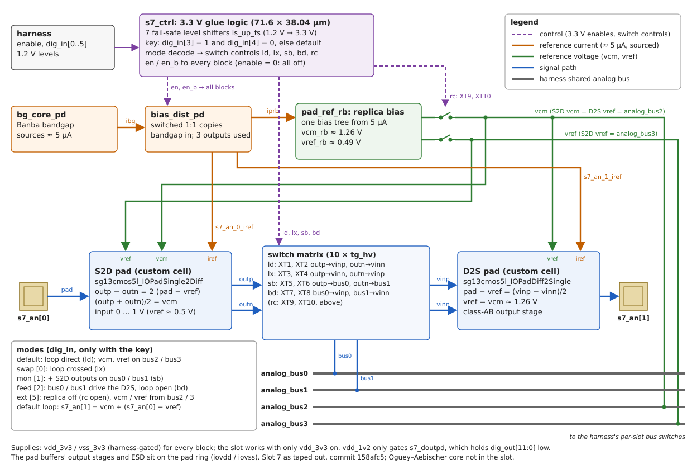
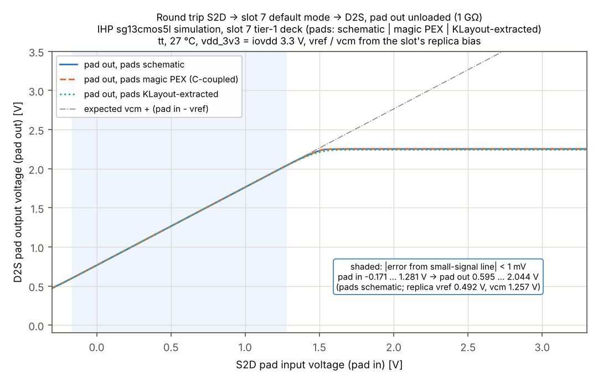
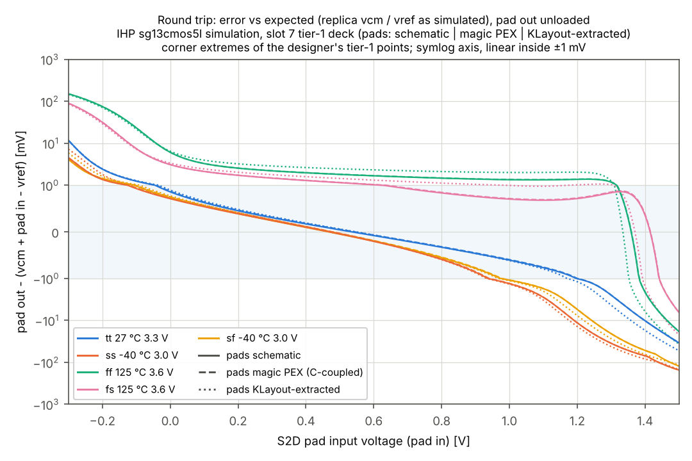
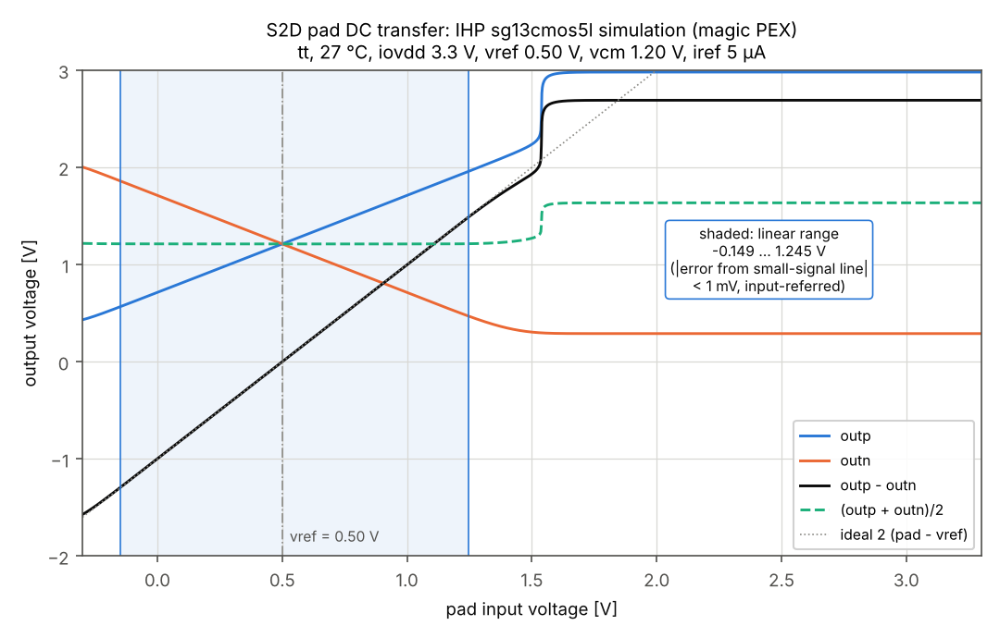
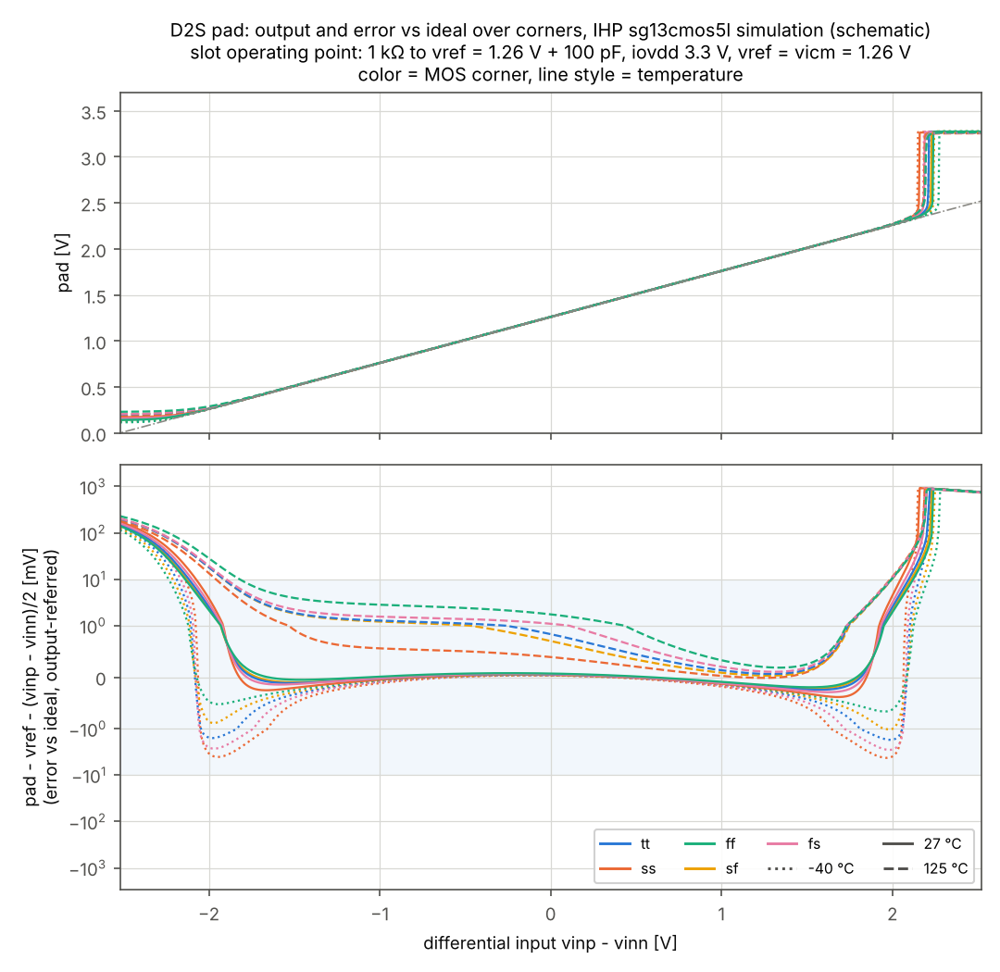
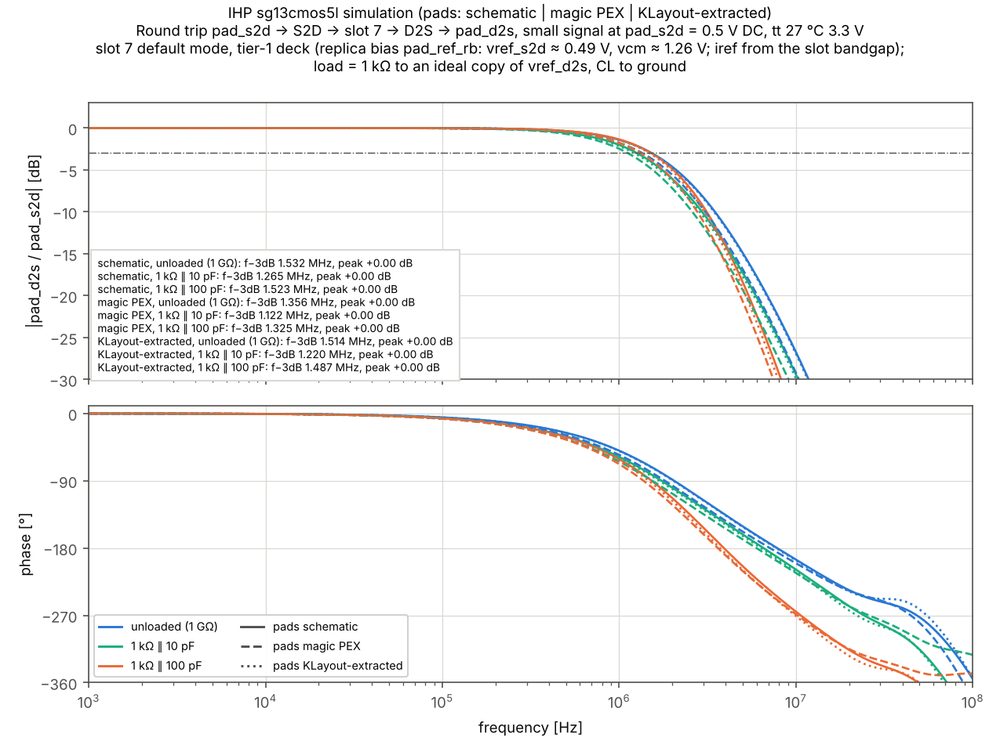
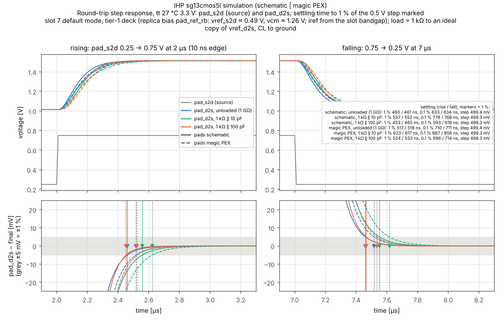
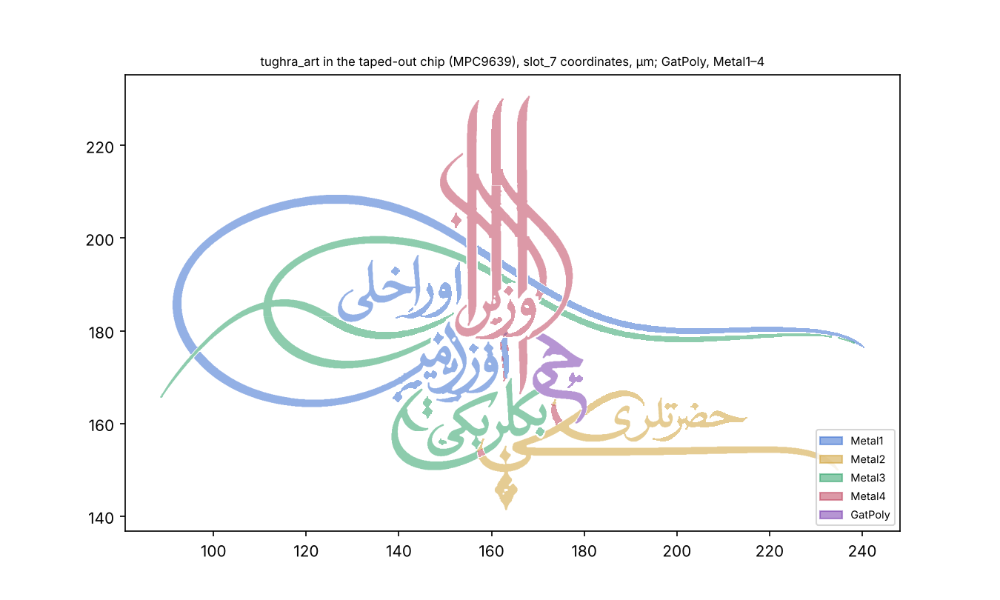

<!--
SPDX-FileCopyrightText: 2026 Christoph Maier
SPDX-License-Identifier: Apache-2.0
-->
# Slot 7: custom S2D / D2S pad pair with a bandgap-referenced replica bias (as taped out, November 2026)

Designer: Christoph Maier. Chipalooza Challenge #2 (IHP sg13cmos5l), slot 7, taped out on 2026-11-09 as commit `158afc5` of
this repository. No silicon results exist yet: every number below is a **simulation** (IHP sg13cmos5l; schematic or extracted
layout as stated), and the design had no specification before it was characterized (proof of concept).

## Slot 7 at a glance

**What it is.** Two custom analog I/O pads that turn a single-ended pad voltage into a differential pair inside the chip
(**S2D**, input pad `s7_an[0]`) and a differential pair back into a pad voltage (**D2S**, output pad `s7_an[1]`), with the gain
set by matched devices (2 and ½), not by resistors. A small on-slot bandgap, a bias distribution and a replica-bias block give
both pads their 5 µA references and their common-mode / reference voltages; 3.3 V glue with fail-safe enables selects the modes.
In the default mode the D2S pad reproduces the S2D pad voltage, shifted by `vcm − vref` ≈ 0.77 V.



*Figure 1: blocks, references and signal path (details in [§2.1](#21-signal-and-current-flow) and [glue_logic.md](glue_logic.md)).*



*Figure 2: what the slot does, end to end: D2S pad output vs S2D pad input in the default mode, tt 27 °C 3.3 V, with the
slot's own replica `vcm` / `vref`. The shaded band is the input range where the output is within 1 mV of the straight line:
−0.171 … 1.281 V in → 0.595 … 2.044 V out. Schematic, extracted (magic PEX) and KLayout-extracted pads lie on top of each
other. Above about 1.5 V input the S2D outputs saturate and the output stops at about 2.25 V.*



*Figure 3: the same as an error (pad out − expected), at the corner extremes of the slot simulation. Over the intended input
range 0 … 1 V the error is at most 0.86 mV at tt 27 °C and 6.1 mV at ff 125 °C 3.6 V.*



*Figure 4: the input pad alone (S2D, extracted layout): `outp`, `outn`, their difference (= 2 (pad − vref)) and their common
mode vs pad voltage; shaded: linear input range (error < 1 mV input-referred).*



*Figure 5: the output pad alone (D2S) at the slot's operating point (input common mode = vref = 1.26 V, 1 kΩ + 100 pF load),
5 process corners × 3 temperatures: output (top) and error from the ideal ½ (vinp − vinn) (bottom, shaded ±10 mV).*



*Figure 6: the round trip as a small-signal transfer (pad_s2d → pad_d2s), magnitude and phase, tt 27 °C 3.3 V, unloaded and with 1 kΩ ∥ 10 / 100 pF, pads schematic, magic PEX and KLayout-extracted: about 1.1 … 1.5 MHz bandwidth, no peaking. Over the 5 PVT points of the slot simulation: 1.08 … 1.69 MHz.*



*Figure 7: a 0.25 → 0.75 V step through the loop: the output settles to 1 % in 453 … 623 ns (schematic and PEX, three loads), first-order, without overshoot.*

### Key numbers (simulation)

| quantity | value | conditions | source |
|---|---|---|---|
| S2D gain (outp − outn)/(pad − vref) | 1.9985 … 1.9993 | 5 corners × 3 T × 3.0 … 3.6 V; schematic = extracted | [S2D data sheet](datasheets/sg13cmos5l_IOPadSingle2Diff.md) |
| S2D linear input range (1 mV) | −0.157 … 1.296 V at tt 27 °C 3.3 V; high end ≥ 0.980 V at every corner | vref 0.49 V, vcm 1.26 V | [DC curves](../../verification/c2_gaps/dc_curves/results.md) §1b |
| S2D −3 dB bandwidth | 1.24 … 1.67 MHz | extracted layout, 5 corners × 3 T | [S2D data sheet](datasheets/sg13cmos5l_IOPadSingle2Diff.md) |
| D2S gain pad / (vinp − vinn) | 0.4983 … 0.5000 | schematic and extracted | [DC curves](../../verification/c2_gaps/dc_curves/results.md) §2b |
| D2S INL over ±1 V differential | ≤ 0.56 mV at 3.3 V, ≤ 1.38 mV at 3.0 V | slot operating point (vicm 1.26 V), 1 kΩ | [DC curves](../../verification/c2_gaps/dc_curves/results.md) §2b |
| D2S linear output range (10 mV) | 0.211 … 2.317 V at tt 27 °C; worst 0.328 … 2.258 V | 3.3 V, slot operating point, 1 kΩ | [DC curves](../../verification/c2_gaps/dc_curves/results.md) §2b |
| D2S bandwidth, slew rate | 1.43 … 2.71 MHz, 1.59 … 2.79 V/µs | extracted layout, 10 … 300 pF | [D2S post-layout](../../verification/c2_gaps/d2s_pex/results.md) |
| round-trip bandwidth, 1 % settling | 1.08 … 1.69 MHz, no peaking; 453 … 623 ns | 5 PVT points; schematic and PEX; unloaded … 1 kΩ ∥ 100 pF | [AC / transient](../../verification/c2_gaps/ac_tran/results.md), Figures 6, 7 |
| round-trip error, pad in 0 … 1 V | ≤ 0.86 mV (tt 27 °C); ≤ 6.5 mV (ff 125 °C 3.6 V) | default mode, replica bias | [slot data sheet](datasheets/slot_7_system.md), Figure 3 |
| `vcm` / `vref` from the replica | 1.115 … 1.395 V / 0.436 … 0.596 V; mismatch σ 5.4 / 3.8 mV | corners × −40 … 125 °C × 3.0 … 3.6 V | [replica data sheet](datasheets/pad_ref_rb.md), [replica bias](../../verification/c2_gaps/replica_bias/results.md) |
| bandgap reference current | 3.83 … 6.37 µA (typ. 4.96 µA) | set by the resistor corner (−21 % / +28 %) | [bandgap](../../verification/c2_gaps/slot_modes_bg/results.md) |
| supply current, enabled | slot 48.4 … 49.7 µA; pad ring 365 … 396 µA | 5 corners | [slot data sheet](datasheets/slot_7_system.md) |
| supply current, disabled / pad leakage unpowered | slot 25 … 56 nA, ring 9 … 58 nA / ≤ 67 nA at 125 °C | | [slot data sheet](datasheets/slot_7_system.md), §2.2 |

**Verification status.** Slot layout: KLayout DRC clean, LVS match (497 devices); both pads DRC clean and KLayout LVS match
(magic LVS: only the accepted `vss` / `iovss` substrate merge); the chip GDS contains `158afc5` unchanged (XOR 0). Not done:
PEX of the whole slot, ESD / latch-up simulation of the pads, silicon measurement. The Oguey–Aebischer core `oa_core_pd` is
**not** in the taped-out slot (see [§8](#8-about-this-document-set)). Details: [§5](#5-verification-state), [signoff](../../signoff/README.md).

## Known limitations and use in a system

**In short:** an instrumentation / audio-class pad pair: about 0 … 1 V in, 0.2 … 2.3 V out, 1 … 2 MHz bandwidth, a few mV
of error, about 0.45 mA in all; loads up to 300 pF; simulated only, ESD not simulated. The details:

For reuse in a system. All simulation, no silicon; "limits" are the designer's working limits, not a specification
([achieved vs working limits](ACHIEVED_VS_LIMITS.md)).

- **S2D input range** (1 mV linear): −0.157 … 1.296 V at tt 27 °C 3.3 V with the replica's `vref` 0.49 V / `vcm` 1.26 V; high end ≥ 0.980 V at every corner, low end above 0 V (≤ 0.086 V) at 125 °C. It moves with `vref` and `vcm` and shrinks at 3.0 V (e.g. `vref` 0.5 V, `vcm` 1.65 V: 0.371 … 0.630 V); above about 1.5 V the outputs saturate ([DC curves](../../verification/c2_gaps/dc_curves/results.md) §1, §1b, §4).
- **D2S output range and linearity depend on the input common mode:** at the slot's `vicm` = `vref` = 1.26 V, 0.211 … 2.317 V at tt 27 °C, worst 0.328 … 2.258 V (3.3 V, 1 kΩ), INL ≤ 0.56 mV (≤ 1.38 mV at 3.0 V); at `vicm` 1.65 V (CACE condition) the 3.0 V range shrinks to 1.449 … 1.851 V and the INL reaches 88.4 mV ([DC curves](../../verification/c2_gaps/dc_curves/results.md) §2, §2b).
- **Loads:** simulated with 1 kΩ or open and 10 pF … 1 nF; the designer's load range is 10 … 300 pF ([HOW_IT_WORKS.md §3.3](HOW_IT_WORKS.md#33-miller-compensation-and-bandwidth)); at 1 nF the D2S peaks by 4.8 dB with 1 kΩ and 7.4 dB unloaded; at 300 pF the step overshoots up to 9.1 % ([AC / transient](../../verification/c2_gaps/ac_tran/results.md) §3, [D2S re-run](../../verification/c2_gaps/d2s_schematic_rerun/results.md) §4).
- **Bandwidth class ~1–2 MHz:** round trip 1.08 … 1.69 MHz, 1 % settling 453 … 623 ns (tt 27 °C), D2S slew 1.59 … 2.79 V/µs: an instrumentation / audio-range pad, not a fast I/O. 10 kHz THD −78 dB at tt 27 °C, −53 dB at ff 125 °C, where 0 V lies below the linear input range ([AC / transient](../../verification/c2_gaps/ac_tran/results.md) §1, [D2S post-layout](../../verification/c2_gaps/d2s_pex/results.md)).
- **Supply current:** enabled, slot `vdd_3v3` 48.4 … 49.7 µA, pad ring 365 … 396 µA (D2S unloaded); disabled 25 … 56 nA / 9 … 58 nA ([slot data sheet](datasheets/slot_7_system.md)). The pads' currents follow `iref` (D2S ring 235.6 … 380.2 µA for 3.75 … 6.25 µA, [D2S data sheet](datasheets/sg13cmos5l_IOPadDiff2Single.md)), and `iref` follows the resistor corner (3.83 … 6.37 µA, [bandgap](../../verification/c2_gaps/slot_modes_bg/results.md) §3).
- **Start-up / enable:** bandgap 0.80 … 0.83 µs after enable (90 %, ss −40 °C), replica `vcm` 0.79 … 1.81 µs, `vref` 1.03 … 2.02 µs ([§2.3](#23-the-blocks)), S2D 1.36 … 1.52 µs, D2S 0.98 … 2.39 µs (schematic … PEX); the D2S pad swings by up to +228 / −225 mV while it starts (PEX, 1 kΩ). Slot-level enable-to-settled: only ss −40 °C (`vcm` at 98 % after 1.6 µs) ([slot modes](../../verification/c2_gaps/slot_modes_bg/results.md) §1, [D2S re-run](../../verification/c2_gaps/d2s_schematic_rerun/results.md) §5, [S2D data sheet](datasheets/sg13cmos5l_IOPadSingle2Diff.md)).
- **Shared buses:** in mon the loop stays stable but is 10–30× slower while the `analog_bus0/1` switches are closed ([top-level README](../../README.md)), and the taps add a shared chip pad on `outp` / `outn` ([glue_logic.md](glue_logic.md)); bus drive was simulated through 10 kΩ only ([TEST_PLAN.md §1](TEST_PLAN.md#1-what-can-be-observed-where)). `vcm` / `vref` on `analog_bus2/3` drive gates only: read them with a high-impedance meter.
- **Mismatch:** one of 30 D2S Monte Carlo samples has gain 0.48877, below the 0.49 working limit (3.1 σ); D2S output offset −14.28 … 13.92 mV (σ 6.28 mV), S2D input offset −10.2 … 16.0 mV (σ 5.25 mV; 19.6 mV max on the extracted layout, 100 samples each, [S2D mismatch](../../verification/c2_gaps/s2d_mismatch/results.md)), more than the corner errors of the default loop (≤ 6.5 mV); no slot-level Monte Carlo ([D2S re-run](../../verification/c2_gaps/d2s_schematic_rerun/results.md) §1–2, [S2D data sheet](datasheets/sg13cmos5l_IOPadSingle2Diff.md)). The S2D numbers are from the re-run of 2026-11-25 on the taped-out netlist ([s2d_mismatch](../../verification/c2_gaps/s2d_mismatch/results.md)).
- **Not verified:** ESD and latch-up simulation of the pads (the slot's latch-up DRC rules report 0, a rule check), PEX of the whole slot, full-RC extraction of the pads and `pad_ref_rb` (C-coupled only), silicon ([§5](#5-verification-state), [HOW_IT_WORKS.md §7](HOW_IT_WORKS.md#7-what-the-sources-do-not-say), [replica bias](../../verification/c2_gaps/replica_bias/results.md)). Sign-off of the taped-out GDS, re-run 2026-11-25: KLayout DRC 0 (also with latch-up rules), LVS match (497 devices), magic + netgen as recorded; magic DRC shows 48 "Metal1 overlap of Via1" markers in `bg_core_pd` that the committed stand-alone report did not have (same cell, XOR 0: tool / PDK version, KLayout passes the same rules); antenna rules not run ([signoff/taped_out_158afc5/](../../signoff/taped_out_158afc5/README.md)).
- **Simulation-only items:** the extracted D2S (and the schematic D2S drive_params) needs ngspice `rshunt` = 1e12 to converge, ≤ 0.006 % effect on the schematic ([AC / transient](../../verification/c2_gaps/ac_tran/results.md) §4, [D2S re-run](../../verification/c2_gaps/d2s_schematic_rerun/results.md) §1); the designer's netlist converter for the KLayout-extracted pads (`run_starve.convert()`, design repo 9052bd35) simulates all pad antenna diodes at the PDK default size, 0.7 … 1.7 % of their area; this made the 10 kHz round-trip sine through those pads abort, and with the size fixed it runs and matches the schematic pads within 0.07 mV ([KLayout pad diodes](../../verification/c2_gaps/klayout_pad_diodes/README.md)); still open: the KLayout view's up-to-55 mV range-end shift (an S2D output common mode 33 mV low, not the diodes) and some ss / sf −40 °C mode and power-up runs that abort in the simulator ([§5a](#5a-gap-simulations-of-2026-11-23)).
- **CACE unit labels:** S2D `Vcm_dev` and D2S `Glitch_max` / `Glitch_min` are labeled mV but computed in V, so CACE compared them with 50 / 400 as if in V; the physical values (≤ 16.0 mV; +228 / −225 mV) are inside 50 / 400 mV ([AC / transient](../../verification/c2_gaps/ac_tran/results.md) §4).
- **Supply voltage:** characterized at 3.0 … 3.6 V; the PDK process specification gives VGS ≤ 3.3 V (maximum, 27 °C, hot-carrier lifetime) for HV devices with L ≥ 0.5 / 0.6 µm, and no maximum for the 0.45 µm switches and logic of the slot ([§2.2](#22-supplies-enable-and-fail-safe)).
- **`oa_core_pd` is not in the slot:** the only reference is `bg_core_pd` ([§8](#8-about-this-document-set)).

## Where to find what

| question | go to |
|---|---|
| How is the slot built, block by block? | [§2](#2-electrical-function); schematics: [pix/schematics/](pix/schematics/README.md); layout: [pix/layout/](pix/layout/README.md) |
| Why does it work, and how is it sized? | [HOW_IT_WORKS.md](HOW_IT_WORKS.md) (principles, design equations, sizing tables per block; plots: [pix/plots/](pix/plots/README.md)) |
| What do the modes and the `dig_in` bits do? | [§2.4](#24-modes), [glue_logic.md](glue_logic.md) |
| Which pins, where? | [§4](#4-physical-interface-and-layout-hierarchy) |
| What does each pad do, in numbers? | data sheets: [S2D](datasheets/sg13cmos5l_IOPadSingle2Diff.md), [D2S](datasheets/sg13cmos5l_IOPadDiff2Single.md), [replica bias](datasheets/pad_ref_rb.md), [whole slot](datasheets/slot_7_system.md) ([how the data sheets were made](datasheets/README.md)) |
| Frequency response, steps, noise, enable transients | [AC / transient](../../verification/c2_gaps/ac_tran/README.md) (20 figures; read `results.md` first) |
| DC transfer, input / output range, linearity | [DC curves](../../verification/c2_gaps/dc_curves/README.md) (22 figures; read `results.md` first) |
| Which working limits were met, and by what margin? | [ACHIEVED_VS_LIMITS.md](ACHIEVED_VS_LIMITS.md) (per pad and `pad_ref_rb`; working limits, not a specification) |
| What was verified, and what is open? | [§3](#3-readiness-of-the-blocks-that-were-kicked-off), [§5](#5-verification-state), [§5a](#5a-gap-simulations-of-2026-11-23), [signoff](../../signoff/README.md) |
| How to measure the chip | [TEST_PLAN.md](TEST_PLAN.md) |
| Earlier test platforms (not taped out) | [test_platforms.md](test_platforms.md) |
| Everything as PDF | [data book](pdf/slot7_databook.pdf) (summary, contents, all chapters, data sheets, figures, appendices; about 250 pages) and [data sheet in three pages](pdf/slot7_digest.pdf) ([source](DIGEST.md)); both made by [book/build_book.py](book/build_book.py) from the Markdown files |
| How this set was made; AI assistance | [§8](#8-about-this-document-set), [log.md](log.md), [../AI_ASSISTANCE.md](../AI_ASSISTANCE.md) |

## 1. Which version was taped out

| source | slot 7 commit |
|---|---|
| `config.txt` `s7_version` on `tapeout_nov_2026` | `158afc5afab0056bd6d216a4db3833e34a364949` |
| submodule gitlink at the tapeout commit `7eeb3cb` ("as taped out to IHP on November 9, 2026") | `158afc5` |
| submodule gitlink at the branch tip (commit `055993f`, after the tapeout commit, 2026-11-09 18:04 +0100) | `c072679`, an older state (the stage B test platform) |

**Taped out is `158afc5`** ([`tatzelbrumm/sg13cmos5l_cm_slot7`](https://github.com/tatzelbrumm/sg13cmos5l_cm_slot7/tree/158afc5afab0056bd6d216a4db3833e34a364949):
"slot_7 v3 + tughra art"). The gitlink at the tip of `tapeout_nov_2026` points to a different, older commit; a
`git submodule update` there checks out the stage B test platform, not the taped-out slot.

*Checked on 2026-11-22, from the chip GDS `gds/MPC9639.gds.gz` on `tapeout_nov_2026`, KLayout 0.30:*

- the cell `slot_7` of the chip has the bounding box 0,0 to 537.15 × 273 µm and, flattened and merged per layer, **is identical
  (XOR 0 on every layer) to `final/gds/slot_7.gds` of `158afc5`**; against `final/gds/slot_7.gds` of `c072679` it differs on 34 layers;
- its children are the six blocks of section 4, named with a `YX_` prefix in the chip (the harness prefixes cells on import);
- the cells `sg13cmos5l_IOPadSingle2Diff` and `sg13cmos5l_IOPadDiff2Single` of the chip equal the pad GDS of `158afc5`
  (XOR 0 on every layer, same bounding box -0.62,0 to 80.62 × 180 µm).

## 2. Electrical function

### 2.1 Signal and current flow


*Figure: signal and current flow of slot 7 as taped out (`158afc5`). Connections from the netlist as described in [glue_logic.md](glue_logic.md) (switch matrix §4, same-net joins and `bias_dist_pd` configuration §5). Generated by [`pix/make_signal_flow.py`](pix/make_signal_flow.py) (SVG; [PNG](pix/slot7_signal_flow.png)).*

The same as plain text: [pix/slot7_signal_flow.txt](pix/slot7_signal_flow.txt).

Default function (enable = 1): the pad signal at `s7_an[0]` is reproduced at `s7_an[1]`, shifted from the S2D `vref` (~0.49 V) to the D2S `vref`
(= `vcm`, ~1.26 V): D2S out = `vcm` + (S2D in − `vref`), for an input of 0 … 1 V. Swap crosses the differential pair (inverts about `vcm`).
The point of the slot is to show the two pad buffers working together with on-slot references and fail-safe enables.

### 2.2 Supplies, enable and fail-safe

- **Supplies:** `vdd_3v3` / `vss_3v3` for everything; `vdd_1v2` only gates the 12 pull-downs of `dig_out[11:0]` (`s7_doutpd`, NMOS 0.5 µm / 0.45 µm hv, held low).
  The slot works with only `vdd_3v3` switched on: the enables do not need a 1.2 V presence.
- **Enable:** harness `enable` = 1 turns the slot on in the default mode. Inside, `s7_ctrl` makes the 3.3 V enables (`en_3v3`, `en_3v3_b`) with fail-safe level
  shifters (`efs_ls_core`, 7 instances) and 3.3 V static logic (`nand2_hv` ×13, `inv_hv` ×12, `tg_hv` transmission gates ×10); all devices are 1 µm / 0.45 µm hv
  (`macros/hv_logic`: the IO and standard-cell libraries have only 1.2 V logic).
- **Disabled:** every reference output is high-Z, every distribution transmission gate open, tree nodes pulled to the rails; the slot draws leakage only, and the
  pads draw ≤ 67 nA at 125 °C from the pad ring while the slot's supplies are off (designer's simulation, `en_ctrl_3v3` starvation test: S2D ≤ 0.4 nA at −40 / 27 °C,
  ≤ 25 nA at 125 °C; D2S ≤ 4.3 nA / ≤ 67 nA; mostly output and ESD-device leakage, nearly independent of the enable levels).
- **Enabled current (tt 27 °C, simulation):** slot `vdd_3v3` ≈ 49 µA; pad ring ≈ 365–396 µA, mostly the D2S output stage.
- **Voltage limits (PDK):** the IHP process specification (`libs.doc/doc/SG13CMOS5L_os_process_spec.pdf` of the PDK, Rev. 0.2,
  §2.1.4–2.1.6) states VGS ≤ 3.3 V (maximum) at 27 °C for the HV NMOS and HV iNMOS with L ≥ 0.6 µm and the HV PMOS with
  L ≥ 0.5 µm (footnote: 1 FIT in 10 years for hot-carrier injection), and a drain–source breakdown of at least 5.2 V. The slot
  runs from 3.3 V nominal; the characterization extends to 3.6 V as a supply-tolerance corner, above that maximum. The
  switches and the 3.3 V logic of the slot are HV devices of 1 / 0.45 µm ([HOW_IT_WORKS.md](HOW_IT_WORKS.md) sizing tables), a
  gate length for which the specification states no maximum. Not assessed further here.

### 2.3 The blocks

| block | electrical function | key design facts (from the delivery repository and the design repository's READMEs) |
|---|---|---|
| `bg_core_pd` | reference-current source for everything: Banba current-mode bandgap, no op amp | pnpMPA and `rhigh`; **sources about 5 µA** out of `iout` into an NMOS input diode; high-Z when `en_3v3` = 0 (so disabled cores may share one node); 47.55 × 50.05 µm; flat over temperature and MOS corners, but follows the `rhigh` corners (about −20 % / +30 %). Power-down transistors `en_3v3` / `en_3v3_b`. Characterized in the `bias_bg_pd` and `bias_sel_pd` suites; the bg extraction has 41 nodes only capacitors touch |
| `bias_dist_pd` | switchable distribution mirror: reference currents in, one 1:1 sourced copy per pad bias tree out | input NMOS diode NI 6 µm / 6 µm → NM → PMOS diode PD 5 µm / 6 µm → outputs PO 5 µm / 6 µm; every input and output behind a transmission gate (`bdp_slice` ×8: nand2_hv + inv_hv + tg_hv); `en_3v3` = 0 opens every gate, TDN pulls `ni` to vss, SVPD pulls `vpd` to vdd; 60.49 × 16.44 µm **Added 2026-11-23:** copy accuracy and mismatch, schematic and extracted ([§5a](#5a-gap-simulations-of-2026-11-23)) |
| `pad_ref_rb` | **replica bias** of the pads' reference voltages: gives `vcm` (S2D `vcm` = D2S `vref`, center of the linear band) and `vref` (S2D `vref`, about 0.5 V) from one 5 µA reference, one bias tree, one enable, with bypass capacitors | `bias_tree_rb` (TG switch, NI 6/6, NBP 2.4/6 → BP 2/6 → `vbp`, PBNC 2/6 → BNC 1/8 → `vbnc`), `vcm_rb` (top-edge detector, fold-node replica, average, unit-device OTA buffer) and `vref_s2d_rb`; `bypass_rb` capacitors (hv NMOS to vss: vref ≈ 1297 µm²); replica devices track the pads' operating windows over process, temperature and `iovdd` at a current far below a resistive divider's. CACE results 8/8 groups; enable time vcm 0.79–1.81 µs, vref 1.03–2.02 µs, no overshoot; S2D enable kick vcm ≤ 0.112 V, vref ≤ 0.088 V; closed-loop INL S2D ≤ 1.73 mV, D2S ≤ 1.72 mV, round trip ≤ 0.75 mV (schematic, 2026-11-07) |
| `s7_ctrl` (glue logic) | master enable, key and mode decode, switch matrix (10 transmission gates), 3.3 V fail-safe level shifting of `enable` and `dig_in[0..5]` | full description, logic equations and truth table in [glue_logic.md](glue_logic.md); mode controls act only with the key `dig_in[3]` = 1, `dig_in[4]` = 0; `rc` / `ld` / `lx` / `sb` / `bd` select replica-bias connection, loop direct, crossed, S2D → buses, buses → D2S; 71.6 × 38.04 µm |
| `sg13cmos5l_IOPadSingle2Diff` (S2D pad) | buffered single-ended-in, differential-out pad: `outp − outn = 2 (pad − vref)`, `(outp + outn)/2 = vcm` | matched-pair DDA `s2d_mpdda`: four signal units on (`vin`, `vref`), (`vcm`, `vfbp`), (`vfbn`, `vcm`), a folded cascode with the outputs as the only high-impedance nodes, two units as CMFB into a cascoded PMOS diode, two 12 × 12 µm hv NMOS capacitors as load; the gain comes from how the matched units are connected, not from a resistor ratio. Own bias tree fed by `iref`; enable gates `en_3v3` / `en_3v3_b`, outputs tied to `vcm` while disabled; primary ESD: gate-tied clamps with rppd ties, diodes DP1/2, DN1/2; no secondary protection (the buffer input is the pad). Input window: unit gates ≲ `iovdd` − 1.3 V; with `vref` = 0.5 V the pad range is 0 … 1 V |
| `sg13cmos5l_IOPadDiff2Single` (D2S pad) | buffered differential-in, single-ended-out class-AB pad: `pad − vref = (vinp − vinn)/2` | Miller-compensated class-AB driver `d2s_mpdda_pd` (MP-DDA front end, folded cascode, class-AB control) driving the output stage that **is** the pad's clamp frames (OP with replica RP1 and dummy RPD in the P frame; ON with replica RN1 in the N frames); Miller capacitors CMA / CMB (hv PMOS in accumulation, 7.96 × 32.16 µm); own bias tree fed by `iref` (six bias lines), fail-safe enable, primary ESD diodes `DCNDiode` / `DCPDiode`. Headroom limits are at `iovdd` = 3.0 V **Added 2026-11-23:** magic PEX of the taped-out cell and post-layout CACE, 9 groups ([§5a](#5a-gap-simulations-of-2026-11-23)); ESD and latch-up simulation still not done |
| `s7_doutpd` (glue logic) | holds `dig_out[11:0]` low while `vdd_1v2` is on | 12 hv NMOS 0.5 / 0.45 µm, gate on `vdd_1v2`; see [glue_logic.md](glue_logic.md) |

The two pads replace the harness's analog pads `s7_an[0]` and `s7_an[1]`, so their ring pins (`iovdd iovss vdd vss`) and bond pad come from the harness
frame; the slot supplies their core-side pins (section 4).

### 2.4 Modes

`dig_in[0..5]` act only with the key `dig_in[3]` = 1 and `dig_in[4]` = 0; otherwise the default applies.

| `dig_in` | name | effect |
|---|---|---|
| none / no key | default | loop S2D → D2S direct; `analog_bus0/1` disconnected; `vcm` on `analog_bus2`, `vref` on `analog_bus3` |
| `[0]` | swap | loop crossed (polarity flip) |
| `[1]` | mon | S2D `outp` / `outn` → `analog_bus0` / `analog_bus1` (loop stays on; it is 10–30× slower while the bus switches are closed) |
| `[2]` | feed | `analog_bus0/1` → D2S `vinp` / `vinn`, loop off (wins over swap and mon); drive around `vcm` |
| `[5]` | ext | replica bias disconnected; drive `vcm` on `analog_bus2` and the S2D `vref` on `analog_bus3` |

Harness settings (delivery's `docs/FOR_TIM.md`): `proj_sel` = 7; `power_3v3_ena` on (`power_1v2_ena` only for the `dig_out`
pull-downs); `proj_ena` on; first route all `dig_in` registers to constant 0 (0x0D), then set bits through 0x0D / 0x0E;
`analog_ena[k]` (reg 0x51 bits 4…7) for the buses in use.


### 2.5 Expected values

- `vcm` ≈ 1.26 V (1.12–1.37 V over corners), `vref` ≈ 0.49 V (0.44–0.58 V); read with a high-impedance voltmeter.
- Default loop: D2S pad out = `vcm` + (S2D pad in − `vref`); error ≤ 1.3 mV (−40 / 27 °C), ≤ 6.5 mV (125 °C) for pad in 0 … 1 V. Swap: `vcm` − (in − `vref`).
- Current, enabled: slot `vdd_3v3` ≈ 49 µA, pad ring ≈ 365–396 µA (mostly the D2S output stage).
- S2D enable kick through the ext switches (tt, 27 °C): `vcm` +118 / −63 mV, `vref` +85 / −62 mV.

## 3. Readiness of the blocks that were kicked off

How each block was started, and how far it got by the tapeout. ("Pass" in the CACE results quoted below means inside the designer's *working limits*; the design is a proof of concept and had no specification. The observed intervals are in [datasheets/](datasheets/README.md).) "Kicked off" means a launch brief or cloud session recorded in the design repository (`docs/launch/`
on `harness-test`; the `sudelbuecher/cloud_sessions/` briefs and reports and the chat logs on `sudel_buecher`). Readiness is as the blocks' own reports and READMEs state it;
where a README is older than a later report, the later one is used and the stale statement is named. "In the slot" = present in the taped-out `slot_7` (section 4).

| block | kicked off by | readiness at the tapeout | open or stale |
|---|---|---|---|
| `bg_core_pd` | compact layout 2026-10-28; cloud session **C1** (30–31 Oct: DRC, LVS, PEX, mismatch in the bias verification) | in the slot. Layout, DRC clean, LVS match (29 devices / 21 nets), PEX 1/2/3 and KLayout-PEX with all ports connected (C1); no CACE suite of its own (characterized inside `bias_bg_pd` / `bias_sel_pd`). PEX does not move dc bias currents (≤ 0.02 %), but raises supply sensitivity at 100 kHz – 1 MHz (up to ×2.6) and slows settling by 40–57 % | its README still says "not yet checked with IHP's own decks" (older than C1). No mismatch model for pnpMPA. At ss / −40 °C the slot's swap and mon mode simulations stall at the bandgap's start-up node in the solver |
| `oa_core_pd` (Oguey–Aebischer) | cloud sessions **C0** (30 Oct: DRC, LVS, PEX) and **C1** | built and verified (DRC clean, LVS 28 devices / 22 nets, PEX) but **not in the taped-out slot**; used only in the test platform | the delivery repository still carries the macro and a README that says both cores are placed |
| `bias_dist_pd` | session **C4** (layout agent D, round 2, 2026-11-08) | in the slot. Layout 60.49 × 16.44 µm, KLayout DRC clean (maximal deck with latch-up 0), LVS against the flat CDL OK; schematic back-annotated from the layout; truth-table simulation only (2026-11-07) | no CACE suite; number of inputs was still "to be decided" in its README **Added 2026-11-23:** copy accuracy and mismatch ([§5a](#5a-gap-simulations-of-2026-11-23)) |
| `pad_ref_rb` (with `vcm_rb`, `vref_s2d_rb`, `bias_tree_rb`, `bypass_rb`) | session **C4** (brief `docs/launch/replica_bias_TASK.md`; 6–8 Nov; layout agents P, P3, N, F) | in the slot. Schematic CACE 8/8 groups pass (2026-11-07); layout v2 73.8 × 76.26 µm (M1/M2 only), LVS OK; used extracted in the slot's tier-1 simulation | `vcm_rb` / `vref_s2d_rb` READMEs say "Layout: not started" — superseded by `pad_ref_rb`'s layout. Monte Carlo and a PEX CACE suite not confirmed **Added 2026-11-23:** PEX (C-coupled) CACE and a 100-run mismatch Monte Carlo with per-run data ([§5a](#5a-gap-simulations-of-2026-11-23)) |
| `en_ctrl_3v3` (fail-safe enable; `efs_ls_core`) | session **C4**, v2 of 2026-11-08 (agent E) | its level-shifter core is in `s7_ctrl`; CACE 128/128 runs pass, layout DRC clean, LVS match | Monte Carlo and PEX not done |
| `s7_ctrl`, `s7_doutpd`, static ties (the glue; [glue_logic.md](glue_logic.md)) | session **C4** (slot hook-up on 2026-11-08, from the designer's mode specification; layout agent C) | in the slot. `s7_ctrl` layout DRC / LVS clean; whole slot DRC, LVS deep match (497 devices), magic + netgen match with one expected port error; modes simulated with extracted pads: all pass at tt 27 °C and ff 125 °C | built and verified within one day; `s7_doutpd` has no stand-alone verification; no PEX or fill of the whole slot; at ss −40 °C the manual modes did not converge in DC and swap / mon stall in transient (see glue_logic.md §7); no glue-level Monte Carlo |
| `sg13cmos5l_IOPadDiff2Single` (D2S pad) | cloud session **C2** (31 Oct – 3 Nov; bottom-up by agents: capacitors K, primitives P / N rebuilt as P2 / N2, floorplan F2, assembly) | taped out. Layout, backannotation, KLayout DRC clean, KLayout LVS pass, magic LVS fails only on the `vss` pin (substrate merge, accepted 2026-11-03); tier-1 simulation uses the extracted pad | the pad README lists PEX and post-layout CACE as not done and says the committed CACE results predate the layout; ESD and latch-up simulation not done **Added 2026-11-23:** PEX and post-layout CACE now done ([§5a](#5a-gap-simulations-of-2026-11-23)) |
| `sg13cmos5l_IOPadSingle2Diff` (S2D pad) | cloud session **C3** (3 Nov) | taped out. Layout, DRC clean, KLayout LVS pass, magic LVS fails only on `vss` (as D2S); magic PEX and post-layout CACE: 414/414 runs pass on both schematic and extracted views (2026-11-05) | its `FILL_IN.md` has open points |
| test platform stage A / B ([test_platforms.md](test_platforms.md); OA and BG cores, bias tree, transmission gates to `analog_bus0..3`) | cloud session **C5** (6–7 Nov; brief `docs/launch/slot7_testplatform_TASK.md`) | finished and delivered (DRC 0, LVS match, PVT simulation, harness flow on the fork), then replaced by the slot circuit on 8 Nov; **not in the taped-out slot** | the tip of `tapeout_nov_2026` still points its slot 7 gitlink at stage B (section 1) |
| delivery repository and harness test | tasks `docs/launch/slot7_delivery_repo_TASK.md`, `custom_pad_harness_test_TASK.md` | `tatzelbrumm/sg13cmos5l_cm_slot7` created; harness test of the custom-pad flow on the fork | the harness flow with the final v3 slot circuit on the delivery's branch is stated as not yet run; harness README: slot 7 wrapper rebuilt by hand ("automation ... not yet completely automated") |

Sources: the briefs and reports named above; `macros/*/README.md` of the design repository at `9052bd35` and `91a7da8b`; the slot 7 delivery repository at `158afc5`. I read
the C0 / C1 reports and the READMEs listed; I did **not** read the C2 / C3 / C4 chat logs in full, so their entries (agents, dates) are taken from the chatlog index of the design repository.

## 4. Physical interface and layout hierarchy

### 4.1 Top level

`slot_7` (537.15 × 273 µm) sits in the chip as `slot7_wrapper` in `chipalooza_frame` at (1363.85, 2153.95) µm; the origin of `slot_7` itself is at (1379.95, 2170.05) µm in chip coordinates (checked on 2026-11-22). The harness reads
`final/gds/slot_7.gds` (top cell `slot_7`) and the two custom pad cells in `pads/`. Frame and all 63 pin names, layers and
positions are the harness's; the stand-in's Metal4 stub pins were removed. LEF, `.lib` and `.vh` were not changed (`.lib` is a
pin-less stub).

- **Supplies:** `vdd_3v3` / `vss_3v3`; `vdd_1v2` only for the `dig_out` pull-downs. The slot works with only `vdd_3v3`
  switched on.
- **Enable:** `enable` = 1 selects the default mode: bandgap reference, replica bias on, loop S2D → D2S direct, `vcm` on
  `analog_bus2` and `vref` on `analog_bus3`.
- **Fail-safe:** disabled, the slot draws leakage only; with the slot's supplies off, the pads draw leakage only (≤ 67 nA at
  125 °C, simulation by the designer).
- **`dig_out[11:0]`:** held low by 12 NMOS pull-downs (`s7_doutpd`, gate on `vdd_1v2`).

Block diagram, from `docs/slot_7.md` of the delivery repository: harness `enable` and `dig_in[0..5]` → `s7_ctrl` (master enable,
mode decode, switch matrix) → bandgap core `bg_core_pd` → `bias_dist_pd` → `pad_ref_rb` (replica bias) and both custom pads;
S2D pad → D2S pad loop direct or swapped; S2D outputs on `analog_bus0/1` or D2S fed from them; `vcm` / `vref` on
`analog_bus2/3`. Picture: [`docs/slot_7.png`](../slot_7.png).

### 4.2 Pads

Two of slot 7's analog pads are replaced by custom I/O pad cells (`config.txt`):

```
s7_an[0]:  sg13cmos5l_IOPadSingle2Diff  s7_an_0
s7_an[1]:  sg13cmos5l_IOPadDiff2Single  s7_an_1
```

The remaining dedicated pins of slot 7 follow the harness defaults (slot table: 2 dedicated pins). Both cells are standalone cells
80 µm wide and 180 µm high with ring pins `iovdd iovss vdd vss` and the bond pad `pad`. In the chip they are instances in
`sg13cmos5l_padframe` (at (2080, 2260) µm for `IOPadSingle2Diff` and (2080, 2370) µm for `IOPadDiff2Single`, as KLayout reports them).
The harness imports them through `scripts/setup_custom.sh` (views looked for in `pads/<name>/`); the magic views are in
[`magic/custom_io/`](https://github.com/tatzelbrumm/sg13cmos5l_ocd_chipalooza/tree/7eeb3cb41108c5de7348050f6f69d839310f27e4/magic/custom_io) on the tapeout branch.

| cell | replaces | core-side pins, in order along the core edge | role |
|---|---|---|---|
| `sg13cmos5l_IOPadSingle2Diff` (S2D) | `s7_an[0]` | `vref outp outn vcm en_3v3 en_3v3_b iref` | pad input → differential `outp` / `outn` around `vcm` |
| `sg13cmos5l_IOPadDiff2Single` (D2S) | `s7_an[1]` | `vinp vinn vref iref en_3v3_b en_3v3` | differential `vinp` / `vinn` → pad output |

Pad-side nets on the slot, all Metal3 at the right edge of the slot (x = 535.050 … 536.450 µm, slot-local; origin lower left):

| net | pin | y0 (µm) | y1 (µm) | | net | pin | y0 (µm) | y1 (µm) |
|---|---|---|---|---|---|---|---|---|
| `s7_an_0_vref` | S2D `vref` | 112.115 | 112.405 | | `s7_an_1_vinp` | D2S `vinp` | 222.115 | 222.405 |
| `s7_an_0_outp` | S2D `outp` | 123.725 | 124.015 | | `s7_an_1_vinn` | D2S `vinn` | 222.655 | 222.945 |
| `s7_an_0_outn` | S2D `outn` | 129.825 | 130.115 | | `s7_an_1_vref` | D2S `vref` | 223.195 | 223.485 |
| `s7_an_0_vcm` | S2D `vcm` | 135.875 | 136.165 | | `s7_an_1_iref` | D2S `iref` | 260.455 | 260.745 |
| `s7_an_0_en_3v3` | S2D `en_3v3` | 142.505 | 142.795 | | `s7_an_1_en_3v3_b` | D2S `en_3v3_b` | 260.995 | 261.285 |
| `s7_an_0_en_3v3_b` | S2D `en_3v3_b` | 153.695 | 153.985 | | `s7_an_1_en_3v3` | D2S `en_3v3` | 261.535 | 261.825 |
| `s7_an_0_iref` | S2D `iref` | 159.365 | 159.655 | | | | | |

(The table is the delivery repository's pin table, copied from its README; I did not re-measure it. The harness side: in the slot the
nets `s7_an_0_vcm`, `s7_an_1_vref` and `analog_bus2` are one net, as the CDL port name `analog_bus2,s7_an_0_vcm,s7_an_1_vref` shows.)

**Known LVS note on the pads (quoted from the delivery repository):** the cell's `vss` p+ tie and the `iovss` ties share the
p-substrate, so `vss` and `iovss` are one net in the extracted layout, and magic + netgen end with "Top level cell failed pin
matching" on `vss`; accepted by the designer on 2026-11-03, everything else matches. IHP's own `IOPadAnalog` shows the same merge.

**Caveat from the harness README (tapeout branch, "Caveats"):** "Slot 7: The original analog pin in metal3 needed to be removed.
Automation rebuilding the slot wrapper with the custom pad pins has not yet been completely automated." The slot wrapper
`magic/slot7_wrapper.mag` was hand-preserved for the build; LVS is never run on the populated chip.

### 4.3 Hierarchy of `slot_7` (from `final/gds/slot_7.gds` of `158afc5`, read on 2026-11-22)

88 cells in all. Direct children of `slot_7`, each instantiated once; placement from `docs/slot_7.md`:

| block | size (µm) | placement (µm) | function | sub-cells (instances) |
|---|---|---|---|---|
| `bg_core_pd` | 47.55 × 50.05 | (330, 152.7) | Banba current-mode bandgap (pnpMPA, rhigh, no op amp); sources about 5 µA; high-Z when disabled | `bg_svpg bg_pmir_pcas_c bg_res_c bg_pnp_c bg_ms1 bg_n4` (1 each) |
| `bias_dist_pd` | 60.49 × 16.44 | (385, 183.1) | switchable distribution mirror: reference current in, one 1:1 sourced copy per pad bias tree out; each input and output switchable | `bdp_slice` ×8, `bdp_tdn bdp_svpd bdp_mirror_n bdp_mirror_p`, seven `bdp_fill*` |
| `pad_ref_rb` | 73.8 × 76.26 | (450, 150) | replica bias: one bias tree from one 5 µA reference gives `vcm` (S2D `vcm` = D2S `vref`) and `vref` (S2D `vref`) | `prb_frame_f prb_capr prb_capm prb_capt prb_capv rb_casc rb_tree_n rb_tree_p rb_tails rb_tubs rb_avg rb_mirror rb_cload` |
| `s7_ctrl` | 71.6 × 38.04 | (452, 60) | master enable, mode decode, switch matrix, fail-safe level shifting (3.3 V only) | `efs_ls_core` ×7, `bdp_nand2_hv` ×13, `bdp_inv_hv` ×12, `bdp_tg_hv` ×10 |
| `s7_doutpd` | 24.67 × 3.85 | (8, 60) | pull-downs holding `dig_out[11:0]` low | `dop_nmosHV_w0p5_l0p45` ×12 |
| `tughra_art` | 158.05 × 90.0 | (88.5, 141.3) | decorative art: floating GatPoly and Metal1–4 with no-fill markers; no device, no pin | — |

Notes:

- The art was added after v3 by `art/add_art.py`; see the aside at the end.
- **The Oguey–Aebischer core `oa_core_pd` is not in the taped-out slot.** The delivery repository still carries `macros/oa_core_pd/` (and its README
  says both cores are placed in `slot_7.gds`, which was true of the test platform); the hierarchy of the taped-out `slot_7.gds` has
  the bandgap core only. `macros/bg_core_pd/` and `macros/oa_core_pd/` in the delivery are copies of the macros, not read by the harness.
- Routing: M1/M2 stubs, M3 horizontal, M4 vertical, TopMetal1 straps for `vdd_3v3` / `vss_3v3`. Over the analog blocks only `en`,
  `en_b` and `s7_an_0_iref` cross `pad_ref_rb` (Metal3, DC), only the supply straps cross `bias_dist_pd` (designer's build log).

## 5. Verification state

By the designer, for `158afc5` (KLayout 0.30.12, PDK `ihp-sg13cmos5l`; from the delivery's `README.md` and `docs/`):

| check | result |
|---|---|
| `run_drc.py --no_density` | no violations |
| maximal deck with `-rd latchUpRules=true` | 0 |
| density | the same 7 minimum-density rules as without the art (AFil.g, GFil.g, M1–M4.j, TM1.c): unfilled slot, filled at chip level |
| LVS `run_lvs.py --run_mode=deep --disable_tap_extraction` against `netlist/slot_7.cdl` | netlists match, strict ports, 0 port errors, 497 devices |
| magic + netgen (`netlist/netgen_check.sh`) | 5 subcircuits match uniquely; top: one port error, `vss_1v2_uq0` (the frame's second `vss_1v2` strip, unconnected inside the slot, joined by the harness) |
| re-run 2026-11-25: `run_drc.py --no_density` on the taped-out GDS (sha256 `469f2327…`; KLayout 0.30.12, PDK IHP-Open-PDK `df4c5054`) | 0 violations, 0 exception lines ([`signoff/taped_out_158afc5/`](../../signoff/taped_out_158afc5/README.md)) |
| re-run 2026-11-25: maximal deck with `-rd latchUpRules=true` | 0 |
| re-run 2026-11-25: density | 7 violations, 1 each: AFil.g, GFil.g, M1–M4.j, TM1.c |
| re-run 2026-11-25: KLayout LVS deep, `--disable_tap_extraction`, vs `netlist/slot_7.cdl` | match, strict ports, 497 layout devices (376 device pairs after simplification, all Match) |
| re-run 2026-11-25: `netlist/netgen_check.sh` (magic 8.3.685, netgen 1.5.324) | 5 subcircuits match uniquely; top: one pin without partner, `vss_1v2_uq0` |
| re-run 2026-11-25: magic DRC `drc(full)` | 48 "Metal1 overlap of Via1" markers at 8 places in `bg_core_pd` (`bg_pmir_pcas_c`); the stand-alone `bg_core_pd` macro gives the same 48 with this magic, its committed report says 0: tool version, not layout |
| re-run 2026-11-25: both pads | KLayout DRC 0, maximal + latch-up 0, KLayout LVS match (against a CDL derived from `pads/*/*.spice`); magic DRC and netgen reports byte-identical to the committed ones (only the `vss` / `iovss` merge) |
| mode simulations | tt and ff pass all 8 modes; at ss / −40 °C default, feed and ext pass; **swap and mon stall at the bandgap's start-up node in the solver** (open item) |

Not done, as stated by the designer: PEX of the whole slot; fill; the harness flow with these pads and this `slot_7.gds` on the delivery's branch
(the stage B flow, with other geometry, was run on the fork). Chip level: the harness README states LVS is never run on the populated chip.
Whether the whole-chip DRC of `MPC9639` (run directories in `validate/`) is clean for slot 7 was **not** checked here.

## 5a. Gap simulations of 2026-11-23

Simulations made after the tapeout to close gaps of the characterization (IHP sg13cmos5l, ngspice-47 with the IHP OSDI models,
CACE 2.11.0, magic / netgen; reproducible with the `run.sh` of each folder from this repository plus the design-repository commits it names).
Each folder's `README.md` and `results.md` give conditions, versions and what the run does **not** show.

| folder | block | result |
|---|---|---|
| [`../../verification/c2_gaps/d2s_pex/`](../../verification/c2_gaps/d2s_pex/) | D2S pad, magic C-coupled PEX of `pads/sg13cmos5l_IOPadDiff2Single` (taped-out GDS) | netgen: circuits match uniquely (76 / 76 devices, 36 / 36 nets; `vss` tied to `iovss` as for S2D). 9 CACE groups, 127 of 127 runs, all inside the CACE working limits. Against the taped-out schematic (re-run 2026-11-25, [d2s_schematic_rerun](../../verification/c2_gaps/d2s_schematic_rerun/results.md)): bandwidth and slew rate about −11 %, settling and enable time about +10 % (enable up to +31 %); DC (gain, INL, currents, swing) unchanged. (The first comparison of 2026-11-23 used committed schematic results that predated the final schematic and showed +5 % current and up to +94 % enable time; those were not layout effects.) The extracted netlist needs the ngspice option `rshunt` = 1e12 to converge (documented there). Not done: full-RC extraction, mismatch, groups dc_3v0 / dc_sel / dc_sel3 / dc_ibias / ac_1nF |
| [`../../verification/c2_gaps/replica_bias/`](../../verification/c2_gaps/replica_bias/) | `pad_ref_rb`, `bias_dist_pd` | cells cut from `final/gds/slot_7.gds` equal the design-commit macros (XOR); netgen match. `pad_ref_rb` PEX equals schematic in DC to 0.1 mV (`vcm` 1.242 … 1.395 V, `vref` 0.436 … 0.596 V over −40 … 125 °C). Mismatch (100 runs, tt 27 °C): `vcm` σ 5.4 mV, `vref` σ 3.8 mV. `bias_dist_pd`: copy error +0.49 … +1.56 % (5 corners × 3 temperatures, 0.5 … 2.5 V), mismatch σ 1.0 … 1.2 % per output, off leakage ≤ 145 pA. Not done: AC / transient on PEX, full-RC extraction |
| [`../../verification/c2_gaps/slot_modes_bg/`](../../verification/c2_gaps/slot_modes_bg/) | slot modes at ss / −40 °C, `bg_core_pd` alone | **The ss / −40 °C failures of swap, mon, feed, ext are a simulator artifact, not a start-up problem:** the designer's run reproduces them; ngspice fails in the pads' antenna diodes, not at a bandgap node (a `.nodeset` of the bandgap fixes only mon); a power-up transient from 0 V settles in all 8 modes at ss / −40 °C / 3.0 V (bandgap node at 90 % 0.80 … 0.83 µs after enable; `vcm` 1.115 V, `vref` 0.447 V; errors 0.24 … 1.43 mV, ext 4.92 mV). `bg_core_pd` alone: no second stable state found; 1 µs and 1 ms supply ramps start at all corners; current into 0.7 V 3.829 … 6.369 µA over 135 points (typical 4.958 µA), set by the resistor corner (−21 % / +28 %), MOS corners ≤ 0.31 %, supply ≤ 0.73 %/V. Still open: several other mode × corner points abort in the simulator during the supply ramp or enable edge (tt / sf −40 °C, ss 125 °C swap), not run to a result; the converted pad netlists pass `a=` / `p=` to `dpantenna`, which expects `l` / `w`, so those diodes are simulated at default size (for the designer) |
| [`../../verification/c2_gaps/klayout_pad_diodes/`](../../verification/c2_gaps/klayout_pad_diodes/README.md) (2026-11-25) | both pads, KLayout-extracted view of the designer's tier-1 deck | **The designer's converter `run_starve.convert()` (design repo 9052bd35, lines 44–45) passes `a=` / `p=` to `dantenna` / `dpantenna`, which read only `l` / `w`: all pad diodes are simulated at 0.78 × 0.78 µm.** Together with a 37 pA step of ngspice's `darea` model at 3·n·kT/q (78 mV, 27 °C) this aborted the round-trip sine; with l / w from A / P it runs (THD −78.3 dB, within 0.07 mV of the schematic pads). AC / step change < 0.1 %. Not explained by it: the 55 mV range-end shift of this view (S2D output common mode 33 mV low) and the −40 °C mode / power-up aborts |

## 6. Files

Delivery repository [`tatzelbrumm/sg13cmos5l_cm_slot7`](https://github.com/tatzelbrumm/sg13cmos5l_cm_slot7/tree/158afc5afab0056bd6d216a4db3833e34a364949) at the taped-out commit:

- [`README.md`](https://github.com/tatzelbrumm/sg13cmos5l_cm_slot7/blob/158afc5afab0056bd6d216a4db3833e34a364949/README.md): provenance table with sha256 of every file
- [`docs/FOR_TIM.md`](../FOR_TIM.md): notes for the harness owner
- [`docs/slot_7.md`](../slot_7.md): modes, files, LVS netlists
- [`docs/PROGRESS.md`](../PROGRESS.md): dated progress log
- `final/gds/slot_7.gds`, `final/lef/slot_7.lef`, `final/lib/slot_7.lib`, `final/vh/slot_7.vh`, `pads/pads.txt`, `pads/<cell>/<cell>.{gds,spice}`
- `netlist/slot_7.cdl`, `netlist/slot_7.spice`, `netlist/slot_7_netgen.spice`, `netlist/netgen_check.sh`; `art/`

Design repository [`tatzelbrumm/sg13cmos5l_cm_ip__single2diff2single`](https://github.com/tatzelbrumm/sg13cmos5l_cm_ip__single2diff2single), the delivery cites
branch `claude/c4-replica-bias` at `9052bd35` (v3), `toplevel` at `91a7da8b` (pads) and `a45cbb55` (art): macro `macros/slot_7/`, concept and
tier-1 simulation in `docs/slot7_hookup/` (`CONCEPT.md`, `tier1/results.txt`).

*Sources of this page: the delivery repository at `158afc5`; `config.txt`, `README`, `.gitmodules` and `gds/MPC9639.gds.gz` of `tapeout_nov_2026`;
design repository file lists at the commits above. Statements marked "checked on 2026-11-22" were produced by the commands recorded in
[log.md](log.md).*
## 7. Aside: the tughra

The cell `tughra_art` is a calligraphic tughra drawn in metal and polysilicon on the otherwise empty band between the TopMetal1 straps
of the slot: a deliberate piece of die art, not a circuit. It has no device and no pin, and is not connected to anything.



*Figure: the polygons of `tughra_art` read from the chip GDS `MPC9639.gds.gz` (cell `YX_tughra_art` inside `slot_7`), drawn per layer in slot-local
coordinates. Made on 2026-11-22 with KLayout and matplotlib from the chip data, not taken from the design repository's preview.*

| item | value |
|---|---|
| cell | `tughra_art`, 158.05 × 90.0 µm; in the chip `YX_tughra_art`, once, inside `slot_7` |
| placement | (88.5, 141.3) µm in the slot; in the chip the slot origin is at (1379.95, 2170.05) µm (no rotation, no mirror), so the art is at about (1468.45, 2311.35) µm |
| layers (art) | GatPoly 2 polygons 74.2 µm²; Metal1 18 / 544.5 µm²; Metal2 7 / 272.1 µm²; Metal3 12 / 484.1 µm²; Metal4 13 / 478.4 µm² (areas read from the chip on 2026-11-22; they equal the design repository's `verify_report.md`) |
| no-fill markers | the seven `.nofill` layers (Activ, GatPoly, Metal1–4, TopMetal1; datatype 23) carry one identical box each, 85.5, 141.0 to 243.55, 231.0 µm in slot coordinates (chip: 1465.45, 2311.05 to 1623.5, 2401.05 µm) |
| filler | *checked on 2026-11-22:* inside that box the chip has **0 µm² of filler** (datatype 22) on GatPoly and Metal1–4, and the drawn areas inside the box equal the art's own areas: the art reached the tape-out unchanged and unfilled |
| source | the design repository's `art/` (`toplevel` at `a45cbb55`, "art rev 4"): `art/source/tughra_source.webp` (the picture), `build_art.py`, `verify_art.py`, `verify_report.md`, `fill_test.md`; the cell as delivered: [`art/tughra_art.gds`](../../art/tughra_art.gds) in the slot 7 repository |
| design-side checks (quoted) | XOR of slot_7 with the art removed against the original: 0 on all 39 layer/datatypes; LVS deep before and after: match, extracted netlists identical; no rule newly violated by the art in DRC with density and antenna on (the 7 density rules AFil.g, GFil.g, M1–M4.j, TM1.c are violated with and without it: unfilled slot); closest approach to existing shapes on its own layer: 36.6 µm on Metal3, more than 60 µm on the others; the PDK filler script keeps out of the marker box (filler test) |
| layers not used | no TopMetal1 art. *Checked on 2026-11-22:* the slot's TopMetal1 (4 merged polygons, the supply straps) has 0 µm² inside the marker box, so the box is a clear area of the TopMetal1 straps |

The art is why `slot_7.gds` differs from v3 (`7394d092…`) by one instance; `art/check_art_only.py` in the delivery proves it (86 sub-cells and slot_7's own shapes
and labels identical; flat XOR of the result against v3 + art = 0 on every layer, and 0 against the design repository's `art/slot7_with_art.gds`).

### 7.1 The inscription

The tughra spells, in Ottoman Turkish in Arabic script, **اوراخلی وزیر اوزدمیر جم بکلربکی حضرتلری**, *Urachlı Vezir Özdemir Cem
Beylerbeyi hazretleri*. Checked on 2026-11-25 against the source picture of the design repository (`art/source/tughra_source.webp`,
`toplevel` at `a45cbb55`), whose color legend under the calligraphy names one word per color (the build cut the legend off at
source row 897, [ART_NOTES.md](https://github.com/tatzelbrumm/sg13cmos5l_cm_ip__single2diff2single/blob/a45cbb555b9a64baebda7ad68f05b62a3dca288f/ART_NOTES.md)),
and against the chip's polygons (figure above). Each color went to one layer (art rev 4).

| word | reading | color in the source | layer on the chip | legend | calligraphy (source picture and chip) |
|---|---|---|---|---|---|
| اوراخلی | Urachlı (from Urach) | red | Metal1 | as written | as written |
| وزیر | vezir | green | Metal4 (with the three stems) | as written | as written |
| اوزدمیر | Özdemir | orange | Metal1 | as written | the letter after ز is drawn as a tall vertical stroke, the height of an alif, where the short د is expected; as drawn the word reads closer to اوزامیر |
| جم | Cem | purple | GatPoly | as written | as written, with an ornamental stroke |
| بکلربکی | beylerbeyi (Ottoman spelling *beglerbegi*) | blue | Metal3 | as written | as written |
| حضرتلری | hazretleri | gold | Metal2 | as written | as written |

The legend is in the order of the reading (right to left). The words were read from the pictures by the documentation
author; no reader of Ottoman calligraphy has checked them.


*Figure: the source picture (`art/source/tughra_source.webp` of the design repository at `a45cbb55`, converted to PNG); the legend row
below the calligraphy is not part of the art on the chip.*

### 7.2 Why a tughra

A tughra is the calligraphic monogram of an Ottoman sultan. This one gives Ottoman court titles (*vezir*, *beylerbeyi*,
*hazretleri*) to Cem Özdemir, born in Bad Urach, Minister-President of Baden-Württemberg and a former federal minister of
education. The choice is deliberate. During the challenge the designer tried to establish, by analogy, what a reviewer
expected, the equivalent of a target bandwidth and the best achievable S₂₁. The answer was an accusation of latent racism
and the advice to take the matter elsewhere. In the designer's view the accusation was unfounded; he took the matter
elsewhere: to the Minister-President.

The tughra is what latent racism looks like when it is actually there: it assigns an Ottoman court to a Swabian on the
strength of his name and his parents' origin ("Muhteşem Urach instead of Haus am Berg-Sozialpädagogik", in the designer's
words). It is not latent: it sits openly on the die, in metal.

## 8. About this document set

> **Where this set comes from.** Copied on 2026-11-23 from
> [`tatzelbrumm/sg13cmos5l_ocd_chipalooza`](https://github.com/tatzelbrumm/sg13cmos5l_ocd_chipalooza/tree/da4557a5b2ac84c6e05c5a683a019df4895b67e9/sudelbuecher/slots/slot_7),
> branch `sudel_buecher` (commit `da4557a5b2ac84c6e05c5a683a019df4895b67e9`), directory `sudelbuecher/slots/slot_7/`
> (README.md, glue_logic.md, test_platforms.md, characterization_candidates.md, log.md, datasheets/ with tools/, pix/).
> It describes slot 7 **as taped out**, i.e. this repository at commit `158afc5afab0056bd6d216a4db3833e34a364949`
> (`s7_version` in `config.txt` of the harness branch `tapeout_nov_2026`).
>
> **The Oguey–Aebischer core `oa_core_pd` is not in the taped-out slot 7.** It was built and verified (cloud sessions C0 and
> C1: DRC, LVS, PEX; section 3) and used in the stage A / B test platforms ([test_platforms.md](test_platforms.md)), but the
> taped-out `final/gds/slot_7.gds` contains only the bandgap core `bg_core_pd` (section 4.3; re-checked on 2026-11-23 with
> KLayout 0.30.12: none of the 88 cells of `final/gds/slot_7.gds` is `oa_core_pd` or one of its own sub-cells `oa_svpg`, `oa_pcas_c`, `oa_pmir_c`,
> `oa_mcs_c`, `oa_ms1`, `oa_n10`, as listed in `macros/oa_core_pd/layout/gds/oa_core_pd.gds`). `macros/oa_core_pd/`
> in this repository is a copy of the macro that no harness script reads; the statement in this repository's top-level
> README that both cores are placed in `slot_7.gds` describes the test platform, not `158afc5`.
>
> Adaptations made while copying (nothing else was changed): links to files of this repository that are unchanged since `158afc5`
> are relative (`../FOR_TIM.md`, `../slot_7.md`, `../PROGRESS.md`, `../slot_7.png`, `../../netlist/slot_7.spice`,
> `../../art/tughra_art.gds`); links to other repositories stay absolute with commits (the harness's `magic/custom_io/` now
> points to the tapeout commit `7eeb3cb`); "in this session" / "checked in this session" became "on 2026-11-22" / "checked on
> 2026-11-22" (the date of that work); the link from `datasheets/slot_7_system.md` to `glue_logic.md` was corrected to
> `../glue_logic.md`; the chat-log link in `log.md` was replaced by a path citation (chat logs are not copied); in
> `characterization_candidates.md` the cross-reference "README's section 6" was corrected to section 2.5. The measurement plan for
> the fabricated chip is [TEST_PLAN.md](TEST_PLAN.md); sign-off reports are in [`../../signoff/`](../../signoff/README.md).

Original introduction: Slot 7 turns a single-ended pad signal into a differential pair and back: two custom analog pads, a bandgap, a
bias distribution and replica-bias block that give the pads their reference currents and common-mode / reference voltages, and a small
3.3 V control block with fail-safe enables. Sections 2 and 3 are the electrical documentation and the state of readiness of each block (the glue logic, which is as important as the circuits, has its own page: [glue_logic.md](glue_logic.md));
the pins, layout hierarchy and verification follow; the tughra art is an aside at the end. Running log of how this page was assembled:
[log.md](log.md). Data for characterizing the blocks: [characterization_candidates.md](characterization_candidates.md); first data sheets built from the existing characterization: [datasheets/](datasheets/README.md); the earlier test platforms (not taped out): [test_platforms.md](test_platforms.md).
