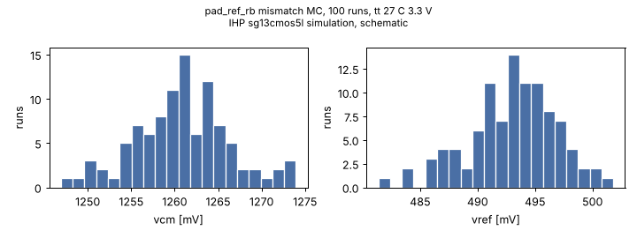
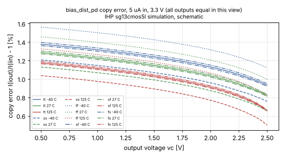

<!--
SPDX-FileCopyrightText: 2026 Christoph Maier
SPDX-License-Identifier: Apache-2.0
-->
# pad_ref_rb: replica bias of the custom pads (slot 7), characterization data sheet

> **Scope: only what was taped out.** `pad_ref_rb` is a block of the taped-out `slot_7` (73.8 × 76.26 µm at (450, 150) µm; cells `bias_tree_rb`, `vcm_rb`, `vref_s2d_rb`, bypass capacitors). The data below were simulated on its **schematic** netlist in the CACE fixture of the design repository (with `en_ctrl_3v3` and `bias_gen_pd` next to it, as in the pads' templates), 2026-11-07. Two points differ from the slot: the fixture's reference current comes from `bias_gen_pd`, which can select the Oguey–Aebischer core (present in the fixture, **not in the taped-out slot**, whose only reference is `bg_core_pd`); and the group `vcm_sel_params` is the one that exercises that selection. No extracted (PEX) view of this suite exists in the results directory (mismatch on extracted netlists is vacuous, per the CACE file's header). Whether the schematic equals the block as laid out after 2026-11-07 was not checked.

**Cell:** `pad_ref_rb`  
**Description (from the CACE file):** Replica bias of the custom pads: shared tree bias_tree_rb, vcm_rb (S2D vcm = D2S vref, centre of the linear band) and vref_s2d_rb (S2D vref, about 0.5 V), one enable  
**PDK:** ihp-sg13cmos5l  
**Designer:** Christoph Maier, CACE file created November 6, 2026  
**Source:** [`macros/pad_ref_rb/verification/cace/pad_ref_rb.yaml`](https://github.com/tatzelbrumm/sg13cmos5l_cm_ip__single2diff2single/blob/9052bd35928c6d40344e8e686c9abbe736bfadb9/macros/pad_ref_rb/verification/cace/pad_ref_rb.yaml) at design-repository commit `9052bd35`; results [`verification/cace/results/`](https://github.com/tatzelbrumm/sg13cmos5l_cm_ip__single2diff2single/tree/9052bd35928c6d40344e8e686c9abbe736bfadb9/macros/pad_ref_rb/verification/cace/results)  
**Generated:** by `datasheets/tools/make_datasheet.py` from the committed CACE files; **no simulation was run for this sheet** and nothing was re-checked against the taped-out netlist.

## Pins

| pin | type | direction | description | limits |
|---|---|---|---|---|
| `vddh` | power | inout | Supply of the block (the pads' iovdd or the slot's vdd_3v3) | Vmin 3.0 Vmax 3.6 |
| `vssh` | ground | inout | Ground of the block (the pads' iovss or the slot's vss_3v3) |  |
| `iref` | signal | input | 5 uA reference current, sourced into the block (bias_tree_rb's NMOS diode) |  |
| `vcm` | signal | output | Internal common mode of the pads, S2D vcm = D2S vref (gates of the pads only) |  |
| `vref` | signal | output | S2D pad reference, about 0.5 V (gates of the pads only) |  |
| `en_3v3` | digital | input | Enable, 3.3 V logic, active high |  |
| `en_3v3_b` | digital | input | Complement of en_3v3 |  |

## Default conditions

| condition | typical | unit | description |
|---|---|---|---|
| `vdd` | 3.3 | V | IO ring supply voltage |
| `vddl` | 1.2 | V | Core ring supply voltage |
| `corner_mos` | tt |  | Process corner MOSFET |
| `corner_r` | typ |  | Process corner resistor (bias_gen_pd's bandgap core) |
| `corner_pnp` | typ |  | Process corner PNP (bandgap core) |
| `temp` | 27 | °C | Ambient temperature |
| `sel` | 0 |  | Reference selection of bias_gen_pd (0 harness, 1 OA core, 2 bandgap) |
| `ibias` | 5e-06 | A | Harness bias current |
| `en` | 1.2 | V | en_1v2 (1.2 V enabled, 0 disabled) |

## Figures

<!-- Figures section added by hand on 2026-11-25, not produced by tools/make_datasheet.py: keep it when regenerating. -->

*vcm and vref, 100-run mismatch Monte Carlo, tt 27 °C 3.3 V (schematic): σ 5.4 mV / 3.8 mV*

*bias_dist_pd: copy error of the 5 µA reference per output over corners, temperatures and output voltage*

Schematics: [pad_ref_rb](../pix/schematics/pad_ref_rb.svg), [bias_tree_rb](../pix/schematics/bias_tree_rb.svg), [vcm_rb](../pix/schematics/vcm_rb.svg), [vref_s2d_rb](../pix/schematics/vref_s2d_rb.svg), [bypass_rb](../pix/schematics/bypass_rb.svg), [bias_dist_pd](../pix/schematics/bias_dist_pd.svg). Layout: [pad_ref_rb](../pix/layout/slot_7_pad_ref_rb.png). Post-layout (C-coupled PEX) equals the schematic in DC to 0.1 mV: [replica bias](../../../verification/c2_gaps/replica_bias/results.md).

## Specification (ex post facto, as characterized)

The design is a proof of concept and had **no specification** before it was characterized. The limits and verdicts in the CACE files (section 'CACE run summaries') are the designer's *working limits*, in part set from earlier measured bands, so *Pass* means "inside the designer's working limit", not "meets a specification". This section instead states, **ex post facto**, the interval each characterized quantity covered: the minimum and maximum over every run of the group's characterization grid (corners, temperature, supply, … as listed), the value at typical conditions (default conditions of the CACE file: tt, 27 °C, 3.3 V, typical resistor / PNP corners) where such a run exists, and the median over the group (CACE's own *typ* value). It is a description of what was simulated, **not a guarantee**; Monte Carlo rows are the observed range of the sampled iterations, not ±3σ; no silicon was measured.

### View: schematic

| group | quantity | unit | min | typ (typical conditions) | median | max | runs | where min / where max |
|---|---|---|---:|---:|---:|---:|---|---|
| vcm_dc_params | Vcm: output, iovdd 3.3 / 3.6 V | V | 1.242 | 1.261 | 1.295 | 1.395 | 30 | vdd=3.3, corner_mos=fs, temp=-40 / vdd=3.6, corner_mos=ss, temp=125 |
| vcm_dc_params | Vref | V | 0.4374 | 0.4937 | 0.4942 | 0.5964 | 30 | vdd=3.3, corner_mos=ff, temp=-40 / vdd=3.6, corner_mos=ss, temp=125 |
| vcm_dc_params | Supply current (tree + both blocks, without the reference) | uA | 18.99 | 19.08 | 19.11 | 19.26 | 30 | vdd=3.3, corner_mos=ss, temp=-40 / vdd=3.6, corner_mos=ff, temp=125 |
| vcm_dc_3v0_params | Vcm: output, iovdd 3.0 V | V | 1.12 | — | 1.15 | 1.193 | 15 | vdd=3.0, corner_mos=ss, temp=-40 / vdd=3.0, corner_mos=sf, temp=125 |
| vcm_dc_3v0_params | Vref | V | 0.4363 | — | 0.4926 | 0.5941 | 15 | vdd=3.0, corner_mos=ff, temp=-40 / vdd=3.0, corner_mos=ss, temp=125 |
| vcm_dc_3v0_params | Supply current (tree + both blocks, without the reference) | uA | 18.93 | — | 19.03 | 19.16 | 15 | vdd=3.0, corner_mos=ss, temp=-40 / vdd=3.0, corner_mos=ff, temp=125 |
| vcm_sel_params | Vcm: output, OA core / bandgap core, 3.0 V | V | 1.117 | — | 1.15 | 1.204 | 18 | vdd=3.0, sel=1, corner_mos=ss, temp=-40 / vdd=3.0, sel=1, corner_mos=ff, temp=125 |
| vcm_sel_params | Vref | V | 0.3756 | — | 0.4913 | 0.6678 | 18 | vdd=3.0, sel=1, corner_mos=ss, temp=-40 / vdd=3.0, sel=1, corner_mos=ff, temp=125 |
| vcm_sel_params | Supply current (tree + both blocks, without the reference) | uA | 11.5 | — | 18.82 | 27.97 | 18 | vdd=3.0, sel=1, corner_mos=ss, temp=-40 / vdd=3.0, sel=1, corner_mos=ff, temp=125 |
| vref_room_params | Vcm | V | 1.14 | 1.261 | 1.26 | 1.365 | 15 | vdd=3.0, corner_mos=ss, temp=27 / vdd=3.6, corner_mos=ss, temp=27 |
| vref_room_params | Vref: output at 27 C (pad range from 0 V) | V | 0.4832 | 0.4937 | 0.4937 | 0.5038 | 15 | vdd=3.0, corner_mos=ff, temp=27 / vdd=3.6, corner_mos=ss, temp=27 |
| vref_room_params | Supply current (tree + both blocks, without the reference) | uA | 19.01 | 19.08 | 19.08 | 19.16 | 15 | vdd=3.0, corner_mos=ss, temp=27 / vdd=3.6, corner_mos=ff, temp=27 |
| vref_hot_params | Vcm | V | 1.178 | — | 1.292 | 1.395 | 15 | vdd=3.0, corner_mos=fs, temp=125 / vdd=3.6, corner_mos=ss, temp=125 |
| vref_hot_params | Vref: output at 125 C (above the S2D input INL edge, <= 0.542 V) | V | 0.5724 | — | 0.5846 | 0.5964 | 15 | vdd=3.0, corner_mos=ff, temp=125 / vdd=3.6, corner_mos=ss, temp=125 |
| vref_hot_params | Supply current (tree + both blocks, without the reference) | uA | 19.12 | — | 19.18 | 19.26 | 15 | vdd=3.0, corner_mos=ss, temp=125 / vdd=3.6, corner_mos=ff, temp=125 |
| vref_cold_params | Vcm | V | 1.12 | — | 1.244 | 1.352 | 15 | vdd=3.0, corner_mos=ss, temp=-40 / vdd=3.6, corner_mos=ss, temp=-40 |
| vref_cold_params | Vref: output at -40 C (pad range from 0 V) | V | 0.4363 | — | 0.446 | 0.4553 | 15 | vdd=3.0, corner_mos=ff, temp=-40 / vdd=3.6, corner_mos=ss, temp=-40 |
| vref_cold_params | Supply current (tree + both blocks, without the reference) | uA | 18.93 | — | 19 | 19.08 | 15 | vdd=3.0, corner_mos=ss, temp=-40 / vdd=3.6, corner_mos=ff, temp=-40 |
| pd_params | Vcm: disabled | V | 1.897e-09 | — | 8.464e-08 | 3.051e-07 | 4 | en=0, vdd=3.6, corner_mos=tt, temp=27 / en=0, vdd=3.6, corner_mos=ff, temp=125 (unit scale inferred, ambiguous near 0) |
| pd_params | Vref: disabled | V | 9.403e-08 | — | 4.666e-06 | 1.651e-05 | 4 | en=0, vdd=3.6, corner_mos=tt, temp=27 / en=0, vdd=3.6, corner_mos=ff, temp=125 (unit scale inferred, ambiguous near 0) |
| pd_params | Supply current (tree + both blocks, without the reference) | uA | 7.06e-05 | — | 0.002733 | 0.009877 | 4 | en=0, vdd=3.6, corner_mos=tt, temp=27 / en=0, vdd=3.6, corner_mos=ff, temp=125 |
| mm_params | Vcm: mismatch (tt 27 C 3.3 V) | V | 1.247 | — | 1.261 | 1.274 | Monte Carlo (iterations up to 100) | CACE summary values (per-run CSV not committed) |
| mm_params | Vref: mismatch (tt 27 C 3.3 V) | V | 0.481 | — | 0.493 | 0.502 | Monte Carlo (iterations up to 100) | CACE summary values (per-run CSV not committed) |
| mm_params | Supply current (tree + both blocks, without the reference) | uA | 18.76 | — | 19.05 | 19.42 | Monte Carlo (iterations up to 100) | CACE summary values (per-run CSV not committed) |

## CACE run summaries (designer's working limits): schematic

Results directory: `verification/cace/results/pad_ref_rb`. One table per parameter group, as CACE wrote it in `summary_<group>.md` (rows with status *Skip* belong to other groups and are left out): the designer's working limits, the measured minimum / typical (median) / maximum over the runs of the group, and CACE's status against those limits (*not* a specification check). *Runs* is the number of rows of the group's CSV.

**Rows in this view:** 24 inside the working limits, 0 outside, 0 other (one row per quantity and group; not run counts).

### vcm_dc_params

*Runs:* 30  
*Swept conditions:* vdd: 3.3, 3.6; corner_mos: ss, sf, tt, fs, ff; temp: -40, 27, 125  

| quantity | working min limit | min value | typ (median) | working max limit | max value | vs working limit |
|---|---:|---:|---:|---:|---:|---|
| Vcm: output, iovdd 3.3 / 3.6 V | 1.031 V | 1.242 V | 1.295 V | 1.53 V | 1.395 V | Pass ✅ |
| Vref | any | 0.437 V | 0.494 V | any | 0.596 V | Pass ✅ |
| Supply current (tree + both blocks, without the reference) | any | 18.986 uA | 19.114 uA | 25 uA | 19.260 uA | Pass ✅ |

### vcm_dc_3v0_params

*Runs:* 15  
*Swept conditions:* vdd: 3.0; corner_mos: ss, sf, tt, fs, ff; temp: -40, 27, 125  

| quantity | working min limit | min value | typ (median) | working max limit | max value | vs working limit |
|---|---:|---:|---:|---:|---:|---|
| Vcm: output, iovdd 3.0 V | 1.031 V | 1.120 V | 1.150 V | 1.262 V | 1.193 V | Pass ✅ |
| Vref | any | 0.436 V | 0.493 V | any | 0.594 V | Pass ✅ |
| Supply current (tree + both blocks, without the reference) | any | 18.926 uA | 19.026 uA | 25 uA | 19.162 uA | Pass ✅ |

### vcm_sel_params

*Runs:* 18  
*Swept conditions:* vdd: 3.0; sel: 1, 2; corner_mos: ss, tt, ff; temp: -40, 27, 125  

| quantity | working min limit | min value | typ (median) | working max limit | max value | vs working limit |
|---|---:|---:|---:|---:|---:|---|
| Vcm: output, OA core / bandgap core, 3.0 V | 1.031 V | 1.117 V | 1.150 V | 1.244 V | 1.204 V | Pass ✅ |
| Vref | any | 0.376 V | 0.491 V | any | 0.668 V | Pass ✅ |
| Supply current (tree + both blocks, without the reference) | any | 11.504 uA | 18.817 uA | 35 uA | 27.966 uA | Pass ✅ |

### vref_room_params

*Runs:* 15  
*Swept conditions:* vdd: 3.0, 3.3, 3.6; corner_mos: ss, sf, tt, fs, ff; temp: 27  

| quantity | working min limit | min value | typ (median) | working max limit | max value | vs working limit |
|---|---:|---:|---:|---:|---:|---|
| Vcm | any | 1.140 V | 1.260 V | any | 1.365 V | Pass ✅ |
| Vref: output at 27 C (pad range from 0 V) | 0.47 V | 0.483 V | 0.494 V | 0.51 V | 0.504 V | Pass ✅ |
| Supply current (tree + both blocks, without the reference) | any | 19.013 uA | 19.079 uA | 25 uA | 19.160 uA | Pass ✅ |

### vref_hot_params

*Runs:* 15  
*Swept conditions:* vdd: 3.0, 3.3, 3.6; corner_mos: ss, sf, tt, fs, ff; temp: 125  

| quantity | working min limit | min value | typ (median) | working max limit | max value | vs working limit |
|---|---:|---:|---:|---:|---:|---|
| Vcm | any | 1.178 V | 1.292 V | any | 1.395 V | Pass ✅ |
| Vref: output at 125 C (above the S2D input INL edge, <= 0.542 V) | 0.55 V | 0.572 V | 0.585 V | 0.7 V | 0.596 V | Pass ✅ |
| Supply current (tree + both blocks, without the reference) | any | 19.125 uA | 19.185 uA | 25 uA | 19.260 uA | Pass ✅ |

### vref_cold_params

*Runs:* 15  
*Swept conditions:* vdd: 3.0, 3.3, 3.6; corner_mos: ss, sf, tt, fs, ff; temp: -40  

| quantity | working min limit | min value | typ (median) | working max limit | max value | vs working limit |
|---|---:|---:|---:|---:|---:|---|
| Vcm | any | 1.120 V | 1.244 V | any | 1.352 V | Pass ✅ |
| Vref: output at -40 C (pad range from 0 V) | 0.35 V | 0.436 V | 0.446 V | 0.5 V | 0.455 V | Pass ✅ |
| Supply current (tree + both blocks, without the reference) | any | 18.926 uA | 18.997 uA | 25 uA | 19.083 uA | Pass ✅ |

### pd_params

*Runs:* 4  
*Swept conditions:* en: 0; vdd: 3.6; corner_mos: tt, ff; temp: 27, 125  

| quantity | working min limit | min value | typ (median) | working max limit | max value | vs working limit |
|---|---:|---:|---:|---:|---:|---|
| Vcm: disabled | any | 0.000 V | 0.000 V | 0.001 V | 0.000 V | Pass ✅ |
| Vref: disabled | any | 0.000 V | 0.000 V | 0.001 V | 0.000 V | Pass ✅ |
| Supply current (tree + both blocks, without the reference) | any | 0.000 uA | 0.003 uA | 0.1 uA | 0.010 uA | Pass ✅ |

### mm_params

*Runs:* 0 rows in the committed CSV (header only: the per-run data were not committed; the values below are CACE's own summary)  
*Swept conditions:* iterations: 1 … 100 (step 1); corner_mos: tt_mismatch; temp: 27  

| quantity | working min limit | min value | typ (median) | working max limit | max value | vs working limit |
|---|---:|---:|---:|---:|---:|---|
| Vcm: mismatch (tt 27 C 3.3 V) | 1.2 V | 1.247 V | 1.261 V | 1.32 V | 1.274 V | Pass ✅ |
| Vref: mismatch (tt 27 C 3.3 V) | 0.47 V | 0.481 V | 0.493 V | 0.52 V | 0.502 V | Pass ✅ |
| Supply current (tree + both blocks, without the reference) | any | 18.762 uA | 19.051 uA | 25 uA | 19.419 uA | Pass ✅ |

## What is not in this sheet

- Any group that has no CSV or summary in the results directory (not run, or run in another view).
- Whether the simulated netlist equals the block as taped out (see `../characterization_candidates.md`).
- Monte Carlo statistics beyond what the group's own summary reports (min / typ / max over the runs).
- Measurements on silicon: none exist at the time of writing.
