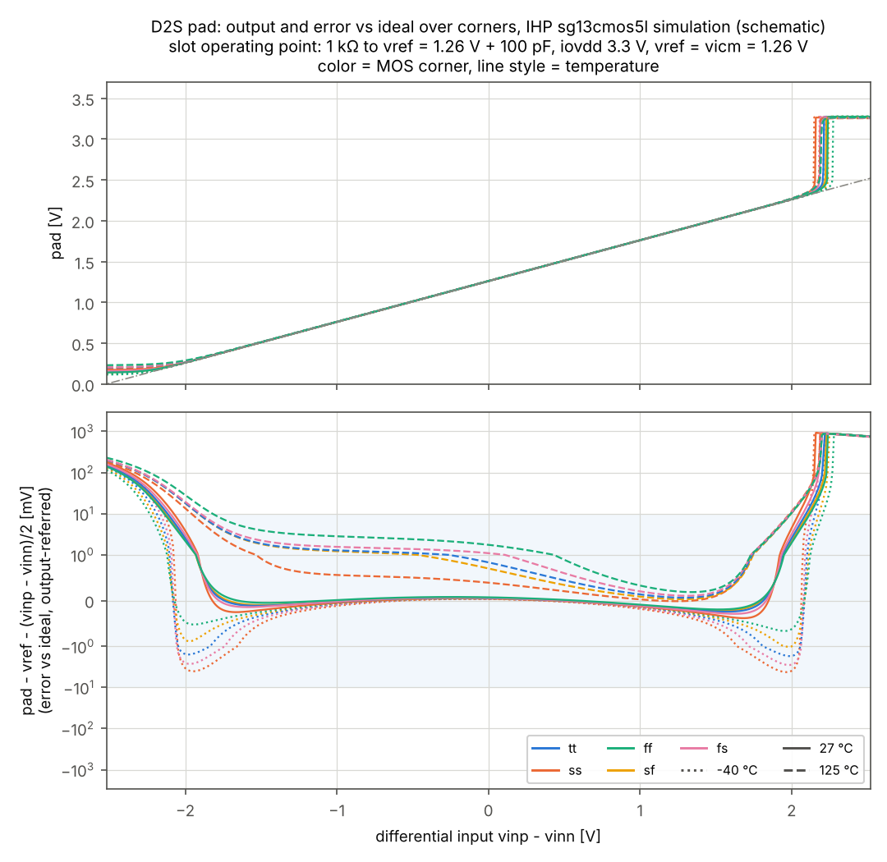
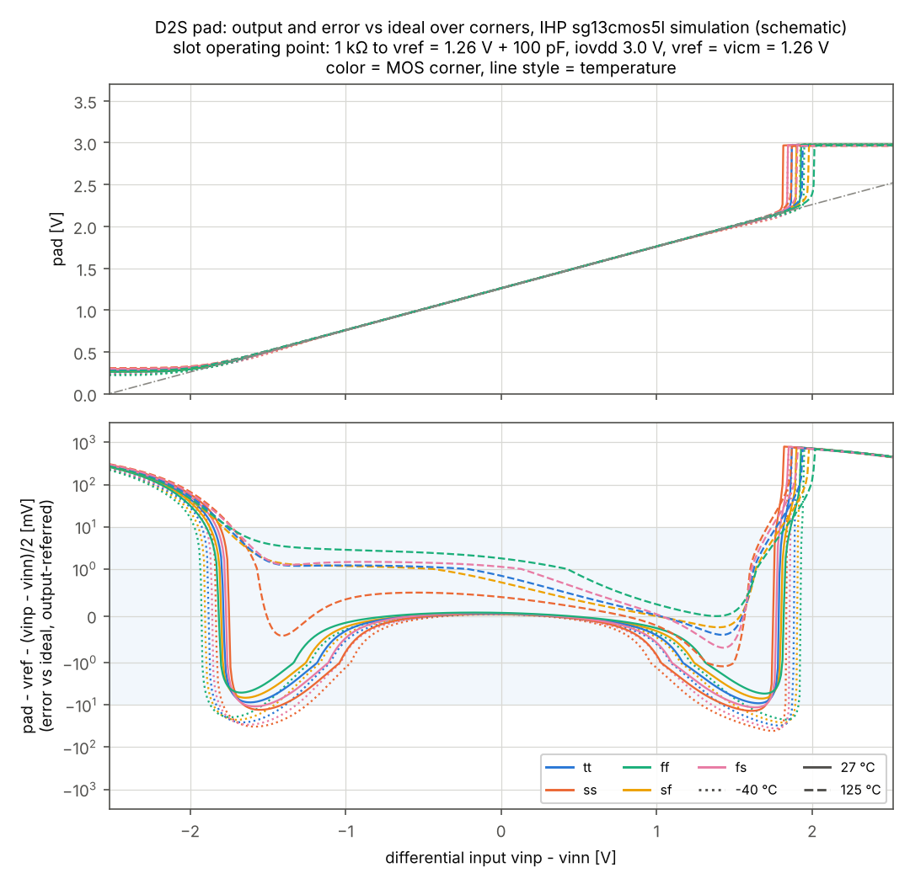
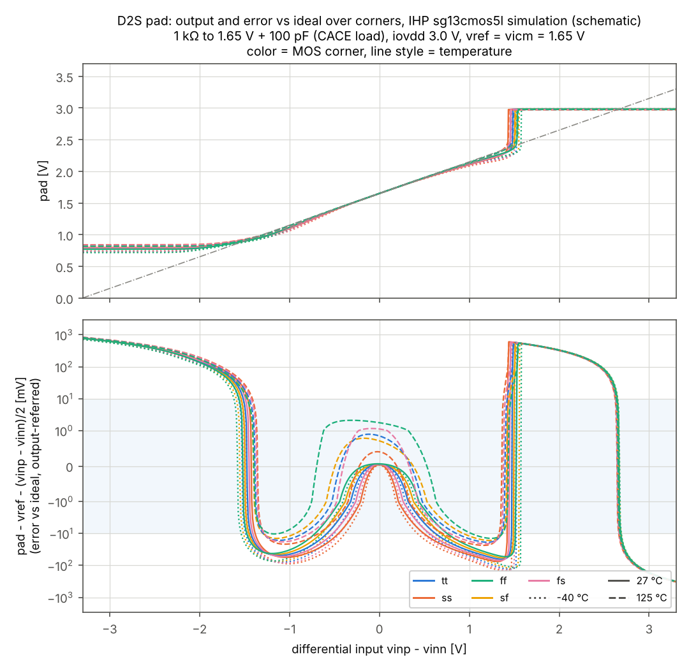
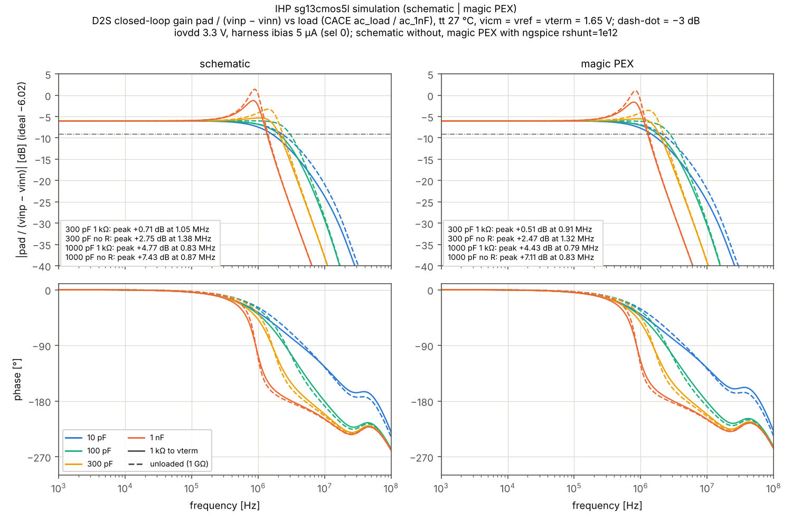
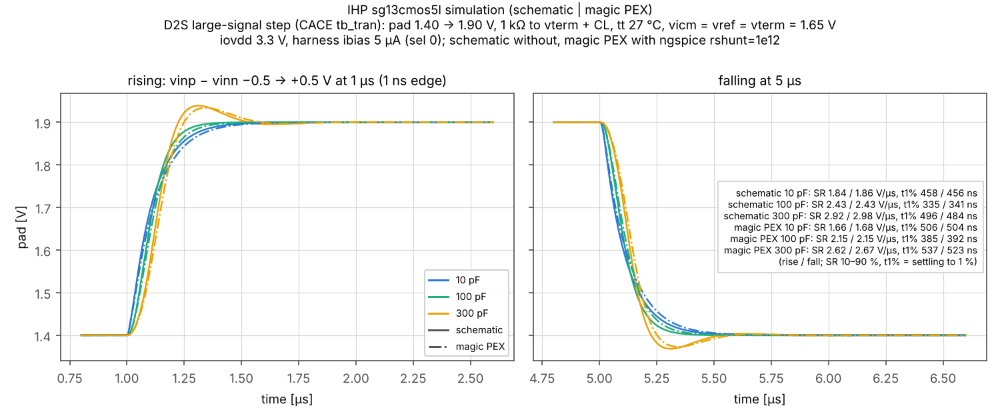
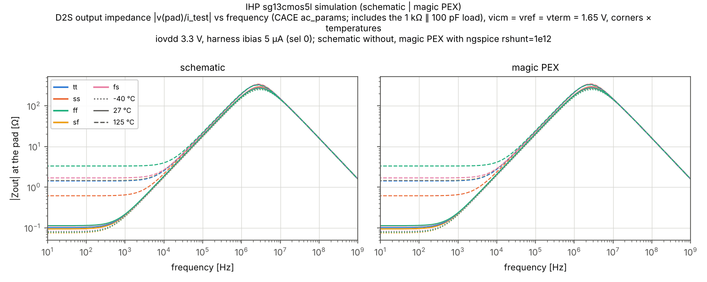

<!--
SPDX-FileCopyrightText: 2026 Christoph Maier
SPDX-License-Identifier: Apache-2.0
-->
# sg13cmos5l_IOPadDiff2Single (D2S pad, s7_an[1]): characterization data sheet

> **Scope: only what was taped out.** `sg13cmos5l_IOPadDiff2Single` is the pad cell that replaces `s7_an[1]` in the taped-out slot 7; the delivery's `pads/` files are copies from the design repository's `toplevel` at `91a7da8b`, the commit used here, and the chip GDS contains the cell unchanged (checked). The tables below are a **re-run of the full CACE suite (15 groups) on the schematic as taped out** (2026-11-25, [d2s_schematic_rerun](../../../verification/c2_gaps/d2s_schematic_rerun/README.md)): the netlist CACE simulates is, line for line, the cell's LVS netlist `pads/sg13cmos5l_IOPadDiff2Single/sg13cmos5l_IOPadDiff2Single.spice` (LVS-matched to the GDS), plus the simulation-only substrate tie `Rsub` (vss to iovss, 1 Ω, `lvs_ignore=open`). They replace the schematic results committed in the design repository (2026-10-21), which predate the final schematic (changed until 2026-11-03) and differ from these by more than 2 % in many quantities ([old vs new](../../../verification/c2_gaps/d2s_schematic_rerun/results.md)). The yaml, templates and working limits are those of `91a7da8b`, unchanged. Post-layout (magic PEX) values of the same cell: [D2S post-layout](../../../verification/c2_gaps/d2s_pex/results.md).

**Cell:** `sg13cmos5l_IOPadDiff2Single`  
**Description (from the CACE file):** Differential-in, single-ended-out class-AB buffered pad with selectable bias and fail-safe enable  
**PDK:** ihp-sg13cmos5l  
**Designer:** Christoph Maier, CACE file created October 20, 2026  
**Source:** [`macros/sg13cmos5l_IOPadDiff2Single/verification/cace/sg13cmos5l_IOPadDiff2Single.yaml`](https://github.com/tatzelbrumm/sg13cmos5l_cm_ip__single2diff2single/blob/91a7da8b67ac56a26c605501146667a1fde28c32/macros/sg13cmos5l_IOPadDiff2Single/verification/cace/sg13cmos5l_IOPadDiff2Single.yaml) at design-repository commit `91a7da8b`; results: the schematic re-run of 2026-11-25, [`verification/c2_gaps/d2s_schematic_rerun/csv/`](../../../verification/c2_gaps/d2s_schematic_rerun/csv) (this repository)  
**Generated:** by `datasheets/tools/make_datasheet.py` from the CACE results of the schematic re-run of 2026-11-25 ([README](../../../verification/c2_gaps/d2s_schematic_rerun/README.md), [old vs new](../../../verification/c2_gaps/d2s_schematic_rerun/results.md)): CACE 2.11 with the design repository's yaml and templates at `91a7da8b`, unchanged; the simulated netlist is the taped-out cell's LVS netlist plus the simulation-only Rsub (vss to iovss, 1 Ω).

## Pins

| pin | type | direction | description | limits |
|---|---|---|---|---|
| `iovdd` | power | inout | IO ring supply (front end, bias, output stage OP) | Vmin 3.0 Vmax 3.6 |
| `iovss` | ground | inout | IO ring ground (output stage ON, front end, bias) |  |
| `vdd` | power | inout | 1.2 V core ring (not connected inside the cell; feeds the level shifters of en_ctrl_3v3 next to it) | Vmin 1.08 Vmax 1.32 |
| `vss` | ground | inout | core ring ground (not connected inside the cell) |  |
| `pad` | signal | inout | Pad (bond pad, drains of the clamp-frame output devices, primary diodes) |  |
| `vinp` | signal | input | Differential input, positive (pad - vref = (vinp - vinn) / 2) |  |
| `vinn` | signal | input | Differential input, negative |  |
| `vref` | signal | input | Output reference voltage |  |
| `iref` | signal | input | Reference current into the bias tree (sourced, 5 uA nominal; from bias_gen_pd next to the cell) |  |
| `en_3v3` | digital | input | Enable, 3.3 V logic, active high (from en_ctrl_3v3 next to the cell) |  |
| `en_3v3_b` | digital | input | Complement of en_3v3, 3.3 V logic (from en_ctrl_3v3 next to the cell) |  |

## Default conditions

| condition | typical | unit | description |
|---|---|---|---|
| `vdd` | 3.3 | V | IO ring supply voltage |
| `vddl` | 1.2 | V | Core ring supply voltage |
| `vref` | 1.65 | V | Output reference voltage |
| `vicm` | 1.65 | V | Input common-mode voltage |
| `corner_mos` | tt |  | Process corner MOSFET |
| `corner_r` | typ |  | Process corner resistor |
| `corner_pnp` | typ |  | Process corner PNP |
| `temp` | 27 | °C | Ambient temperature |
| `sel` | 0 |  | Bias selection (0 harness, 1 OA, 2 bandgap, 3 both) |
| `ibias` | 5e-06 | A | Harness bias current |
| `rload` | 1000 | Ω | Load resistance, pad to vterm |
| `vterm` | 1.65 | V | Load termination voltage |
| `cload` | 1e-10 | F | Load capacitance, pad to ground |

## Figures

<!-- Figures section added by hand on 2026-11-25, not produced by tools/make_datasheet.py: keep it when regenerating. -->

*Output and error vs the ideal ½ (vinp − vinn) at the slot's operating point (vicm = vref = 1.26 V, 1 kΩ + 100 pF), 5 corners × 3 temperatures, 3.3 V (schematic; extracted layout within 0.7 mV)*

*The same at iovdd 3.0 V: INL over ±1 V stays ≤ 1.38 mV at this operating point*

*Linear output range (error < 10 mV) per corner and supply at the slot's operating point*

*For comparison: the CACE test condition vicm = vref = 1.65 V at 3.0 V, where the 87 mV INL of the CACE table comes from (headroom at this common mode, not at the slot's)*

*Closed-loop −3 dB bandwidth per corner, schematic vs extracted layout*

*Frequency response at the CACE loads 10 / 100 / 300 pF and 1 nF, 1 kΩ and unloaded: peaking appears at 1 nF (4.8 dB with 1 kΩ, 7.4 dB unloaded); fresh schematic run of the taped-out circuit and PEX*

*Large-signal steps at 10 / 100 / 300 pF (slew 1.84 / 2.43 / 2.92 V/µs at tt)*

*Output impedance vs frequency*

Schematics: [pad top](../pix/schematics/sg13cmos5l_IOPadDiff2Single.svg), [driver d2s_mpdda_pd](../pix/schematics/d2s_mpdda_pd.svg), [output stage P](../pix/schematics/d2s_out_p.svg), [output stage N](../pix/schematics/d2s_out_n.svg), [bias tree](../pix/schematics/bias_tree_pd.svg). Layout: [all layers](../pix/layout/IOPadDiff2Single.png), [Metal2 and below](../pix/layout/IOPadDiff2Single_frontend.png). Post-layout CACE of all groups: [D2S post-layout](../../../verification/c2_gaps/d2s_pex/results.md) (this sheet's tables are schematic only).

## Specification (ex post facto, as characterized)

The design is a proof of concept with an **ad hoc specification**: the limits and verdicts in the CACE files (section 'CACE run summaries'), the working limits written during the AI-assisted design, in part set from earlier measured bands. *Pass* means "inside that working limit"; where the taped-out design does not meet it is listed in [../ACHIEVED_VS_LIMITS.md](../ACHIEVED_VS_LIMITS.md). This section instead states, **ex post facto**, the interval each characterized quantity covered: the minimum and maximum over every run of the group's characterization grid (corners, temperature, supply, … as listed), the value at typical conditions (default conditions of the CACE file: tt, 27 °C, 3.3 V, typical resistor / PNP corners) where such a run exists, and the median over the group (CACE's own *typ* value). It is a description of what was simulated, **not a guarantee**; Monte Carlo rows are the observed range of the sampled iterations, not ±3σ; no silicon was measured.

### View: schematic

| group | quantity | unit | min | typ (typical conditions) | median | max | runs | where min / where max |
|---|---|---|---:|---:|---:|---:|---|---|
| dc_params | Gain |  | 0.4983 | 0.4999 | 0.5 | 0.5 | 30 | corner_mos=ff, temp=125, vdd=3.3 / corner_mos=ff, temp=27, vdd=3.6 |
| dc_params | Output offset | mV | 0.03202 | 0.05152 | 0.06727 | 1.737 | 30 | corner_mos=ss, temp=-40, vdd=3.3 / corner_mos=ff, temp=125, vdd=3.6 |
| dc_params | Integral nonlinearity | mV | 0.1208 | 1.376 | 0.4504 | 7.5 | 30 | corner_mos=ss, temp=125, vdd=3.6 / corner_mos=ss, temp=-40, vdd=3.3 |
| dc_params | IO ring supply current | uA | 301.7 | 308.4 | 311.3 | 325.3 | 30 | corner_mos=ss, temp=125, vdd=3.3 / corner_mos=ff, temp=-40, vdd=3.6 |
| dc_params | Core ring supply current | nA | 0.008253 | 0.1185 | 0.1185 | 23.89 | 30 | corner_mos=ss, temp=-40, vdd=3.6 / corner_mos=ff, temp=125, vdd=3.3 |
| dc_params | Quiescent current OP | uA | 216.6 | 222.9 | 225.5 | 238.6 | 30 | corner_mos=ss, temp=125, vdd=3.3 / corner_mos=ff, temp=-40, vdd=3.6 |
| dc_params | Quiescent current ON | uA | 216.2 | 222.8 | 225 | 238.5 | 30 | corner_mos=ss, temp=125, vdd=3.3 / corner_mos=ff, temp=-40, vdd=3.6 |
| dc_params | Minimum output-device current | uA | 104.7 | 111 | 113.3 | 120.3 | 30 | corner_mos=ss, temp=-40, vdd=3.3 / corner_mos=ff, temp=27, vdd=3.6 |
| dc_3v0_params | Gain |  | 0.4982 | — | 0.5 | 0.5002 | 15 | corner_mos=ff, temp=125, vdd=3.0 / corner_mos=ss, temp=-40, vdd=3.0 |
| dc_3v0_params | Output offset | mV | 0.03151 | — | 0.04833 | 1.769 | 15 | corner_mos=ss, temp=-40, vdd=3.0 / corner_mos=ff, temp=125, vdd=3.0 |
| dc_3v0_params | Integral nonlinearity | mV | 11.1 | — | 44.95 | 88.42 | 15 | corner_mos=ff, temp=125, vdd=3.0 / corner_mos=ss, temp=-40, vdd=3.0 |
| dc_3v0_params | IO ring supply current | uA | 295.8 | — | 301.1 | 308.8 | 15 | corner_mos=ss, temp=125, vdd=3.0 / corner_mos=ff, temp=-40, vdd=3.0 |
| dc_3v0_params | Core ring supply current | nA | 0.008253 | — | 0.1185 | 23.89 | 15 | corner_mos=ss, temp=-40, vdd=3.0 / corner_mos=ff, temp=125, vdd=3.0 |
| dc_3v0_params | Quiescent current OP | uA | 211 | — | 216.1 | 223.3 | 15 | corner_mos=ss, temp=125, vdd=3.0 / corner_mos=ff, temp=-40, vdd=3.0 |
| dc_3v0_params | Quiescent current ON | uA | 210.6 | — | 216 | 223.2 | 15 | corner_mos=ss, temp=125, vdd=3.0 / corner_mos=ff, temp=-40, vdd=3.0 |
| dc_3v0_params | Minimum output-device current | uA | 62.83 | — | 82.96 | 100.7 | 15 | corner_mos=ss, temp=-40, vdd=3.0 / corner_mos=ff, temp=125, vdd=3.0 |
| dc_sel_params | Gain |  | 0.4983 | 0.4999 | 0.4999 | 0.5 | 9 | sel=1, temp=125, corner_r=typ, corner_pnp=typ / sel=1, temp=-40, corner_r=typ, corner_pnp=typ |
| dc_sel_params | Output offset | mV | 0.02405 | 0.05152 | 0.05125 | 2.439 | 9 | sel=1, temp=-40, corner_r=typ, corner_pnp=typ / sel=1, temp=125, corner_r=typ, corner_pnp=typ |
| dc_sel_params | Integral nonlinearity | mV | 0.1978 | 1.376 | 1.343 | 4.098 | 9 | sel=1, temp=-40, corner_r=typ, corner_pnp=typ / sel=1, temp=125, corner_r=typ, corner_pnp=typ |
| dc_sel_params | IO ring supply current | uA | 214.5 | 308.4 | 311.4 | 412.3 | 9 | sel=1, temp=-40, corner_r=typ, corner_pnp=typ / sel=1, temp=125, corner_r=typ, corner_pnp=typ |
| dc_sel_params | Core ring supply current | nA | 0.01551 | 0.1185 | 0.1381 | 7.038 | 9 | sel=2, temp=-40, corner_r=typ, corner_pnp=typ / sel=1, temp=125, corner_r=typ, corner_pnp=typ |
| dc_sel_params | Quiescent current OP | uA | 152.5 | 222.9 | 220.8 | 288.7 | 9 | sel=1, temp=-40, corner_r=typ, corner_pnp=typ / sel=1, temp=125, corner_r=typ, corner_pnp=typ |
| dc_sel_params | Quiescent current ON | uA | 152.5 | 222.8 | 220.7 | 286.2 | 9 | sel=1, temp=-40, corner_r=typ, corner_pnp=typ / sel=1, temp=125, corner_r=typ, corner_pnp=typ |
| dc_sel_params | Minimum output-device current | uA | 71.31 | 111 | 110.1 | 149.9 | 9 | sel=1, temp=-40, corner_r=typ, corner_pnp=typ / sel=1, temp=125, corner_r=typ, corner_pnp=typ |
| dc_sel3_params | Gain |  | 0.4935 | — | 0.4998 | 0.5 | 3 | sel=3, temp=125 / sel=3, temp=-40 |
| dc_sel3_params | Output offset | mV | 0.06448 | — | 0.46 | 11.99 | 3 | sel=3, temp=-40 / sel=3, temp=125 |
| dc_sel3_params | Integral nonlinearity | mV | 33.98 | — | 47.83 | 51.74 | 3 | sel=3, temp=-40 / sel=3, temp=27 |
| dc_sel3_params | IO ring supply current | uA | 505 | — | 606.8 | 703.5 | 3 | sel=3, temp=-40 / sel=3, temp=125 |
| dc_sel3_params | Core ring supply current | nA | 0.003347 | — | 0.1578 | 9.245 | 3 | sel=3, temp=-40 / sel=3, temp=125 |
| dc_sel3_params | Quiescent current OP | uA | 351.1 | — | 420 | 488.6 | 3 | sel=3, temp=-40 / sel=3, temp=125 |
| dc_sel3_params | Quiescent current ON | uA | 351 | — | 419.5 | 476.6 | 3 | sel=3, temp=-40 / sel=3, temp=125 |
| dc_sel3_params | Minimum output-device current | uA | 185.4 | — | 227.6 | 270.8 | 3 | sel=3, temp=-40 / sel=3, temp=125 |
| dc_ibias_params | Gain |  | 0.4999 | 0.4999 | 0.4999 | 0.5 | 3 | ibias=6.25e-06 / ibias=3.75e-06 |
| dc_ibias_params | Output offset | mV | 0.03564 | 0.05152 | 0.05152 | 0.07783 | 3 | ibias=3.75e-06 / ibias=6.25e-06 |
| dc_ibias_params | Integral nonlinearity | mV | 0.2003 | 1.376 | 1.376 | 6.266 | 3 | ibias=3.75e-06 / ibias=6.25e-06 |
| dc_ibias_params | IO ring supply current | uA | 235.6 | 308.4 | 308.4 | 380.2 | 3 | ibias=3.75e-06 / ibias=6.25e-06 |
| dc_ibias_params | Core ring supply current | nA | 0.1185 | 0.1185 | 0.1185 | 0.1185 | 3 | ibias=3.75e-06 / ibias=3.75e-06 |
| dc_ibias_params | Quiescent current OP | uA | 171.1 | 222.9 | 222.9 | 273.8 | 3 | ibias=3.75e-06 / ibias=6.25e-06 |
| dc_ibias_params | Quiescent current ON | uA | 171 | 222.8 | 222.8 | 273.7 | 3 | ibias=3.75e-06 / ibias=6.25e-06 |
| dc_ibias_params | Minimum output-device current | uA | 83.45 | 111 | 111 | 140.1 | 3 | ibias=3.75e-06 / ibias=6.25e-06 |
| ac_params | Closed-loop gain | dB | -6.05 | -6.021 | -6.021 | -6.021 | 15 | corner_mos=ff, temp=125 / corner_mos=sf, temp=-40 |
| ac_params | Bandwidth | MHz | 1.762 | 2.001 | 2.001 | 2.245 | 15 | corner_mos=ff, temp=-40 / corner_mos=ss, temp=125 |
| ac_params | Gain peaking | dB | 5.347e-08 | 1.257e-06 | 8.238e-07 | 1.607e-06 | 15 | corner_mos=fs, temp=125 / corner_mos=ff, temp=-40 (unit scale inferred, ambiguous near 0) |
| ac_params | PSRR iovdd 1 kHz | dB | 70.64 | 71.54 | 71.54 | 72.51 | 15 | corner_mos=ff, temp=-40 / corner_mos=ss, temp=125 |
| ac_params | PSRR iovdd 100 kHz | dB | 30.71 | 31.6 | 31.6 | 32.53 | 15 | corner_mos=ff, temp=-40 / corner_mos=ss, temp=125 |
| ac_params | CMRR 1 kHz | dB | 95.19 | 125 | 125 | 128.4 | 15 | corner_mos=ff, temp=125 / corner_mos=sf, temp=-40 |
| ac_params | Output impedance 1 kHz | Ω | 0.1891 | 0.2094 | 0.2094 | 3.302 | 15 | corner_mos=ss, temp=-40 / corner_mos=ff, temp=125 |
| ac_params | Output impedance 1 MHz | Ω | 154.7 | 167.4 | 167.4 | 200.8 | 15 | corner_mos=ff, temp=-40 / corner_mos=ff, temp=125 |
| ac_load_params | Bandwidth | MHz | 1.574 | 2.001 | 2.144 | 2.984 | 6 | cload=1e-11, rload=1000 / cload=1e-10, rload=1000000000.0 |
| ac_load_params | Gain peaking | dB | 1.257e-06 | 1.257e-06 | 0.008028 | 2.749 | 6 | cload=1e-11, rload=1000 / cload=3e-10, rload=1000000000.0 |
| ac_1nF_params | Bandwidth, 1 nF | MHz | 1.35 | 1.35 | 1.373 | 1.396 | 2 | cload=1e-09, rload=1000 / cload=1e-09, rload=1000000000.0 |
| ac_1nF_params | Gain peaking, 1 nF | dB | 4.771 | 4.771 | 6.099 | 7.427 | 2 | cload=1e-09, rload=1000 / cload=1e-09, rload=1000000000.0 |
| tran_params | Slew rate, rising | V/us | 1.749 | 2.429 | 2.429 | 3.058 | 9 | corner_mos=ff, cload=1e-11 / corner_mos=ss, cload=3e-10 |
| tran_params | Slew rate, falling | V/us | 1.764 | 2.429 | 2.429 | 3.135 | 9 | corner_mos=ff, cload=1e-11 / corner_mos=ss, cload=3e-10 |
| tran_params | Overshoot | % | -6e-05 | 0.0001 | 0.0001 | 9.115 | 9 | corner_mos=ff, cload=1e-11 / corner_mos=ss, cload=3e-10 |
| tran_params | Settling time, rising | us | 0.3027 | 0.4581 | 0.4581 | 0.6761 | 9 | corner_mos=ss, cload=1e-10 / corner_mos=ss, cload=3e-10 |
| tran_params | Settling time, falling | us | 0.3107 | 0.4564 | 0.4564 | 0.4965 | 9 | corner_mos=ss, cload=1e-10 / corner_mos=ff, cload=3e-10 |
| thd_params | THD | dB | -73.33 | -57.68 | -57.68 | -38.66 | 3 | vdamp=0.5 / vdamp=1.5 |
| thd_params | Output amplitude | V | 0.25 | 0.5 | 0.5 | 0.7504 | 3 | vdamp=0.5 / vdamp=1.5 |
| noise_params | Output noise 1 kHz | nV/rtHz | 605.1 | 678.8 | 678.8 | 715.4 | 3 | temp=125 / temp=-40 |
| noise_params | Output noise 100 kHz | nV/rtHz | 142.6 | 152.6 | 152.6 | 156.5 | 3 | temp=125 / temp=-40 |
| noise_params | Integrated output noise | uV | 223.3 | 234.6 | 234.6 | 235.6 | 3 | temp=125 / temp=-40 |
| drive_params | Max output | V | 3.266 | — | 3.275 | 3.283 | 10 | corner_mos=ss, temp=125 / corner_mos=ff, temp=-40 |
| drive_params | Min output | V | 0.6354 | — | 0.6823 | 0.7359 | 10 | corner_mos=ff, temp=-40 / corner_mos=ss, temp=125 |
| drive_params | Short-circuit source current | mA | 49.71 | — | 67.05 | 93.31 | 10 | corner_mos=ss, temp=125 / corner_mos=ff, temp=-40 |
| drive_params | Short-circuit sink current | mA | 54.77 | — | 82.97 | 124.2 | 10 | corner_mos=ss, temp=125 / corner_mos=ff, temp=-40 |
| pd_params | IO ring current, off | nA | 0.04787 | 298.6 | 257.5 | 642.2 | 48 | pdstate=0, vpad=3.3, corner_mos=tt, temp=27 / pdstate=2, vpad=0, corner_mos=ff, temp=27 |
| pd_params | Core ring current, off | nA | -0 | 0.1087 | 0.6509 | 23.89 | 48 | pdstate=3, vpad=0, corner_mos=tt, temp=27 / pdstate=1, vpad=0, corner_mos=ff, temp=125 |
| pd_params | Pad leakage, off | nA | -36.83 | 0.5018 | 0.1758 | 14.94 | 48 | pdstate=0, vpad=0, corner_mos=ff, temp=125 / pdstate=0, vpad=3.3, corner_mos=ff, temp=125 |
| pd_params | vdd1v2_sense current | nA | -0 | 1.271e-05 | 1.271e-05 | 905.5 | 48 | pdstate=1, vpad=0, corner_mos=tt, temp=27 / pdstate=2, vpad=0, corner_mos=ff, temp=27 |
| pd_params | vdd3v3_sense current | nA | -0 | 7.133e-05 | 0.0001149 | 1114 | 48 | pdstate=2, vpad=0, corner_mos=tt, temp=27 / pdstate=1, vpad=0, corner_mos=ff, temp=27 |
| pd_params | Internal enable | V | 2.688e-10 | 2.791e-10 | 1.392e-07 | 7.104e-07 | 48 | pdstate=3, vpad=0, corner_mos=tt, temp=27 / pdstate=0, vpad=0, corner_mos=ff, temp=125 (unit scale inferred, ambiguous near 0) |
| enable_params | Turn-on time | us | 0.982 | 0.982 | 1.228 | 1.819 | 3 | sel=0, tstop=6e-05 / sel=1, tstop=6e-05 |
| enable_params | Enable glitch, positive | mV | 121.6 | 121.6 | 124.4 | 225.5 | 3 | sel=0, tstop=6e-05 / sel=1, tstop=6e-05 |
| enable_params | Enable glitch, negative | mV | -176.6 | -104.3 | -112.8 | -104.3 | 3 | sel=1, tstop=6e-05 / sel=0, tstop=6e-05 |
| enable_params | IO ring current after start-up | uA | 308.4 | 308.4 | 315.6 | 315.8 | 3 | sel=0, tstop=6e-05 / sel=2, tstop=6e-05 |
| mm_params | Output offset - mismatch | mV | -14.28 | — | 1.323 | 13.92 | 30 | iterations=29.0, corner_mos=tt_mismatch, corner_r=typ_mismatch / iterations=17.0, corner_mos=tt_mismatch, corner_r=typ_mismatch |
| mm_params | Gain - mismatch |  | 0.4888 | — | 0.5003 | 0.5051 | 30 | iterations=28.0, corner_mos=tt_mismatch, corner_r=typ_mismatch / iterations=13.0, corner_mos=tt_mismatch, corner_r=typ_mismatch |
| mm_params | Quiescent current OP - mismatch | uA | 197.4 | — | 220.5 | 243.7 | 30 | iterations=29.0, corner_mos=tt_mismatch, corner_r=typ_mismatch / iterations=15.0, corner_mos=tt_mismatch, corner_r=typ_mismatch |

## CACE run summaries (designer's working limits): schematic

Results directory: [`verification/c2_gaps/d2s_schematic_rerun/csv/`](../../../verification/c2_gaps/d2s_schematic_rerun/csv) (this repository; schematic re-run of 2026-11-25). One table per parameter group, as CACE wrote it in `summary_<group>.md` (rows with status *Skip* belong to other groups and are left out): the designer's working limits, the measured minimum / typical (median) / maximum over the runs of the group, and CACE's status against those limits (*not* a specification check). *Runs* is the number of rows of the group's CSV.

**Rows in this view:** 78 inside the working limits, 1 outside, 0 other (one row per quantity and group; not run counts).

### dc_params

*Runs:* 30  
*Swept conditions:* corner_mos: ss, sf, tt, fs, ff; temp: -40, 27, 125; vdd: 3.3, 3.6  

| quantity | working min limit | min value | typ (median) | working max limit | max value | vs working limit |
|---|---:|---:|---:|---:|---:|---|
| Gain | 0.49 | 0.498347 | 0.4999555 | 0.51 | 0.500001 | Pass ✅ |
| Output offset | -5 mV | 0.032 mV | 0.067 mV | 5 mV | 1.737 mV | Pass ✅ |
| Integral nonlinearity | any | 0.121 mV | 0.450 mV | 10 mV | 7.500 mV | Pass ✅ |
| IO ring supply current | any | 301.743 uA | 311.309 uA | 400 uA | 325.273 uA | Pass ✅ |
| Core ring supply current | any | 0.008 nA | 0.118 nA | 100 nA | 23.889 nA | Pass ✅ |
| Quiescent current OP | 150 uA | 216.609 uA | 225.515 uA | 300 uA | 238.608 uA | Pass ✅ |
| Quiescent current ON | 150 uA | 216.218 uA | 224.987 uA | 300 uA | 238.540 uA | Pass ✅ |
| Minimum output-device current | 30 uA | 104.694 uA | 113.305 uA | any | 120.294 uA | Pass ✅ |

### dc_3v0_params

*Runs:* 15  
*Swept conditions:* corner_mos: ss, sf, tt, fs, ff; temp: -40, 27, 125; vdd: 3.0  

| quantity | working min limit | min value | typ (median) | working max limit | max value | vs working limit |
|---|---:|---:|---:|---:|---:|---|
| Gain | 0.49 | 0.498241 | 0.499951 | 0.51 | 0.500198 | Pass ✅ |
| Output offset | -5 mV | 0.032 mV | 0.048 mV | 5 mV | 1.769 mV | Pass ✅ |
| Integral nonlinearity | any | 11.101 mV | 44.951 mV | any | 88.418 mV | Pass ✅ |
| IO ring supply current | any | 295.799 uA | 301.128 uA | 400 uA | 308.780 uA | Pass ✅ |
| Core ring supply current | any | 0.008 nA | 0.118 nA | 100 nA | 23.889 nA | Pass ✅ |
| Quiescent current OP | 150 uA | 211.035 uA | 216.067 uA | 300 uA | 223.260 uA | Pass ✅ |
| Quiescent current ON | 150 uA | 210.630 uA | 216.017 uA | 300 uA | 223.219 uA | Pass ✅ |
| Minimum output-device current | 30 uA | 62.832 uA | 82.958 uA | any | 100.660 uA | Pass ✅ |

### dc_sel_params

*Runs:* 9  
*Swept conditions:* sel: 0, 1, 2; temp: -40, 27, 125; corner_r: typ; corner_pnp: typ  

| quantity | working min limit | min value | typ (median) | working max limit | max value | vs working limit |
|---|---:|---:|---:|---:|---:|---|
| Gain | 0.49 | 0.498256 | 0.499949 | 0.51 | 0.499963 | Pass ✅ |
| Output offset | -5 mV | 0.024 mV | 0.051 mV | 5 mV | 2.439 mV | Pass ✅ |
| Integral nonlinearity | any | 0.198 mV | 1.343 mV | 10 mV | 4.098 mV | Pass ✅ |
| IO ring supply current | any | 214.484 uA | 311.448 uA | 500 uA | 412.328 uA | Pass ✅ |
| Core ring supply current | any | 0.016 nA | 0.138 nA | 100 nA | 7.038 nA | Pass ✅ |
| Quiescent current OP | 100 uA | 152.511 uA | 220.774 uA | 350 uA | 288.669 uA | Pass ✅ |
| Quiescent current ON | 100 uA | 152.486 uA | 220.721 uA | 350 uA | 286.226 uA | Pass ✅ |
| Minimum output-device current | 30 uA | 71.308 uA | 110.133 uA | any | 149.940 uA | Pass ✅ |

### dc_sel3_params

*Runs:* 3  
*Swept conditions:* sel: 3; temp: -40, 27, 125  

| quantity | working min limit | min value | typ (median) | working max limit | max value | vs working limit |
|---|---:|---:|---:|---:|---:|---|
| Gain | any | 0.493545 | 0.499828 | any | 0.499956 | Pass ✅ |
| Output offset | any | 0.064 mV | 0.460 mV | any | 11.991 mV | Pass ✅ |
| Integral nonlinearity | any | 33.980 mV | 47.827 mV | any | 51.740 mV | Pass ✅ |
| IO ring supply current | any | 505.001 uA | 606.765 uA | any | 703.523 uA | Pass ✅ |
| Core ring supply current | any | 0.003 nA | 0.158 nA | any | 9.245 nA | Pass ✅ |
| Quiescent current OP | any | 351.081 uA | 419.977 uA | any | 488.585 uA | Pass ✅ |
| Quiescent current ON | any | 351.015 uA | 419.514 uA | any | 476.590 uA | Pass ✅ |
| Minimum output-device current | any | 185.406 uA | 227.583 uA | any | 270.762 uA | Pass ✅ |

### dc_ibias_params

*Runs:* 3  
*Swept conditions:* ibias: 3.75e-06, 5e-06, 6.25e-06  

| quantity | working min limit | min value | typ (median) | working max limit | max value | vs working limit |
|---|---:|---:|---:|---:|---:|---|
| Gain | 0.49 | 0.499938 | 0.499949 | 0.51 | 0.499957 | Pass ✅ |
| Output offset | any | 0.036 mV | 0.052 mV | any | 0.078 mV | Pass ✅ |
| Integral nonlinearity | any | 0.200 mV | 1.376 mV | any | 6.266 mV | Pass ✅ |
| IO ring supply current | any | 235.593 uA | 308.420 uA | any | 380.242 uA | Pass ✅ |
| Core ring supply current | any | 0.118 nA | 0.118 nA | any | 0.118 nA | Pass ✅ |
| Quiescent current OP | 120 uA | 171.053 uA | 222.889 uA | 350 uA | 273.750 uA | Pass ✅ |
| Quiescent current ON | 120 uA | 171.015 uA | 222.835 uA | 350 uA | 273.670 uA | Pass ✅ |
| Minimum output-device current | any | 83.449 uA | 111.023 uA | any | 140.139 uA | Pass ✅ |

### ac_params

*Runs:* 15  
*Swept conditions:* corner_mos: ss, sf, tt, fs, ff; temp: -40, 27, 125  

| quantity | working min limit | min value | typ (median) | working max limit | max value | vs working limit |
|---|---:|---:|---:|---:|---:|---|
| Closed-loop gain | -6.2 dB | -6.050 dB | -6.021 dB | -5.85 dB | -6.021 dB | Pass ✅ |
| Bandwidth | 1 MHz | 1.762 MHz | 2.001 MHz | any | 2.245 MHz | Pass ✅ |
| Gain peaking | any | 0.000 dB | 0.000 dB | 1 dB | 0.000 dB | Pass ✅ |
| PSRR iovdd 1 kHz | 60 dB | 70.639 dB | 71.538 dB | any | 72.513 dB | Pass ✅ |
| PSRR iovdd 100 kHz | 25 dB | 30.711 dB | 31.596 dB | any | 32.527 dB | Pass ✅ |
| CMRR 1 kHz | 70 dB | 95.194 dB | 124.952 dB | any | 128.380 dB | Pass ✅ |
| Output impedance 1 kHz | any | 0.189 Ω | 0.209 Ω | 10 Ω | 3.302 Ω | Pass ✅ |
| Output impedance 1 MHz | any | 154.708 Ω | 167.400 Ω | 300 Ω | 200.809 Ω | Pass ✅ |

### ac_load_params

*Runs:* 6  
*Swept conditions:* cload: 1e-11, 1e-10, 3e-10; rload: 1000, 1000000000.0  

| quantity | working min limit | min value | typ (median) | working max limit | max value | vs working limit |
|---|---:|---:|---:|---:|---:|---|
| Bandwidth | 1 MHz | 1.574 MHz | 2.144 MHz | any | 2.985 MHz | Pass ✅ |
| Gain peaking | any | 0.000 dB | 0.008 dB | 4 dB | 2.749 dB | Pass ✅ |

### ac_1nF_params

*Runs:* 2  
*Swept conditions:* cload: 1e-09; rload: 1000, 1000000000.0  

| quantity | working min limit | min value | typ (median) | working max limit | max value | vs working limit |
|---|---:|---:|---:|---:|---:|---|
| Bandwidth, 1 nF | any | 1.350 MHz | 1.373 MHz | any | 1.396 MHz | Pass ✅ |
| Gain peaking, 1 nF | any | 4.771 dB | 6.099 dB | any | 7.427 dB | Pass ✅ |

### tran_params

*Runs:* 9  
*Swept conditions:* corner_mos: ss, tt, ff; cload: 1e-11, 1e-10, 3e-10  

| quantity | working min limit | min value | typ (median) | working max limit | max value | vs working limit |
|---|---:|---:|---:|---:|---:|---|
| Slew rate, rising | 1 V/us | 1.749 V/us | 2.429 V/us | any | 3.058 V/us | Pass ✅ |
| Slew rate, falling | 1 V/us | 1.764 V/us | 2.429 V/us | any | 3.135 V/us | Pass ✅ |
| Overshoot | any | -0.000 % | 0.000 % | 15 % | 9.115 % | Pass ✅ |
| Settling time, rising | any | 0.303 us | 0.458 us | 1 us | 0.676 us | Pass ✅ |
| Settling time, falling | any | 0.311 us | 0.456 us | 1 us | 0.497 us | Pass ✅ |

### thd_params

*Runs:* 3  
*Swept conditions:* vdamp: 0.5, 1, 1.5  

| quantity | working min limit | min value | typ (median) | working max limit | max value | vs working limit |
|---|---:|---:|---:|---:|---:|---|
| THD | any | -73.328 dB | -57.681 dB | -35 dB | -38.665 dB | Pass ✅ |
| Output amplitude | any | 0.250 V | 0.500 V | any | 0.750 V | Pass ✅ |

### noise_params

*Runs:* 3  
*Swept conditions:* temp: -40, 27, 125  

| quantity | working min limit | min value | typ (median) | working max limit | max value | vs working limit |
|---|---:|---:|---:|---:|---:|---|
| Output noise 1 kHz | any | 605.104 nV/rtHz | 678.804 nV/rtHz | 1000 nV/rtHz | 715.419 nV/rtHz | Pass ✅ |
| Output noise 100 kHz | any | 142.647 nV/rtHz | 152.586 nV/rtHz | 200 nV/rtHz | 156.469 nV/rtHz | Pass ✅ |
| Integrated output noise | any | 223.267 uV | 234.582 uV | 300 uV | 235.615 uV | Pass ✅ |

### drive_params

*Runs:* 10  
*Swept conditions:* corner_mos: ss, sf, tt, fs, ff; temp: -40, 125  

| quantity | working min limit | min value | typ (median) | working max limit | max value | vs working limit |
|---|---:|---:|---:|---:|---:|---|
| Max output | 3.0 V | 3.266 V | 3.275 V | any | 3.283 V | Pass ✅ |
| Min output | any | 0.635 V | 0.682 V | 0.9 V | 0.736 V | Pass ✅ |
| Short-circuit source current | 20 mA | 49.714 mA | 67.051 mA | any | 93.306 mA | Pass ✅ |
| Short-circuit sink current | 20 mA | 54.769 mA | 82.966 mA | any | 124.222 mA | Pass ✅ |

### pd_params

*Runs:* 48  
*Swept conditions:* pdstate: 0, 1, 2, 3; vpad: 0, 1.65, 3.3; corner_mos: tt, ff; temp: 27, 125  

| quantity | working min limit | min value | typ (median) | working max limit | max value | vs working limit |
|---|---:|---:|---:|---:|---:|---|
| IO ring current, off | any | 0.048 nA | 257.533 nA | 1000 nA | 642.210 nA | Pass ✅ |
| Core ring current, off | any | -0.000 nA | 0.651 nA | 100 nA | 23.890 nA | Pass ✅ |
| Pad leakage, off | -100 nA | -36.833 nA | 0.176 nA | 100 nA | 14.941 nA | Pass ✅ |
| vdd1v2_sense current | any | -0.000 nA | 0.000 nA | 2000 nA | 905.451 nA | Pass ✅ |
| vdd3v3_sense current | any | -0.000 nA | 0.000 nA | 2000 nA | 1114.270 nA | Pass ✅ |
| Internal enable | any | 0.000 V | 0.000 V | 0.1 V | 0.000 V | Pass ✅ |

### enable_params

*Runs:* 3  
*Swept conditions:* sel: 0, 1, 2; tstop: 6e-05  

| quantity | working min limit | min value | typ (median) | working max limit | max value | vs working limit |
|---|---:|---:|---:|---:|---:|---|
| Turn-on time | any | 0.982 us | 1.228 us | 5 us | 1.819 us | Pass ✅ |
| Enable glitch, positive | any | 121.649 mV | 124.381 mV | 400 mV | 225.546 mV | Pass ✅ |
| Enable glitch, negative | -400 mV | -176.583 mV | -112.755 mV | any | -104.350 mV | Pass ✅ |
| IO ring current after start-up | 200 uA | 308.421 uA | 315.629 uA | 400 uA | 315.825 uA | Pass ✅ |

### mm_params

*Runs:* 30  
*Swept conditions:* iterations: 1 … 30 (step 1); corner_mos: tt_mismatch; corner_r: typ_mismatch  

| quantity | working min limit | min value | typ (median) | working max limit | max value | vs working limit |
|---|---:|---:|---:|---:|---:|---|
| Output offset - mismatch | -20 mV | -14.280 mV | 1.323 mV | 20 mV | 13.919 mV | Pass ✅ |
| Gain - mismatch | 0.49 | 0.488768 | 0.5003495 | 0.51 | 0.505081 | Fail ❌ |
| Quiescent current OP - mismatch | 100 uA | 197.351 uA | 220.496 uA | 400 uA | 243.710 uA | Pass ✅ |

## Notes

- **Re-run, not the committed results.** Every table of this sheet comes from the CACE re-run of 2026-11-25 on the taped-out schematic (CACE 2.11, ngspice-47 with the IHP OSDI models, IHP-Open-PDK `df4c5054`); the working limits and verdicts are those of the unchanged CACE file at `91a7da8b`. Differences to the earlier, committed results: [old vs new](../../../verification/c2_gaps/d2s_schematic_rerun/results.md).
- **Solver aid:** drive_params ran with ngspice `.option rshunt=1e12` (1 TΩ from every node to ground): without it 3 of its 10 runs (tt, sf, ff at −40 °C) gave no result (DC sweep not converging, or no progress after 15 min); on the 7 runs that converge both ways it changes the results by ≤ 0.0002 %. All other groups ran exactly as the templates are (pd_params with the template's own rshunt=1e14).
- **mm_params** now has its per-iteration data (the committed CSV had a header only, because CACE 2.11 nests the iterations one level deeper than the design repository's `cace_to_csv.py` expects), so its specification rows are min / median / max over the iterations of the CSV, not CACE's summary.
- **Units:** the CSV column labels are those of the design repository's `cace_to_csv.py` and are not reliable (several hold SI values under a display-unit label, e.g. `Vos_out[mV]` and `t_on[us]` hold V and s); the generator rescales each column to the unit of CACE's own summary.

## What is not in this sheet

- Any group that has no CSV or summary in the results directory (not run, or run in another view).
- Post-layout values (magic PEX of the taped-out GDS): [D2S post-layout](../../../verification/c2_gaps/d2s_pex/results.md) (the simulated schematic netlist was checked against the taped-out LVS netlist: [netcheck.txt](../../../verification/c2_gaps/d2s_schematic_rerun/netcheck.txt)).
- Monte Carlo statistics beyond what the group's own summary reports (min / typ / max over the runs).
- Measurements on silicon: none exist at the time of writing.
