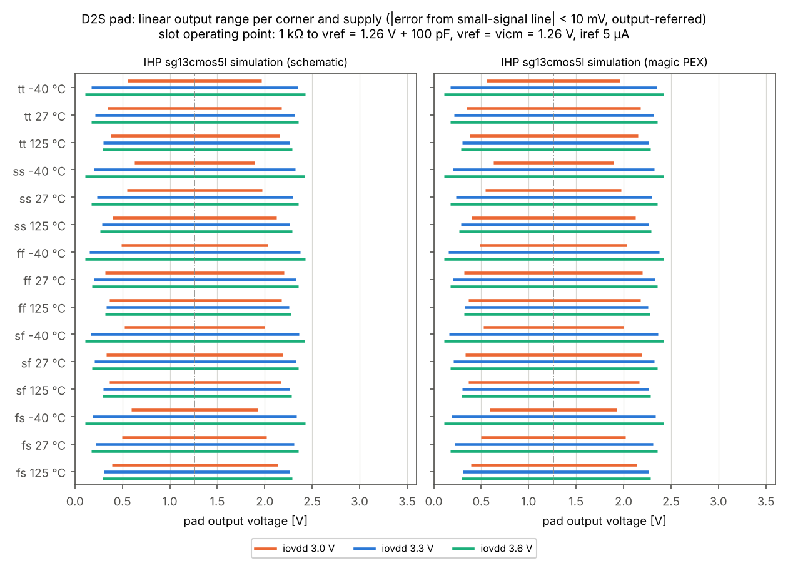
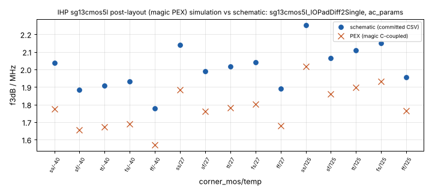

<!--
SPDX-FileCopyrightText: 2026 Christoph Maier
SPDX-License-Identifier: Apache-2.0
-->
# sg13cmos5l_IOPadDiff2Single (D2S pad, s7_an[1]): characterization data sheet

> **Scope: only what was taped out.** `sg13cmos5l_IOPadDiff2Single` is the pad cell that replaces `s7_an[1]` in the taped-out slot 7; the delivery's `pads/` files are copies from the design repository's `toplevel` at `91a7da8b`, the commit used here, and the chip GDS contains the cell unchanged (checked). Only a **schematic** view exists in the results directory. The pad's README (same commit) states that the committed CACE results **predate the layout** (the Miller capacitors CMA / CMB changed shape, 7.96 × 32.16 µm instead of 16 × 16 µm at equal area, and the output stage moved into the clamp frames) and that PEX and post-layout CACE were **not done** for this cell; the results below are therefore pre-layout.

**Cell:** `sg13cmos5l_IOPadDiff2Single`  
**Description (from the CACE file):** Differential-in, single-ended-out class-AB buffered pad with selectable bias and fail-safe enable  
**PDK:** ihp-sg13cmos5l  
**Designer:** Christoph Maier, CACE file created October 20, 2026  
**Source:** [`macros/sg13cmos5l_IOPadDiff2Single/verification/cace/sg13cmos5l_IOPadDiff2Single.yaml`](https://github.com/tatzelbrumm/sg13cmos5l_cm_ip__single2diff2single/blob/91a7da8b67ac56a26c605501146667a1fde28c32/macros/sg13cmos5l_IOPadDiff2Single/verification/cace/sg13cmos5l_IOPadDiff2Single.yaml) at design-repository commit `91a7da8b`; results [`verification/cace/results/`](https://github.com/tatzelbrumm/sg13cmos5l_cm_ip__single2diff2single/tree/91a7da8b67ac56a26c605501146667a1fde28c32/macros/sg13cmos5l_IOPadDiff2Single/verification/cace/results)  
**Generated:** by `datasheets/tools/make_datasheet.py` from the committed CACE files; **no simulation was run for this sheet** and nothing was re-checked against the taped-out netlist.

> **Warning (found 2026-11-25):** the *schematic* CACE results this sheet was generated from (committed 2026-10-21 at `91a7da8b`) predate the final D2S schematic (changed until 2026-11-03), so the schematic tables below describe an earlier circuit: re-running the same templates on the taped-out schematic differs by more than 2 % in 24 values (e.g. output impedance at 1 kHz down to −14 %, turn-on time up to +53 %; [AC / transient cross-check](../../../verification/c2_gaps/ac_tran/results.md)). The post-layout results of the taped-out cell ([D2S post-layout](../../../verification/c2_gaps/d2s_pex/results.md)) and the DC curves are fresh runs and current. A schematic re-run to regenerate this sheet is in progress.

## Pins

| pin | type | direction | description | limits |
|---|---|---|---|---|
| `iovdd` | power | inout | IO ring supply (front end, bias, output stage OP) | Vmin 3.0 Vmax 3.6 |
| `iovss` | ground | inout | IO ring ground (output stage ON, front end, bias) |  |
| `vdd` | power | inout | 1.2 V core ring (not connected inside the cell; feeds the level shifters of en_ctrl_3v3 next to it) | Vmin 1.08 Vmax 1.32 |
| `vss` | ground | inout | core ring ground (not connected inside the cell) |  |
| `pad` | signal | inout | Pad (bond pad, drains of the clamp-frame output devices, primary diodes) |  |
| `vinp` | signal | input | Differential input, positive (pad - vref = (vinp - vinn) / 2) |  |
| `vinn` | signal | input | Differential input, negative |  |
| `vref` | signal | input | Output reference voltage |  |
| `iref` | signal | input | Reference current into the bias tree (sourced, 5 uA nominal; from bias_gen_pd next to the cell) |  |
| `en_3v3` | digital | input | Enable, 3.3 V logic, active high (from en_ctrl_3v3 next to the cell) |  |
| `en_3v3_b` | digital | input | Complement of en_3v3, 3.3 V logic (from en_ctrl_3v3 next to the cell) |  |

## Default conditions

| condition | typical | unit | description |
|---|---|---|---|
| `vdd` | 3.3 | V | IO ring supply voltage |
| `vddl` | 1.2 | V | Core ring supply voltage |
| `vref` | 1.65 | V | Output reference voltage |
| `vicm` | 1.65 | V | Input common-mode voltage |
| `corner_mos` | tt |  | Process corner MOSFET |
| `corner_r` | typ |  | Process corner resistor |
| `corner_pnp` | typ |  | Process corner PNP |
| `temp` | 27 | °C | Ambient temperature |
| `sel` | 0 |  | Bias selection (0 harness, 1 OA, 2 bandgap, 3 both) |
| `ibias` | 5e-06 | A | Harness bias current |
| `rload` | 1000 | Ω | Load resistance, pad to vterm |
| `vterm` | 1.65 | V | Load termination voltage |
| `cload` | 1e-10 | F | Load capacitance, pad to ground |

## Figures

<!-- Figures section added by hand on 2026-11-25, not produced by tools/make_datasheet.py: keep it when regenerating. -->

*Output and error vs the ideal ½ (vinp − vinn) at the slot's operating point (vicm = vref = 1.26 V, 1 kΩ + 100 pF), 5 corners × 3 temperatures, 3.3 V (schematic; extracted layout within 0.7 mV)*

*The same at iovdd 3.0 V: INL over ±1 V stays ≤ 1.38 mV at this operating point*

*Linear output range (error < 10 mV) per corner and supply at the slot's operating point*

*For comparison: the CACE test condition vicm = vref = 1.65 V at 3.0 V, where the 87 mV INL of the CACE table comes from (headroom at this common mode, not at the slot's)*

*Closed-loop −3 dB bandwidth per corner, schematic vs extracted layout*

Schematics: [pad top](../pix/schematics/sg13cmos5l_IOPadDiff2Single.svg), [driver d2s_mpdda_pd](../pix/schematics/d2s_mpdda_pd.svg), [output stage P](../pix/schematics/d2s_out_p.svg), [output stage N](../pix/schematics/d2s_out_n.svg), [bias tree](../pix/schematics/bias_tree_pd.svg). Layout: [all layers](../pix/layout/IOPadDiff2Single.png), [Metal2 and below](../pix/layout/IOPadDiff2Single_frontend.png). Post-layout CACE of all groups: [D2S post-layout](../../../verification/c2_gaps/d2s_pex/results.md) (this sheet's tables are schematic only).

## Specification (ex post facto, as characterized)

The design is a proof of concept and had **no specification** before it was characterized. The limits and verdicts in the CACE files (section 'CACE run summaries') are the designer's *working limits*, in part set from earlier measured bands, so *Pass* means "inside the designer's working limit", not "meets a specification". This section instead states, **ex post facto**, the interval each characterized quantity covered: the minimum and maximum over every run of the group's characterization grid (corners, temperature, supply, … as listed), the value at typical conditions (default conditions of the CACE file: tt, 27 °C, 3.3 V, typical resistor / PNP corners) where such a run exists, and the median over the group (CACE's own *typ* value). It is a description of what was simulated, **not a guarantee**; Monte Carlo rows are the observed range of the sampled iterations, not ±3σ; no silicon was measured.

### View: schematic

| group | quantity | unit | min | typ (typical conditions) | median | max | runs | where min / where max |
|---|---|---|---:|---:|---:|---:|---|---|
| dc_params | Gain |  | 0.4981 | 0.4999 | 0.5 | 0.5 | 30 | corner_mos=ff, temp=125, vdd=3.3 / corner_mos=ff, temp=27, vdd=3.6 |
| dc_params | Output offset | mV | 0.03487 | 0.05669 | 0.07344 | 1.947 | 30 | corner_mos=ss, temp=-40, vdd=3.3 / corner_mos=ff, temp=125, vdd=3.6 |
| dc_params | Integral nonlinearity | mV | 0.1222 | 1.356 | 0.4804 | 7.404 | 30 | corner_mos=ss, temp=125, vdd=3.6 / corner_mos=ss, temp=-40, vdd=3.3 |
| dc_params | IO ring supply current | uA | 293.2 | 298.7 | 301.7 | 314 | 30 | corner_mos=ss, temp=125, vdd=3.3 / corner_mos=ff, temp=-40, vdd=3.6 |
| dc_params | Core ring supply current | nA | 0.008253 | 0.1185 | 0.1185 | 23.89 | 30 | corner_mos=ss, temp=-40, vdd=3.6 / corner_mos=ff, temp=125, vdd=3.3 |
| dc_params | Quiescent current OP | uA | 207.4 | 212.4 | 215.4 | 226.6 | 30 | corner_mos=ss, temp=125, vdd=3.3 / corner_mos=ff, temp=-40, vdd=3.6 |
| dc_params | Quiescent current ON | uA | 207 | 212.3 | 214.6 | 226.5 | 30 | corner_mos=ss, temp=125, vdd=3.3 / corner_mos=ff, temp=-40, vdd=3.6 |
| dc_params | Minimum output-device current | uA | 95.77 | 102.1 | 105.1 | 112 | 30 | corner_mos=ss, temp=-40, vdd=3.3 / corner_mos=ff, temp=27, vdd=3.6 |
| dc_3v0_params | Gain |  | 0.498 | — | 0.4999 | 0.5002 | 15 | corner_mos=ff, temp=125, vdd=3.0 / corner_mos=ss, temp=-40, vdd=3.0 |
| dc_3v0_params | Output offset | mV | 0.03434 | — | 0.05332 | 1.985 | 15 | corner_mos=ss, temp=-40, vdd=3.0 / corner_mos=ff, temp=125, vdd=3.0 |
| dc_3v0_params | Integral nonlinearity | mV | 10.92 | — | 44.4 | 87.36 | 15 | corner_mos=ff, temp=125, vdd=3.0 / corner_mos=ss, temp=-40, vdd=3.0 |
| dc_3v0_params | IO ring supply current | uA | 286.9 | — | 291.7 | 298.2 | 15 | corner_mos=ss, temp=27, vdd=3.0 / corner_mos=ff, temp=-40, vdd=3.0 |
| dc_3v0_params | Core ring supply current | nA | 0.008253 | — | 0.1185 | 23.89 | 15 | corner_mos=ss, temp=-40, vdd=3.0 / corner_mos=ff, temp=125, vdd=3.0 |
| dc_3v0_params | Quiescent current OP | uA | 201.4 | — | 206 | 211.9 | 15 | corner_mos=ss, temp=27, vdd=3.0 / corner_mos=ff, temp=-40, vdd=3.0 |
| dc_3v0_params | Quiescent current ON | uA | 201.4 | — | 205.8 | 211.8 | 15 | corner_mos=ss, temp=27, vdd=3.0 / corner_mos=ff, temp=-40, vdd=3.0 |
| dc_3v0_params | Minimum output-device current | uA | 57.4 | — | 76.82 | 93.29 | 15 | corner_mos=ss, temp=-40, vdd=3.0 / corner_mos=ff, temp=125, vdd=3.0 |
| dc_sel_params | Gain |  | 0.498 | 0.4999 | 0.4999 | 0.5 | 9 | sel=1, temp=125, corner_r=typ, corner_pnp=typ / sel=1, temp=-40, corner_r=typ, corner_pnp=typ |
| dc_sel_params | Output offset | mV | 0.02655 | 0.05669 | 0.05668 | 2.706 | 9 | sel=1, temp=-40, corner_r=typ, corner_pnp=typ / sel=1, temp=125, corner_r=typ, corner_pnp=typ |
| dc_sel_params | Integral nonlinearity | mV | 0.1965 | 1.356 | 1.355 | 4.094 | 9 | sel=1, temp=-40, corner_r=typ, corner_pnp=typ / sel=1, temp=125, corner_r=typ, corner_pnp=typ |
| dc_sel_params | IO ring supply current | uA | 207.9 | 298.7 | 302.9 | 400.9 | 9 | sel=1, temp=-40, corner_r=typ, corner_pnp=typ / sel=1, temp=125, corner_r=typ, corner_pnp=typ |
| dc_sel_params | Core ring supply current | nA | 0.01551 | 0.1185 | 0.1381 | 7.038 | 9 | sel=1, temp=-40, corner_r=typ, corner_pnp=typ / sel=1, temp=125, corner_r=typ, corner_pnp=typ |
| dc_sel_params | Quiescent current OP | uA | 145.2 | 212.4 | 212 | 276.3 | 9 | sel=1, temp=-40, corner_r=typ, corner_pnp=typ / sel=1, temp=125, corner_r=typ, corner_pnp=typ |
| dc_sel_params | Quiescent current ON | uA | 145.2 | 212.3 | 212 | 273.6 | 9 | sel=1, temp=-40, corner_r=typ, corner_pnp=typ / sel=1, temp=125, corner_r=typ, corner_pnp=typ |
| dc_sel_params | Minimum output-device current | uA | 67 | 102.1 | 102 | 139.1 | 9 | sel=1, temp=-40, corner_r=typ, corner_pnp=typ / sel=1, temp=125, corner_r=typ, corner_pnp=typ |
| dc_sel3_params | Gain |  | 0.4926 | — | 0.4998 | 0.5 | 3 | sel=3, temp=125 / sel=3, temp=-40 |
| dc_sel3_params | Output offset | mV | 0.07093 | — | 0.5345 | 13.55 | 3 | sel=3, temp=-40 / sel=3, temp=125 |
| dc_sel3_params | Integral nonlinearity | mV | 34.65 | — | 47.56 | 52.27 | 3 | sel=3, temp=-40 / sel=3, temp=27 |
| dc_sel3_params | IO ring supply current | uA | 491.9 | — | 591.3 | 687.3 | 3 | sel=3, temp=-40 / sel=3, temp=125 |
| dc_sel3_params | Core ring supply current | nA | 0.003347 | — | 0.1578 | 9.245 | 3 | sel=3, temp=-40 / sel=3, temp=125 |
| dc_sel3_params | Quiescent current OP | uA | 335.6 | — | 401.9 | 469.8 | 3 | sel=3, temp=-40 / sel=3, temp=125 |
| dc_sel3_params | Quiescent current ON | uA | 335.5 | — | 401.4 | 456.3 | 3 | sel=3, temp=-40 / sel=3, temp=125 |
| dc_sel3_params | Minimum output-device current | uA | 172 | — | 212.2 | 253.8 | 3 | sel=3, temp=-40 / sel=3, temp=125 |
| dc_ibias_params | Gain |  | 0.4999 | 0.4999 | 0.4999 | 0.5 | 3 | ibias=6.25e-06 / ibias=3.75e-06 |
| dc_ibias_params | Output offset | mV | 0.03924 | 0.05669 | 0.05669 | 0.08597 | 3 | ibias=3.75e-06 / ibias=6.25e-06 |
| dc_ibias_params | Integral nonlinearity | mV | 0.1953 | 1.356 | 1.356 | 6.19 | 3 | ibias=3.75e-06 / ibias=6.25e-06 |
| dc_ibias_params | IO ring supply current | uA | 228.2 | 298.7 | 298.7 | 368.2 | 3 | ibias=3.75e-06 / ibias=6.25e-06 |
| dc_ibias_params | Core ring supply current | nA | 0.1185 | 0.1185 | 0.1185 | 0.1185 | 3 | ibias=3.75e-06 / ibias=3.75e-06 |
| dc_ibias_params | Quiescent current OP | uA | 163.1 | 212.4 | 212.4 | 260.8 | 3 | ibias=3.75e-06 / ibias=6.25e-06 |
| dc_ibias_params | Quiescent current ON | uA | 163 | 212.3 | 212.3 | 260.7 | 3 | ibias=3.75e-06 / ibias=6.25e-06 |
| dc_ibias_params | Minimum output-device current | uA | 76.7 | 102.1 | 102.1 | 129.1 | 3 | ibias=3.75e-06 / ibias=6.25e-06 |
| ac_params | Closed-loop gain | dB | -6.055 | -6.022 | -6.022 | -6.021 | 15 | corner_mos=ff, temp=125 / corner_mos=sf, temp=-40 |
| ac_params | Bandwidth | MHz | 1.778 | 2.015 | 2.015 | 2.252 | 15 | corner_mos=ff, temp=-40 / corner_mos=ss, temp=125 |
| ac_params | Gain peaking | dB | 3.027e-07 | 9.419e-07 | 9.28e-07 | 1.532e-06 | 15 | corner_mos=fs, temp=125 / corner_mos=ff, temp=-40 (unit scale inferred, ambiguous near 0) |
| ac_params | PSRR iovdd 1 kHz | dB | 70.66 | 71.56 | 71.56 | 72.53 | 15 | corner_mos=ff, temp=-40 / corner_mos=ss, temp=125 |
| ac_params | PSRR iovdd 100 kHz | dB | 30.74 | 31.62 | 31.62 | 32.55 | 15 | corner_mos=ff, temp=-40 / corner_mos=ss, temp=125 |
| ac_params | CMRR 1 kHz | dB | 93.79 | 124 | 124 | 127.5 | 15 | corner_mos=ff, temp=125 / corner_mos=sf, temp=-40 |
| ac_params | Output impedance 1 kHz | Ω | 0.1951 | 0.2176 | 0.2176 | 3.85 | 15 | corner_mos=ss, temp=-40 / corner_mos=ff, temp=125 |
| ac_params | Output impedance 1 MHz | Ω | 159 | 171.7 | 171.7 | 206.1 | 15 | corner_mos=ff, temp=-40 / corner_mos=ff, temp=125 |
| ac_load_params | Bandwidth | MHz | 1.582 | 2.015 | 2.162 | 3.006 | 6 | cload=1e-11, rload=1000 / cload=1e-10, rload=1000000000.0 |
| ac_load_params | Gain peaking | dB | 3.682e-07 | 1.942e-06 | 0.0265 | 2.899 | 6 | cload=1e-11, rload=1000000000.0 / cload=3e-10, rload=1000000000.0 |
| ac_1nF_params | Bandwidth, 1 nF | MHz | 1.336 | 1.336 | 1.358 | 1.381 | 2 | cload=1e-09, rload=1000 / cload=1e-09, rload=1000000000.0 |
| ac_1nF_params | Gain peaking, 1 nF | dB | 4.852 | 4.852 | 6.222 | 7.593 | 2 | cload=1e-09, rload=1000 / cload=1e-09, rload=1000000000.0 |
| tran_params | Slew rate, rising | V/us | 1.76 | 2.448 | 2.448 | 3.054 | 9 | corner_mos=ff, cload=1e-11 / corner_mos=ss, cload=3e-10 |
| tran_params | Slew rate, falling | V/us | 1.781 | 2.466 | 2.466 | 3.166 | 9 | corner_mos=ff, cload=1e-11 / corner_mos=ss, cload=3e-10 |
| tran_params | Overshoot | % | -7e-05 | 0.0001 | 0.0001 | 9.321 | 9 | corner_mos=ss, cload=1e-11 / corner_mos=ss, cload=3e-10 |
| tran_params | Settling time, rising | us | 0.2959 | 0.4562 | 0.4562 | 0.6892 | 9 | corner_mos=ss, cload=1e-10 / corner_mos=ss, cload=3e-10 |
| tran_params | Settling time, falling | us | 0.3036 | 0.4532 | 0.4532 | 0.6165 | 9 | corner_mos=ss, cload=1e-10 / corner_mos=ss, cload=3e-10 |
| thd_params | THD | dB | -73.2 | -57.79 | -57.79 | -38.87 | 3 | vdamp=0.5 / vdamp=1.5 |
| thd_params | Output amplitude | V | 0.25 | 0.4999 | 0.4999 | 0.7503 | 3 | vdamp=0.5 / vdamp=1.5 |
| noise_params | Output noise 1 kHz | nV/rtHz | 607.6 | 681.7 | 681.7 | 718.5 | 3 | temp=125 / temp=-40 |
| noise_params | Output noise 100 kHz | nV/rtHz | 142.6 | 152.5 | 152.5 | 156.4 | 3 | temp=125 / temp=-40 |
| noise_params | Integrated output noise | uV | 222.7 | 234.2 | 234.2 | 235.1 | 3 | temp=125 / temp=-40 |
| drive_params | Max output | V | 3.266 | — | 3.275 | 3.283 | 10 | corner_mos=ss, temp=125 / corner_mos=ff, temp=-40 |
| drive_params | Min output | V | 0.6396 | — | 0.6865 | 0.7386 | 10 | corner_mos=ff, temp=-40 / corner_mos=ss, temp=125 |
| drive_params | Short-circuit source current | mA | 49.65 | — | 66.98 | 93.21 | 10 | corner_mos=ss, temp=125 / corner_mos=ff, temp=-40 |
| drive_params | Short-circuit sink current | mA | 53.03 | — | 80.36 | 120.3 | 10 | corner_mos=ss, temp=125 / corner_mos=ff, temp=-40 |
| pd_params | IO ring current, off | nA | 0.04144 | 298.6 | 257.6 | 642.2 | 48 | pdstate=0, vpad=3.3, corner_mos=tt, temp=27 / pdstate=2, vpad=0, corner_mos=ff, temp=27 |
| pd_params | Core ring current, off | nA | -0 | 0.1087 | 0.6509 | 23.89 | 48 | pdstate=3, vpad=0, corner_mos=tt, temp=27 / pdstate=1, vpad=0, corner_mos=ff, temp=125 |
| pd_params | Pad leakage, off | nA | -36.83 | 0.2447 | 0.0472 | 9.71 | 48 | pdstate=0, vpad=0, corner_mos=ff, temp=125 / pdstate=0, vpad=3.3, corner_mos=ff, temp=125 |
| pd_params | vdd1v2_sense current | nA | -0 | 1.271e-05 | 1.271e-05 | 905.5 | 48 | pdstate=1, vpad=0, corner_mos=tt, temp=27 / pdstate=2, vpad=0, corner_mos=ff, temp=27 |
| pd_params | vdd3v3_sense current | nA | -0 | 7.133e-05 | 0.0001149 | 1114 | 48 | pdstate=2, vpad=0, corner_mos=tt, temp=27 / pdstate=1, vpad=0, corner_mos=ff, temp=27 |
| pd_params | Internal enable | V | 2.688e-10 | 2.791e-10 | 1.392e-07 | 7.104e-07 | 48 | pdstate=3, vpad=0, corner_mos=tt, temp=27 / pdstate=0, vpad=0, corner_mos=ff, temp=125 (unit scale inferred, ambiguous near 0) |
| enable_params | Turn-on time | us | 0.8054 | 0.8544 | 0.8544 | 1.228 | 3 | sel=2, tstop=6e-05 / sel=1, tstop=6e-05 |
| enable_params | Enable glitch, positive | mV | 111.9 | 111.9 | 117.1 | 224.4 | 3 | sel=0, tstop=6e-05 / sel=1, tstop=6e-05 |
| enable_params | Enable glitch, negative | mV | -187.4 | -107.8 | -119.6 | -107.8 | 3 | sel=1, tstop=6e-05 / sel=0, tstop=6e-05 |
| enable_params | IO ring current after start-up | uA | 298.7 | 298.7 | 306.3 | 309.1 | 3 | sel=0, tstop=6e-05 / sel=2, tstop=6e-05 |
| mm_params | Output offset - mismatch | mV | -11.39 | — | 0.709 | 10.1 | Monte Carlo (iterations up to 30) | CACE summary values (per-run CSV not committed) |
| mm_params | Gain - mismatch |  | 0.4939 | — | 0.4994 | 0.5085 | Monte Carlo (iterations up to 30) | CACE summary values (per-run CSV not committed) |
| mm_params | Quiescent current OP - mismatch | uA | 192.9 | — | 214.5 | 232.8 | Monte Carlo (iterations up to 30) | CACE summary values (per-run CSV not committed) |

## CACE run summaries (designer's working limits): schematic

Results directory: `verification/cace/results/sg13cmos5l_IOPadDiff2Single`. One table per parameter group, as CACE wrote it in `summary_<group>.md` (rows with status *Skip* belong to other groups and are left out): the designer's working limits, the measured minimum / typical (median) / maximum over the runs of the group, and CACE's status against those limits (*not* a specification check). *Runs* is the number of rows of the group's CSV.

**Rows in this view:** 79 inside the working limits, 0 outside, 0 other (one row per quantity and group; not run counts).

### dc_params

*Runs:* 30  
*Swept conditions:* corner_mos: ss, sf, tt, fs, ff; temp: -40, 27, 125; vdd: 3.3, 3.6  

| quantity | working min limit | min value | typ (median) | working max limit | max value | vs working limit |
|---|---:|---:|---:|---:|---:|---|
| Gain | 0.49 | 0.498076 | 0.49995199999999995 | 0.51 | 0.500001 | Pass ✅ |
| Output offset | -5 mV | 0.035 mV | 0.073 mV | 5 mV | 1.947 mV | Pass ✅ |
| Integral nonlinearity | any | 0.122 mV | 0.480 mV | 10 mV | 7.404 mV | Pass ✅ |
| IO ring supply current | any | 293.199 uA | 301.718 uA | 400 uA | 314.031 uA | Pass ✅ |
| Core ring supply current | any | 0.008 nA | 0.118 nA | 100 nA | 23.889 nA | Pass ✅ |
| Quiescent current OP | 150 uA | 207.398 uA | 215.360 uA | 300 uA | 226.565 uA | Pass ✅ |
| Quiescent current ON | 150 uA | 206.962 uA | 214.601 uA | 300 uA | 226.492 uA | Pass ✅ |
| Minimum output-device current | 30 uA | 95.770 uA | 105.074 uA | any | 111.950 uA | Pass ✅ |

### dc_3v0_params

*Runs:* 15  
*Swept conditions:* corner_mos: ss, sf, tt, fs, ff; temp: -40, 27, 125; vdd: 3.0  

| quantity | working min limit | min value | typ (median) | working max limit | max value | vs working limit |
|---|---:|---:|---:|---:|---:|---|
| Gain | 0.49 | 0.497956 | 0.499946 | 0.51 | 0.500191 | Pass ✅ |
| Output offset | -5 mV | 0.034 mV | 0.053 mV | 5 mV | 1.985 mV | Pass ✅ |
| Integral nonlinearity | any | 10.922 mV | 44.396 mV | any | 87.361 mV | Pass ✅ |
| IO ring supply current | any | 286.930 uA | 291.658 uA | 400 uA | 298.176 uA | Pass ✅ |
| Core ring supply current | any | 0.008 nA | 0.118 nA | 100 nA | 23.889 nA | Pass ✅ |
| Quiescent current OP | 150 uA | 201.400 uA | 205.953 uA | 300 uA | 211.860 uA | Pass ✅ |
| Quiescent current ON | 150 uA | 201.353 uA | 205.808 uA | 300 uA | 211.815 uA | Pass ✅ |
| Minimum output-device current | 30 uA | 57.403 uA | 76.819 uA | any | 93.291 uA | Pass ✅ |

### dc_sel_params

*Runs:* 9  
*Swept conditions:* sel: 0, 1, 2; temp: -40, 27, 125; corner_r: typ; corner_pnp: typ  

| quantity | working min limit | min value | typ (median) | working max limit | max value | vs working limit |
|---|---:|---:|---:|---:|---:|---|
| Gain | 0.49 | 0.498007 | 0.499944 | 0.51 | 0.49996 | Pass ✅ |
| Output offset | -5 mV | 0.027 mV | 0.057 mV | 5 mV | 2.706 mV | Pass ✅ |
| Integral nonlinearity | any | 0.197 mV | 1.355 mV | 10 mV | 4.094 mV | Pass ✅ |
| IO ring supply current | any | 207.880 uA | 302.908 uA | 500 uA | 400.925 uA | Pass ✅ |
| Core ring supply current | any | 0.016 nA | 0.138 nA | 100 nA | 7.038 nA | Pass ✅ |
| Quiescent current OP | 100 uA | 145.226 uA | 212.021 uA | 350 uA | 276.342 uA | Pass ✅ |
| Quiescent current ON | 100 uA | 145.198 uA | 211.963 uA | 350 uA | 273.634 uA | Pass ✅ |
| Minimum output-device current | 30 uA | 67.000 uA | 101.993 uA | any | 139.075 uA | Pass ✅ |

### dc_sel3_params

*Runs:* 3  
*Swept conditions:* sel: 3; temp: -40, 27, 125  

| quantity | working min limit | min value | typ (median) | working max limit | max value | vs working limit |
|---|---:|---:|---:|---:|---:|---|
| Gain | any | 0.492566 | 0.499796 | any | 0.499952 | Pass ✅ |
| Output offset | any | 0.071 mV | 0.534 mV | any | 13.547 mV | Pass ✅ |
| Integral nonlinearity | any | 34.651 mV | 47.558 mV | any | 52.268 mV | Pass ✅ |
| IO ring supply current | any | 491.861 uA | 591.262 uA | any | 687.264 uA | Pass ✅ |
| Core ring supply current | any | 0.003 nA | 0.158 nA | any | 9.245 nA | Pass ✅ |
| Quiescent current OP | any | 335.603 uA | 401.944 uA | any | 469.810 uA | Pass ✅ |
| Quiescent current ON | any | 335.530 uA | 401.407 uA | any | 456.261 uA | Pass ✅ |
| Minimum output-device current | any | 172.040 uA | 212.228 uA | any | 253.827 uA | Pass ✅ |

### dc_ibias_params

*Runs:* 3  
*Swept conditions:* ibias: 3.75e-06, 5e-06, 6.25e-06  

| quantity | working min limit | min value | typ (median) | working max limit | max value | vs working limit |
|---|---:|---:|---:|---:|---:|---|
| Gain | 0.49 | 0.499932 | 0.499944 | 0.51 | 0.499953 | Pass ✅ |
| Output offset | any | 0.039 mV | 0.057 mV | any | 0.086 mV | Pass ✅ |
| Integral nonlinearity | any | 0.195 mV | 1.356 mV | any | 6.190 mV | Pass ✅ |
| IO ring supply current | any | 228.170 uA | 298.671 uA | any | 368.187 uA | Pass ✅ |
| Core ring supply current | any | 0.118 nA | 0.118 nA | any | 0.118 nA | Pass ✅ |
| Quiescent current OP | 120 uA | 163.074 uA | 212.405 uA | 350 uA | 260.780 uA | Pass ✅ |
| Quiescent current ON | 120 uA | 163.033 uA | 212.347 uA | 350 uA | 260.692 uA | Pass ✅ |
| Minimum output-device current | any | 76.701 uA | 102.104 uA | any | 129.098 uA | Pass ✅ |

### ac_params

*Runs:* 15  
*Swept conditions:* corner_mos: ss, sf, tt, fs, ff; temp: -40, 27, 125  

| quantity | working min limit | min value | typ (median) | working max limit | max value | vs working limit |
|---|---:|---:|---:|---:|---:|---|
| Closed-loop gain | -6.2 dB | -6.055 dB | -6.022 dB | -5.85 dB | -6.021 dB | Pass ✅ |
| Bandwidth | 1 MHz | 1.778 MHz | 2.015 MHz | any | 2.252 MHz | Pass ✅ |
| Gain peaking | any | 0.000 dB | 0.000 dB | 1 dB | 0.000 dB | Pass ✅ |
| PSRR iovdd 1 kHz | 60 dB | 70.659 dB | 71.561 dB | any | 72.534 dB | Pass ✅ |
| PSRR iovdd 100 kHz | 25 dB | 30.741 dB | 31.625 dB | any | 32.555 dB | Pass ✅ |
| CMRR 1 kHz | 70 dB | 93.788 dB | 123.952 dB | any | 127.460 dB | Pass ✅ |
| Output impedance 1 kHz | any | 0.195 Ω | 0.218 Ω | 10 Ω | 3.850 Ω | Pass ✅ |
| Output impedance 1 MHz | any | 158.964 Ω | 171.692 Ω | 300 Ω | 206.093 Ω | Pass ✅ |

### ac_load_params

*Runs:* 6  
*Swept conditions:* cload: 1e-11, 1e-10, 3e-10; rload: 1000, 1000000000.0  

| quantity | working min limit | min value | typ (median) | working max limit | max value | vs working limit |
|---|---:|---:|---:|---:|---:|---|
| Bandwidth | 1 MHz | 1.582 MHz | 2.162 MHz | any | 3.006 MHz | Pass ✅ |
| Gain peaking | any | 0.000 dB | 0.027 dB | 4 dB | 2.899 dB | Pass ✅ |

### ac_1nF_params

*Runs:* 2  
*Swept conditions:* cload: 1e-09; rload: 1000, 1000000000.0  

| quantity | working min limit | min value | typ (median) | working max limit | max value | vs working limit |
|---|---:|---:|---:|---:|---:|---|
| Bandwidth, 1 nF | any | 1.336 MHz | 1.358 MHz | any | 1.381 MHz | Pass ✅ |
| Gain peaking, 1 nF | any | 4.852 dB | 6.222 dB | any | 7.593 dB | Pass ✅ |

### tran_params

*Runs:* 9  
*Swept conditions:* corner_mos: ss, tt, ff; cload: 1e-11, 1e-10, 3e-10  

| quantity | working min limit | min value | typ (median) | working max limit | max value | vs working limit |
|---|---:|---:|---:|---:|---:|---|
| Slew rate, rising | 1 V/us | 1.760 V/us | 2.448 V/us | any | 3.054 V/us | Pass ✅ |
| Slew rate, falling | 1 V/us | 1.781 V/us | 2.466 V/us | any | 3.166 V/us | Pass ✅ |
| Overshoot | any | -0.000 % | 0.000 % | 15 % | 9.321 % | Pass ✅ |
| Settling time, rising | any | 0.296 us | 0.456 us | 1 us | 0.689 us | Pass ✅ |
| Settling time, falling | any | 0.304 us | 0.453 us | 1 us | 0.616 us | Pass ✅ |

### thd_params

*Runs:* 3  
*Swept conditions:* vdamp: 0.5, 1, 1.5  

| quantity | working min limit | min value | typ (median) | working max limit | max value | vs working limit |
|---|---:|---:|---:|---:|---:|---|
| THD | any | -73.203 dB | -57.788 dB | -35 dB | -38.870 dB | Pass ✅ |
| Output amplitude | any | 0.250 V | 0.500 V | any | 0.750 V | Pass ✅ |

### noise_params

*Runs:* 3  
*Swept conditions:* temp: -40, 27, 125  

| quantity | working min limit | min value | typ (median) | working max limit | max value | vs working limit |
|---|---:|---:|---:|---:|---:|---|
| Output noise 1 kHz | any | 607.562 nV/rtHz | 681.729 nV/rtHz | 1000 nV/rtHz | 718.511 nV/rtHz | Pass ✅ |
| Output noise 100 kHz | any | 142.600 nV/rtHz | 152.548 nV/rtHz | 200 nV/rtHz | 156.423 nV/rtHz | Pass ✅ |
| Integrated output noise | any | 222.724 uV | 234.152 uV | 300 uV | 235.136 uV | Pass ✅ |

### drive_params

*Runs:* 10  
*Swept conditions:* corner_mos: ss, sf, tt, fs, ff; temp: -40, 125  

| quantity | working min limit | min value | typ (median) | working max limit | max value | vs working limit |
|---|---:|---:|---:|---:|---:|---|
| Max output | 3.0 V | 3.266 V | 3.275 V | any | 3.283 V | Pass ✅ |
| Min output | any | 0.640 V | 0.686 V | 0.9 V | 0.739 V | Pass ✅ |
| Short-circuit source current | 20 mA | 49.654 mA | 66.978 mA | any | 93.213 mA | Pass ✅ |
| Short-circuit sink current | 20 mA | 53.031 mA | 80.359 mA | any | 120.343 mA | Pass ✅ |

### pd_params

*Runs:* 48  
*Swept conditions:* pdstate: 0, 1, 2, 3; vpad: 0, 1.65, 3.3; corner_mos: tt, ff; temp: 27, 125  

| quantity | working min limit | min value | typ (median) | working max limit | max value | vs working limit |
|---|---:|---:|---:|---:|---:|---|
| IO ring current, off | any | 0.041 nA | 257.644 nA | 1000 nA | 642.206 nA | Pass ✅ |
| Core ring current, off | any | -0.000 nA | 0.651 nA | 100 nA | 23.890 nA | Pass ✅ |
| Pad leakage, off | -100 nA | -36.831 nA | 0.047 nA | 100 nA | 9.710 nA | Pass ✅ |
| vdd1v2_sense current | any | -0.000 nA | 0.000 nA | 2000 nA | 905.451 nA | Pass ✅ |
| vdd3v3_sense current | any | -0.000 nA | 0.000 nA | 2000 nA | 1114.270 nA | Pass ✅ |
| Internal enable | any | 0.000 V | 0.000 V | 0.1 V | 0.000 V | Pass ✅ |

### enable_params

*Runs:* 3  
*Swept conditions:* sel: 0, 1, 2; tstop: 6e-05  

| quantity | working min limit | min value | typ (median) | working max limit | max value | vs working limit |
|---|---:|---:|---:|---:|---:|---|
| Turn-on time | any | 0.805 us | 0.854 us | 5 us | 1.228 us | Pass ✅ |
| Enable glitch, positive | any | 111.938 mV | 117.147 mV | 400 mV | 224.351 mV | Pass ✅ |
| Enable glitch, negative | -400 mV | -187.352 mV | -119.613 mV | any | -107.822 mV | Pass ✅ |
| IO ring current after start-up | 200 uA | 298.672 uA | 306.328 uA | 400 uA | 309.127 uA | Pass ✅ |

### mm_params

*Runs:* 0 rows in the committed CSV (header only: the per-run data were not committed; the values below are CACE's own summary)  
*Swept conditions:* iterations: 1 … 30 (step 1); corner_mos: tt_mismatch; corner_r: typ_mismatch  

| quantity | working min limit | min value | typ (median) | working max limit | max value | vs working limit |
|---|---:|---:|---:|---:|---:|---|
| Output offset - mismatch | -20 mV | -11.389 mV | 0.709 mV | 20 mV | 10.103 mV | Pass ✅ |
| Gain - mismatch | 0.49 | 0.493947 | 0.49944900000000003 | 0.51 | 0.508495 | Pass ✅ |
| Quiescent current OP - mismatch | 100 uA | 192.935 uA | 214.543 uA | 400 uA | 232.826 uA | Pass ✅ |

## What is not in this sheet

- Any group that has no CSV or summary in the results directory (not run, or run in another view).
- Whether the simulated netlist equals the block as taped out (see `../characterization_candidates.md`).
- Monte Carlo statistics beyond what the group's own summary reports (min / typ / max over the runs).
- Measurements on silicon: none exist at the time of writing.
