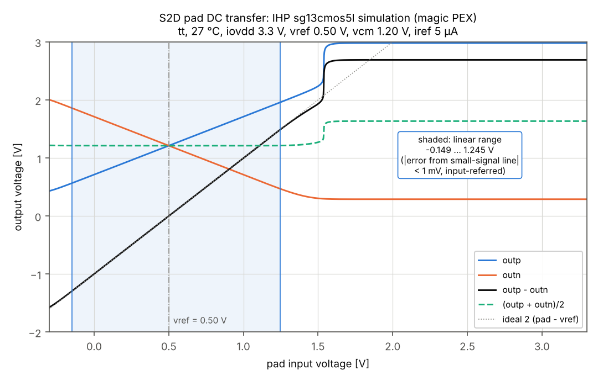
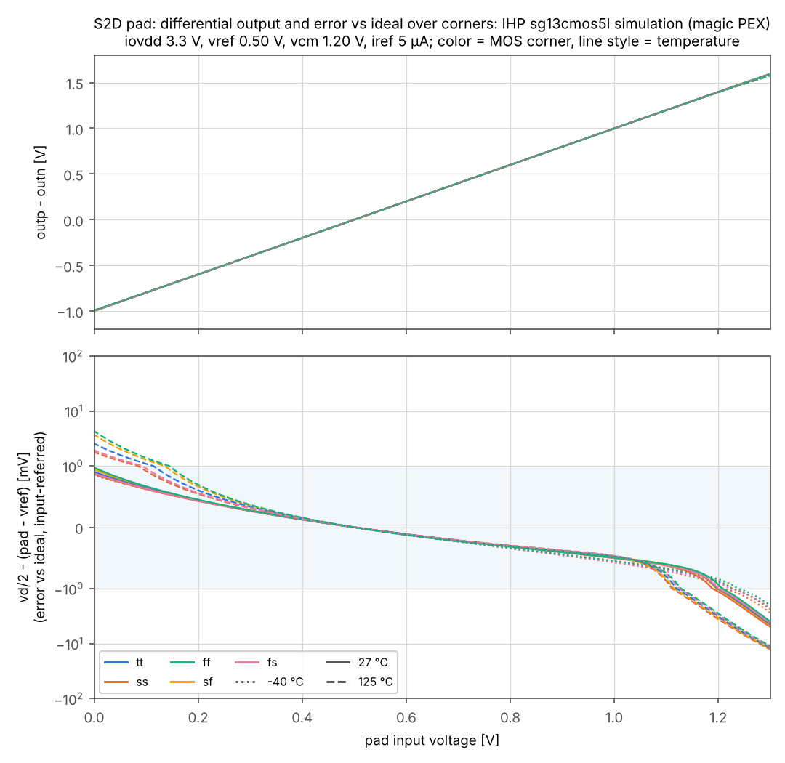
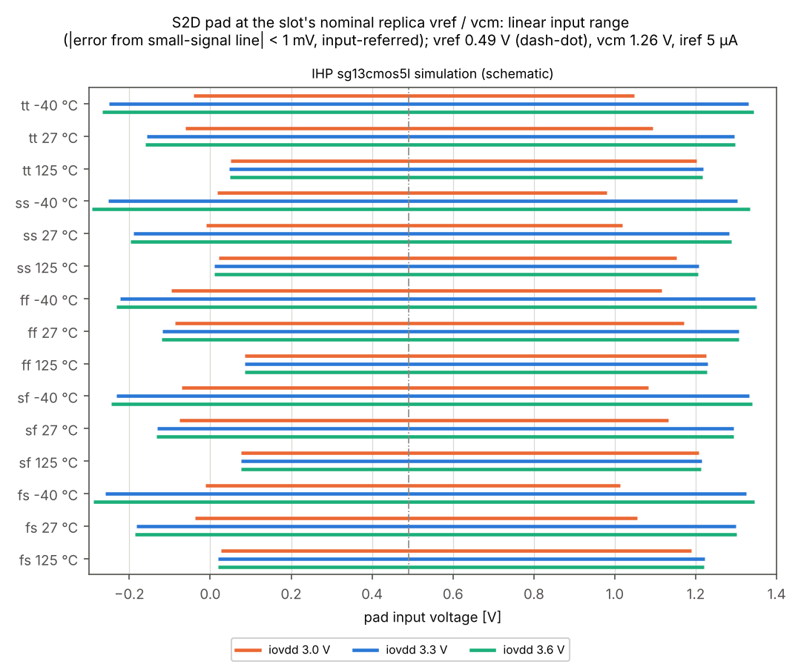
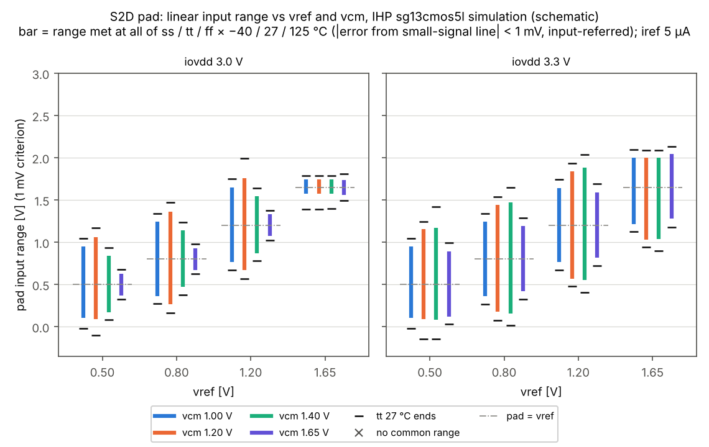
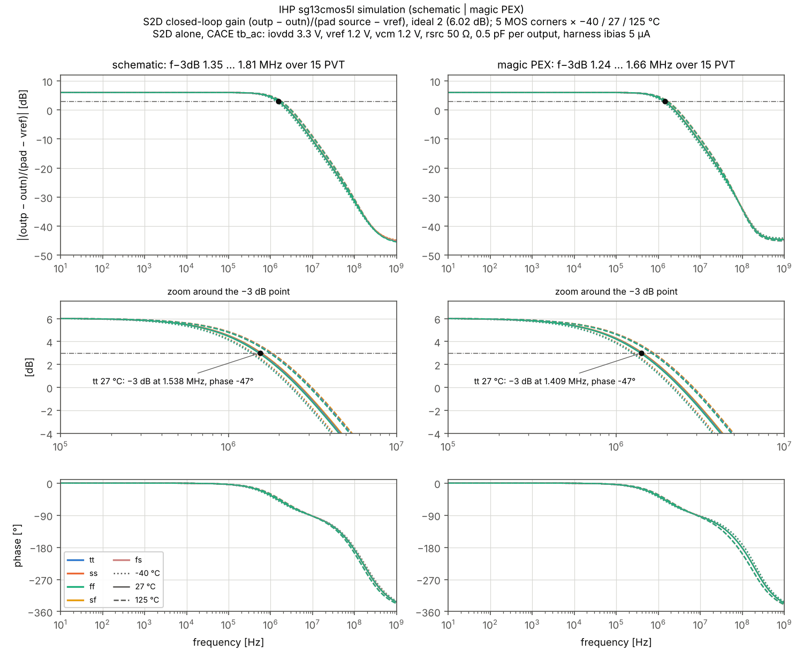
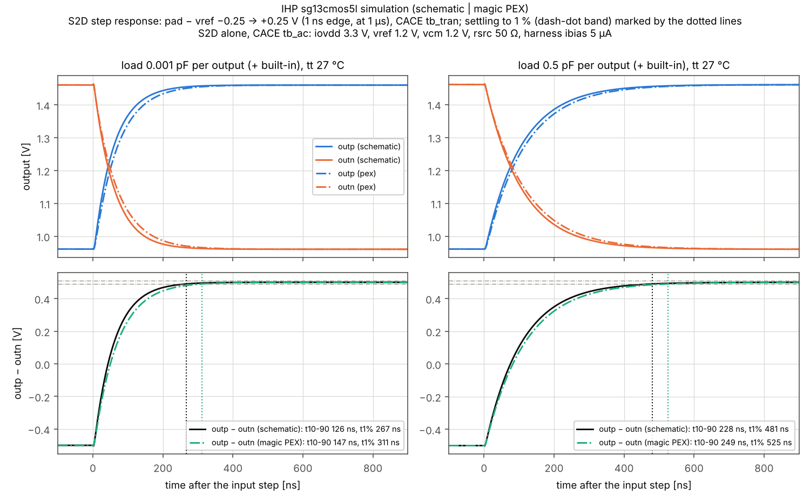
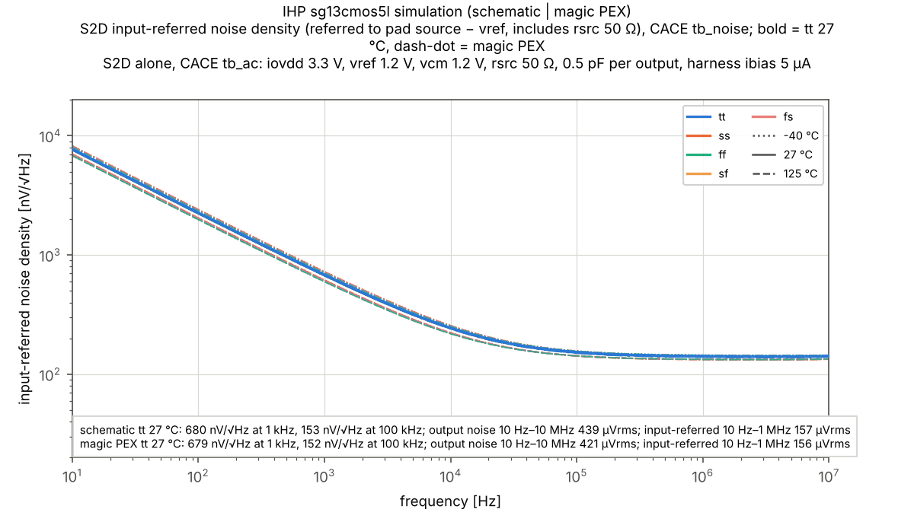

<!--
SPDX-FileCopyrightText: 2026 Christoph Maier
SPDX-License-Identifier: Apache-2.0
-->
# sg13cmos5l_IOPadSingle2Diff (S2D pad, s7_an[0]): characterization data sheet

> **Scope: only what was taped out.** `sg13cmos5l_IOPadSingle2Diff` is the pad cell that replaces `s7_an[0]` in the taped-out slot 7; the delivery repository's `pads/` GDS and netlist are byte copies from the design repository's `toplevel` at `91a7da8b`, the commit used here, and the chip GDS contains the cell unchanged (checked). Two results views exist: the schematic netlist and the magic C-coupled extraction (`_pex`, post-layout, 2026-11-05); both are given. The pad's own bias tree takes `iref` from the slot (`bias_gen_pd` and `en_ctrl_3v3` are outside the cell since 2026-11-04; the CACE fixture `s2d_mpdda_pd_sel` supplies them, including a selection that can pick the Oguey–Aebischer core: in the taped-out slot `iref` comes from `bg_core_pd` through `bias_dist_pd`).

**Cell:** `sg13cmos5l_IOPadSingle2Diff`  
**Description (from the CACE file):** Single-ended-in, differential-out buffered input pad (matched-pair DDA, gain 2) with selectable bias and fail-safe enable  
**PDK:** ihp-sg13cmos5l  
**Designer:** Christoph Maier, CACE file created October 20, 2026  
**Source:** [`macros/sg13cmos5l_IOPadSingle2Diff/verification/cace/sg13cmos5l_IOPadSingle2Diff.yaml`](https://github.com/tatzelbrumm/sg13cmos5l_cm_ip__single2diff2single/blob/91a7da8b67ac56a26c605501146667a1fde28c32/macros/sg13cmos5l_IOPadSingle2Diff/verification/cace/sg13cmos5l_IOPadSingle2Diff.yaml) at design-repository commit `91a7da8b`; results [`verification/cace/results/`](https://github.com/tatzelbrumm/sg13cmos5l_cm_ip__single2diff2single/tree/91a7da8b67ac56a26c605501146667a1fde28c32/macros/sg13cmos5l_IOPadSingle2Diff/verification/cace/results)  
**Generated:** by `datasheets/tools/make_datasheet.py` from the committed CACE files; **no simulation was run for this sheet** and nothing was re-checked against the taped-out netlist.

## Pins

| pin | type | direction | description | limits |
|---|---|---|---|---|
| `iovdd` | power | inout | IO ring supply (buffer, bias tree, protection) | Vmin 3.0 Vmax 3.6 |
| `iovss` | ground | inout | IO ring ground |  |
| `vdd` | power | inout | 1.2 V core ring (not connected inside the cell; feeds the level shifters of en_ctrl_3v3 next to it) |  |
| `vss` | ground | inout | core ring ground (joined to iovss only through the p-substrate, Rsub) |  |
| `pad` | signal | inout | Pad (input); the buffer's vin, directly (no secondary protection), primary protection as drawn |  |
| `outp` | signal | output | Differential output, positive (outp - outn = 2 (pad - vref)) |  |
| `outn` | signal | output | Differential output, negative |  |
| `vcm` | signal | input | Internal (output) common mode; gate only |  |
| `vref` | signal | input | Pad reference; gate only |  |
| `iref` | signal | input | Reference current into the bias tree (sourced, 5 uA nominal; from bias_gen_pd next to the cell) |  |
| `en_3v3` | digital | input | Enable, 3.3 V logic, active high (from en_ctrl_3v3 next to the cell) |  |
| `en_3v3_b` | digital | input | Complement of en_3v3, 3.3 V logic (from en_ctrl_3v3 next to the cell) |  |

## Default conditions

| condition | typical | unit | description |
|---|---|---|---|
| `vdd` | 3.3 | V | IO ring supply voltage |
| `vddl` | 1.2 | V | Core ring supply voltage |
| `vref` | 1.2 | V | Pad reference |
| `vcm` | 1.2 | V | Internal common mode |
| `corner_mos` | tt |  | Process corner MOSFET |
| `corner_r` | typ |  | Process corner resistor (rhigh, rppd) |
| `corner_pnp` | typ |  | Process corner PNP (bandgap core) |
| `temp` | 27 | °C | Ambient temperature |
| `sel` | 0 |  | Bias selection (0 harness, 1 OA core, 2 bandgap, 3 both) |
| `ibias` | 5e-06 | A | Harness bias current |
| `rsrc` | 50 | Ω | Source resistance into the pad |
| `cload` | 0.5 | pF | External load per output, to ground (next stage, routing) |

## Figures

<!-- Figures section added by hand on 2026-11-25, not produced by tools/make_datasheet.py: keep it when regenerating. -->

*DC transfer, extracted layout, tt 27 °C 3.3 V: outp, outn, difference and common mode vs pad; shaded: linear input range (error < 1 mV input-referred)*

*Difference and error vs the ideal 2 (pad − vref) over 5 corners × 3 temperatures, extracted layout*

*Linear input range per corner and supply at the slot's vref 0.49 V / vcm 1.26 V (schematic)*

*Linear input range vs the vref and vcm settings (schematic)*

*Closed-loop frequency response of (outp − outn)/(pad − vref), schematic and extracted, over corners: 1.24 … 1.81 MHz*

*Step response (outp, outn, difference) at the CACE loads 0.001 and 0.5 pF*

*Input-referred noise density: 680 nV/√Hz at 1 kHz, 153 nV/√Hz at 100 kHz*

Schematics: [pad top](../pix/schematics/sg13cmos5l_IOPadSingle2Diff.svg), [core amplifier s2d_mpdda](../pix/schematics/s2d_mpdda.svg), [with power-down s2d_mpdda_pd](../pix/schematics/s2d_mpdda_pd.svg), [matched unit unit_r2](../pix/schematics/unit_r2.svg), [bias tree](../pix/schematics/bias_tree_noab_pd.svg), [ESD](../pix/schematics/s2d_pad_esd.svg). Layout: [all layers](../pix/layout/IOPadSingle2Diff.png), [Metal2 and below](../pix/layout/IOPadSingle2Diff_frontend.png). More figures and the range tables: [DC curves](../../../verification/c2_gaps/dc_curves/README.md).

## Specification (ex post facto, as characterized)

The design is a proof of concept and had **no specification** before it was characterized. The limits and verdicts in the CACE files (section 'CACE run summaries') are the designer's *working limits*, in part set from earlier measured bands, so *Pass* means "inside the designer's working limit", not "meets a specification". This section instead states, **ex post facto**, the interval each characterized quantity covered: the minimum and maximum over every run of the group's characterization grid (corners, temperature, supply, … as listed), the value at typical conditions (default conditions of the CACE file: tt, 27 °C, 3.3 V, typical resistor / PNP corners) where such a run exists, and the median over the group (CACE's own *typ* value). It is a description of what was simulated, **not a guarantee**; Monte Carlo rows are the observed range of the sampled iterations, not ±3σ; no silicon was measured.

### View: schematic

| group | quantity | unit | min | typ (typical conditions) | median | max | runs | where min / where max |
|---|---|---|---:|---:|---:|---:|---|---|
| dc_params | Gain |  | 1.998 | 1.999 | 1.999 | 1.999 | 135 | vdd=3.0, corner_mos=fs, corner_r=wcs, temp=-40 / vdd=3.3, corner_mos=ss, corner_r=bcs, temp=125 |
| dc_params | Input offset (systematic) | mV | -3.143e-05 | -8.646e-06 | -7.809e-07 | 0.0005802 | 135 | vdd=3.0, corner_mos=ff, corner_r=wcs, temp=27 / vdd=3.6, corner_mos=ff, corner_r=typ, temp=125 |
| dc_params | Integral nonlinearity | mV | 0.08722 | 0.1518 | 0.163 | 1.069 | 135 | vdd=3.6, corner_mos=ss, corner_r=bcs, temp=27 / vdd=3.0, corner_mos=ss, corner_r=wcs, temp=-40 |
| dc_params | Output common-mode error | mV | 5.003 | 10.49 | 10.49 | 18.05 | 135 | vdd=3.0, corner_mos=fs, corner_r=bcs, temp=125 / vdd=3.6, corner_mos=sf, corner_r=wcs, temp=-40 |
| dc_params | IO ring current | uA | 114.6 | 115.5 | 115.5 | 116.9 | 135 | vdd=3.0, corner_mos=ss, corner_r=bcs, temp=27 / vdd=3.6, corner_mos=ff, corner_r=bcs, temp=-40 |
| range_params | Gain vs vref and vcm |  | 1.95 | — | 1.998 | 2.038 | 96 | vdd=3.0, vref=0.5, vcm=1.65, corner_mos=ss, temp=-40 / vdd=3.0, vref=1.65, vcm=1.0, corner_mos=ss, temp=-40 |
| range_params | Integral nonlinearity vs vref and vcm | mV | 0.189 | — | 5.866 | 172.3 | 96 | vdd=3.0, vref=1.2, vcm=1.2, corner_mos=ff, temp=125 / vdd=3.0, vref=1.65, vcm=1.4, corner_mos=ss, temp=-40 |
| range_params | Output common-mode error vs vref and vcm | mV | 3.317 | — | 8.345 | 15.46 | 96 | vdd=3.0, vref=1.65, vcm=1.65, corner_mos=ss, temp=125 / vdd=3.0, vref=0.5, vcm=1.0, corner_mos=ss, temp=-40 |
| window_params | Input range, low end | V | 0 | — | 0 | 0.08702 | 27 | vref=0.5, vdd=3.0, corner_mos=ss, temp=-40 / vref=0.5, vdd=3.6, corner_mos=ff, temp=125 |
| window_params | Input range, high end | V | 1.057 | — | 1.194 | 1.299 | 27 | vref=0.5, vdd=3.0, corner_mos=ss, temp=-40 / vref=0.5, vdd=3.6, corner_mos=ff, temp=-40 |
| dc_sel_params | Gain vs bias select |  | 1.999 | 1.999 | 1.999 | 1.999 | 45 | sel=0, corner_mos=ff, temp=-40 / sel=2, corner_mos=ss, temp=125 |
| dc_sel_params | Input offset (systematic) vs bias select | mV | -8.895e-06 | -8.646e-06 | -7.82e-07 | 0.0005477 | 45 | sel=2, corner_mos=ss, temp=27 / sel=0, corner_mos=ff, temp=125 |
| dc_sel_params | Integral nonlinearity vs bias select | mV | 0.04257 | 0.1518 | 0.1542 | 0.4376 | 45 | sel=1, corner_mos=sf, temp=-40 / sel=1, corner_mos=ff, temp=125 |
| dc_sel_params | Output common-mode error vs bias select | mV | 6.367 | 10.49 | 10.47 | 14.15 | 45 | sel=2, corner_mos=ff, temp=125 / sel=0, corner_mos=sf, temp=-40 |
| dc_sel_params | IO ring current vs bias select | uA | 76.02 | 115.5 | 122.3 | 173.6 | 45 | sel=1, corner_mos=ss, temp=-40 / sel=1, corner_mos=ff, temp=125 |
| dc_sel3_params | Gain, sel 11 |  | 1.998 | — | 1.998 | 1.999 | 15 | sel=3, corner_mos=ff, temp=125 / sel=3, corner_mos=ss, temp=-40 |
| dc_sel3_params | Input offset (systematic), sel 11 | mV | -4.471e-05 | — | -4.846e-07 | 0.0005477 | 15 | sel=3, corner_mos=sf, temp=27 / sel=3, corner_mos=ff, temp=125 |
| dc_sel3_params | Integral nonlinearity, sel 11 | mV | 0.4011 | — | 0.8933 | 6.66 | 15 | sel=3, corner_mos=sf, temp=-40 / sel=3, corner_mos=ss, temp=125 |
| dc_sel3_params | Output common-mode error, sel 11 | mV | 6.66 | — | 12.41 | 16.4 | 15 | sel=3, corner_mos=fs, temp=125 / sel=3, corner_mos=sf, temp=-40 |
| dc_sel3_params | IO ring current, sel 11 | uA | 196.7 | — | 246.3 | 294.7 | 15 | sel=3, corner_mos=ss, temp=-40 / sel=3, corner_mos=ff, temp=125 |
| dc_ibias_params | Gain vs ibias |  | 1.999 | 1.999 | 1.999 | 1.999 | 15 | ibias=7e-06, corner_mos=ff / ibias=3e-06, corner_mos=ss |
| dc_ibias_params | Input offset (systematic) vs ibias | mV | -8.898e-09 | -8.646e-09 | -8.646e-09 | -6.346e-09 | 15 | ibias=6e-06, corner_mos=ss / ibias=5e-06, corner_mos=ff (unit scale inferred, ambiguous near 0) |
| dc_ibias_params | Integral nonlinearity vs ibias | mV | 0.03629 | 0.1518 | 0.1518 | 0.3522 | 15 | ibias=3e-06, corner_mos=ff / ibias=7e-06, corner_mos=ss |
| dc_ibias_params | Output common-mode error vs ibias | mV | 8.667 | 10.49 | 10.49 | 11.68 | 15 | ibias=3e-06, corner_mos=ff / ibias=7e-06, corner_mos=ss |
| dc_ibias_params | IO ring current vs ibias | uA | 69.71 | 115.5 | 115.5 | 161.4 | 15 | ibias=3e-06, corner_mos=ss / ibias=7e-06, corner_mos=ff |
| ac_params | Closed-loop gain at 1 kHz | dB | 6.015 | 6.016 | 6.016 | 6.017 | 15 | corner_mos=ff, temp=-40 / corner_mos=ss, temp=125 |
| ac_params | Closed-loop -3 dB bandwidth | MHz | 1.353 | 1.54 | 1.54 | 1.812 | 15 | corner_mos=ff, temp=-40 / corner_mos=ss, temp=125 |
| ac_params | Output common-mode response to iovdd at 1 kHz | dB | -58.31 | -55.61 | -55.5 | -53.85 | 15 | corner_mos=sf, temp=125 / corner_mos=fs, temp=-40 |
| ac_mm_params | PSRR iovdd at 1 kHz (input-referred), mismatch | dB | 79.09 | — | 92.59 | 113.4 | Monte Carlo (iterations up to 30) | CACE summary values (per-run CSV not committed) |
| ac_mm_params | PSRR iovdd at 100 kHz (input-referred), mismatch | dB | 77.3 | — | 91.01 | 104.5 | Monte Carlo (iterations up to 30) | CACE summary values (per-run CSV not committed) |
| ac_mm_params | PSRR iovss at 1 kHz (input-referred), mismatch | dB | 83.32 | — | 90.35 | 110.6 | Monte Carlo (iterations up to 30) | CACE summary values (per-run CSV not committed) |
| ac_mm_params | PSRR iovss at 100 kHz (input-referred), mismatch | dB | 63.78 | — | 74.5 | 94.84 | Monte Carlo (iterations up to 30) | CACE summary values (per-run CSV not committed) |
| ac_mm_params | CMRR at 1 kHz (pad and vref together), mismatch | dB | 87.7 | — | 96.87 | 131.1 | Monte Carlo (iterations up to 30) | CACE summary values (per-run CSV not committed) |
| tran_params | Rise time 10-90 % | ns | 104.1 | — | 170.3 | 259 | 18 | cload=1e-15, corner_mos=ss, temp=125 / cload=5e-13, corner_mos=ff, temp=-40 |
| tran_params | Settling time to 1 % | ns | 222.3 | — | 360.8 | 546 | 18 | cload=1e-15, corner_mos=ss, temp=125 / cload=5e-13, corner_mos=ff, temp=-40 |
| tran_params | Overshoot | % | 0 | — | 0 | 0.002001 | 18 | cload=1e-15, corner_mos=ss, temp=-40 / cload=1e-15, corner_mos=tt, temp=125 |
| tran_params | Largest output common-mode deviation during the step | mV | 7.418 | — | 11.75 | 15.65 | 18 | cload=5e-13, corner_mos=ff, temp=125 / cload=1e-15, corner_mos=ss, temp=-40 |
| noise_params | Input noise density at 1 kHz | nV/rtHz | 596 | 679.6 | 679.6 | 726.5 | 15 | corner_mos=ff, temp=125 / corner_mos=ss, temp=-40 |
| noise_params | Input noise density at 100 kHz | nV/rtHz | 142.5 | 152.8 | 152.8 | 157.1 | 15 | corner_mos=sf, temp=125 / corner_mos=ff, temp=-40 |
| noise_params | Differential output noise, 10 Hz - 10 MHz | uV | 427.5 | 438.5 | 436.2 | 440.7 | 15 | corner_mos=ff, temp=-40 / corner_mos=ss, temp=27 |
| pd_params | IO ring current, off | nA | 0.05939 | 298.6 | 233.9 | 597.1 | 24 | pdstate=0, vpad=3.3, temp=27 / pdstate=1, vpad=0, temp=27 |
| pd_params | Core ring current, off | nA | -0 | 0.1087 | 0.1185 | 4.831 | 24 | pdstate=3, vpad=0, temp=27 / pdstate=1, vpad=0, temp=125 |
| pd_params | Pad input leakage, off | nA | -7.64 | 0.2508 | 0.09811 | 5.876 | 24 | pdstate=0, vpad=0, temp=125 / pdstate=0, vpad=3.3, temp=125 |
| pd_params | Internal enable | V | 2.688e-10 | 2.791e-10 | 1.335e-07 | 3.602e-07 | 24 | pdstate=3, vpad=0, temp=27 / pdstate=0, vpad=0, temp=125 (unit scale inferred, ambiguous near 0) |
| pd_params | Differential output, off | mV | -0.000654 | -2.633e-06 | -5.473e-06 | 1.12e-05 | 24 | pdstate=0, vpad=0, temp=125 / pdstate=0, vpad=1.65, temp=125 |
| pd_params | Output common mode, off | mV | -8.807e-10 | -8.484e-10 | 1.9e-07 | 4.674e-07 | 24 | pdstate=0, vpad=1.65, temp=27 / pdstate=0, vpad=0, temp=125 (unit scale inferred, ambiguous near 0) |
| enable_params | Enable time | us | 1.359 | 1.399 | 1.401 | 1.43 | 9 | corner_mos=ss, temp=-40 / corner_mos=ff, temp=125 |
| enable_params | Output CM glitch, high | V | 0.2108 | 0.2349 | 0.2349 | 0.2705 | 9 | corner_mos=ss, temp=-40 / corner_mos=ss, temp=125 |
| enable_params | Output CM glitch, low | V | -0.01117 | -0.003697 | -0.003558 | -0.003362 | 9 | corner_mos=ss, temp=125 / corner_mos=ss, temp=-40 |
| enable_params | Differential output at the end | V | 0.4998 | 0.4998 | 0.4998 | 0.4998 | 9 | corner_mos=ff, temp=-40 / corner_mos=ss, temp=125 |
| enable_params | IO ring current, enabled | uA | 115.2 | 115.5 | 115.5 | 116.1 | 9 | corner_mos=ss, temp=125 / corner_mos=ff, temp=-40 |
| mm_params | Input offset - Mismatch | mV | -17.25 | — | -0.391 | 18.17 | Monte Carlo (iterations up to 100) | CACE summary values (per-run CSV not committed) |
| mm_params | Gain - Mismatch |  | 1.959 | — | 1.998 | 2.038 | Monte Carlo (iterations up to 100) | CACE summary values (per-run CSV not committed) |
| mm_params | Output common-mode error - Mismatch | mV | -18.98 | — | 10.09 | 39.86 | Monte Carlo (iterations up to 100) | CACE summary values (per-run CSV not committed) |
| mc_params | Input offset - Process MC | mV | -0 | — | -0 | -0 | Monte Carlo (iterations up to 30) | CACE summary values (per-run CSV not committed) |
| mc_params | Gain - Process MC |  | 1.999 | — | 1.999 | 1.999 | Monte Carlo (iterations up to 30) | CACE summary values (per-run CSV not committed) |
| mc_params | Output common-mode error - Process MC | mV | 10.14 | — | 10.45 | 10.85 | Monte Carlo (iterations up to 30) | CACE summary values (per-run CSV not committed) |

### View: post-layout (magic PEX, C-coupled)

| group | quantity | unit | min | typ (typical conditions) | median | max | runs | where min / where max |
|---|---|---|---:|---:|---:|---:|---|---|
| dc_params | Gain |  | 1.998 | 1.999 | 1.999 | 1.999 | 135 | vdd=3.0, corner_mos=fs, corner_r=wcs, temp=-40 / vdd=3.3, corner_mos=ss, corner_r=bcs, temp=125 |
| dc_params | Input offset (systematic) | mV | -3.143e-05 | -8.642e-06 | -7.775e-07 | 0.0005804 | 135 | vdd=3.0, corner_mos=ff, corner_r=wcs, temp=27 / vdd=3.6, corner_mos=ff, corner_r=wcs, temp=125 |
| dc_params | Integral nonlinearity | mV | 0.08722 | 0.1518 | 0.163 | 1.069 | 135 | vdd=3.6, corner_mos=ss, corner_r=bcs, temp=27 / vdd=3.0, corner_mos=ss, corner_r=wcs, temp=-40 |
| dc_params | Output common-mode error | mV | 5.003 | 10.49 | 10.49 | 18.05 | 135 | vdd=3.0, corner_mos=fs, corner_r=bcs, temp=125 / vdd=3.6, corner_mos=sf, corner_r=wcs, temp=-40 |
| dc_params | IO ring current | uA | 114.6 | 115.5 | 115.5 | 116.9 | 135 | vdd=3.0, corner_mos=ss, corner_r=bcs, temp=27 / vdd=3.6, corner_mos=ff, corner_r=bcs, temp=-40 |
| range_params | Gain vs vref and vcm |  | 1.95 | — | 1.998 | 2.038 | 96 | vdd=3.0, vref=0.5, vcm=1.65, corner_mos=ss, temp=-40 / vdd=3.0, vref=1.65, vcm=1.0, corner_mos=ss, temp=-40 |
| range_params | Integral nonlinearity vs vref and vcm | mV | 0.189 | — | 5.866 | 172.3 | 96 | vdd=3.0, vref=1.2, vcm=1.2, corner_mos=ff, temp=125 / vdd=3.0, vref=1.65, vcm=1.4, corner_mos=ss, temp=-40 |
| range_params | Output common-mode error vs vref and vcm | mV | 3.317 | — | 8.345 | 15.46 | 96 | vdd=3.0, vref=1.65, vcm=1.65, corner_mos=ss, temp=125 / vdd=3.0, vref=0.5, vcm=1.0, corner_mos=ss, temp=-40 |
| window_params | Input range, low end | V | 0 | — | 0 | 0.08702 | 27 | vref=0.5, vdd=3.0, corner_mos=ss, temp=-40 / vref=0.5, vdd=3.6, corner_mos=ff, temp=125 |
| window_params | Input range, high end | V | 1.058 | — | 1.194 | 1.299 | 27 | vref=0.5, vdd=3.0, corner_mos=ss, temp=-40 / vref=0.5, vdd=3.6, corner_mos=ff, temp=-40 |
| dc_sel_params | Gain vs bias select |  | 1.999 | 1.999 | 1.999 | 1.999 | 45 | sel=0, corner_mos=ff, temp=-40 / sel=2, corner_mos=ss, temp=125 |
| dc_sel_params | Input offset (systematic) vs bias select | mV | -8.891e-06 | -8.642e-06 | -7.613e-07 | 0.0005478 | 45 | sel=0, corner_mos=ss, temp=27 / sel=1, corner_mos=ff, temp=125 |
| dc_sel_params | Integral nonlinearity vs bias select | mV | 0.04257 | 0.1518 | 0.1543 | 0.4375 | 45 | sel=1, corner_mos=sf, temp=-40 / sel=1, corner_mos=ff, temp=125 |
| dc_sel_params | Output common-mode error vs bias select | mV | 6.367 | 10.49 | 10.47 | 14.15 | 45 | sel=2, corner_mos=ff, temp=125 / sel=0, corner_mos=sf, temp=-40 |
| dc_sel_params | IO ring current vs bias select | uA | 76.02 | 115.5 | 122.3 | 173.6 | 45 | sel=1, corner_mos=ss, temp=-40 / sel=1, corner_mos=ff, temp=125 |
| dc_sel3_params | Gain, sel 11 |  | 1.998 | — | 1.998 | 1.999 | 15 | sel=3, corner_mos=ff, temp=125 / sel=3, corner_mos=ss, temp=-40 |
| dc_sel3_params | Input offset (systematic), sel 11 | mV | -4.47e-05 | — | -7.802e-07 | 0.0005478 | 15 | sel=3, corner_mos=sf, temp=27 / sel=3, corner_mos=ff, temp=125 |
| dc_sel3_params | Integral nonlinearity, sel 11 | mV | 0.4011 | — | 0.8933 | 6.653 | 15 | sel=3, corner_mos=sf, temp=-40 / sel=3, corner_mos=ss, temp=125 |
| dc_sel3_params | Output common-mode error, sel 11 | mV | 6.66 | — | 12.41 | 16.4 | 15 | sel=3, corner_mos=fs, temp=125 / sel=3, corner_mos=sf, temp=-40 |
| dc_sel3_params | IO ring current, sel 11 | uA | 196.7 | — | 246.3 | 294.7 | 15 | sel=3, corner_mos=ss, temp=-40 / sel=3, corner_mos=ff, temp=125 |
| dc_ibias_params | Gain vs ibias |  | 1.999 | 1.999 | 1.999 | 1.999 | 15 | ibias=7e-06, corner_mos=ff / ibias=3e-06, corner_mos=ss |
| dc_ibias_params | Input offset (systematic) vs ibias | mV | -8.891e-09 | -8.642e-09 | -8.642e-09 | -6.341e-09 | 15 | ibias=7e-06, corner_mos=ss / ibias=6e-06, corner_mos=ff (unit scale inferred, ambiguous near 0) |
| dc_ibias_params | Integral nonlinearity vs ibias | mV | 0.03629 | 0.1518 | 0.1518 | 0.3522 | 15 | ibias=3e-06, corner_mos=ff / ibias=7e-06, corner_mos=ss |
| dc_ibias_params | Output common-mode error vs ibias | mV | 8.667 | 10.49 | 10.49 | 11.68 | 15 | ibias=3e-06, corner_mos=ff / ibias=7e-06, corner_mos=ss |
| dc_ibias_params | IO ring current vs ibias | uA | 69.71 | 115.5 | 115.5 | 161.4 | 15 | ibias=3e-06, corner_mos=ss / ibias=7e-06, corner_mos=ff |
| ac_params | Closed-loop gain at 1 kHz | dB | 6.015 | 6.016 | 6.016 | 6.017 | 15 | corner_mos=ff, temp=-40 / corner_mos=ss, temp=125 |
| ac_params | Closed-loop -3 dB bandwidth | MHz | 1.237 | 1.409 | 1.409 | 1.666 | 15 | corner_mos=ff, temp=-40 / corner_mos=ss, temp=125 |
| ac_params | Output common-mode response to iovdd at 1 kHz | dB | -58.31 | -55.61 | -55.49 | -53.85 | 15 | corner_mos=sf, temp=125 / corner_mos=fs, temp=-40 |
| tran_params | Rise time 10-90 % | ns | 121.2 | — | 190.9 | 283 | 18 | cload=1e-15, corner_mos=ss, temp=125 / cload=5e-13, corner_mos=ff, temp=-40 |
| tran_params | Settling time to 1 % | ns | 258.6 | — | 404.1 | 596.1 | 18 | cload=1e-15, corner_mos=ss, temp=125 / cload=5e-13, corner_mos=ff, temp=-40 |
| tran_params | Overshoot | % | 0 | — | 0 | 0.001 | 18 | cload=1e-15, corner_mos=ss, temp=-40 / cload=1e-15, corner_mos=ss, temp=125 |
| tran_params | Largest output common-mode deviation during the step | mV | 7.666 | — | 12.03 | 15.98 | 18 | cload=5e-13, corner_mos=ff, temp=125 / cload=1e-15, corner_mos=ss, temp=-40 |
| noise_params | Input noise density at 1 kHz | nV/rtHz | 595.9 | 679.4 | 679.4 | 726.4 | 15 | corner_mos=ff, temp=125 / corner_mos=ss, temp=-40 |
| noise_params | Input noise density at 100 kHz | nV/rtHz | 142 | 152.2 | 152.2 | 156.4 | 15 | corner_mos=sf, temp=125 / corner_mos=ff, temp=-40 |
| noise_params | Differential output noise, 10 Hz - 10 MHz | uV | 410.5 | 421.2 | 419.9 | 423.1 | 15 | corner_mos=ff, temp=-40 / corner_mos=ss, temp=27 |
| pd_params | IO ring current, off | nA | 0.06926 | 298.6 | 233.9 | 597.1 | 24 | pdstate=0, vpad=3.3, temp=27 / pdstate=1, vpad=0, temp=27 |
| pd_params | Core ring current, off | nA | -0 | 0.1087 | 0.1185 | 4.831 | 24 | pdstate=3, vpad=0, temp=27 / pdstate=1, vpad=0, temp=125 |
| pd_params | Pad input leakage, off | nA | -7.647 | 0.2494 | 0.09736 | 5.869 | 24 | pdstate=0, vpad=0, temp=125 / pdstate=0, vpad=3.3, temp=125 |
| pd_params | Internal enable | V | 2.688e-10 | 2.791e-10 | 1.335e-07 | 3.602e-07 | 24 | pdstate=3, vpad=0, temp=27 / pdstate=0, vpad=0, temp=125 (unit scale inferred, ambiguous near 0) |
| pd_params | Differential output, off | mV | -0.0006539 | -2.879e-06 | -5.579e-06 | 1.11e-05 | 24 | pdstate=3, vpad=0, temp=125 / pdstate=0, vpad=1.65, temp=125 |
| pd_params | Output common mode, off | mV | -2.854e-10 | -2.313e-10 | 1.959e-07 | 4.784e-07 | 24 | pdstate=2, vpad=1.65, temp=27 / pdstate=3, vpad=0, temp=125 (unit scale inferred, ambiguous near 0) |
| enable_params | Enable time | us | 1.463 | 1.498 | 1.512 | 1.524 | 9 | corner_mos=ss, temp=-40 / corner_mos=ff, temp=125 |
| enable_params | Output CM glitch, high | V | 0.2196 | 0.2468 | 0.2468 | 0.2865 | 9 | corner_mos=ss, temp=-40 / corner_mos=ss, temp=125 |
| enable_params | Output CM glitch, low | V | -0.004025 | -0.003815 | -0.003737 | -0.003248 | 9 | corner_mos=ss, temp=125 / corner_mos=ss, temp=-40 |
| enable_params | Differential output at the end | V | 0.4998 | 0.4998 | 0.4998 | 0.4998 | 9 | corner_mos=ff, temp=-40 / corner_mos=ss, temp=125 |
| enable_params | IO ring current, enabled | uA | 115.2 | 115.5 | 115.5 | 116.1 | 9 | corner_mos=ss, temp=125 / corner_mos=ff, temp=-40 |

## CACE run summaries (designer's working limits): schematic

Results directory: `verification/cace/results/sg13cmos5l_IOPadSingle2Diff`. One table per parameter group, as CACE wrote it in `summary_<group>.md` (rows with status *Skip* belong to other groups and are left out): the designer's working limits, the measured minimum / typical (median) / maximum over the runs of the group, and CACE's status against those limits (*not* a specification check). *Runs* is the number of rows of the group's CSV.

**Rows in this view:** 57 inside the working limits, 0 outside, 0 other (one row per quantity and group; not run counts).

### dc_params

*Runs:* 135  
*Swept conditions:* vdd: 3.0 … 3.6 (step ); corner_mos: ss, sf, tt, fs, ff; corner_r: bcs, typ, wcs; temp: -40 … 125 (step )  

| quantity | working min limit | min value | typ (median) | working max limit | max value | vs working limit |
|---|---:|---:|---:|---:|---:|---|
| Gain | 1.99 | 1.99849 | 1.99898 | 2.01 | 1.9993 | Pass ✅ |
| Input offset (systematic) | -1 mV | -0.000 mV | -0.000 mV | 1 mV | 0.001 mV | Pass ✅ |
| Integral nonlinearity | any | 0.087 mV | 0.163 mV | 2 mV | 1.069 mV | Pass ✅ |
| Output common-mode error | -30 mV | 5.003 mV | 10.491 mV | 30 mV | 18.050 mV | Pass ✅ |
| IO ring current | any | 114.640 uA | 115.536 uA | 135 uA | 116.860 uA | Pass ✅ |

### range_params

*Runs:* 96  
*Swept conditions:* vdd: 3.0; vref: 0.5, 0.8, 1.2, 1.65; vcm: 1.0, 1.2, 1.4, 1.65; corner_mos: ss, tt, ff; temp: -40, 125  

| quantity | working min limit | min value | typ (median) | working max limit | max value | vs working limit |
|---|---:|---:|---:|---:|---:|---|
| Gain vs vref and vcm | any | 1.94975 | 1.997785 | any | 2.03771 | Pass ✅ |
| Integral nonlinearity vs vref and vcm | any | 0.189 mV | 5.866 mV | any | 172.310 mV | Pass ✅ |
| Output common-mode error vs vref and vcm | any | 3.317 mV | 8.345 mV | any | 15.457 mV | Pass ✅ |

### window_params

*Runs:* 27  
*Swept conditions:* vref: 0.5; vdd: 3.0, 3.3, 3.6; corner_mos: ss, tt, ff; temp: -40, 27, 125  

| quantity | working min limit | min value | typ (median) | working max limit | max value | vs working limit |
|---|---:|---:|---:|---:|---:|---|
| Input range, low end | any | 0.000 V | 0.000 V | 0.1 V | 0.087 V | Pass ✅ |
| Input range, high end | 1.0 V | 1.057 V | 1.194 V | any | 1.299 V | Pass ✅ |

### dc_sel_params

*Runs:* 45  
*Swept conditions:* sel: 0, 1, 2; corner_mos: ss, sf, tt, fs, ff; temp: -40, 27, 125  

| quantity | working min limit | min value | typ (median) | working max limit | max value | vs working limit |
|---|---:|---:|---:|---:|---:|---|
| Gain vs bias select | 1.99 | 1.99881 | 1.99897 | 2.01 | 1.99917 | Pass ✅ |
| Input offset (systematic) vs bias select | -1 mV | -0.000 mV | -0.000 mV | 1 mV | 0.001 mV | Pass ✅ |
| Integral nonlinearity vs bias select | any | 0.043 mV | 0.154 mV | 2 mV | 0.438 mV | Pass ✅ |
| Output common-mode error vs bias select | -30 mV | 6.367 mV | 10.467 mV | 30 mV | 14.147 mV | Pass ✅ |
| IO ring current vs bias select | any | 76.023 uA | 122.266 uA | 220 uA | 173.602 uA | Pass ✅ |

### dc_sel3_params

*Runs:* 15  
*Swept conditions:* sel: 3; corner_mos: ss, sf, tt, fs, ff; temp: -40, 27, 125  

| quantity | working min limit | min value | typ (median) | working max limit | max value | vs working limit |
|---|---:|---:|---:|---:|---:|---|
| Gain, sel 11 | any | 1.99819 | 1.9984 | any | 1.99854 | Pass ✅ |
| Input offset (systematic), sel 11 | any | -0.000 mV | -0.000 mV | any | 0.001 mV | Pass ✅ |
| Integral nonlinearity, sel 11 | any | 0.401 mV | 0.893 mV | any | 6.660 mV | Pass ✅ |
| Output common-mode error, sel 11 | any | 6.660 mV | 12.411 mV | any | 16.403 mV | Pass ✅ |
| IO ring current, sel 11 | any | 196.746 uA | 246.278 uA | any | 294.674 uA | Pass ✅ |

### dc_ibias_params

*Runs:* 15  
*Swept conditions:* ibias: 3e-06, 4e-06, 5e-06, 6e-06, 7e-06; corner_mos: ss, tt, ff  

| quantity | working min limit | min value | typ (median) | working max limit | max value | vs working limit |
|---|---:|---:|---:|---:|---:|---|
| Gain vs ibias | 1.99 | 1.99871 | 1.99896 | 2.01 | 1.99924 | Pass ✅ |
| Input offset (systematic) vs ibias | -1 mV | -0.000 mV | -0.000 mV | 1 mV | -0.000 mV | Pass ✅ |
| Integral nonlinearity vs ibias | any | 0.036 mV | 0.152 mV | any | 0.352 mV | Pass ✅ |
| Output common-mode error vs ibias | -30 mV | 8.667 mV | 10.491 mV | 30 mV | 11.682 mV | Pass ✅ |
| IO ring current vs ibias | any | 69.711 uA | 115.536 uA | any | 161.433 uA | Pass ✅ |

### ac_params

*Runs:* 15  
*Swept conditions:* corner_mos: ss, sf, tt, fs, ff; temp: -40, 27, 125  

| quantity | working min limit | min value | typ (median) | working max limit | max value | vs working limit |
|---|---:|---:|---:|---:|---:|---|
| Closed-loop gain at 1 kHz | any | 6.015 dB | 6.016 dB | any | 6.017 dB | Pass ✅ |
| Closed-loop -3 dB bandwidth | 1 MHz | 1.353 MHz | 1.540 MHz | any | 1.812 MHz | Pass ✅ |
| Output common-mode response to iovdd at 1 kHz | any | -58.312 dB | -55.496 dB | -30 dB | -53.850 dB | Pass ✅ |

### ac_mm_params

*Runs:* 0 rows in the committed CSV (header only: the per-run data were not committed; the values below are CACE's own summary)  
*Swept conditions:* iterations: 1 … 30 (step 1); corner_mos: tt_mismatch; corner_r: typ_mismatch; temp: 27  

| quantity | working min limit | min value | typ (median) | working max limit | max value | vs working limit |
|---|---:|---:|---:|---:|---:|---|
| PSRR iovdd at 1 kHz (input-referred), mismatch | 60 dB | 79.088 dB | 92.588 dB | any | 113.425 dB | Pass ✅ |
| PSRR iovdd at 100 kHz (input-referred), mismatch | any | 77.297 dB | 91.014 dB | any | 104.492 dB | Pass ✅ |
| PSRR iovss at 1 kHz (input-referred), mismatch | 60 dB | 83.323 dB | 90.351 dB | any | 110.644 dB | Pass ✅ |
| PSRR iovss at 100 kHz (input-referred), mismatch | any | 63.779 dB | 74.496 dB | any | 94.844 dB | Pass ✅ |
| CMRR at 1 kHz (pad and vref together), mismatch | 70 dB | 87.699 dB | 96.871 dB | any | 131.126 dB | Pass ✅ |

### tran_params

*Runs:* 18  
*Swept conditions:* cload: 0.001, 0.5; corner_mos: ss, tt, ff; temp: -40, 27, 125  

| quantity | working min limit | min value | typ (median) | working max limit | max value | vs working limit |
|---|---:|---:|---:|---:|---:|---|
| Rise time 10-90 % | any | 104.072 ns | 170.347 ns | any | 259.048 ns | Pass ✅ |
| Settling time to 1 % | any | 222.291 ns | 360.848 ns | 1000 ns | 546.010 ns | Pass ✅ |
| Overshoot | any | 0.000 % | 0.000 % | 5 % | 0.002 % | Pass ✅ |
| Largest output common-mode deviation during the step | any | 7.418 mV | 11.747 mV | 50 mV | 15.646 mV | Pass ✅ |

### noise_params

*Runs:* 15  
*Swept conditions:* corner_mos: ss, sf, tt, fs, ff; temp: -40, 27, 125  

| quantity | working min limit | min value | typ (median) | working max limit | max value | vs working limit |
|---|---:|---:|---:|---:|---:|---|
| Input noise density at 1 kHz | any | 596.040 nV/rtHz | 679.565 nV/rtHz | 1000 nV/rtHz | 726.533 nV/rtHz | Pass ✅ |
| Input noise density at 100 kHz | any | 142.545 nV/rtHz | 152.826 nV/rtHz | 250 nV/rtHz | 157.115 nV/rtHz | Pass ✅ |
| Differential output noise, 10 Hz - 10 MHz | any | 427.544 uV | 436.153 uV | 1000 uV | 440.692 uV | Pass ✅ |

### pd_params

*Runs:* 24  
*Swept conditions:* pdstate: 0, 1, 2, 3; vpad: 0, 1.65, 3.3; temp: 27, 125  

| quantity | working min limit | min value | typ (median) | working max limit | max value | vs working limit |
|---|---:|---:|---:|---:|---:|---|
| IO ring current, off | any | 0.059 nA | 233.906 nA | 1000 nA | 597.111 nA | Pass ✅ |
| Core ring current, off | any | -0.000 nA | 0.119 nA | 100 nA | 4.831 nA | Pass ✅ |
| Pad input leakage, off | -100 nA | -7.640 nA | 0.098 nA | 100 nA | 5.876 nA | Pass ✅ |
| Internal enable | any | 0.000 V | 0.000 V | 0.1 V | 0.000 V | Pass ✅ |
| Differential output, off | -1 mV | -0.001 mV | -0.000 mV | 1 mV | 0.000 mV | Pass ✅ |
| Output common mode, off | -1 mV | -0.000 mV | 0.000 mV | 1 mV | 0.000 mV | Pass ✅ |

### enable_params

*Runs:* 9  
*Swept conditions:* corner_mos: ss, tt, ff; temp: -40, 27, 125  

| quantity | working min limit | min value | typ (median) | working max limit | max value | vs working limit |
|---|---:|---:|---:|---:|---:|---|
| Enable time | any | 1.359 us | 1.401 us | 3 us | 1.430 us | Pass ✅ |
| Output CM glitch, high | any | 0.211 V | 0.235 V | any | 0.270 V | Pass ✅ |
| Output CM glitch, low | any | -0.011 V | -0.004 V | any | -0.003 V | Pass ✅ |
| Differential output at the end | any | 0.500 V | 0.500 V | any | 0.500 V | Pass ✅ |
| IO ring current, enabled | any | 115.179 uA | 115.536 uA | any | 116.115 uA | Pass ✅ |

### mm_params

*Runs:* 0 rows in the committed CSV (header only: the per-run data were not committed; the values below are CACE's own summary)  
*Swept conditions:* iterations: 1 … 100 (step 1); corner_mos: tt_mismatch; corner_r: typ_mismatch; temp: 27  

| quantity | working min limit | min value | typ (median) | working max limit | max value | vs working limit |
|---|---:|---:|---:|---:|---:|---|
| Input offset - Mismatch | -20 mV | -17.250 mV | -0.391 mV | 20 mV | 18.173 mV | Pass ✅ |
| Gain - Mismatch | 1.93 | 1.95906 | 1.99825 | 2.07 | 2.03785 | Pass ✅ |
| Output common-mode error - Mismatch | -60 mV | -18.980 mV | 10.088 mV | 60 mV | 39.864 mV | Pass ✅ |

### mc_params

*Runs:* 0 rows in the committed CSV (header only: the per-run data were not committed; the values below are CACE's own summary)  
*Swept conditions:* iterations: 1 … 30 (step 1); corner_mos: tt_stat; corner_r: typ; temp: 27  

| quantity | working min limit | min value | typ (median) | working max limit | max value | vs working limit |
|---|---:|---:|---:|---:|---:|---|
| Input offset - Process MC | -5 mV | -0.000 mV | -0.000 mV | 5 mV | -0.000 mV | Pass ✅ |
| Gain - Process MC | 1.99 | 1.99895 | 1.99896 | 2.01 | 1.99898 | Pass ✅ |
| Output common-mode error - Process MC | -30 mV | 10.141 mV | 10.445 mV | 30 mV | 10.854 mV | Pass ✅ |

## CACE run summaries (designer's working limits): post-layout (magic PEX, C-coupled)

Results directory: `verification/cace/results/sg13cmos5l_IOPadSingle2Diff_pex`. One table per parameter group, as CACE wrote it in `summary_<group>.md` (rows with status *Skip* belong to other groups and are left out): the designer's working limits, the measured minimum / typical (median) / maximum over the runs of the group, and CACE's status against those limits (*not* a specification check). *Runs* is the number of rows of the group's CSV.

**Rows in this view:** 46 inside the working limits, 0 outside, 0 other (one row per quantity and group; not run counts).

### dc_params

*Runs:* 135  
*Swept conditions:* vdd: 3.0 … 3.6 (step ); corner_mos: ss, sf, tt, fs, ff; corner_r: bcs, typ, wcs; temp: -40 … 125 (step )  

| quantity | working min limit | min value | typ (median) | working max limit | max value | vs working limit |
|---|---:|---:|---:|---:|---:|---|
| Gain | 1.99 | 1.99849 | 1.99898 | 2.01 | 1.9993 | Pass ✅ |
| Input offset (systematic) | -1 mV | -0.000 mV | -0.000 mV | 1 mV | 0.001 mV | Pass ✅ |
| Integral nonlinearity | any | 0.087 mV | 0.163 mV | 2 mV | 1.069 mV | Pass ✅ |
| Output common-mode error | -30 mV | 5.003 mV | 10.491 mV | 30 mV | 18.050 mV | Pass ✅ |
| IO ring current | any | 114.640 uA | 115.536 uA | 135 uA | 116.860 uA | Pass ✅ |

### range_params

*Runs:* 96  
*Swept conditions:* vdd: 3.0; vref: 0.5, 0.8, 1.2, 1.65; vcm: 1.0, 1.2, 1.4, 1.65; corner_mos: ss, tt, ff; temp: -40, 125  

| quantity | working min limit | min value | typ (median) | working max limit | max value | vs working limit |
|---|---:|---:|---:|---:|---:|---|
| Gain vs vref and vcm | any | 1.94975 | 1.997785 | any | 2.03771 | Pass ✅ |
| Integral nonlinearity vs vref and vcm | any | 0.189 mV | 5.866 mV | any | 172.308 mV | Pass ✅ |
| Output common-mode error vs vref and vcm | any | 3.317 mV | 8.345 mV | any | 15.457 mV | Pass ✅ |

### window_params

*Runs:* 27  
*Swept conditions:* vref: 0.5; vdd: 3.0, 3.3, 3.6; corner_mos: ss, tt, ff; temp: -40, 27, 125  

| quantity | working min limit | min value | typ (median) | working max limit | max value | vs working limit |
|---|---:|---:|---:|---:|---:|---|
| Input range, low end | any | 0.000 V | 0.000 V | 0.1 V | 0.087 V | Pass ✅ |
| Input range, high end | 1.0 V | 1.058 V | 1.194 V | any | 1.299 V | Pass ✅ |

### dc_sel_params

*Runs:* 45  
*Swept conditions:* sel: 0, 1, 2; corner_mos: ss, sf, tt, fs, ff; temp: -40, 27, 125  

| quantity | working min limit | min value | typ (median) | working max limit | max value | vs working limit |
|---|---:|---:|---:|---:|---:|---|
| Gain vs bias select | 1.99 | 1.99881 | 1.99897 | 2.01 | 1.99917 | Pass ✅ |
| Input offset (systematic) vs bias select | -1 mV | -0.000 mV | -0.000 mV | 1 mV | 0.001 mV | Pass ✅ |
| Integral nonlinearity vs bias select | any | 0.043 mV | 0.154 mV | 2 mV | 0.438 mV | Pass ✅ |
| Output common-mode error vs bias select | -30 mV | 6.367 mV | 10.467 mV | 30 mV | 14.147 mV | Pass ✅ |
| IO ring current vs bias select | any | 76.023 uA | 122.266 uA | 220 uA | 173.602 uA | Pass ✅ |

### dc_sel3_params

*Runs:* 15  
*Swept conditions:* sel: 3; corner_mos: ss, sf, tt, fs, ff; temp: -40, 27, 125  

| quantity | working min limit | min value | typ (median) | working max limit | max value | vs working limit |
|---|---:|---:|---:|---:|---:|---|
| Gain, sel 11 | any | 1.99819 | 1.9984 | any | 1.99854 | Pass ✅ |
| Input offset (systematic), sel 11 | any | -0.000 mV | -0.000 mV | any | 0.001 mV | Pass ✅ |
| Integral nonlinearity, sel 11 | any | 0.401 mV | 0.893 mV | any | 6.653 mV | Pass ✅ |
| Output common-mode error, sel 11 | any | 6.660 mV | 12.411 mV | any | 16.403 mV | Pass ✅ |
| IO ring current, sel 11 | any | 196.746 uA | 246.278 uA | any | 294.674 uA | Pass ✅ |

### dc_ibias_params

*Runs:* 15  
*Swept conditions:* ibias: 3e-06, 4e-06, 5e-06, 6e-06, 7e-06; corner_mos: ss, tt, ff  

| quantity | working min limit | min value | typ (median) | working max limit | max value | vs working limit |
|---|---:|---:|---:|---:|---:|---|
| Gain vs ibias | 1.99 | 1.99871 | 1.99896 | 2.01 | 1.99924 | Pass ✅ |
| Input offset (systematic) vs ibias | -1 mV | -0.000 mV | -0.000 mV | 1 mV | -0.000 mV | Pass ✅ |
| Integral nonlinearity vs ibias | any | 0.036 mV | 0.152 mV | any | 0.352 mV | Pass ✅ |
| Output common-mode error vs ibias | -30 mV | 8.667 mV | 10.491 mV | 30 mV | 11.682 mV | Pass ✅ |
| IO ring current vs ibias | any | 69.711 uA | 115.536 uA | any | 161.433 uA | Pass ✅ |

### ac_params

*Runs:* 15  
*Swept conditions:* corner_mos: ss, sf, tt, fs, ff; temp: -40, 27, 125  

| quantity | working min limit | min value | typ (median) | working max limit | max value | vs working limit |
|---|---:|---:|---:|---:|---:|---|
| Closed-loop gain at 1 kHz | any | 6.015 dB | 6.016 dB | any | 6.017 dB | Pass ✅ |
| Closed-loop -3 dB bandwidth | 1 MHz | 1.237 MHz | 1.409 MHz | any | 1.666 MHz | Pass ✅ |
| Output common-mode response to iovdd at 1 kHz | any | -58.309 dB | -55.495 dB | -30 dB | -53.849 dB | Pass ✅ |

### tran_params

*Runs:* 18  
*Swept conditions:* cload: 0.001, 0.5; corner_mos: ss, tt, ff; temp: -40, 27, 125  

| quantity | working min limit | min value | typ (median) | working max limit | max value | vs working limit |
|---|---:|---:|---:|---:|---:|---|
| Rise time 10-90 % | any | 121.181 ns | 190.871 ns | any | 283.025 ns | Pass ✅ |
| Settling time to 1 % | any | 258.613 ns | 404.129 ns | 1000 ns | 596.129 ns | Pass ✅ |
| Overshoot | any | 0.000 % | 0.000 % | 5 % | 0.001 % | Pass ✅ |
| Largest output common-mode deviation during the step | any | 7.666 mV | 12.025 mV | 50 mV | 15.981 mV | Pass ✅ |

### noise_params

*Runs:* 15  
*Swept conditions:* corner_mos: ss, sf, tt, fs, ff; temp: -40, 27, 125  

| quantity | working min limit | min value | typ (median) | working max limit | max value | vs working limit |
|---|---:|---:|---:|---:|---:|---|
| Input noise density at 1 kHz | any | 595.906 nV/rtHz | 679.416 nV/rtHz | 1000 nV/rtHz | 726.377 nV/rtHz | Pass ✅ |
| Input noise density at 100 kHz | any | 141.994 nV/rtHz | 152.160 nV/rtHz | 250 nV/rtHz | 156.372 nV/rtHz | Pass ✅ |
| Differential output noise, 10 Hz - 10 MHz | any | 410.465 uV | 419.855 uV | 1000 uV | 423.070 uV | Pass ✅ |

### pd_params

*Runs:* 24  
*Swept conditions:* pdstate: 0, 1, 2, 3; vpad: 0, 1.65, 3.3; temp: 27, 125  

| quantity | working min limit | min value | typ (median) | working max limit | max value | vs working limit |
|---|---:|---:|---:|---:|---:|---|
| IO ring current, off | any | 0.069 nA | 233.930 nA | 1000 nA | 597.121 nA | Pass ✅ |
| Core ring current, off | any | -0.000 nA | 0.119 nA | 100 nA | 4.831 nA | Pass ✅ |
| Pad input leakage, off | -100 nA | -7.647 nA | 0.097 nA | 100 nA | 5.869 nA | Pass ✅ |
| Internal enable | any | 0.000 V | 0.000 V | 0.1 V | 0.000 V | Pass ✅ |
| Differential output, off | -1 mV | -0.001 mV | -0.000 mV | 1 mV | 0.000 mV | Pass ✅ |
| Output common mode, off | -1 mV | -0.000 mV | 0.000 mV | 1 mV | 0.000 mV | Pass ✅ |

### enable_params

*Runs:* 9  
*Swept conditions:* corner_mos: ss, tt, ff; temp: -40, 27, 125  

| quantity | working min limit | min value | typ (median) | working max limit | max value | vs working limit |
|---|---:|---:|---:|---:|---:|---|
| Enable time | any | 1.463 us | 1.512 us | 3 us | 1.524 us | Pass ✅ |
| Output CM glitch, high | any | 0.220 V | 0.247 V | any | 0.287 V | Pass ✅ |
| Output CM glitch, low | any | -0.004 V | -0.004 V | any | -0.003 V | Pass ✅ |
| Differential output at the end | any | 0.500 V | 0.500 V | any | 0.500 V | Pass ✅ |
| IO ring current, enabled | any | 115.179 uA | 115.536 uA | any | 116.115 uA | Pass ✅ |

## What is not in this sheet

- Any group that has no CSV or summary in the results directory (not run, or run in another view).
- Whether the simulated netlist equals the block as taped out (see `../characterization_candidates.md`).
- Monte Carlo statistics beyond what the group's own summary reports (min / typ / max over the runs).
- Measurements on silicon: none exist at the time of writing.
