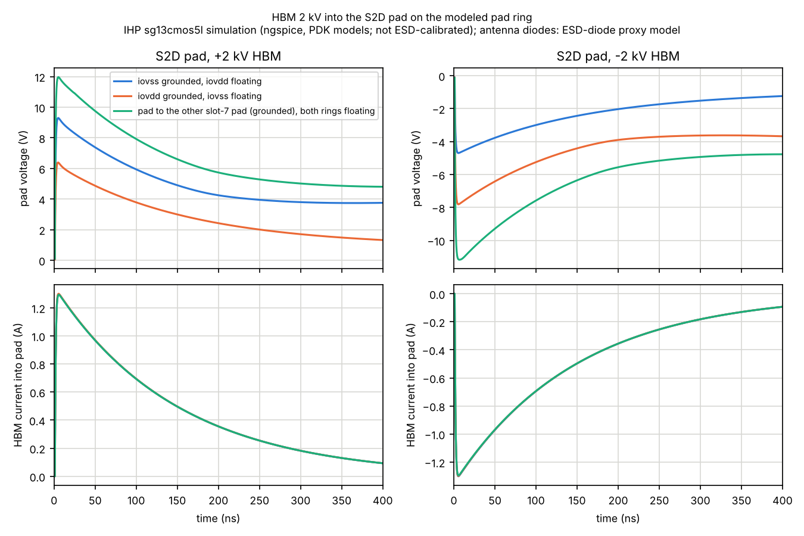
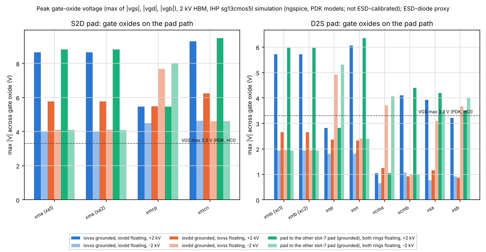
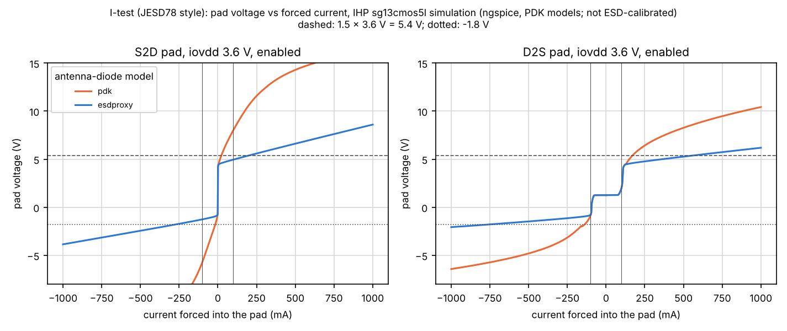
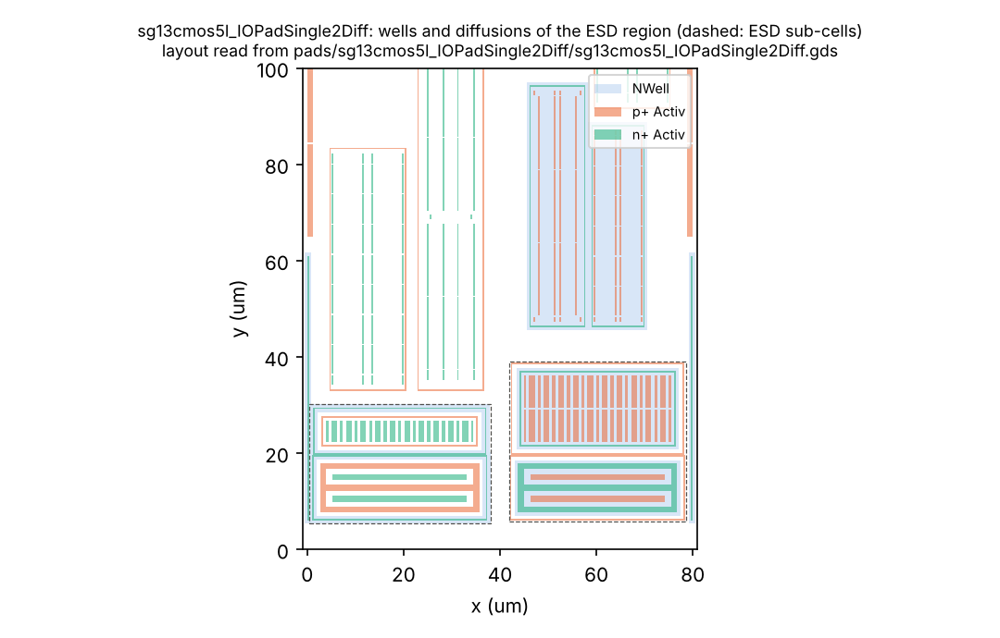

<!--
SPDX-FileCopyrightText: 2026 Christoph Maier
SPDX-License-Identifier: Apache-2.0
-->
# ESD (HBM) and latch-up of the slot-7 pads: results

**IHP sg13cmos5l simulation**, ngspice-47 with the IHP OSDI models, tt, 27 °C, runs of 2026-11-25. Method, ring model,
diode-model variants and how to reproduce: [README.md](README.md). Tables below are made by `tables.py` from `csv/`.

> **Model validity.** The PDK's diode and MOS models are **not calibrated for ESD currents**: no snapback, no
> high-injection or self-heating behavior fitted at ampere currents, no thermal failure model, no parasitic
> thyristor. The PDK antenna-diode model is fitted for reverse bias only and is unusable in forward at ESD currents
> (§1); the HBM tables therefore use the **ESD-diode proxy** (`esdproxy`: the PDK's `diodevss_mod` / `diodevdd_mod`
> scaled to the antenna-diode areas), which is itself not a model of these diodes. All numbers are **indicative**:
> where the current goes, and which gate oxides see how much of the pad voltage. They do **not** say whether the pads
> pass a given HBM level. Only silicon (HBM / TLP measurement) can.

## 0. Verdicts

| question | answer (indicative, see validity note) |
|---|---|
| Is there a supply clamp between iovdd and iovss? | **Yes.** Five `sg13cmos5l_IOPadIOVdd` cells, each an RC-triggered 756.8 µm NMOS clamp, 2.09 … 2.53 mm along the ring from the slot-7 pads (harness `tapeout_nov_2026`, `2ef5a869`). In every HBM run they keep \|iovdd − iovss\| at the pads ≤ 3.52 V (2 kV), so the core of both pads sees at most about the 3.6 V operating supply across its rails. |
| Peak pad voltage at ±2 kV | S2D: +9.30 / −4.70 V (iovss grounded), +6.39 / −7.81 V (iovdd grounded), +12.0 / −11.2 V (D2S pad grounded). D2S: +6.29 / −2.62 V, +3.52 / −5.60 V, +11.2 / −12.0 V. The S2D is higher because its diodes are 35 µm² per stripe against 83 … 85 µm² on the D2S. |
| Does any gate oxide see more than its rating? | **Against the only rating the PDK gives (VGS ≤ 3.3 V, a hot-carrier lifetime limit, not a breakdown limit): yes**, at 1 kV on both pads and already at 500 V on the S2D (input-device gate–drain 3.52 V, clamp MCN gate–drain 3.99 V). At 2 kV the S2D input devices XA1 / XA2 (gate = pad, no secondary protection) see **8.83 V gate-to-drain** (8.65 V with iovss grounded), the clamp gates 8.0 … 9.5 V; on the D2S the feedback inputs C1 / C2 (gate = pad) 5.98 V, the output devices 5.3 / 6.4 V, the Miller capacitors (behind 2 kΩ) 4.1 / 4.4 V. The PDK gives no gate-oxide breakdown or ESD rating, so whether 8.8 V across 7.3 … 7.5 nm of oxide for a few ns is destructive cannot be decided from the PDK; see §3.3. |
| Diode current density at 2 kV | S2D: 0.60 … 0.61 A per stripe, 17.1 … 17.5 mA/µm², 10.3 … 10.6 mA/µm of perimeter, 268 … 310 nJ per stripe. D2S: 0.59 … 0.63 A, 7.0 … 7.4 mA/µm², 4.3 … 4.6 mA/µm, 164 … 188 nJ. The 2 kΩ `d2s_sp2k` diodes carry ≤ 1.1 mA. |
| I-test ±100 mA at 3.6 V | S2D: the current goes into the supply through the pad diodes **and the clamp MOS channels** (MCP / MCN conduct as transistors once the pad is beyond the rail); pad +4.95 / −1.26 V (proxy) or +8.02 / −5.70 V (PDK diodes); outputs saturate (+100 mA: outp 3.29 V, outn 0.31 V); bias lines move ≤ 27 mV. D2S: the **enabled output stage sinks / sources the 100 mA itself** (ON 100 mA, OP 95 mA), pad +2.02 / −0.79 V, diode current ≤ 0.5 mA. 5.4 V on the pad needs 0.20 A (S2D, proxy; 23 mA with PDK diodes) and 0.57 A (D2S, proxy; 0.17 A with PDK diodes). |
| Overvoltage 5.4 V | supply current 0.435 → 0.489 mA; largest MOS stress \|vgs\| 4.49 V, \|vgd\| 5.05 V, \|vds\| 5.00 V (below BVDSS min 5.3 V), junctions 5.4 V (below 12 V); VGS ≤ 3.3 V exceeded on the enable switches and bias tree. |
| Latch-up | **cannot be simulated with the PDK models** (no parasitic PNPN). Layout: both pads use double guard rings around every ESD device; KLayout latch-up DRC (`-rd latchUpRules=true`): **0 violations** for both pads and the slot. Lumped PNPN with assumed parameters (§5.3): no latch for β_npn·β_pnp ≤ 1; otherwise trigger 24 mA … 0.70 A if 1 % of the injected carriers pass the guard rings, 2.4 … 70 mA if 10 % do. |
| PDK antenna-diode model as shipped | 12 of 16 HBM runs abort at the current edge; the 4 that finish put the S2D pad at −20.7 V (−2 kV, iovss grounded) and +13.2 V (+2 kV, iovdd grounded) (§3.4): model-limited, not a prediction. |
| CDM | not done (§6). |

## 1. What the compact models do at ESD currents

Forward voltage (DC, tt 27 °C) of the pad devices as the compact models give it (`iv.py`, `csv/model_iv.csv`,
[plots/model_iv.png](plots/model_iv.png)):

| model | device | V at 10 mA | V at 0.1 A | V at 0.5 A | V at 1.33 A |
|---|---|---|---|---|---|
| pdk | dpantenna 1.26x27.78 (S2D DP1) | 41.4 | 405 | 2019 | 5368 |
| pdk | dantenna 1.26x27.78 (S2D DN1) | 50.5 | 496 | 2473 | 6577 |
| pdk | dpantenna 1.26x65.8 (D2S DP0) | 18.5 | 176 | 873 | 2321 |
| pdk | dantenna 1.26x67.6 (D2S DN0) | 22.0 | 210 | 1047 | 2782 |
| pdk | MCP drain path, hv PMOS 266.4/0.6 ng 40 (S2D) | 1.20 | 4.44 | 10.6 | 13.3 |
| pdk | MCN drain path, hv NMOS 88/0.6 ng 20 (S2D) | 1.44 | 5.78 | 13.1 | 22.0 |
| pdk | OP drain path, hv PMOS 546.12/0.6 ng 82 (D2S) | 0.929 | 3.03 | 8.15 | 11.5 |
| pdk | ON drain path, hv NMOS 299.2/1 ng 68 (D2S) | 1.10 | 3.14 | 10.8 | 17.4 |
| esdproxy | dpantenna 1.26x27.78 (S2D DP1) | 1.00 | 1.82 | 5.19 | 12.1 |
| esdproxy | dantenna 1.26x27.78 (S2D DN1) | 0.979 | 1.60 | 3.97 | 8.76 |
| esdproxy | dpantenna 1.26x65.8 (D2S DP0) | 0.929 | 1.31 | 2.76 | 5.70 |
| esdproxy | dantenna 1.26x67.6 (D2S DN0) | 0.911 | 1.22 | 2.24 | 4.24 |

- The PDK antenna diodes have a series resistance of 2.2 … 4 kΩ per stripe and a high-injection knee near 10 µA: 405 V
  at 0.1 A. This is a model built for the reverse direction (`diodes.lib`), not a property of the silicon.
- "Drain path" = the pad-to-rail path of the clamp / output MOS with its gate tied as in the pad (MCP gate to iovdd
  via 6.768 kΩ, MCN gate to iovss via 1.959 kΩ, the rppd values of the IHP cells `Clamp_P20N0D` / `Clamp_N20N0D`; OP /
  ON gate at their own rail, as disabled). Once the pad is beyond the rail, the device conducts as a transistor with
  the pad as its source (gate − pad > V_T), in parallel with its drain junction; that is physical. The PSP junctions
  themselves are linearized above `imax` (2.0 / 2.5 mA for hv NMOS / PMOS), so they add little at ESD currents.
- Neither variant has snapback. A real gate-grounded NMOS such as MCN (gate tied to iovss by rppd; same size and gate tie as
  the IHP `Clamp_N20N0D`) would snap back near its trigger voltage and clamp the pad; the simulation cannot
  show that.

## 2. HBM network

`csv/hbm_network_check.csv` (2 kV): into a short, peak 1.30 A, 10–90 % rise 1.85 ns, 1/e decay 150 ns (L = 1.365 µH);
peak 1.23 A, rise 7.96 ns (L = 6.83 µH). Into 500 Ω: 0.98 A, 1.42 ns / 0.95 A, 6.39 ns, decay 200 ns. JS-001 asks
1.20 … 1.48 A into a short at 2 kV and a rise of 2 … 10 ns: the peak currents are inside, the fast network's rise
(1.85 ns, because the capacitor starts to discharge during the rise) is 0.15 ns short of the window. Its decay is
specified differently in JS-001 (130 … 170 ns, 90 % → 36.8 %); the 1/e time here, 150 ns, is the RC value.

## 3. HBM results (antenna diodes: ESD-diode proxy)

### 3.1 Pad and ring voltages

Waveforms at ±2 kV: [plots/hbm_wave_s2d.png](plots/hbm_wave_s2d.png), [plots/hbm_wave_d2s.png](plots/hbm_wave_d2s.png);
peak pad voltage against HBM level: [plots/hbm_vpad_peak.png](plots/hbm_vpad_peak.png). All 44 proxy runs ran to 1 µs.

**S2D pad**

| grounded | V_HBM (V) | L (µH) | I peak (A) | V pad peak (V) | V iovdd peak (V) | V iovss peak (V) | max \|iovdd − iovss\| (V) | RC clamps peak (A) |
|---|---|---|---|---|---|---|---|---|
| iovss | 500 | 1.36 | 0.323 | 3.93 | 2.21 | 0.000236 | 2.21 | 0.323 |
| iovss | −500 | 1.36 | −0.325 | −1.94 | −0.0548 | −0.0182 | 0.0366 | 0.00364 |
| iovss | 1000 | 1.36 | 0.648 | 5.78 | 2.44 | 0.000329 | 2.44 | 0.648 |
| iovss | −1000 | 1.36 | −0.651 | −2.87 | −0.078 | −0.0365 | 0.0415 | 0.00499 |
| iovss | 2000 | 1.36 | 1.30 | 9.30 | 3.28 | 0.000473 | 3.28 | 1.30 |
| iovss | −2000 | 1.36 | −1.30 | −4.70 | −0.117 | −0.073 | 0.0451 | 0.00685 |
| iovdd | 500 | 1.36 | 0.325 | 2.35 | 0.0867 | 0.0577 | 0.0291 | 0.00289 |
| iovdd | −500 | 1.36 | −0.324 | −3.58 | −0.0015 | −2.20 | 2.20 | 0.324 |
| iovdd | 1000 | 1.36 | 0.65 | 3.72 | 0.174 | 0.0871 | 0.0865 | 0.0041 |
| iovdd | −1000 | 1.36 | −0.649 | −5.04 | −0.00219 | −2.44 | 2.44 | 0.649 |
| iovdd | 2000 | 1.36 | 1.30 | 6.39 | 0.347 | 0.14 | 0.208 | 0.00558 |
| iovdd | −2000 | 1.36 | −1.30 | −7.81 | −0.00331 | −3.19 | 3.19 | 1.30 |
| D2S pad | 500 | 1.36 | 0.323 | 5.36 | 3.20 | 1.37 | 2.22 | 0.317 |
| D2S pad | −500 | 1.36 | −0.322 | −5.17 | −1.51 | −3.25 | 2.21 | 0.318 |
| D2S pad | 1000 | 1.36 | 0.646 | 7.67 | 4.15 | 1.76 | 2.48 | 0.635 |
| D2S pad | −1000 | 1.36 | −0.646 | −7.23 | −2.04 | −4.41 | 2.46 | 0.629 |
| D2S pad | 2000 | 1.36 | 1.29 | 12.0 | 5.97 | 2.48 | 3.49 | 1.24 |
| D2S pad | −2000 | 1.36 | −1.29 | −11.2 | −3.08 | −6.60 | 3.52 | 1.26 |
| iovss | 2000 | 6.83 | 1.22 | 8.73 | 3.17 | 0.000213 | 3.17 | 1.22 |
| iovss | −2000 | 6.83 | −1.23 | −4.49 | −0.109 | −0.0688 | 0.0435 | 0.00323 |
| iovdd | 2000 | 6.83 | 1.22 | 5.90 | 0.327 | 0.133 | 0.195 | 0.00257 |
| iovdd | −2000 | 6.83 | −1.22 | −7.49 | −0.00138 | −3.08 | 3.08 | 1.22 |

**D2S pad**

| grounded | V_HBM (V) | L (µH) | I peak (A) | V pad peak (V) | V iovdd peak (V) | V iovss peak (V) | max \|iovdd − iovss\| (V) | RC clamps peak (A) |
|---|---|---|---|---|---|---|---|---|
| iovss | 500 | 1.36 | 0.324 | 3.23 | 2.21 | 0.000294 | 2.21 | 0.319 |
| iovss | −500 | 1.36 | −0.325 | −1.40 | −0.119 | −0.0133 | 0.106 | 0.00517 |
| iovss | 1000 | 1.36 | 0.648 | 4.26 | 2.44 | 0.000959 | 2.44 | 0.631 |
| iovss | −1000 | 1.36 | −0.65 | −1.82 | −0.156 | −0.0266 | 0.132 | 0.00749 |
| iovss | 2000 | 1.36 | 1.30 | 6.29 | 3.22 | 0.0026 | 3.22 | 1.26 |
| iovss | −2000 | 1.36 | −1.30 | −2.62 | −0.228 | −0.0532 | 0.178 | 0.00985 |
| iovdd | 500 | 1.36 | 0.325 | 1.61 | 0.0871 | 0.201 | 0.122 | 0.00473 |
| iovdd | −500 | 1.36 | −0.324 | −3.16 | −0.0022 | −2.20 | 2.20 | 0.319 |
| iovdd | 1000 | 1.36 | 0.65 | 2.26 | 0.174 | 0.342 | 0.178 | 0.00676 |
| iovdd | −1000 | 1.36 | −0.649 | −3.95 | −0.0031 | −2.43 | 2.43 | 0.64 |
| iovdd | 2000 | 1.36 | 1.30 | 3.52 | 0.349 | 0.511 | 0.164 | 0.00935 |
| iovdd | −2000 | 1.36 | −1.30 | −5.60 | −0.0128 | −3.11 | 3.10 | 1.25 |
| S2D pad | 500 | 1.36 | 0.322 | 5.17 | 3.66 | 1.92 | 2.21 | 0.318 |
| S2D pad | −500 | 1.36 | −0.323 | −5.36 | −2.26 | −4.00 | 2.22 | 0.317 |
| S2D pad | 1000 | 1.36 | 0.646 | 7.23 | 5.20 | 2.83 | 2.46 | 0.629 |
| S2D pad | −1000 | 1.36 | −0.646 | −7.67 | −3.54 | −5.91 | 2.48 | 0.635 |
| S2D pad | 2000 | 1.36 | 1.29 | 11.2 | 8.11 | 4.63 | 3.51 | 1.26 |
| S2D pad | −2000 | 1.36 | −1.29 | −12.0 | −6.03 | −9.50 | 3.48 | 1.24 |
| iovss | 2000 | 6.83 | 1.22 | 6.17 | 3.16 | 0.00122 | 3.16 | 1.22 |
| iovss | −2000 | 6.83 | −1.23 | −2.52 | −0.249 | −0.0501 | 0.2 | 0.00455 |
| iovdd | 2000 | 6.83 | 1.23 | 3.37 | 0.329 | 0.497 | 0.182 | 0.00426 |
| iovdd | −2000 | 6.83 | −1.22 | −5.45 | −0.00843 | −3.04 | 3.04 | 1.20 |

Reading the tables:

- **Current paths.** Positive zap, iovss grounded: pad → `dpantenna` pair (and MCP / OP) → iovdd ring → the five RC
  clamps (they carry all of it, 0.25 … 0.29 A each at 2 kV) → iovss. Negative zap, iovss grounded: iovss → `dantenna`
  pair → pad, directly. With iovdd grounded the roles swap: the positive zap goes straight into iovdd, the negative one
  pulls iovss down through the RC clamps' body diodes and IOVss diodes (the clamps' "RC clamps peak" column is then the
  reverse current through them). Pad-to-pad: diode of the zapped pad → ring → RC clamps → diode of the other pad.
- **The RC clamps work in the model**: \|iovdd − iovss\| ≤ 3.52 V at 2 kV, 2.2 … 2.5 V at 0.5 … 1 kV.
- **Ring resistance** (2.1 mm to the nearest clamp at 0.25 mΩ/µm) adds about 0.5 Ω, ≈ 0.65 V at 1.3 A.
- **Rise time**: with the 10 ns network the peaks drop by 0.15 … 0.6 V (last four rows of each table).
- What the table **does not** include: snapback of MCN / ON (would lower the positive peaks when iovss is the
  reference), the junction capacitance and clamps of the other 50-odd pads on the ring (more parallel paths), any
  on-chip decoupling between iovdd and iovss, the package.

### 3.2 Diode currents, current densities and energy

Largest forward current per diode over all proxy runs (`csv/hbm_diodes.csv`; perimeter = 2 (l + w)):

| diode | size l × w (µm) | area (µm²) | \|V_HBM\| (V) | I peak (A) | I / area (mA/µm²) | I / perimeter (mA/µm) | energy (nJ) | worst run |
|---|---|---|---|---|---|---|---|---|
| S2D DP1 / DP2 (dpantenna) | 27.78 × 1.26 | 35.0 | 500 | 0.152 | 4.33 | 2.61 | 34.4 | iovdd gnd, +500 |
| | | | 1000 | 0.304 | 8.68 | 5.23 | 99.0 | iovdd gnd, +1 kV |
| | | | 2000 | 0.603 | 17.2 | 10.4 | 310 | iovdd gnd, +2 kV |
| S2D DN1 / DN2 (dantenna) | 27.78 × 1.26 | 35.0 | 500 | 0.153 | 4.37 | 2.64 | 33.3 | iovss gnd, −500 |
| | | | 1000 | 0.306 | 8.76 | 5.28 | 90.2 | iovss gnd, −1 kV |
| | | | 2000 | 0.613 | 17.5 | 10.6 | 269 | iovss gnd, −2 kV |
| D2S DP0 / DP1 (dpantenna) | 65.8 × 1.26 | 82.9 | 500 | 0.156 | 1.88 | 1.16 | 27.9 | iovdd gnd, +500 |
| | | | 1000 | 0.311 | 3.75 | 2.32 | 69.5 | iovdd gnd, +1 kV |
| | | | 2000 | 0.614 | 7.40 | 4.58 | 188 | iovdd gnd, +2 kV |
| D2S DN0 / DN1 (dantenna) | 67.6 × 1.26 | 85.2 | 500 | 0.16 | 1.88 | 1.16 | 27.7 | iovss gnd, −500 |
| | | | 1000 | 0.32 | 3.75 | 2.32 | 65.9 | iovss gnd, −1 kV |
| | | | 2000 | 0.633 | 7.43 | 4.59 | 169 | iovss gnd, −2 kV |
| D2S `d2s_sp2k` dpantenna (A / B) | 4.98 × 0.64 | 3.19 | 2000 | 0.00108 | 0.339 | 0.096 | 0.163 | iovdd gnd, +2 kV |

- The two stripes of each pair share the current equally (identical models, identical connection). The clamp MOS
  devices take the rest: S2D MCP up to 0.137 A at +2 kV (iovss grounded), i.e. about 10 % of the zap.
- Energy is ∫ V_ak · I dt over 1 µs, in the diode model including its series resistance; with the proxy model most of
  it is I²·R in the 5.7 / 8.3 Ω (S2D) or 2.4 / 3.5 Ω (D2S) series resistance.
- For orientation on size, not a rating: the PDK's sg13g2 ESD-diode cells that the proxy models belong to are named
  `diodevdd_2kv` / `diodevss_2kv` with a device area of 35 µm² (`sg13g2_esd.lib`) and `_4kv` with 70 µm². Each S2D
  polarity has 2 × 35.0 µm², each D2S polarity 2 × 83 … 85 µm². Whether antenna-diode stripes and those cells have
  the same current capability per area is not known from the PDK.

### 3.3 Gate oxides on the pad path

Largest voltage across each gate oxide (max over time of \|vgs\|, \|vgd\|, \|vgb\|) over **all** proxy runs and
configurations at each level (`csv/hbm_mos.csv`, [plots/hbm_oxide.png](plots/hbm_oxide.png) for ±2 kV per
configuration). "Worst run" names the zapped pad, the grounding and the polarity.

| pad | device (gate connection) | 500 V | 1 kV | 2 kV | worst run at 2 kV |
|---|---|---|---|---|---|
| S2D | XA1 / XA2 input PMOS 20 / 1 (gate = pad; \|vgd\|, drain = fold node y) | 3.52 | 5.37 | 8.83 | S2D zapped, D2S pad grounded, +2 kV (8.65 V with iovss grounded) |
| S2D | MCP clamp PMOS (drain = pad, gate via rppd to iovdd; \|vgd\|) | 3.62 | 5.13 | 8.03 | S2D, D2S grounded, −2 kV |
| S2D | MCN clamp NMOS (drain = pad, gate via rppd to iovss; \|vgd\|) | 3.99 | 5.91 | 9.49 | D2S zapped −2 kV, S2D pad grounded |
| D2S | C1 / C2 feedback input PMOS 20 / 1 (gate = vfb = pad; \|vgd\|) | 2.81 | 3.91 | 5.98 | S2D zapped −2 kV, D2S pad grounded |
| D2S | OP output PMOS (drain = pad, gate = a; \|vgd\|) | 2.97 | 3.56 | 5.31 | S2D zapped +2 kV, D2S pad grounded |
| D2S | ON output NMOS (drain = pad, gate = b; \|vgd\|) | 3.04 | 4.19 | 6.36 | S2D zapped −2 kV, D2S pad grounded |
| D2S | CMA Miller cap (gate = a, body = pa = pad via 2 kΩ) | 2.93 | 3.25 | 4.06 | S2D zapped +2 kV, D2S pad grounded |
| D2S | CMB Miller cap (gate = pb = pad via 2 kΩ, body = b) | 2.94 | 3.26 | 4.40 | S2D zapped −2 kV, D2S pad grounded |
| D2S | SA / SB disable switches (a → iovdd, b → iovss) | 2.73 | 3.09 | 4.19 | pad-to-pad |

Devices off the pad path (bias tree, enable switches, core) are recorded only where they were the largest of their pad
in a run (`role` = "largest …" in `csv/hbm_mos.csv`): in runs where that pad was neither zapped nor the return, with
at most 2.21 / 2.44 / 3.26 V at 500 V / 1 kV / 2 kV, and once in a zapped pad (D2S cascode XPCR, 1.76 V, iovdd
grounded, +1 kV); in all other runs they are below the pad-path maximum of the run. The worst values come from the pad-to-pad configuration, where both rings float and the grounded pad's own devices
see the ring swing. Against what the PDK documents give:

| reference | value | source | exceeded at 2 kV by |
|---|---|---|---|
| maximum VGS, hv MOS (L ≥ 0.6 / 0.5 µm), 27 °C | 3.3 V | process spec 2.1.4 / 2.1.5, footnote "1 FIT in 10 years for HCI" (a lifetime limit, not a breakdown voltage) | every device in the table above (at 500 V: the S2D input devices and both S2D clamps) |
| drain–source breakdown BVDSS, hv NMOS / PMOS (100 pA/µm criterion) | ≥ 5.3 V / ≥ 5.3 V | process spec 2.1.4 / 2.1.5 | \|vds\| of MCN 9.5 V, MCP 8.1 V, ON 6.6 V, OP 5.95 V (the models have no snapback, so they just sit there) |
| junction breakdown | 12 V | process spec BVNPWHV | not reached (pad ≤ 12.0 V against its own rail) |
| gate-oxide thickness, hv | 7.3 nm (n-well), 7.5 nm (p-well) | process spec 3.6 | 8.83 V across 7.3 nm is 12.1 MV/cm |

The PDK gives **no gate-oxide breakdown voltage and no ESD rating**, so the question "does an oxide exceed its rating"
has only the 3.3 V answer: yes, by a factor up to 2.9 at 2 kV. For orientation only (not a PDK number): intrinsic
breakdown fields of thermal SiO2 are usually quoted around 10 MV/cm for DC stress, somewhat higher for ns pulses; the
S2D input gate at 2 kV (12.1 MV/cm) is in that range in this model. The most exposed oxides are the **S2D input
devices**: their gate is the pad with no series resistor or secondary clamp (design choice, HOW_IT_WORKS §2.5), and
their drain (fold node y) stays near iovss while the pad rises. Real snapback of MCN would cap the positive pad voltage
(iovss reference) near its trigger voltage, which the PDK does not give.

### 3.4 PDK antenna-diode model as shipped

The same zaps with `dantenna` / `dpantenna` as shipped (16 runs: both pads, iovss or iovdd grounded, ±500 V and
±2 kV; 240 s wall-time limit per run; `csv/hbm_summary.csv`, rows `hbm_pdk_*`). "aborted" = ngspice stopped with
"timestep too small"; the peak values are those reached until then.

| pad | grounded | V_HBM (V) | status | ran to (ns) | V pad peak (V) | V iovdd peak (V) | V iovss peak (V) |
|---|---|---|---|---|---|---|---|
| s2d | iovss gnd | 500 | aborted | 1.28 | 6.96 | 1.12 | 0.000596 |
| s2d | iovss gnd | -500 | ok | 1000 | -10.8 | -0.859 | -0.0173 |
| s2d | iovss gnd | 2000 | aborted | 1.21 | 9.33 | 1.39 | 0.00279 |
| s2d | iovss gnd | -2000 | ok | 1000 | -20.7 | -1.54 | -0.0667 |
| s2d | iovdd gnd | 500 | ok | 1000 | 9.20 | 0.0855 | 0.35 |
| s2d | iovdd gnd | -500 | aborted | 1.29 | -7.06 | -0.00334 | -1.15 |
| s2d | iovdd gnd | 2000 | ok | 1000 | 13.2 | 0.346 | 0.792 |
| s2d | iovdd gnd | -2000 | aborted | 1.22 | -8.90 | -0.0157 | -1.43 |
| d2s | iovss gnd | 500 | aborted | 1.28 | 4.89 | 1.11 | 0.000486 |
| d2s | iovss gnd | -500 | aborted | 14.5 | -7.49 | -0.879 | -0.0124 |
| d2s | iovss gnd | 2000 | aborted | 1.15 | 1.85 | 0.135 | 0.000541 |
| d2s | iovss gnd | -2000 | aborted | 1.10 | -0.0529 | -0.0107 | -4.38e-13 |
| d2s | iovdd gnd | 500 | stopped after 240 s wall time at t = 1.182 ns |  |  |  |  |
| d2s | iovdd gnd | -500 | aborted | 1.30 | -5.79 | -0.00474 | -1.12 |
| d2s | iovdd gnd | 2000 | aborted | 1.10 | 0.0231 | 5.08e-12 | 0.00123 |
| d2s | iovdd gnd | -2000 | aborted | 1.10 | -0.0501 | -3.44e-12 | -0.00767 |

- 12 of 16 runs stop in the first 0.1 … 14 ns, at the current edge, with the pad at up to 9.3 V; the solver cannot
  follow the 2 … 4 kΩ forward branches of the diode model together with the MOS junctions.
- The four S2D runs that finish show what the model implies: the antenna diodes carry only 2 … 4 mA, the clamp MOS
  devices (MCN / MCP as transistors and through their linearized junctions) carry the rest, and the pad reaches
  **−10.8 V (−500 V) and −20.7 V (−2 kV)** with iovss grounded, **+9.2 V (+500 V) and +13.2 V (+2 kV)** with iovdd
  grounded; the S2D input-device oxide then sees 10.1 V (−500 V) to 19.9 V (−2 kV).
- These numbers are a property of a model that its authors fitted for reverse bias only; they are not a prediction of
  the silicon. They do show that, without a forward-capable diode model, every conclusion about the pad voltage depends
  on the model rather than on the circuit, which is why the tables in §3.1 … §3.3 use the proxy.

## 4. I-test and overvoltage (JESD78 style)

### 4.1 I-test, iovdd = 3.6 V, both pads enabled

DC current forced into one pad, swept 0 → ±1 A (`latchup.py`, `csv/itest.csv`, [plots/itest_vpad.png](plots/itest_vpad.png)).
Supply current at zero injection 0.435 mA (both pads and the ring). JESD78 limits the pad voltage to 1.5 × VDD = 5.4 V
for positive injection; for negative injection the table uses −1.8 V (0.5 × VDD beyond the rail, the mirror of
the positive limit; my choice, JESD78 does not define it this way).

| diode model | pad | forced | V pad (V) | I for 5.4 V / −1.8 V (A) | where the 100 mA goes | I supply (mA) | effect on the circuit |
|---|---|---|---|---|---|---|---|
| esdproxy | S2D | +100 mA | 4.95 | 0.205 | DP1 + DP2 87.5 mA, MCP 12.5 mA → iovdd; the 3.6 V supply sinks it | −99.6 | outp / outn saturate at 3.29 / 0.31 V (from 1.95 / 0.59 V); bias lines vbp +27 mV, vbpc +27 mV, vbn / vbnc < 1 mV; D2S output unchanged (1.2601 V) |
| esdproxy | S2D | −100 mA | −1.26 | 0.276 | DN1 + DN2 92.9 mA, MCN 7.1 mA from iovss → iovss bond pads | 0.435 | outp / outn 0.39 / 2.16 V (saturated); vbn −5.6 mV; D2S output −3.8 mV |
| pdk | S2D | +100 mA | 8.02 | 0.023 | MCP 98.3 mA (PMOS channel: pad above its gate, which is tied to iovdd), diodes 1.7 mA | −99.6 | as above |
| pdk | S2D | −100 mA | −5.70 | 0.0168 | MCN 98.1 mA (NMOS channel), diodes 1.9 mA | 0.435 | as above |
| esdproxy | D2S | +100 mA | 2.02 | 0.572 | **ON 100.0 mA** (the loop drives the output NMOS), diodes < 1 nA → iovss | 0.209 | pad pulled 0.76 V above its 1.26 V target; supply current drops (the output PMOS is off); S2D-side bias +4 mV |
| esdproxy | D2S | −100 mA | −0.79 | 0.763 | **OP 94.9 mA** from the 3.6 V supply, ON body 4.1 mA, DN 0.48 mA | 95.1 | bias vbp / vbpc −25 mV (iovdd at the pad sags 26 mV on the ring) |
| pdk | D2S | +100 mA | 2.02 | 0.172 | ON 100 mA | 0.209 | as above |
| pdk | D2S | −100 mA | −0.83 | 0.139 | OP 95.0 mA, ON 4.96 mA | 95.2 | as above |

- At ±100 mA no pad reaches 5.4 V / −1.8 V with the proxy; with the PDK diodes the S2D does (at 23 / 17 mA). With
  either model the S2D input is then driven to 5 … 8 V or −1.3 … −5.7 V, i.e. its input-device gate oxides see up to
  about the pad voltage minus the fold-node voltage for the duration of the test (JESD78 injection is DC-like).
- The D2S output stage is strong enough to hold the pad within 2.02 / −0.79 V up to ±100 mA (plateau in the plot up to
  about ±100 mA); beyond that the diodes take over.
- The values at 0 mA for the S2D (pad floating) differ between the two models (0.22 V / 1.17 V): the S2D pad is a pure
  gate input; with nothing driving it, its voltage is set by leakage.

### 4.2 Supply overvoltage 5.4 V

Operating point with iovdd swept 0 … 5.4 V, both pads enabled at the slot operating point (`csv/overvoltage.csv`,
[plots/overvoltage_isupply.png](plots/overvoltage_isupply.png)):

| pad | supply (V) | I supply (mA) | max \|vgs\| (V), device | max \|vgd\| (V), device | max \|vds\| (V), device | max \|vdb\| (V), device |
|---|---|---|---|---|---|---|
| S2D | 3.6 | 0.435 | 2.69, xt.XTGN | 3.01, xa.XTNP | 3.21, xa.xs.XCYC | 3.60, xa.xs.XCYC |
| S2D | 5.4 | 0.489 | 4.49, xt.XTGN | 5.05, xa.XTNP | 5.00, xa.xs.XCYC | 5.40, xa.xs.XCYC |
| D2S | 3.6 | 0.435 | 2.69, xt.XTGN | 2.68, xt.XTGN | 2.69, xt.XPBN | 2.95, xd.XFPL |
| D2S | 5.4 | 0.489 | 4.49, xt.XTGN | 4.48, xt.XTGN | 4.47, xt.XPBN | 4.74, xd.XFPL |

(The supply current is the total of both pads plus the ring cells.) At 5.4 V the largest \|vds\| (5.00 V) stays below
BVDSS min 5.3 V and junctions (≤ 5.4 V) below 12 V; gate voltages exceed the 3.3 V VGS limit on the enable switches
(XTGN, XTNP, L = 0.45 µm, for which the process spec gives no VGS maximum) and on any device whose gate is at a rail. In
DC the RC clamps stay off (their trigger is dV/dt), so the supply current rises only 12 %. No breakdown or latch-up
mechanism is in the models, so "no damage" is not shown by this run. Below about 2 V supply the plotted current
reflects the ideal `vcm` / `vref` sources, which stay at 1.26 / 0.49 V while the supply ramps.

## 5. Latch-up

### 5.1 Layout rule check (cited)

`signoff/taped_out_158afc5/reports/S2D.maxlu.txt`, `D2S.maxlu.txt`, `slot_7.maxlu.txt`: KLayout maximal deck of the
PDK with `-rd latchUpRules=true` (rules LU.a / LU.b: every p+ in n-well and n+ in p-well within 20 µm of a tie; LU.c,
c1, d, d1), 271 rule categories, **0 violations** for both pads and for `slot_7`. A rule check of tie distances, not
a proof of latch-up immunity.

### 5.2 Geometry of the ESD region (`lu_geometry.py`, `csv/lu_geometry.csv`, [plots/lu_layout_s2d.png](plots/lu_layout_s2d.png), [plots/lu_layout_d2s.png](plots/lu_layout_d2s.png))

- Every ESD sub-cell uses the double guard ring of the PDK latch-up guideline (layout rules §7.2.1): the n+ devices
  (`DCNDiode`, `Clamp_N_M1`) sit in a p+ ring inside an n-well ring (n-well ring width 1.58 µm); the p+ devices
  (`DCPDiode`, `Clamp_P_M1`) sit in an n-well with an n+ ring and an outer p+ ring.
- S2D: n+ (N side, left) to the n-well of the P side (right): 8.96 µm; n+ of the N cells to the nearest core PMOS
  well: 21.9 µm; P-side well to the nearest core n+: 8.63 µm.
- D2S (stacked vertically: two clamp N cells, DCN, Miller caps, DCP, clamp P, core): n+ to P-side well 17.3 µm; n+ to
  the nearest other well holding p+ 6.33 µm (the Miller-capacitor wells, body = pa / b, not a supply); P-side well to
  the nearest core n+ 7.24 µm.

### 5.3 Lumped parasitic thyristor (all parameters assumed)

`scr.py`, `csv/scr_trigger.csv`, [plots/scr_trigger.png](plots/scr_trigger.png). **Every parameter here is an
assumption; nothing comes from the PDK.** Structure: PNP (emitter = p+ at iovdd, base = n-well node, collector =
substrate node) and NPN (emitter = n+ at iovss, base = substrate node, collector = n-well node), n-well resistance
R_nw to the iovdd tie, substrate resistance R_sub to the iovss guard ring, Gummel–Poon BJTs with IS = 1e-15 A
(V_BE ≈ 0.72 V at 1 mA) and 10 Ω emitter / collector series resistance, iovdd 3.6 V. Injection: a fraction α of the
forced pad current reaches the victim behind the guard rings (negative injection: electrons collected by the well;
positive: holes collected by the substrate). Supply ramped from 0 V so the PNPN starts off; injection held 2 µs, then
removed; "latched" = supply current > 1 mA 3.7 µs after removal; trigger current by bisection. Ranges: β 0.5 … 10
each, R_nw and R_sub 300 Ω and 3000 Ω each (chosen to span a decade; the process spec lists no n-well or substrate sheet
resistance from which to compute them), α 1 % and 10 % (the guard rings collect the rest).

| β_npn × β_pnp | injection | α | R_nw 300 Ω, R_sub 300 Ω | R_nw 300 Ω, R_sub 3000 Ω | R_nw 3000 Ω, R_sub 300 Ω | R_nw 3000 Ω, R_sub 3000 Ω |
|---|---|---|---|---|---|---|
| 0.5 × 0.5 | − | 0.01 | no latch ≤ 1 A | no latch ≤ 1 A | no latch ≤ 1 A | no latch ≤ 1 A |
| 0.5 × 0.5 | − | 0.1 | no latch ≤ 1 A | no latch ≤ 1 A | no latch ≤ 1 A | no latch ≤ 1 A |
| 0.5 × 0.5 | + | 0.01 | no latch ≤ 1 A | no latch ≤ 1 A | no latch ≤ 1 A | no latch ≤ 1 A |
| 0.5 × 0.5 | + | 0.1 | no latch ≤ 1 A | no latch ≤ 1 A | no latch ≤ 1 A | no latch ≤ 1 A |
| 0.5 × 2 | − | 0.01 | no latch ≤ 1 A | no latch ≤ 1 A | no latch ≤ 1 A | no latch ≤ 1 A |
| 0.5 × 2 | − | 0.1 | no latch ≤ 1 A | no latch ≤ 1 A | no latch ≤ 1 A | no latch ≤ 1 A |
| 0.5 × 2 | + | 0.01 | no latch ≤ 1 A | no latch ≤ 1 A | no latch ≤ 1 A | no latch ≤ 1 A |
| 0.5 × 2 | + | 0.1 | no latch ≤ 1 A | no latch ≤ 1 A | no latch ≤ 1 A | no latch ≤ 1 A |
| 2 × 0.5 | − | 0.01 | no latch ≤ 1 A | no latch ≤ 1 A | no latch ≤ 1 A | no latch ≤ 1 A |
| 2 × 0.5 | − | 0.1 | no latch ≤ 1 A | no latch ≤ 1 A | no latch ≤ 1 A | no latch ≤ 1 A |
| 2 × 0.5 | + | 0.01 | no latch ≤ 1 A | no latch ≤ 1 A | no latch ≤ 1 A | no latch ≤ 1 A |
| 2 × 0.5 | + | 0.1 | no latch ≤ 1 A | no latch ≤ 1 A | no latch ≤ 1 A | no latch ≤ 1 A |
| 0.5 × 10 | − | 0.01 | 271 mA | 228 mA | 44.3 mA | 24.1 mA |
| 0.5 × 10 | − | 0.1 | 27.1 mA | 22.8 mA | 4.43 mA | 2.42 mA |
| 0.5 × 10 | + | 0.01 | 703 mA | 462 mA | 266 mA | 62 mA |
| 0.5 × 10 | + | 0.1 | 70.3 mA | 46.1 mA | 26.6 mA | 6.2 mA |
| 2 × 2 | − | 0.01 | 359 mA | 235 mA | 128 mA | 31.8 mA |
| 2 × 2 | − | 0.1 | 35.9 mA | 23.5 mA | 12.8 mA | 3.18 mA |
| 2 × 2 | + | 0.01 | 359 mA | 128 mA | 235 mA | 31.8 mA |
| 2 × 2 | + | 0.1 | 35.9 mA | 12.8 mA | 23.5 mA | 3.18 mA |
| 2 × 10 | − | 0.01 | 271 mA | 226 mA | 44.1 mA | 24.1 mA |
| 2 × 10 | − | 0.1 | 27.1 mA | 22.6 mA | 4.41 mA | 2.41 mA |
| 2 × 10 | + | 0.01 | 357 mA | 127 mA | 234 mA | 31.7 mA |
| 2 × 10 | + | 0.1 | 35.7 mA | 12.7 mA | 23.4 mA | 3.17 mA |
| 10 × 10 | − | 0.01 | 271 mA | 226 mA | 44 mA | 24.1 mA |
| 10 × 10 | − | 0.1 | 27.1 mA | 22.6 mA | 4.4 mA | 2.41 mA |
| 10 × 10 | + | 0.01 | 271 mA | 44 mA | 226 mA | 24.1 mA |
| 10 × 10 | + | 0.1 | 27.1 mA | 4.4 mA | 22.6 mA | 2.41 mA |

- **No latch at all for β_npn · β_pnp ≤ 1** (the regenerative loop gain cannot exceed 1), whatever the injection.
- Where the loop gain is > 1, the trigger current scales as 1 / α and falls with the resistances, of the order of
  0.7 V / (α · R) (with equal R_nw = R_sub = 300 Ω and α = 1 %: 0.27 … 0.36 A against 0.23 A from that estimate):
  **24 mA … 0.70 A at α = 1 %, 2.4 … 70 mA at α = 10 %**. A trigger current below the JESD78 100 mA appears only with α = 10 %, or with
  α = 1 % and both resistances at 3 kΩ.
- The lumped model says what would have to be true for latch-up at 100 mA (10 % of the injected carriers past the
  double guard rings into a well or substrate region with ≥ 1 kΩ to its tie, and parasitic β product > 1). It cannot
  say whether that is true here; that needs either a TCAD / calibrated parasitic-bipolar model of the process or a
  JESD78 measurement. The geometry (§5.2: double guard rings around every pad-connected diffusion, ≥ 8.6 µm from the
  ESD devices to the core's opposite-type diffusions, LU rules clean) is what one would draw to keep α small.

## 6. What could not be done

- **Snapback, second breakdown, thermal failure, high-injection physics**: not in the PDK models; no TLP data. The
  peak voltages are those of non-snapping devices with an ESD-diode proxy; a real pass / fail level needs silicon
  (HBM tester or TLP).
- **Calibrated antenna-diode forward model**: none in the PDK; the proxy is the PDK's sg13g2 ESD-diode model scaled by
  area. The PDK model as shipped does not converge at ESD currents (§3.4).
- **CDM**: not done. A charged-device model needs the package and die capacitance to ground and the discharge path
  inductance, none of which is known for this chip and package; the compact models' behavior in the sub-ns range
  (overshoot before junctions conduct) is also not calibrated. Making those numbers up would violate the no-invented-numbers rule of this study.
- **Rest of the ring**: the 32 `IOPadAnalog` and the GPIO / 1.2 V supply cells on the same rings, on-chip decoupling,
  the core `vss` ring and the 1.2 V domain (JS-001 pin groups other than iovdd / iovss) are not modeled; supply-pad
  zaps (iovdd to iovss) were not run.
- **Corners and temperature**: only tt, 27 °C. JESD78 I-test at 125 °C (Class II) not run.
- **Latch-up trigger**: the PDK has no model of the parasitic bipolars; §5.3 is an assumption-driven estimate. A
  well / substrate resistance from layout would need the n-well and substrate sheet resistance, which the process
  spec does not list.
- **Layout parasitics**: schematic pad netlists; the pad metal resistance between the bond pad, the diodes and the
  clamps is not included (the magic PEX of the D2S is C-only).
