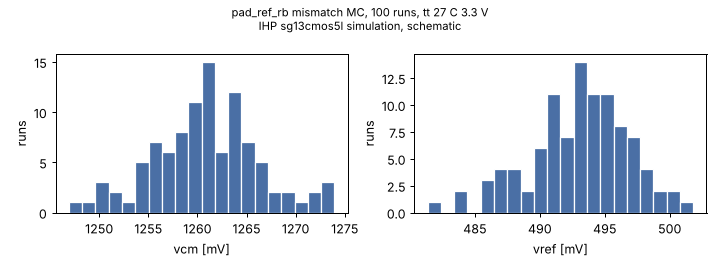
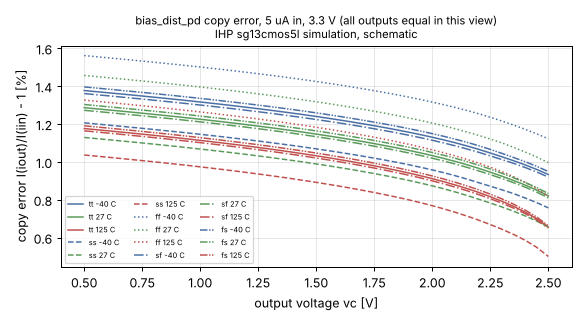

<!--
SPDX-FileCopyrightText: 2026 Christoph Maier
SPDX-License-Identifier: Apache-2.0
-->
# Results: pad_ref_rb post-layout and mismatch, bias_dist_pd copy accuracy

IHP sg13cmos5l simulation (ngspice-47, PSP 103 OSDI, CACE 2.11), 2026-11-23. Layout: the cells of
`final/gds/slot_7.gds` (slot commit `158afc5`), XOR-identical to the macro GDS at design commit `9052bd35`; extraction
magic C-coupled (`sak-pex.sh -m 2`), netgen LVS of the extractions against the source netlists: match uniquely. Method,
commands and limits: [README.md](README.md). All numbers below are copied from `results/tables.md` as written by
`run.sh` (JOBS=1 run); the CSVs behind them are in `results/`.

## 1. pad_ref_rb: PEX view vs schematic

**Result: the PEX view gives the schematic's numbers.** Largest difference of one run: 0.1 mV in Vcm (vcm_dc_params
and vref_cold_params, tt −40 °C 3.3 V: committed 1.24742 V, schematic rerun 1.24749 V, PEX 1.24752 V); every other DC
quantity agrees to the 6 significant digits of the CSVs. The same 0.07 mV appears between the schematic rerun and the
committed CSV, so 0.1 mV is the numerical resolution of that operating point, not a layout effect. This is expected:
the C-coupled extraction adds only capacitances (77 in pad_ref_rb, 181 fF in total) to the same devices, and every group
here is a DC operating point. In pd_params the disabled outputs differ by at most 0.12 nV (Vref) and the supply current
by 0.1 pA, from the extracted junction areas / perimeters (ad, as, pd, ps).

All six groups pass on the PEX view (CACE summaries in `results/cace_pex/`):

| group (conditions) | quantity | limits | PEX min .. max |
|---|---|---|---|
| vcm_dc_params (3.3 / 3.6 V, 5 corners, −40 / 27 / 125 °C) | Vcm | 1.031 .. 1.53 V | 1.242 .. 1.395 V |
| vcm_dc_3v0_params (3.0 V, 5 corners, 3 T) | Vcm | 1.031 .. 1.262 V | 1.120 .. 1.193 V |
| vref_room_params (3.0 / 3.3 / 3.6 V, 5 corners, 27 °C) | Vref | 0.47 .. 0.51 V | 0.4832 .. 0.5038 V |
| vref_hot_params (125 °C) | Vref | 0.55 .. 0.7 V | 0.5724 .. 0.5964 V |
| vref_cold_params (−40 °C) | Vref | 0.35 .. 0.5 V | 0.4363 .. 0.4553 V |
| all DC groups above | Ib (supply, without the 5 µA reference) | ≤ 25 µA | 18.93 .. 19.26 µA |
| pd_params (disabled, 3.6 V, tt / ff, 27 / 125 °C) | Vcm / Vref / Ib | ≤ 1 mV / 1 mV / 0.1 µA | ≤ 0.31 µV / 16.5 µV / 9.9 nA |

#### pad_ref_rb: schematic vs magic C-coupled PEX (IHP sg13cmos5l simulation, CACE 2.11, ngspice-47)

Min .. max over the runs of each group; "max |PEX - sch|" = the largest difference of one run between the views
(runs matched by their conditions); "rerun vs committed" = the same for this schematic rerun against the CSV committed
in the design repository (2026-11-07).

| group | runs | quantity | committed schematic min .. max | PEX min .. max | max \|PEX - sch\| | rerun vs committed max \|diff\| |
|---|---|---|---|---|---|---|
| vcm_dc_params | 30 / 30 | Vcm [V] | 1.242 .. 1.395 | 1.242 .. 1.395 | 0.0001 V | 7e-05 V |
| vcm_dc_params | 30 / 30 | Vref [V] | 0.4374 .. 0.5964 | 0.4374 .. 0.5964 | 0 V | 0 V |
| vcm_dc_params | 30 / 30 | Ib [uA] | 18.99 .. 19.26 | 18.99 .. 19.26 | 0 uA | 0 uA |
| vcm_dc_3v0_params | 15 / 15 | Vcm [V] | 1.12 .. 1.193 | 1.12 .. 1.193 | 0 V | 0 V |
| vcm_dc_3v0_params | 15 / 15 | Vref [V] | 0.4363 .. 0.5941 | 0.4363 .. 0.5941 | 0 V | 0 V |
| vcm_dc_3v0_params | 15 / 15 | Ib [uA] | 18.93 .. 19.16 | 18.93 .. 19.16 | 0 uA | 0 uA |
| vref_room_params | 15 / 15 | Vcm [V] | 1.14 .. 1.365 | 1.14 .. 1.365 | 0 V | 0 V |
| vref_room_params | 15 / 15 | Vref [V] | 0.4832 .. 0.5038 | 0.4832 .. 0.5038 | 0 V | 0 V |
| vref_room_params | 15 / 15 | Ib [uA] | 19.01 .. 19.16 | 19.01 .. 19.16 | 0 uA | 0 uA |
| vref_hot_params | 15 / 15 | Vcm [V] | 1.178 .. 1.395 | 1.178 .. 1.395 | 0 V | 0 V |
| vref_hot_params | 15 / 15 | Vref [V] | 0.5724 .. 0.5964 | 0.5724 .. 0.5964 | 0 V | 0 V |
| vref_hot_params | 15 / 15 | Ib [uA] | 19.12 .. 19.26 | 19.12 .. 19.26 | 0 uA | 0 uA |
| vref_cold_params | 15 / 15 | Vcm [V] | 1.12 .. 1.352 | 1.12 .. 1.352 | 0.0001 V | 7e-05 V |
| vref_cold_params | 15 / 15 | Vref [V] | 0.4363 .. 0.4553 | 0.4363 .. 0.4553 | 0 V | 0 V |
| vref_cold_params | 15 / 15 | Ib [uA] | 18.93 .. 19.08 | 18.93 .. 19.08 | 0 uA | 0 uA |
| pd_params | 4 / 4 | Vcm [V] | 1.897e-09 .. 3.051e-07 | 1.897e-09 .. 3.051e-07 | 2.5e-12 V | 7e-13 V |
| pd_params | 4 / 4 | Vref [V] | 9.403e-08 .. 1.651e-05 | 9.401e-08 .. 1.651e-05 | 1.2e-10 V | 4e-11 V |
| pd_params | 4 / 4 | Ib [uA] | 7.060e-05 .. 9.877e-03 | 7.059e-05 .. 9.877e-03 | 9.9e-08 uA | 2.8e-08 uA |

## 2. pad_ref_rb: mismatch Monte Carlo (schematic, 100 runs)

The per-run CSV is `results/mc/mm_params_runs.csv`; the CACE summary of this run is identical to the one committed in
the design repository (min / typ / max 1.247 / 1.261 / 1.274 V for Vcm, 0.481 / 0.493 / 0.502 V for Vref), so these
are the runs behind the committed summary (same seeds, 12345 + iteration). Limits of the group: Vcm 1.2 … 1.32 V,
Vref 0.47 … 0.52 V: all 100 runs pass, and mean ± 3 sigma is inside both.

#### pad_ref_rb: local-mismatch Monte Carlo (IHP sg13cmos5l simulation, schematic, tt_mismatch, 27 C, 3.3 V, 100 runs)

| quantity | n | mean | sigma | min | max | mean - 3 sigma .. mean + 3 sigma |
|---|---|---|---|---|---|---|
| Vcm | 100 | 1260.86 mV | 5.415 mV | 1246.91 mV | 1273.95 mV | 1244.61 .. 1277.10 mV |
| Vref | 100 | 493.05 mV | 3.788 mV | 481.36 mV | 501.81 mV | 481.69 .. 504.42 mV |
| Ib | 100 | 19.06 uA | 0.148 uA | 18.76 uA | 19.42 uA | 18.61 .. 19.50 uA |

Statistical uncertainty: 100 runs estimate sigma to about ±7 % (1 sigma of the estimate). The run covers the DUT's
devices (mm_ok=1), bias_gen_pd's mirror and the enable logic; not the harness iDAC mirror (no mm_ok in the template), and
one condition only (tt, 27 °C, 3.3 V, sel = 0).

## 3. bias_dist_pd: copy accuracy, leakage, mismatch

**Systematic copy ratio: +0.49 … +1.56 % over 5 corners × −40 / 27 / 125 °C and an output voltage of 0.5 … 2.5 V**
(5 µA in, 3.3 V; tt 27 °C at 1.0 V: 1.0123). The ratio falls with the output voltage by 0.44 … 0.54 % from 0.5 to 2.5 V
(output conductance of PO / the switch) and with temperature by about 0.2 %; ff is highest, ss lowest. The four outputs
are identical in both views (no mismatch in a corner run; the extraction has the same devices as the schematic). The
schematic and the extraction differ by at most 1.3e-4 in the ratio (this run; ≤ 1.4e-4 in two earlier runs of the same
flow), while two extractions of the same layout that differ only in the order of the capacitor lines (magic writes
them in a varying order) differed by up to 2.5e-4 between themselves: the view difference is below the numerical
resolution of these DC sweeps (reltol 1e-5; the schematic results repeat exactly).

#### bias_dist_pd: copy ratio I(iout<j>) / I(iin0) at 5 uA, all four outputs on, 3.3 V (IHP sg13cmos5l simulation)

View **schematic** (netlist/source/bias_dist_pd.spice + hv_logic.spice). Ratio min .. max over vc = 0.5 ... 2.5 V (41 points), all four outputs; spread = largest
|ratio(out j) - ratio(out k)| at one vc.

| corner | T [C] | ratio @ 0.5 V | ratio @ 1.0 V | ratio @ 2.5 V | min .. max (all outputs, 0.5 ... 2.5 V) | output spread |
|---|---|---|---|---|---|---|
| tt | -40 | 1.0138 | 1.0132 | 1.0093 | 1.0093 .. 1.0138 | 0.0e+00 |
| tt | 27 | 1.0129 | 1.0123 | 1.0082 | 1.0082 .. 1.0129 | 0.0e+00 |
| tt | 125 | 1.0118 | 1.0111 | 1.0066 | 1.0066 .. 1.0118 | 0.0e+00 |
| ss | -40 | 1.0121 | 1.0115 | 1.0076 | 1.0076 .. 1.0121 | 0.0e+00 |
| ss | 27 | 1.0113 | 1.0107 | 1.0066 | 1.0066 .. 1.0113 | 0.0e+00 |
| ss | 125 | 1.0104 | 1.0097 | 1.0050 | 1.0050 .. 1.0104 | 0.0e+00 |
| ff | -40 | 1.0156 | 1.0150 | 1.0112 | 1.0112 .. 1.0156 | 0.0e+00 |
| ff | 27 | 1.0146 | 1.0140 | 1.0100 | 1.0100 .. 1.0146 | 0.0e+00 |
| ff | 125 | 1.0133 | 1.0126 | 1.0082 | 1.0082 .. 1.0133 | 0.0e+00 |
| sf | -40 | 1.0136 | 1.0130 | 1.0092 | 1.0092 .. 1.0136 | 0.0e+00 |
| sf | 27 | 1.0127 | 1.0121 | 1.0081 | 1.0081 .. 1.0127 | 0.0e+00 |
| sf | 125 | 1.0116 | 1.0110 | 1.0065 | 1.0065 .. 1.0116 | 0.0e+00 |
| fs | -40 | 1.0140 | 1.0134 | 1.0095 | 1.0095 .. 1.0140 | 0.0e+00 |
| fs | 27 | 1.0130 | 1.0124 | 1.0083 | 1.0083 .. 1.0130 | 0.0e+00 |
| fs | 125 | 1.0119 | 1.0113 | 1.0066 | 1.0066 .. 1.0119 | 0.0e+00 |

All corners and temperatures (schematic): ratio 1.0050 .. 1.0156, i.e. copy error +0.50 % .. +1.56 %.

View **magic_pex_2** (magic C-coupled extraction of the bias_dist_pd cell of slot_7.gds). Ratio min .. max over vc = 0.5 ... 2.5 V (41 points), all four outputs; spread = largest
|ratio(out j) - ratio(out k)| at one vc.

| corner | T [C] | ratio @ 0.5 V | ratio @ 1.0 V | ratio @ 2.5 V | min .. max (all outputs, 0.5 ... 2.5 V) | output spread |
|---|---|---|---|---|---|---|
| tt | -40 | 1.0138 | 1.0132 | 1.0093 | 1.0093 .. 1.0138 | 0.0e+00 |
| tt | 27 | 1.0128 | 1.0123 | 1.0082 | 1.0082 .. 1.0128 | 0.0e+00 |
| tt | 125 | 1.0118 | 1.0112 | 1.0066 | 1.0066 .. 1.0118 | 0.0e+00 |
| ss | -40 | 1.0121 | 1.0115 | 1.0076 | 1.0076 .. 1.0121 | 0.0e+00 |
| ss | 27 | 1.0114 | 1.0107 | 1.0065 | 1.0065 .. 1.0114 | 0.0e+00 |
| ss | 125 | 1.0103 | 1.0098 | 1.0049 | 1.0049 .. 1.0103 | 0.0e+00 |
| ff | -40 | 1.0156 | 1.0150 | 1.0112 | 1.0112 .. 1.0156 | 0.0e+00 |
| ff | 27 | 1.0146 | 1.0140 | 1.0100 | 1.0100 .. 1.0146 | 0.0e+00 |
| ff | 125 | 1.0132 | 1.0126 | 1.0082 | 1.0082 .. 1.0132 | 0.0e+00 |
| sf | -40 | 1.0136 | 1.0130 | 1.0092 | 1.0092 .. 1.0136 | 0.0e+00 |
| sf | 27 | 1.0127 | 1.0120 | 1.0081 | 1.0081 .. 1.0127 | 0.0e+00 |
| sf | 125 | 1.0116 | 1.0110 | 1.0065 | 1.0065 .. 1.0116 | 0.0e+00 |
| fs | -40 | 1.0140 | 1.0134 | 1.0095 | 1.0095 .. 1.0140 | 0.0e+00 |
| fs | 27 | 1.0130 | 1.0123 | 1.0084 | 1.0084 .. 1.0130 | 0.0e+00 |
| fs | 125 | 1.0119 | 1.0113 | 1.0066 | 1.0066 .. 1.0119 | 0.0e+00 |

All corners and temperatures (magic_pex_2): ratio 1.0049 .. 1.0156, i.e. copy error +0.49 % .. +1.56 %.

Leakage relative to the 5 µA copy: 145 pA worst case = 2.9e-5 (output switch off, input on, ff 125 °C); block off:
25.9 pA = 5.2e-6.

#### bias_dist_pd: leakage of the outputs (IHP sg13cmos5l simulation; |I(iout<j>)| max over the 4 outputs and vc = 0.5 ... 2.5 V)

| view | case | corner / T of the maximum | max \|I\| per output | at tt 27 C |
|---|---|---|---|---|
| schematic | en_3v3 = 0 (block off) | ff / 125 C | 25.9 pA | 0.0412 pA |
| schematic | en_3v3 = 1, en_out = 0, input on | ff / 125 C | 145 pA | 0.115 pA |
| magic_pex_2 | en_3v3 = 0 (block off) | ff / 125 C | 25.9 pA | 0.0412 pA |
| magic_pex_2 | en_3v3 = 1, en_out = 0, input on | ff / 125 C | 145 pA | 0.115 pA |

#### bias_dist_pd: local-mismatch Monte Carlo of the copy ratio (IHP sg13cmos5l simulation, tt_mismatch, 27 C, 3.3 V, 100 runs)

mm_ok=1 added to every MOSFET (pex_for_sim.py --mm-ok); the source netlist of bias_dist_pd has no mm_ok, so this
MC is new. Ratio at vc = 1.0 V.

| view | output | mean | sigma | min | max |
|---|---|---|---|---|---|
| schematic | iout0 | 1.0131 | 0.0119 | 0.9829 | 1.0476 |
| schematic | iout1 | 1.0129 | 0.0115 | 0.9795 | 1.0458 |
| schematic | iout2 | 1.0127 | 0.0118 | 0.9831 | 1.0470 |
| schematic | iout3 | 1.0131 | 0.0120 | 0.9747 | 1.0453 |
| schematic | iout1 - iout2 (the pads' pair) | 0.0002 | 0.0036 | -0.0096 | 0.0099 |
| magic_pex_2 | iout0 | 1.0132 | 0.0102 | 0.9905 | 1.0349 |
| magic_pex_2 | iout1 | 1.0129 | 0.0104 | 0.9900 | 1.0363 |
| magic_pex_2 | iout2 | 1.0127 | 0.0106 | 0.9859 | 1.0402 |
| magic_pex_2 | iout3 | 1.0127 | 0.0103 | 0.9871 | 1.0392 |
| magic_pex_2 | iout1 - iout2 (the pads' pair) | 0.0002 | 0.0041 | -0.0094 | 0.0086 |

(n = 100 iterations per view)

Mismatch dominates the per-output copy error: sigma 1.0 … 1.2 % per output (tt 27 °C) against a systematic +1.2 %, so
a single output lies within about +1.2 % ± 3.6 % (3 sigma). The two pads' outputs iout1 / iout2 share NI / NM / PD, so
their difference has sigma 0.36 … 0.41 %. The schematic and PEX sigmas (1.15 … 1.20 % vs 1.02 … 1.06 %) come from
different random draws (the device order differs) and differ by about the statistical uncertainty of 100 runs
(±14 % at 95 % confidence); the MC does not include the source current's own error or layout gradients.

## Not resolved here (TBD)

- Dynamic behaviour on the PEX view (enable time, supply rejection, the pads' kick-back on vcm / vref): no AC or
  transient group exists in the pad_ref_rb yaml; not run.
- Full-RC extraction (wiring resistance) not done; `vcm_sel_params` not run on the PEX view.
- bias_dist_pd with its real loads (the trees' input diodes behind their switches), with several inputs summed, at
  3.0 / 3.6 V, and its mismatch MC at other corners / temperatures.
- The 31 / 4 magic extraction warnings were not examined individually.
