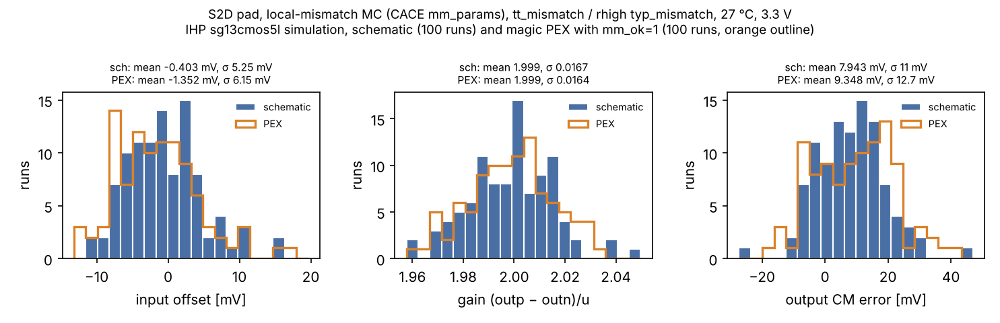
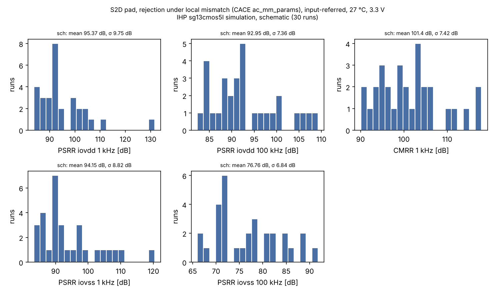

<!--
SPDX-FileCopyrightText: 2026 Christoph Maier
SPDX-License-Identifier: Apache-2.0
-->
# S2D pad Monte Carlo groups: results

IHP sg13cmos5l simulation, `sg13cmos5l_IOPadSingle2Diff` (S2D pad, `s7_an[0]`), design repository commit
`91a7da8b`, CACE 2.11, ngspice-47, 2026-11-25. Method and provenance: [README.md](README.md). Sections 3 and 4 are
generated (`run.sh … results`); every number in sections 1 and 2 is taken from them, from `csv/`, from
[staleness.txt](staleness.txt) or from [netcheck.txt](netcheck.txt).

## 1. Runs

| group | view | conditions | runs with a result | wall clock (2 ngspice at a time) |
|---|---|---|---|---|
| mm_params | schematic | tt_mismatch, rhigh typ_mismatch, 27 °C, 3.3 V, vref = vcm = 1.2 V, iterations 1 … 100 | 100 / 100 | 03:48:56 … 03:50:49 UTC |
| ac_mm_params | schematic | as mm_params, iterations 1 … 30 | 30 / 30 | 03:50:55 … 03:51:58 |
| mc_params | schematic | tt_stat, rhigh typ, 27 °C, iterations 1 … 30 | 30 / 30 | 03:51:58 … 03:52:32 |
| dc_params (check) | schematic | 3 supplies × 5 MOS corners × 3 rhigh corners × 3 temperatures | 135 / 135 | 03:52:32 … 03:55:17 |
| mm_params | magic PEX (C-coupled), mm_ok=1 on 221 extracted devices | as mm_params schematic | 100 / 100 | 03:55:19 … 03:58:20 |

No solver aid, no failed run. Seeds as in the templates: `SEED = 12345 + iteration` for every view. The only error in
the logs is CACE's documentation step after the PEX group (KLayout cannot find the PDK's `sg13g2.lyp` for the layout
picture); it runs after the results are written and does not touch them.

## 2. Reading

- **Staleness.** The committed `mm_params`, `ac_mm_params` and `mc_params` summaries are from commit 6229797
  (2026-10-26), i.e. from the pre-layout design: after them the S2D schematic changed in 8 commits up to 2026-11-05
  (on 2026-10-27/28 `bias_gen_pd` + `bias_tree_noab_pd` instead of `bias_sel_pd`; on 2026-11-03/04 the input
  protection as drawn, `s2d_pad_esd`, instead of IHP's IOPadAnalog cells with the 587 Ω secondary resistor; on
  2026-11-04 the backannotation of the drawn cell; design README and yaml header at 91a7da8b). They are stale. The other
  committed schematic groups were re-run on 2026-11-05 01:22 … 01:48, after the last schematic change (01:19, which
  only added the `_pex` symbol): the `dc_params` check here reproduces all 135 committed runs exactly (largest
  difference 0 in every quantity, section 4), so those results are current, unlike the D2S ones of
  ../d2s_schematic_rerun.
- **Offset, gain, CM error (schematic, 100 runs):** input offset mean −0.40 mV, **σ 5.25 mV** (95 % CI 4.61 … 6.10),
  −10.2 … +16.0 mV; gain mean 1.999, **σ 0.0167** (0.83 %), 1.958 … 2.050; output CM error mean 7.9 mV,
  **σ 11.0 mV**, −27.3 … +47.0 mV. All 100 runs inside the working limits (±20 mV, 1.93 … 2.07, ±60 mV). The
  committed summary (stale design) had −17.25 … +18.17 mV, 1.959 … 2.038, −19.0 … +39.9 mV; the design README at
  91a7da8b quotes, from that run's data files, σ 6.19 mV, gain σ 0.74 %, CM error mean 10.8 mV / σ 12.2 mV. With 100
  runs the σ estimate itself is uncertain by about −12 … +16 % (95 %): the offset σ of the taped-out schematic (5.25
  mV) is lower than the pre-layout 6.19 mV, at about the edge of what 100 runs resolve; gain and CM spreads are about
  the same.
- **PEX (magic C-coupled, mm_ok=1 added, 100 runs):** offset σ 6.15 mV (CI 5.40 … 7.14), gain σ 0.0164, CM error
  σ 12.7 mV; the σ confidence intervals overlap those of the schematic, so no layout effect on the mismatch spread is
  resolved with 100 runs. The same seed gives uncorrelated results in the two views (correlation 0.01 … 0.06): the
  extraction lists 221 devices in another order (the schematic 75 instances with m / fingers), so each seed draws other
  numbers per device; the PDK's mismatch scales with 1/sqrt(m·w·l), so the expected spread is the same for both.
- **PSRR / CMRR (schematic, 30 runs, input-referred):** PSRR iovdd 1 kHz median 92.9 dB, worst 83.8 dB; 100 kHz
  median 91.7, worst 82.3 dB; PSRR iovss 1 kHz median 91.0, worst 83.4 dB; 100 kHz median 76.2, worst 66.0 dB; CMRR
  1 kHz median 100.5, worst 90.1 dB. All inside the working limits (≥ 60 / 60 / 70 dB). σ in dB is 6.8 … 9.8 dB, but
  the dB values are skewed (a run near cancellation gives a very large value); as input-referred coupling the worst
  runs are 64 µV/V (iovdd 1 kHz), 77 µV/V (iovdd 100 kHz), 67 µV/V (iovss 1 kHz), 500 µV/V (iovss 100 kHz) and
  31 µV/V (common mode 1 kHz) (section 3). Against the stale committed summary the worst cases are 0.1 … 5.0 dB better
  and the medians 0.3 … 3.6 dB higher.
- **Process MC (schematic, 30 runs):** the global variation moves the output CM error by σ 0.17 mV (10.19 … 10.91 mV)
  and the gain by σ 8.6 ppm (the testbench prints the gain to 6 digits, i.e. 10 ppm steps); the offset stays at the
  systematic −8.6 nV (σ 0.13 nV): tt_stat varies every device of a type alike, so it creates no offset. Matches the
  committed summary within 0.06 mV (CM error) and 1e-5 (gain).

Figures (150 dpi): [figures/s2d_mm_hist.png](figures/s2d_mm_hist.png) (offset, gain, CM error; schematic filled,
PEX outline), [figures/s2d_ac_mm_hist.png](figures/s2d_ac_mm_hist.png) (PSRR iovdd / iovss at 1 / 100 kHz, CMRR),
[figures/s2d_mc_hist.png](figures/s2d_mc_hist.png) (process MC).

## 3. Statistics per group, view and quantity (= tables/stats.md)

| group | view | quantity | unit | n (runs with data / runs) | mean | sigma | sigma, 95 % CI | min | median | max | mean - 3 sigma | mean + 3 sigma | working limits | min / max inside |
|---|---|---|---|---|---:|---:|---|---:|---:|---:|---:|---:|---|---|
| mm_params | schematic | Input offset - Mismatch | mV | 100 / 100 | -0.403 | 5.251 | 4.61 … 6.1 | -10.22 | -0.7581 | 15.97 | -16.16 | 15.35 | -20 … 20 | yes |
| mm_params | schematic | Gain - Mismatch |  | 100 / 100 | 1.999 | 0.01668 | 0.0146 … 0.0194 | 1.958 | 2 | 2.05 | 1.949 | 2.049 | 1.93 … 2.07 | yes |
| mm_params | schematic | Output common-mode error - Mismatch | mV | 100 / 100 | 7.943 | 10.97 | 9.63 … 12.7 | -27.29 | 7.498 | 47.04 | -24.96 | 40.85 | -60 … 60 | yes |
| mm_params | magic PEX (C-coupled) | Input offset - Mismatch | mV | 100 / 100 | -1.352 | 6.149 | 5.4 … 7.14 | -13.17 | -1.738 | 19.63 | -19.8 | 17.1 | -20 … 20 | yes |
| mm_params | magic PEX (C-coupled) | Gain - Mismatch |  | 100 / 100 | 1.999 | 0.01638 | 0.0144 … 0.019 | 1.959 | 1.999 | 2.034 | 1.95 | 2.048 | 1.93 … 2.07 | yes |
| mm_params | magic PEX (C-coupled) | Output common-mode error - Mismatch | mV | 100 / 100 | 9.348 | 12.7 | 11.2 … 14.8 | -17.87 | 10.46 | 41.95 | -28.75 | 47.45 | -60 … 60 | yes |
| ac_mm_params | schematic | PSRR iovdd at 1 kHz (input-referred), mismatch | dB | 30 / 30 | 95.37 | 9.752 | 7.77 … 13.1 | 83.83 | 92.91 | 131.6 | 66.11 | 124.6 | 60 … any | yes |
| ac_mm_params | schematic | PSRR iovdd at 100 kHz (input-referred), mismatch | dB | 30 / 30 | 92.95 | 7.362 | 5.86 … 9.9 | 82.32 | 91.7 | 109.3 | 70.87 | 115 | any … any | yes |
| ac_mm_params | schematic | PSRR iovss at 1 kHz (input-referred), mismatch | dB | 30 / 30 | 94.15 | 8.823 | 7.03 … 11.9 | 83.42 | 91.05 | 120.4 | 67.68 | 120.6 | 60 … any | yes |
| ac_mm_params | schematic | PSRR iovss at 100 kHz (input-referred), mismatch | dB | 30 / 30 | 76.76 | 6.842 | 5.45 … 9.2 | 66.02 | 76.21 | 91.82 | 56.24 | 97.29 | any … any | yes |
| ac_mm_params | schematic | CMRR at 1 kHz (pad and vref together), mismatch | dB | 30 / 30 | 101.4 | 7.418 | 5.91 … 9.98 | 90.08 | 100.5 | 117.9 | 79.12 | 123.6 | 70 … any | yes |
| mc_params | schematic | Input offset - Process MC | mV | 30 / 30 | -8.583e-06 | 1.274e-07 | 1.01e-07 … 1.71e-07 | -8.797e-06 | -8.608e-06 | -8.341e-06 | -8.965e-06 | -8.201e-06 | -5 … 5 | yes |
| mc_params | schematic | Gain - Process MC |  | 30 / 30 | 1.999 | 8.604e-06 | 6.85e-06 … 1.16e-05 | 1.999 | 1.999 | 1.999 | 1.999 | 1.999 | 1.99 … 2.01 | yes |
| mc_params | schematic | Output common-mode error - Process MC | mV | 30 / 30 | 10.52 | 0.1727 | 0.137 … 0.232 | 10.19 | 10.5 | 10.91 | 9.997 | 11.03 | -30 … 30 | yes |

ac_mm_params, the same runs as input-referred coupling 10^(-PSRR/20) (µV at the input per V on iovdd / iovss, or per V of common mode for CMRR): the dB values are skewed (a run near perfect cancellation gives a very large dB value), the linear coupling is the quantity that adds up.

| quantity | n | mean | sigma | median | max (= min in dB) |
|---|---|---:|---:|---:|---:|
| PSRRp_1k | 30 | 24.7 µV/V | 16.7 µV/V | 22.6 µV/V | 64.4 µV/V |
| PSRRp_100k | 30 | 29.8 µV/V | 19.9 µV/V | 26 µV/V | 76.5 µV/V |
| PSRRn_1k | 30 | 27.8 µV/V | 18.7 µV/V | 28 µV/V | 67.4 µV/V |
| PSRRn_100k | 30 | 188 µV/V | 126 µV/V | 155 µV/V | 500 µV/V |
| CMRR_1k | 30 | 11.4 µV/V | 8.11 µV/V | 9.45 µV/V | 31.3 µV/V |

mm_params, schematic vs PEX run with the same seed: Pearson correlation over the 100 seeds (the extraction has another device list and order, so the same seed draws other numbers per device).

| quantity | correlation |
|---|---:|
| Vos_in | 0.01 |
| Gain | 0.06 |
| Vcm_err | 0.01 |

## 4. Comparison with the committed results (= tables/compare_committed.md)

### Monte Carlo groups: committed CACE summary (min / typ / max) vs this run

"this run, CACE" = CACE 2.11's own summary of this run (its typ column); "this run, CSV" = from the per-run CSV: min / median / mean / max.

| group | view | quantity | unit | committed min / typ / max (status) | this run, CACE min / typ / max (status) | this run, CSV min / median / mean / max | sigma |
|---|---|---|---|---|---|---|---|
| mm_params | schematic | Input offset - Mismatch | mV | -17.250 mV / -0.391 mV / 18.173 mV (Pass) | -10.223 mV / -0.758 mV / 15.972 mV (Pass) | -10.22 / -0.7581 / -0.403 / 15.97 | 5.251 |
| mm_params | schematic | Gain - Mismatch |  | 1.95906 / 1.99825 / 2.03785 (Pass) | 1.95771 / 2.0000999999999998 / 2.04973 (Pass) | 1.958 / 2 / 1.999 / 2.05 | 0.01668 |
| mm_params | schematic | Output common-mode error - Mismatch | mV | -18.980 mV / 10.088 mV / 39.864 mV (Pass) | -27.288 mV / 7.498 mV / 47.044 mV (Pass) | -27.29 / 7.498 / 7.943 / 47.04 | 10.97 |
| mm_params | pex | Input offset - Mismatch | mV | -17.250 mV / -0.391 mV / 18.173 mV (Pass) | -13.174 mV / -1.738 mV / 19.625 mV (Pass) | -13.17 / -1.738 / -1.352 / 19.63 | 6.149 |
| mm_params | pex | Gain - Mismatch |  | 1.95906 / 1.99825 / 2.03785 (Pass) | 1.95903 / 1.99924 / 2.03356 (Pass) | 1.959 / 1.999 / 1.999 / 2.034 | 0.01638 |
| mm_params | pex | Output common-mode error - Mismatch | mV | -18.980 mV / 10.088 mV / 39.864 mV (Pass) | -17.869 mV / 10.462 mV / 41.952 mV (Pass) | -17.87 / 10.46 / 9.348 / 41.95 | 12.7 |
| ac_mm_params | schematic | PSRR iovdd at 1 kHz (input-referred), mismatch | dB | 79.088 dB / 92.588 dB / 113.425 dB (Pass) | 83.828 dB / 92.909 dB / 131.605 dB (Pass) | 83.83 / 92.91 / 95.37 / 131.6 | 9.752 |
| ac_mm_params | schematic | PSRR iovdd at 100 kHz (input-referred), mismatch | dB | 77.297 dB / 91.014 dB / 104.492 dB (Pass) | 82.324 dB / 91.698 dB / 109.260 dB (Pass) | 82.32 / 91.7 / 92.95 / 109.3 | 7.362 |
| ac_mm_params | schematic | PSRR iovss at 1 kHz (input-referred), mismatch | dB | 83.323 dB / 90.351 dB / 110.644 dB (Pass) | 83.423 dB / 91.049 dB / 120.378 dB (Pass) | 83.42 / 91.05 / 94.15 / 120.4 | 8.823 |
| ac_mm_params | schematic | PSRR iovss at 100 kHz (input-referred), mismatch | dB | 63.779 dB / 74.496 dB / 94.844 dB (Pass) | 66.024 dB / 76.205 dB / 91.820 dB (Pass) | 66.02 / 76.21 / 76.76 / 91.82 | 6.842 |
| ac_mm_params | schematic | CMRR at 1 kHz (pad and vref together), mismatch | dB | 87.699 dB / 96.871 dB / 131.126 dB (Pass) | 90.080 dB / 100.499 dB / 117.901 dB (Pass) | 90.08 / 100.5 / 101.4 / 117.9 | 7.418 |
| mc_params | schematic | Input offset - Process MC | mV | -0.000 mV / -0.000 mV / -0.000 mV (Pass) | -0.000 mV / -0.000 mV / -0.000 mV (Pass) | -8.797e-06 / -8.608e-06 / -8.583e-06 / -8.341e-06 | 1.274e-07 |
| mc_params | schematic | Gain - Process MC |  | 1.99895 / 1.99896 / 1.99898 (Pass) | 1.99894 / 1.99896 / 1.99897 (Pass) | 1.999 / 1.999 / 1.999 / 1.999 | 8.604e-06 |
| mc_params | schematic | Output common-mode error - Process MC | mV | 10.141 mV / 10.445 mV / 10.854 mV (Pass) | 10.195 mV / 10.500 mV / 10.911 mV (Pass) | 10.19 / 10.5 / 10.52 / 10.91 | 0.1727 |

### dc_params (check of the committed non-Monte-Carlo schematic results, 2026-11-05)

committed `dc_params.csv` (135 runs) vs this run (135 runs), matched by conditions; largest difference over all matched runs, absolute and relative to the committed value. Values as in the CSVs: SI (V, A), whatever the [unit] label says.

| quantity | matched runs | largest abs. difference | largest rel. difference | committed range | this run range |
|---|---:|---:|---:|---|---|
| Gain[] | 135 | 0 | 0 % | 1.998 … 1.999 | 1.998 … 1.999 |
| Vos_in[mV] | 135 | 0 | 0 % | -3.143e-08 … 5.802e-07 | -3.143e-08 … 5.802e-07 |
| INL[mV] | 135 | 0 | 0 % | 8.722e-05 … 0.001069 | 8.722e-05 … 0.001069 |
| Vcm_err[mV] | 135 | 0 | 0 % | 0.005003 … 0.01805 | 0.005003 … 0.01805 |
| Iio[A] | 135 | 0 | 0 % | 0.0001146 … 0.0001169 | 0.0001146 … 0.0001169 |
