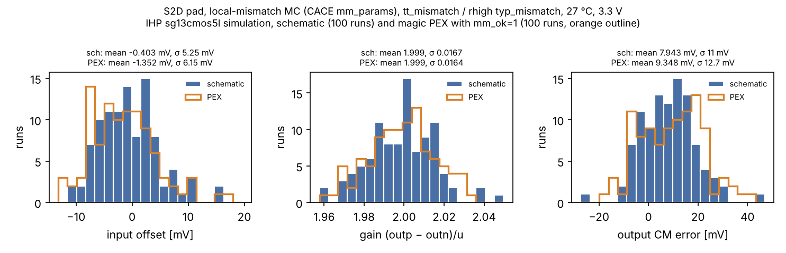
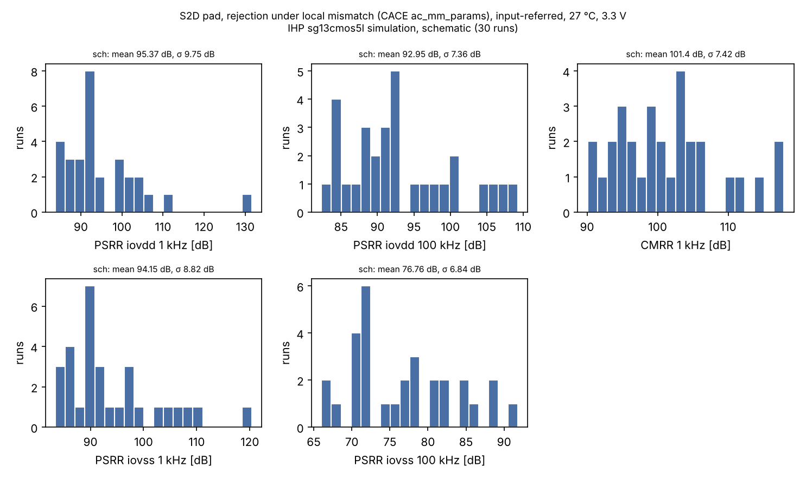

<!--
SPDX-FileCopyrightText: 2026 Christoph Maier
SPDX-License-Identifier: Apache-2.0
-->
# S2D pad Monte Carlo groups: results

IHP sg13cmos5l simulation, `sg13cmos5l_IOPadSingle2Diff` (S2D pad, `s7_an[0]`), design repository commit
`91a7da8b`, CACE 2.11, ngspice-47, 2026-11-25. Method and provenance: [README.md](README.md). Sections 3 and 4 are
generated (`run.sh … results`); every number in sections 1 and 2 is taken from them, from `csv/`, from
[staleness.txt](staleness.txt) or from [netcheck.txt](netcheck.txt).

## 1. Runs

| group | view | conditions | runs with a result | wall clock (2 ngspice at a time) |
|---|---|---|---|---|
| mm_params | schematic | tt_mismatch, rhigh typ_mismatch, 27 °C, 3.3 V, vref = vcm = 1.2 V, iterations 1 … 100 | 100 / 100 | 03:48:56 … 03:50:49 UTC |
| ac_mm_params | schematic | as mm_params, iterations 1 … 30 | 30 / 30 | 03:50:55 … 03:51:58 |
| mc_params | schematic | tt_stat, rhigh typ, 27 °C, iterations 1 … 30 | 30 / 30 | 03:51:58 … 03:52:32 |
| dc_params (check) | schematic | 3 supplies × 5 MOS corners × 3 rhigh corners × 3 temperatures | 135 / 135 | 03:52:32 … 03:55:17 |
| mm_params | magic PEX (C-coupled), mm_ok=1 on 221 extracted devices | as mm_params schematic | 100 / 100 | 03:55:19 … 03:58:20 |

No solver aid, no failed run. Seeds as in the templates: `SEED = 12345 + iteration` for every view. The only error in
the logs is CACE's documentation step after the PEX group (KLayout cannot find the PDK's `sg13g2.lyp` for the layout
picture); it runs after the results are written and does not touch them.

## 2. Reading

- **Staleness.** The committed `mm_params`, `ac_mm_params` and `mc_params` summaries are from commit 6229797
  (2026-10-26), i.e. from the pre-layout design: after them the S2D schematic changed in 8 commits up to 2026-11-05
  (on 2026-10-27/28 `bias_gen_pd` + `bias_tree_noab_pd` instead of `bias_sel_pd`; on 2026-11-03/04 the input
  protection as drawn, `s2d_pad_esd`, instead of IHP's IOPadAnalog cells with the 587 Ω secondary resistor; on
  2026-11-04 the backannotation of the drawn cell; design README and yaml header at 91a7da8b). They are stale. The other
  committed schematic groups were re-run on 2026-11-05 01:22 … 01:48, after the last schematic change (01:19, which
  only added the `_pex` symbol): the `dc_params` check here reproduces all 135 committed runs exactly (largest
  difference 0 in every quantity, section 4), so those results are current, unlike the D2S ones of
  ../d2s_schematic_rerun.
- **Offset, gain, CM error (schematic, 100 runs):** input offset mean −0.40 mV, **σ 5.25 mV** (95 % CI 4.61 … 6.10),
  −10.2 … +16.0 mV; gain mean 1.999, **σ 0.0167** (0.83 %), 1.958 … 2.050; output CM error mean 7.9 mV,
  **σ 11.0 mV**, −27.3 … +47.0 mV. All 100 runs inside the working limits (±20 mV, 1.93 … 2.07, ±60 mV). The
  committed summary (stale design) had −17.25 … +18.17 mV, 1.959 … 2.038, −19.0 … +39.9 mV; the design README at
  91a7da8b quotes, from that run's data files, σ 6.19 mV, gain σ 0.74 %, CM error mean 10.8 mV / σ 12.2 mV. With 100
  runs the σ estimate itself is uncertain by about −12 … +16 % (95 %): the offset σ of the taped-out schematic (5.25
  mV) is lower than the pre-layout 6.19 mV, at about the edge of what 100 runs resolve; gain and CM spreads are about
  the same.
- **PEX (magic C-coupled, mm_ok=1 added, 100 runs):** offset σ 6.15 mV (CI 5.40 … 7.14), gain σ 0.0164, CM error
  σ 12.7 mV; the σ confidence intervals overlap those of the schematic, so no layout effect on the mismatch spread is
  resolved with 100 runs. The same seed gives uncorrelated results in the two views (correlation 0.01 … 0.06): the
  extraction lists 221 devices in another order (the schematic 75 instances with m / fingers), so each seed draws other
  numbers per device; the PDK's mismatch scales with 1/sqrt(m·w·l), so the expected spread is the same for both.
- **PSRR / CMRR (schematic, 30 runs, input-referred):** PSRR iovdd 1 kHz median 92.9 dB, worst 83.8 dB; 100 kHz
  median 91.7, worst 82.3 dB; PSRR iovss 1 kHz median 91.0, worst 83.4 dB; 100 kHz median 76.2, worst 66.0 dB; CMRR
  1 kHz median 100.5, worst 90.1 dB. All inside the working limits (≥ 60 / 60 / 70 dB). σ in dB is 6.8 … 9.8 dB, but
  the dB values are skewed (a run near cancellation gives a very large value); as input-referred coupling the worst
  runs are 64 µV/V (iovdd 1 kHz), 77 µV/V (iovdd 100 kHz), 67 µV/V (iovss 1 kHz), 500 µV/V (iovss 100 kHz) and
  31 µV/V (common mode 1 kHz) (section 3). Against the stale committed summary the worst cases are 0.1 … 5.0 dB better
  and the medians 0.3 … 3.6 dB higher.
- **Process MC (schematic, 30 runs):** the global variation moves the output CM error by σ 0.17 mV (10.19 … 10.91 mV)
  and the gain by σ 8.6 ppm (the testbench prints the gain to 6 digits, i.e. 10 ppm steps); the offset stays at the
  systematic −8.6 nV (σ 0.13 nV): tt_stat varies every device of a type alike, so it creates no offset. Matches the
  committed summary within 0.06 mV (CM error) and 1e-5 (gain).

Figures (150 dpi): [figures/s2d_mm_hist.png](figures/s2d_mm_hist.png) (offset, gain, CM error; schematic filled,
PEX outline), [figures/s2d_ac_mm_hist.png](figures/s2d_ac_mm_hist.png) (PSRR iovdd / iovss at 1 / 100 kHz, CMRR),
[figures/s2d_mc_hist.png](figures/s2d_mc_hist.png) (process MC).

