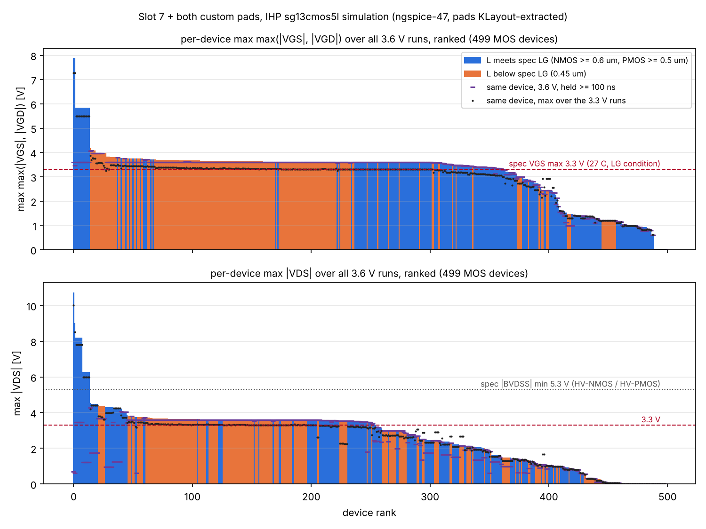
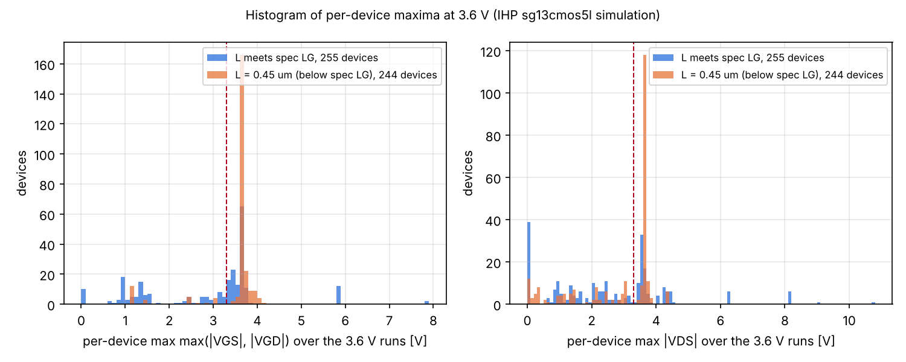

<!--
SPDX-FileCopyrightText: 2026 Christoph Maier
SPDX-License-Identifier: Apache-2.0
-->
# Terminal voltages of every MOS device in slot 7 and its custom pads: results

**IHP sg13cmos5l simulation**, ngspice-47, IHP OSDI models (PSP 103, quasi-static unless stated otherwise). The deck is
the slot-level deck: pads, `pad_ref_rb` and `bias_dist_pd` are KLayout-extracted with the diode fix applied. It has
499 MOS devices, all HV. Method, conditions and limits of this study: [README.md](README.md). Every generated table:
[tables.md](tables.md). Runs of 2026-11-25.

In this file:

- *Gate stress* means max(|VGS|, |VGD|). The source is the electrical source: the lower diffusion terminal for NMOS, the
  higher for PMOS.
- *Peak* means the largest value at any simulated point.
- *Held* means the largest value that stays for at least 100 ns. For DC runs, held = peak.
- *Above 3.3 V* means above 3.301 V. This 1 mV tolerance keeps out VGS = supply, which comes out a few µV above 3.3 V at
  some points.
- *L meets LG* means L ≥ 0.6 µm for HV-NMOS and L ≥ 0.5 µm for HV-PMOS. This is the specification's condition. Every
  other device in the slot has L = 0.45 µm.

## 1. Verdict

| question | answer |
|---|---|
| Largest terminal voltages at **3.3 V nominal**, enabled, DC (15 PVT points; pad −0.2 … 3.3 V; three D2S loads) | \|VGS\| **3.300 V**: the 3.3 V logic, gate at one rail and source at the other. \|VGD\| and \|VDS\| **3.500 V**: S2D pad clamp PMOS `x2s.xlay.x_3` (266.4/0.6 µm, L meets LG). This only happens with the pad driven to −0.2 V: gate at `iovdd` through rppd, drain = pad, VGS ≈ 0. No 0.45 µm device goes above 3.300 V. |
| Same at **3.6 V** (15 PVT points) | \|VGS\| **3.600 V**, \|VGD\| = \|VDS\| **3.800 V** (the same clamp, pad −0.2 V). Gate stress above 3.3 V: **154 of 244** devices with L = 0.45 µm and **74 of 255** with L meeting LG. The 74 are 67 in `ls_up_fs` (leaker PMOS 0.3/20, keeper PMOS 0.3/5), 4 in the S2D pad, 3 in `bg_core_pd`. All of them see VGS or VGD = supply; the S2D clamp sees supply + 0.2 V with the pad at −0.2 V. |
| **Transients and disabled state**, 3.3 V | Some nodes float when the slot is switched off: the spare output `isp` of `bias_dist_pd`, the D2S `vinp` / `vinn`, the S2D `vref` and others. The enable and disable edges kick these nodes beyond the rails, and they stay there until the run ends (tens of µs). Held gate stress up to **3.714 V** on `bias_dist_pd` TG NMOS `xs.xd.xlay.x_8.x_7` (1/0.45 µm, `en`, ff −40 °C). **17** devices with L = 0.45 µm are held above 3.301 V: 10 `s7_ctrl` `tg_hv` switches (3.30 … 3.68 V), 4 `bias_dist_pd` output TGs (3.59 … 3.71 V) and 3 pad enable switches within 2 mV of 3.3 V (section 3). Held \|VDS\| up to **3.955 V** (`bg_core_pd` `xms1_7`, 0.5/12.5 µm). |
| Same, 3.6 V | Held gate stress up to **4.082 V** (`s7_ctrl` switch PMOS `xs.xc.xt10.xp`, 1/0.45 µm, gate at `rc_b` = 3.6 V, `vref` at −0.48 V after the disable edge). Held \|VDS\| up to **4.283 V** (`bg_core_pd` `xms1_7`). |
| Does a device with **L below LG (0.45 µm)** see more than 3.3 V? | **At 3.3 V supply, enabled, DC: no** (max 3.300 V). **At 3.3 V in the disabled state after an enable edge: yes**, held up to 3.714 V on 17 devices (switches next to floating nodes). Peaks during edges reach 3.875 V. **At 3.6 V: yes**, by design: every 0.45 µm logic and switch device sees VGS = 3.6 V (154 in DC). Held up to 4.082 V. The specification states no maximum for L = 0.45 µm. |
| Does a device with L meeting LG see more than 3.3 V? | At 3.3 V, DC, enabled: one device, the S2D clamp PMOS, at 3.500 V gate–drain with the pad at −0.2 V. Its VGS is 0, so it carries no channel current (no HCI). At 3.3 V, held in transients: 4 devices at 3.40 … 3.50 V (that clamp, and D2S pad devices during the `pu late` start-up). At **3.6 V: 74 devices in DC, at VGS = 3.600 V**. That is 0.3 V above the specification's 3.3 V maximum at 27 °C, for the whole 3.6 V corner. |
| \|VDS\| against BVDSS (spec min 5.3 V for HV-NMOS / HV-PMOS) | Held \|VDS\| ≤ 3.955 V (3.3 V) and ≤ 4.283 V (3.6 V): margin ≥ 1.0 V. DC ≤ 3.800 V. Peak \|VDS\| above 5.3 V appears only on internal nodes of the two long-channel series stacks, for nanoseconds: up to 10.745 V on `bg_core_pd` `xms1_0`. Section 4: these are not a time-step artifact and are larger than capacitive coupling allows, most likely the quasi-static charge partition of the model; the NQS check aborted before the edge. |
| Fail-safe | Slot supplies off, ring on, pads driven 0 … supply through 1 kΩ: gate stress and \|VDS\| ≤ supply (3.600 V at 3.6 V) on the pad devices. Examples: the S2D clamp, and the D2S Miller-capacitor PMOS `x2d.xlay.x_2` (7.96/32.16 µm) with VGS 3.6 V at pad 0 V. All supplies at 0 V with the pads driven to 3.6 V through 1 kΩ: no node above 0.828 V. The pad clamps to the unpowered ring through its ESD diode. |

## 2. DC, enabled default mode

From `tables.md`: 45 DC sweeps per supply (5 corners × 3 temperatures × 3 loads); the 3.0 V tier-1 points give 5 more
(dc open at ss −40 °C 3.0 V failed). Each sweep runs the pad from −0.2 V to max(3.3 V, supply).

| supply | gate-length class | devices | gate stress > 3.3 V | max gate stress [V] | max \|VDS\| [V] |
|---|---|---|---|---|---|
| 3.0 V | L meets LG | 255 | 0 | 3.300 (S2D clamp NMOS `x_43`, 88/0.6 µm, gate at ground, pad at 3.3 V) | 3.300 |
| 3.0 V | 0.45 µm | 244 | 0 | 3.000 | |
| 3.3 V | L meets LG | 255 | 1 (S2D clamp `x_3`, 3.500 V at pad −0.2 V) | 3.500 | 3.500 |
| 3.3 V | 0.45 µm | 244 | 0 | 3.300 | |
| 3.6 V | L meets LG | 255 | 74 (`ls_up_fs` 67, S2D pad 4, `bg_core_pd` 3) | 3.800 | 3.800 |
| 3.6 V | 0.45 µm | 244 | 154 (`s7_ctrl` logic 58, `ls_up_fs` 48, `bias_dist_pd` 40, `tg_hv` 7, S2D pad 1) | 3.600 | |

Neither the D2S load (unloaded, 1 kΩ to vterm, 1 kΩ to ground) nor the temperature changes these maxima. The same
values appear at every corner, because they are set by the rails and the pad source, not by the analog operating point.

## 3. Transients and the disabled state

Largest values per job kind (all devices, all runs of that kind). From `tables.md`:

| job | supply | runs | max \|VGS\| [V] | device | max \|VGD\| [V] | max \|VDS\| [V] |
|---|---|---|---|---|---|---|
| step (pad 0 → supply → −0.2 → 0.5 V, 10 ns) | 3.3 | 6 | 3.300 | logic | 3.501 | 3.500 (S2D clamp) |
| step | 3.6 | 14 | 3.600 | logic | 3.801 | 3.800 (S2D clamp) |
| pu (10 µs ramp) / pu fast (1 µs) | 3.3 | 2 / 3 | 3.300 / 3.301 | logic | 3.300 / 5.491 | 3.300 / 7.815 |
| pu / pu fast | 3.6 | 4 / 7 | 3.600 / 3.601 | logic | 3.600 / 5.851 | 3.600 / 8.196 |
| pu late (enable 20 µs after the ramp) | 3.3 / 3.6 | 1 / 1 | 3.385 / 3.666 | `tg_hv` `xt7` PMOS | 3.586 / 3.884 | 5.690 / 5.782 |
| en (disable 2 µs, enable 22 µs) | 3.3 | 3 | 3.875 | `bias_dist_pd` `x_8.x_7` | 7.278 | 10.013 |
| en | 3.6 | 7 | 4.182 | `bias_dist_pd` `x_8.x_7` | 7.888 | 10.745 |
| off (disable, then pad −0.2 … supply) | 3.3 / 3.6 | 2 / 7 | 3.875 / 4.182 | `bias_dist_pd` `x_8.x_7` | 3.875 / 4.182 | 4.201 / 4.541 |
| mode (default → swap → mon → feed → ext → all_high → default) | 3.3 / 3.6 | 2 / 5 | 3.483 / 3.817 | `ls_up_fs` output inverter `xi3.xp` | 3.483 / 3.817 | 4.020 / 4.306 |

Peaks above the supply come from three mechanisms:

1. **Floating nodes kicked at the enable / disable edges and held there.**
   - The nodes: `xs.isp`, the unconnected spare output 3 of `bias_dist_pd`, rises to 4.156 V at 3.6 V (tt 27 °C, `en`).
     The S2D `vref` and the D2S `vinp` / `vinn` fall to about −0.26 … −0.52 V once their switches open.
   - Nothing then pulls them back except junction leakage, so they stay there for the rest of the run.
   - The devices that see it are the 1/0.45 µm switches with one terminal on such a node: the `bias_dist_pd` output TGs
     `x_5 … x_8.x_7` and the `s7_ctrl` `tg_hv` PMOS `xt1 … xt10`.
   - Held gate stress per supply:

     | supply | held gate stress |
     |---|---|
     | 3.3 V | 3.56 … 3.71 V |
     | 3.6 V | 3.96 … 4.08 V |

   - How long such a node stays beyond the rail in silicon is set by junction leakage. These runs do not show that time.
2. **Internal nodes of long-channel series stacks at fast gate edges.**
   - The stacks: `bg_core_pd` start-up chain `xms1_0 … xms1_7` (8 × PMOS 0.5/12.5 µm, gates on `en_b`) and the
     `ls_up_fs` leakers `xpl1 … xpl10` (10 × PMOS 0.3/20 µm).
   - Their internal nodes swing several volts beyond the rails for a few ns. For example, `xs.xbg.net1` reaches +5.3 V
     at disable and −6.6 V at enable (3.6 V, tt 27 °C).
   - Peak \|VDS\| of these devices: up to 10.7 V. Peak gate stress: up to 7.9 V.
   - Held values of the same devices: gate stress ≤ 3.6 V, \|VDS\| ≤ 4.28 V.
   - Section 4: these spikes are not a time-step artifact, but they are larger than capacitive coupling allows; they
     are not taken as real stress here.

3. **Switching overshoot of logic nodes**, for nanoseconds at the bit and enable edges. Up to 3.483 V (3.3 V) and
   3.817 V (3.6 V) on the `ls_up_fs` output inverters during mode switching. Not held: the held values of these devices
   are the supply.

Per-device lists: [tables.md](tables.md), sections "Top 20 devices by …" (3.6 V and 3.3 V, held and peak), and
`csv/device_max.csv`.

## 4. Solver and model check of the edge spikes (`edges.py`, enable edges at tt 27 °C 3.6 V)

| setting | time points | `xs.xbg.net1` max / min [V] | `xs.isp` max [V] | largest \|VGS\| [V] (device) | largest \|VDS\| [V] (device) |
|---|---|---|---|---|---|
| gear, cshunt 1 fF, max step 10 ns (the stress runs) | 4345 | 5.308 / −6.586 | 4.156 | 4.156 (`bias_dist_pd` `x_8.x_7`) | 10.186 (`bg_core_pd` `xms1_0`) |
| max step 2 ns | 21073 | 5.316 / −6.838 | 4.155 | 4.155 (same) | 10.438 (same) |
| max step 0.5 ns | 84047 | 5.314 / −6.917 | 4.155 | 4.155 (same) | 10.517 (same) |
| trapezoidal integration | 4250 | 4.912 / −4.241 | 4.163 | 4.142 (same) | 7.841 (same) |
| NQS model (`rfmode=1`) on `bg_core_pd` and `ls_up_fs` | aborted at 2.162 µs, before the disable edge reached `en_b` | | | | |
| NQS model on `bg_core_pd` only | aborted at 2.129 µs, before the disable edge reached `en_b` | | | | |

Plot: `plots/solver_check_en_tt_27_3.6.png`.

- The spikes are the same with maximum time steps of 10, 2 and 0.5 ns, so they are not a time-step artifact.
- They are larger than capacitive coupling can explain. `net1` falls by about 10 V (from +3.88 V to −6.6 V) while the
  gate `en_b` falls by 3.6 V. A capacitive divider cannot move a node by more than the gate swing.
- A likely cause is the quasi-static charge partition of the PSP model. When a 0.5 × 12.5 µm channel turns on, the
  model takes part of its inversion charge from the floating drain node at once. That node has only junction capacitance
  plus 1 fF `cshunt`. In a real device the channel fills from the source over the transit time of a 12.5 µm (or 20 µm)
  channel.
- **The NQS check did not decide it.** Both runs with the PDK's NQS model card abort just before the disable edge reaches
  `en_b`. One aborts in the D2S pad diode, the other at the `ls_up_fs` node `xs.xc.xle.x`. So this study cannot say how far
  `net1` really goes. The trapezoidal run is no help either: it gives smaller spikes (−4.2 V instead of −6.6 V), but
  trapezoidal integration is known to ring at such nodes. Nor is it a reference: the one stress run that converged only
  with it (`mode` ff −40 °C 3.6 V) showed 7.5 V on a NAND2 internal node, and that result was discarded.
- **How to use these numbers:** the stack spikes (`bg_core_pd` `xms1_*`, `ls_up_fs` `xpl*`) are reported in the tables
  as computed, but they are not taken as real stress here. The held values of the same devices are gate stress ≤ 3.6 V
  and \|VDS\| ≤ 4.28 V at 3.6 V. Apart from these stacks, no node in any powered run goes more than 0.64 V beyond the rails (the extremes: `pad_ref_rb` node `xs.xr.xlay.n_25` at −0.634 V and `xs.isp` 0.582 V above the supply, both at the enable edges at 3.6 V).

## 5. BVDSS

| supply | type | max \|VDS\| peak [V] | device | max \|VDS\| held ≥ 100 ns [V] | device | spec \|BVDSS\| min [V] |
|---|---|---|---|---|---|---|
| 3.0 V | HV-NMOS / HV-PMOS | 3.300 / 3.200 | S2D clamps `x_43` / `x_3` (DC) | same | same | 5.3 / 5.3 |
| 3.3 V | HV-NMOS | 3.813 | `bias_dist_pd` `x_6.x_7` (1/0.45, `off` ff −40 °C, 1.14 µs) | 3.398 | D2S `x_209` (6/6) | 5.3 |
| 3.3 V | HV-PMOS | 10.013 (stack spike, section 4) | `bg_core_pd` `xms1_0` (0.5/12.5) | 3.955 | `bg_core_pd` `xms1_7` | 5.3 |
| 3.6 V | HV-NMOS | 4.346 | `bias_dist_pd` `x_6.x_7` (1/0.45, `en` sf −40 °C, 2.11 µs) | 3.706 | D2S `x_209` (6/6) | 5.3 |
| 3.6 V | HV-PMOS | 10.745 (stack spike, section 4) | `bg_core_pd` `xms1_0` (0.5/12.5) | 4.283 | `bg_core_pd` `xms1_7` | 5.3 |

No HV-iNMOS is used. Apart from the stack spikes of section 4, every \|VDS\| is at least 0.95 V below 5.3 V, and every
held \|VDS\| at least 1.0 V below.

## 6. Plots

*Per-device maximum over all 3.6 V runs.*

- **Top panel:** gate stress. **Bottom panel:** \|VDS\|. Devices are ranked by the value.
- **Bar colors:** blue = L meets LG, orange = 0.45 µm.
- **Markers:** violet dash = the held value at 3.6 V. Black dot = the peak over the 3.3 V runs of the same device.
- **Reading it:** the plateau at 3.6 V is VGS = supply. The few bars far above it are the stack spikes of section 4.
  Their held values (violet) are at or below 3.6 V for gate stress and 4.28 V for \|VDS\|.

*Histograms of the same per-device peak values (3.6 V runs), by gate-length class.*

## 7. Top 20, 3.6 V runs, by held gate stress (from `csv/top20_vgx_held_3v6.csv`)

| # | device | block | type | W/L [µm] | L meets LG | held gate stress, 3.6 V [V] | run | DC enabled, 3.6 V [V] | 27 °C runs only [V] | held, 3.3 V runs [V] |
|---|---|---|---|---|---|---|---|---|---|---|
| 1 | `xs.xc.xt10.xp` | s7_ctrl tg_hv switches | HV-PMOS | 1/0.45 | no | 4.082 | en ss -40 °C 3.6 V | 0.591 | 3.977 | 3.682 |
| 2 | `xs.xd.xlay.x_8.x_7` | bias_dist_pd | HV-NMOS | 1/0.45 | no | 4.065 | en ss -40 °C 3.6 V | 3.600 | 3.982 | 3.714 |
| 3 | `xs.xd.xlay.x_5.x_7` | bias_dist_pd | HV-NMOS | 1/0.45 | no | 3.974 | en ss -40 °C 3.6 V | 2.773 | 3.856 | 3.589 |
| 4 | `xs.xd.xlay.x_6.x_7` | bias_dist_pd | HV-NMOS | 1/0.45 | no | 3.974 | en ss -40 °C 3.6 V | 2.773 | 3.855 | 3.588 |
| 5 | `xs.xd.xlay.x_7.x_7` | bias_dist_pd | HV-NMOS | 1/0.45 | no | 3.974 | en ss -40 °C 3.6 V | 2.773 | 3.856 | 3.588 |
| 6 | `xs.xc.xt2.xp` | s7_ctrl tg_hv switches | HV-PMOS | 1/0.45 | no | 3.972 | en ss -40 °C 3.6 V | 2.127 | 3.862 | 3.583 |
| 7 | `xs.xc.xt3.xp` | s7_ctrl tg_hv switches | HV-PMOS | 1/0.45 | no | 3.972 | en ss -40 °C 3.6 V | 3.353 | 3.862 | 3.583 |
| 8 | `xs.xc.xt8.xp` | s7_ctrl tg_hv switches | HV-PMOS | 1/0.45 | no | 3.972 | en ss -40 °C 3.6 V | 3.593 | 3.862 | 3.583 |
| 9 | `xs.xc.xt1.xp` | s7_ctrl tg_hv switches | HV-PMOS | 1/0.45 | no | 3.962 | off ss -40 °C 3.6 V | 2.430 | 3.861 | 3.565 |
| 10 | `xs.xc.xt4.xp` | s7_ctrl tg_hv switches | HV-PMOS | 1/0.45 | no | 3.962 | off ss -40 °C 3.6 V | 3.353 | 3.861 | 3.565 |
| 11 | `xs.xc.xt7.xp` | s7_ctrl tg_hv switches | HV-PMOS | 1/0.45 | no | 3.962 | off ss -40 °C 3.6 V | 3.593 | 3.861 | 3.565 |
| 12 | `x2s.xlay.x_3` | S2D pad | HV-PMOS | 266.4/0.6 | yes | 3.800 | dc 1k ff -40 °C 3.6 V | 3.800 | 3.800 | 3.500 |
| 13 | `xs.xc.xt5.xp` | s7_ctrl tg_hv switches | HV-PMOS | 1/0.45 | no | 3.757 | en ss 125 °C 3.6 V | 3.593 | 3.716 | 3.464 |
| 14 | `xs.xc.xt6.xp` | s7_ctrl tg_hv switches | HV-PMOS | 1/0.45 | no | 3.720 | en tt 27 °C 3.6 V | 3.593 | 3.720 | 3.434 |
| 15 | `x2d.xlay.x_171` | D2S pad | HV-NMOS | 4.4/1 | yes | 3.719 | pu late tt 27 °C 3.6 V | 1.752 | 3.719 | 3.406 |
| 16 | `x2d.xlay.x_232` | D2S pad | HV-PMOS | 6.66/0.6 | yes | 3.707 | pu late tt 27 °C 3.6 V | 1.688 | 3.707 | 3.398 |
| 17 | `x2d.xlay.x_234` | D2S pad | HV-PMOS | 6.66/0.6 | yes | 3.703 | pu late tt 27 °C 3.6 V | 1.688 | 3.703 | 3.396 |
| 18 | `xs.xc.xt9.xn` | s7_ctrl tg_hv switches | HV-NMOS | 1/0.45 | no | 3.622 | en ff 125 °C 3.6 V | 2.331 | 3.588 | 3.303 |
| 19 | `x2s.xlay.x_192` | S2D pad | HV-PMOS | 1/0.45 | no | 3.618 | en ff 125 °C 3.6 V | 3.030 | 3.588 | 3.302 |
| 20 | `x2s.xlay.x_193` | S2D pad | HV-PMOS | 1/0.45 | no | 3.618 | en ff 125 °C 3.6 V | 3.353 | 3.588 | 3.302 |

The same lists by peak gate stress, peak \|VGS\|, \|VDS\| and \|VGB\|, and the 3.3 V lists: [tables.md](tables.md).

## 8. Runs that gave no result

Listed in `csv/runs.csv` and in [tables.md](tables.md) ("Failed runs"). The solver aids were rshunt for DC, and 2 ns and
0.5 ns maximum steps for transients. Transient limit: 240 s per try; 10 µs power-up ramps 150 s.

| run | outcome | covered instead by |
|---|---|---|
| `dc` ss −40 °C 3.0 V unloaded | aborts in the D2S pad diode at pad −0.2 V | the 1k and 1kgnd sweeps at the same point |
| `fs` at −40 °C (7 of 10 points) | abort in the S2D pad diode, or no progress | `fst` (fail-safe as a slow transient) at all ten −40 °C points |
| `mode` ff −40 °C (3.3, 3.6 V), sf −40 °C 3.6 V | time limit (ff −40 °C 3.6 V converged only with trapezoidal integration in the first pass: 7.5 V on a NAND2 internal node, result discarded) | `mode` at tt 27, ss −40 / 125, ff 125, fs 125 °C |
| `off` tt 27 °C 3.3 V | time limit; completed only with trapezoidal integration, result discarded (trapezoidal ringing, section 4) | `off` ff −40 / ss 125 °C 3.3 V, and the disabled interval of `en` tt 27 °C 3.3 V |
| `pu` (10 µs ramp) ss 125 °C (3.3, 3.6 V), ff 125 °C 3.6 V, fs 125 °C 3.6 V | time limit (the ramp stalls) | `pu fast` at the same points, `pu` at tt 27, ff −40, ss −40, sf −40 °C |

Not run (time box): the transient jobs at fs −40 °C 3.6 V, sf 125 °C 3.6 V, ss −40 °C 3.3 V, ff 125 °C 3.3 V. They
were dropped from `jobs.txt` after their neighbors had run.

## 9. What this means for the documentation

- README §2.2 is right: the switches and logic are 1 / 0.45 µm HV devices. The specification states no VGS maximum for
  that gate length. In normal operation at 3.3 V they see exactly the supply, 3.300 V, and nothing more in DC.
- **3.6 V is above the specification's maximum** for every device that is switched rail to rail. That includes devices
  that meet the LG condition: the `ls_up_fs` leaker and keeper PMOS (0.3/20, 0.3/5), the `bg_core_pd` power-down and
  start-up PMOS, and the S2D pad clamps (VGD). The specification ties its limit to 27 °C and to an HCI lifetime of 1 FIT
  in 10 years. A 3.6 V characterization corner is therefore an excursion. It is not a qualified operating point.
- Two things push a device beyond the supply:
  - **Disable kick on floating nodes:** a few hundred mV, on the floating nodes of the disabled slot (`isp`, `vref`,
    `vinp` / `vinn`).
  - **Pad below ground:** the S2D pad driven to −0.2 V. That puts the clamp PMOS gate–drain at supply + 0.2 V.
- Neither comes near BVDSS (held \|VDS\| ≤ 4.28 V against 5.3 V).
